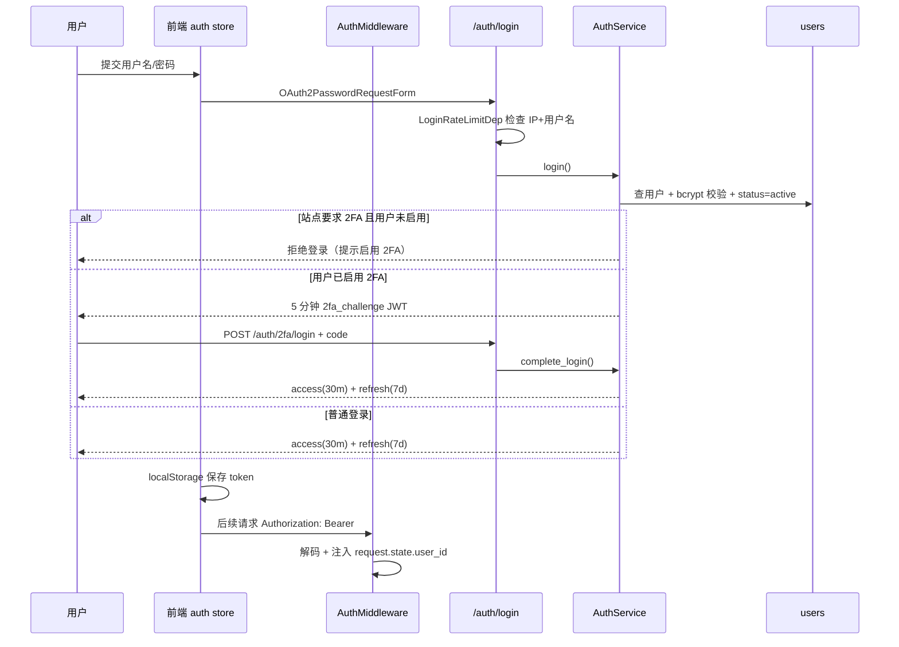

# CygnusX 身份、权限与用户管理架构（Identity & Access）

> **用途**：记录账号生命周期、认证（密码/2FA/API Key）、授权（RBAC + 模块门禁）、管理端用户管理与前端登录/设置页面的 as-built 实现。
> **类型**：as-built（2026-10-21 代码基线）。
> **适用范围**：`/api/v1/auth/*`、`/api/v1/users/*`、`/api/v1/admin/users/*`、`/api/v1/modules/registry`、`middleware/{auth,rbac,module_gate,login_rate_limit,audit,cookie}.py`、`data/MODULE_LOCKED.yaml`、登录/注册/初始化/个人设置页面。
> **不适用范围**：Agent 能力/模型选择（见 [CygnusX_agent_architecture.md](CygnusX_agent_architecture.md)）；团队空间文件 ACL（见 [CygnusX_project_workspace_architecture.md](CygnusX_project_workspace_architecture.md)）；站点级开关（见 [CygnusX_notification_engagement_architecture.md](CygnusX_notification_engagement_architecture.md)）。

## 这个模块如何发挥作用

平台的身份面由四层组成：**凭证**（密码、TOTP、API Key）→ **会话令牌**（JWT access/refresh）→ **角色与会话校验**（RBAC、`token_version`）→ **模块级授权**（`MODULE_LOCKED.yaml` + 用户 `disabled_modules`）。所有 HTTP 请求先经过统一中间件链，业务路由再通过 FastAPI 依赖或显式检查做第二道校验。

用户有三种来源：自助注册（默认 `pending`，需管理员审批）、管理员直接创建（直接 `active`）、系统初始化创建首个管理员。平台没有邮件验证、密码找回、服务端登出与会话表；令牌吊销依赖 `users.token_version` 自增。

HTTP 中间件在非活跃路径直接传递 ASGI：Audit 对非写方法、CookieRequired 对非消费
请求/关闭计费功能时不建立 BaseHTTPMiddleware 响应体流转包装。写操作审计与真实消费
守卫仍使用原 dispatch，不改变权限或计费语义。工作区改动、回归与隔离容量验证见
[Web 容量优化快照](CygnusX_web_capacity_optimization.md)；现有运行 Web 尚未重启发布。

模块门禁与 JWT 依赖另通过 `request_identity.py` 复用同请求、同事件循环、同会话工厂内的用户快照。
每个请求仍读取已提交的数据库身份，JWT 类型/版本检查保留；门禁返回响应头后清空并
失效上下文，延后子任务和其他事件循环重新查询。没有跨请求身份 TTL 缓存。
候选代码边界、撤销验证和同机容量结果见[第三轮快照](CygnusX_web_request_identity_capacity.md)。

## 1. 总体架构

```mermaid
flowchart TD
    subgraph Client[前端]
        LOGIN[LoginView / RegisterView / SetupView]
        STORE[stores/auth.ts<br/>localStorage tokens]
        CLIENT[api/client.ts<br/>Bearer + 401 单飞刷新]
        MODSTORE[stores/modules.ts]
        GUARD[utils/moduleGuard.ts]
    end
    subgraph Edge[FastAPI 中间件链]
        TRACE[TraceContext]
        RL[RateLimit per-IP]
        AUDIT[Audit]
        COOKIE[CookieRequired]
        AUTH[AuthMiddleware<br/>JWT / X-API-Key]
        MG[ModuleGate]
        CORS[CORS]
    end
    subgraph API[路由]
        A1[/auth/*]
        A2[/users/*]
        A3[/admin/users/*]
        A4[/modules/registry]
    end
    subgraph Domain[服务与领域]
        AS[AuthService]
        US[UserService]
        AKS[ApiKeyService]
        TS[TOTPService]
        UR[UserRepository]
    end
    DB[(users / api_keys / audit_logs)]
    YAML[data/MODULE_LOCKED.yaml]
    LOGIN --> STORE --> CLIENT --> TRACE
    TRACE --> RL --> AUDIT --> COOKIE --> AUTH --> MG --> CORS --> API
    API --> Domain --> DB
    AUTH --> DB
    MG --> YAML
    MG --> DB
    MODSTORE --> A4
    GUARD --> MODSTORE
```

### 实现图：登录（含 2FA）与刷新



## 2. 数据模型

### 2.1 `users`（`infrastructure/database/models/user.py`）

| 字段 | 类型 | 说明 |
| --- | --- | --- |
| `id` | UUID PK | 用户标识 |
| `username` | String unique | 3–50 位 `[a-zA-Z0-9_]` |
| `email` | String unique, not null | 邮箱格式校验 |
| `hashed_password` | String | bcrypt |
| `role` | String default `user` | `admin` / `user` |
| `status` | String default `active` | `active` / `inactive` / `locked` / `pending`；管理端另写入未建模的 `rejected` |
| `token_version` | Integer | 令牌版本；改密/审批/角色或状态变更时自增 |
| `workspace_id` | UUID FK | 个人工作区 |
| `nickname` / `avatar_url` | String | 资料 |
| `preferences` | JSON | 前端偏好（主题、动效等） |
| `last_login_at` | Timestamp | 最近登录 |
| `storage_quota` / `used_storage` | BigInteger | 个人存储配额与用量（默认 500 GiB） |
| `admin_note` / `lab_group` | String | 管理备注、课题组 |
| `totp_secret` / `is_2fa_enabled` | String / Boolean | TOTP 密钥（Fernet 加密）与开关 |
| `disabled_modules` | JSON | 被管理员禁用的模块 key 列表 |

工作区 `WorkspaceModel`：`owner_id`、`quota`（默认 10 GiB）。领域聚合为 `domain/user/entities.py` 的 `User` / `Workspace`；仓储 `SqlAlchemyUserRepository` 提供 `has_any_admin`、`add_used_storage`、`recompute_used_storage`、硬删除等方法。

### 2.2 `api_keys`（`models/api_key.py`）

`user_id`（CASCADE）、`name`、`key_hash`（SHA-256 unique）、`key_prefix`（前 12 位展示）、`scopes` JSON、`expires_at`、`last_used_at`、`is_active`。密钥形如 `omh_<token_urlsafe(32)>`，只在创建时返回明文。

### 2.3 `audit_logs`（`models/audit_log.py`）

由 `AuditMiddleware` 写入，记录写操作的方法、路径、用户、IP、状态码、耗时等；不随用户删除级联。

### 2.4 其他边界

- 团队角色（`teams` 表，`owner/writer/reader`）是文件 ACL 体系，不是平台 RBAC；`/api/v1/teams` 只提供"我的团队列表"（`api/v1/teams.py`、`team_service.py`）。
- 模块注册表是**文件**而非数据库表：`data/MODULE_LOCKED.yaml` 当前 19 个模块，其中 17 个可锁（`home`、`admin` 不可锁），所有模块 `default_locked: false`。

## 3. 认证流程

### 3.1 登录

`POST /api/v1/auth/login`（`api/v1/auth.py`）使用 OAuth2 密码表单，先经 `LoginRateLimitDep`：同一 IP+用户名 5 次失败/300 秒 → 封禁 900 秒（Redis ZSET，Redis 不可用时内存兜底）。`AuthService.login`：

1. 查用户并 bcrypt 校验；非 `active` 拒绝。
2. 若站点 `totp_policy == "required"` 且用户未启用 2FA，拒绝登录。
3. 已启用 2FA：返回 5 分钟 `2fa_challenge` JWT，不返回 access/refresh。
4. 否则签发 access（30 分钟）+ refresh（7 天），算法 HS256。

### 3.2 2FA（TOTP）

| 方法 | 路径 | 说明 |
| --- | --- | --- |
| GET | `/auth/2fa/status` | 是否启用 |
| POST | `/auth/2fa/setup` | 生成密钥与 otpauth URI |
| POST | `/auth/2fa/verify` | 验证并启用 |
| POST | `/auth/2fa/disable` | 关闭 |
| POST | `/auth/2fa/login` | 用 challenge + 动态码换取正式令牌 |

验证窗口为 ±1 个 30 秒步长；issuer 固定 `CygnusX`。密钥使用 `ai_provider_key_encryption_key` 做 Fernet 加密；未配置密钥时退化为明文存储（启动时生产环境校验会拦截默认密钥）。

### 3.3 注册与初始化

- `POST /auth/register`：受站点 `registration_enabled` 控制；创建 `status=pending` 用户、默认锁定模块、初始化饼干账户与默认目录，并写入欢迎通知。
- `GET /auth/setup-required`：是否尚无管理员。
- `POST /auth/setup`：仅当 `has_any_admin() == false` 时允许创建首个管理员。
- 无邮箱验证、无找回密码流程。

### 3.4 令牌刷新与登出

- `POST /auth/refresh`：校验 `type=="refresh"` 与 `token_version`，签发新 access/refresh；旧 refresh 不进入黑名单（无 rotation 检测）。
- 无服务端登出端点；前端 `stores/auth.ts` 清 localStorage 即视为登出。真正吊销依赖 `token_version` 自增（改密、审批、角色/状态变更）。

### 3.5 API Key

`POST/GET/DELETE /auth/api-keys`。默认 `scopes=["*"]`；请求头 `X-API-Key` 优先于 Bearer。校验包含过期时间、用户 active、scope 通配匹配，并更新 `last_used_at`。`user_scoped` 工具与外部 MCP 通道依赖该机制。

### 3.6 密码与限流

- 密码 8–128 位且至少含字母与数字；bcrypt 哈希。修改密码需旧密码，禁止复用旧密码，成功后 `token_version+1`。
- 全局每 IP 滑动窗口限流返回 429 + `Retry-After`，Redis 故障时放行。
- 登录失败封禁状态不落用户表，只存在 Redis/内存。

## 4. 授权

### 4.1 中间件链

`main.py` 注册顺序（后注册者更外层）导致实际入站顺序为：

`TraceContext → RateLimit → Audit → CookieRequired → Auth → ModuleGate → CORS → 路由`

- `AuthMiddleware`：公开路径白名单（登录、注册、刷新、初始化、站点设置/内容、工作流监控 ingest 等）直接放行；`/api/v1/studio/shared/` 为公开前缀；`X-API-Key` 先校验，再解码 Bearer，并把 `user_id`/`role` 写入 `request.state`。
- `ModuleGateMiddleware`：按路径匹配可锁模块，读取用户 `disabled_modules`；管理员绕过；注册表/数据库异常时**降级放行**；未认证请求放行由路由依赖处理。
- `CookieRequiredMiddleware`：仅拦截 `POST /api/v1/tasks`，账户冻结返回 402、停用返回 403。

> **注册顺序注意**：`CookieRequired` 在 `Auth` 外层，而它读取 `request.state.user_id`。按当前注册顺序，进入 Cookie 中间件时 Auth 尚未执行，`user_id` 为空，实际会直接放行。该守卫当前不生效，任务提交的余额/账户状态仍由 `TaskService` 与饼干预扣逻辑兜底。修改中间件顺序前需先补集成测试。

### 4.2 JWT 校验与 RBAC

- 业务依赖 `api/deps.py` 的 `CurrentUserId` 会再次校验 `type=="access"`、用户存在且 active、`token_version` 一致。
- `require_admin_totp` 要求管理员 + 已启用 2FA + 请求头 `X-TOTP-Code`，用于删除用户等敏感操作。
- `middleware/rbac.py` 的 `require_roles(*roles)` 每请求查库；角色**不信任令牌声明**。当前存在三套等价的 `require_admin` 实现（`middleware/rbac.py`、`api/deps.py`、TOTP 变体），新代码应使用 `middleware/rbac` 的统一实现。

### 4.3 模块门禁

- 唯一数据源 `data/MODULE_LOCKED.yaml`：`key/name/route_prefix/api_prefix/lockable/default_locked/ai`；启动时由 `infrastructure/config/module_registry.py` 做语法与重复 key 硬校验，失败拒绝启动。
- 后端按 `api_prefix` 匹配（等于前缀或以 `前缀/` 开头），管理员绕过；`GET /api/v1/modules/registry` 向登录用户暴露注册表。
- 前端 `stores/modules.ts` 拉取注册表，`utils/moduleGuard.ts` 做前缀匹配；被禁模块的菜单显示锁图标，路由守卫阻止进入，API 403 时全局弹窗提示。
- 共享基础设施（`/auth`、`/llm`、`/prompts`、`/notifications`、`/announcements`、`/festival`、`/docs`、`/site-settings`、`/site-content`、`/platform`、`/modules`）不进入注册表、永不拦截。

## 5. 管理端用户管理（`/api/v1/admin/users`）

| 能力 | 方法与路径 | 关键约束 |
| --- | --- | --- |
| 列表 | `GET /admin/users` | 左连饼干账户，返回余额/状态 |
| 创建 | `POST /admin/users` | 直接 active；应用默认锁定模块 |
| 审批 | `PUT /{id}/approve` | `pending`/`rejected` → `active`；`token_version+1`；初始化饼干账户/目录 |
| 拒绝 | `PUT /{id}/reject` | 写入字符串 `rejected`（未进入 `UserStatus` 枚举） |
| 角色 | `PUT /{id}/role` | — |
| 配额 | `PUT /{id}/quota` | `0 < quota ≤ 5120 GiB`，不得低于已用 |
| 备注 | `PUT /{id}/note` | ≤1000 字 |
| 模块 | `PUT /{id}/modules` | 拒绝管理员目标，仅允许可锁 key |
| 状态 | `PUT /{id}/status` | 禁止自我停用，保留至少一个 active 管理员 |
| 删除 | `DELETE /{id}` | 需 `AdminTotpRequired`；禁止自删与删除最后一个管理员；手工清理饼干/通知/记忆等关联并删除文件系统根目录 |
| 记忆管理 | `GET/PUT/DELETE /{id}/memories` 与整理回滚 | 管理员查看/修正/回滚用户长期记忆 |

管理端列表与操作页面为 `AdminUserManagementView.vue`，含模块矩阵、配额编辑、TOTP 删除确认。

## 6. 前端实现

| 区域 | 文件 | 行为 |
| --- | --- | --- |
| 令牌存储 | `frontend/src/stores/auth.ts` | access/refresh 存 localStorage；`isAdmin` 由用户角色派生 |
| HTTP | `frontend/src/api/client.ts` | 注入 Bearer；401 时单飞刷新并重放；`MODULE_LOCKED` 全局提示 |
| 登录 | `LoginView.vue` | 两步式：密码 →（可选）TOTP；含演示账号填充按钮（仅用于本地演示） |
| 注册 | `RegisterView.vue` | 先读 `/site-settings`，按注册开关展示/隐藏 |
| 初始化 | `SetupView.vue` | 首次部署创建管理员 |
| 个人中心 | `ProfileView.vue` | 资料、偏好、审计日志、记忆、客户端导出 |
| 设置 | `SettingsView.vue` | 密码、2FA、平台配置（需 TOTP）、TOTP 策略 |
| 模块 | `stores/modules.ts` + `utils/moduleGuard.ts` | 注册表缓存、前缀匹配、锁定提示去重 |
| 路由 | `frontend/src/router/index.ts` | 仅 `requiresAuth`；**没有前端管理员角色守卫**，管理页依赖后端 403 与布局占位 |

## 7. 配置、迁移与测试

- 配置（`core/config.py`）：`jwt_secret_key`（默认值在生产校验中被拒绝）、HS256、access 30 分钟、refresh 7 天；`enable_cookie_system`、`initial_cookie_balance`；生产环境拒绝默认 JWT/加密密钥。
- 迁移：初始 users、`token_version`、`nickname`、`disabled_modules`、TOTP 列、`lab_group`、`admin_note`、`api_keys`、团队/文件 scope、存储配额等。
- 测试：`tests/unit/test_module_registry.py`、`test_module_gate.py`、`test_admin_user_modules.py`、`test_api_key_scopes.py`、`test_security_round2.py`；集成 `tests/integration/test_phase0b_http.py`；前端 `authRefresh.spec.ts`。
- 测试缺口：登录/注册服务、TOTP 登录、登录限流、审计中间件、auth store、路由守卫均无直接覆盖。

## 8. 已知风险与待修项

| 级别 | 问题 | 影响 |
| --- | --- | --- |
| 高 | `CookieRequiredMiddleware` 位于 Auth 外层，读不到 `user_id` | 冻结/停用账户的 `POST /tasks` 守卫不生效 |
| 高 | `AuthMiddleware` 不校验 JWT `type` 与用户状态 | 直接消费 `request.state.user_id` 的路由可能接受 refresh/2FA challenge 令牌或已停用用户，直到过期 |
| 高 | `rejected` 不是 `UserStatus` 枚举成员 | 被拒用户登录时 `UserStatus("rejected")` 抛 `ValueError`，表现为 500 而非 401 |
| 中 | bcrypt 72 字节上限未防护（schema 允许 128 字符/Unicode） | 长密码/中文密码在注册、改密、管理员建号时可能 500 |
| 中 | 无服务端登出、无 refresh rotation/reuse detection | 令牌泄露后最长 7 天有效 |
| 中 | 登录页内置演示账号填充 | 生产部署若未移除会暴露演示入口 |
| 中 | 遗留 `/users/{id}` 删除接口缺少 TOTP 与最后管理员保护 | 存在绕过管理端不变量的路径 |
| 低 | `PUT /users/{id}` 允许自助改 `status` 且不 bump `token_version` | 状态变更不能即时吊销令牌 |
| 低 | `GET /users/` 为返回空列表的 stub | 调用方可能静默拿到空数据 |
| 低 | 令牌 `expires_in` 在四个端点硬编码 1800 秒 | 修改配置后响应值与真实过期时间不一致 |
| 低 | 模块注册表 19 个模块与 AGENTS.md "18 模块"表述不一致 | 文档口径需统一（以 YAML 为准） |

## 9. 关键文件索引

| 层 | 文件 |
| --- | --- |
| API | `src/cygnusx/api/v1/{auth,users,modules}.py`、`api/v1/admin/users.py`、`api/deps.py`、`api/v1/router.py` |
| 中间件 | `src/cygnusx/middleware/{auth,rbac,module_gate,login_rate_limit,audit,cookie,rate_limit}.py` |
| 服务/领域 | `application/services/{auth,user,api_key,totp}_service.py`、`domain/user/*`、`core/security.py` |
| 持久化 | `infrastructure/database/models/{user,api_key,audit_log,team}.py`、`repositories/user_repository.py` |
| 注册表 | `data/MODULE_LOCKED.yaml`、`infrastructure/config/module_registry.py` |
| 前端 | `frontend/src/stores/{auth,modules}.ts`、`api/client.ts`、`utils/moduleGuard.ts`、`router/index.ts`、`views/{Login,Register,Setup,Profile,Settings,AdminUserManagement}View.vue` |
| 测试 | `tests/unit/test_{module_registry,module_gate,admin_user_modules,api_key_scopes,security_round2}.py`、`tests/integration/test_phase0b_http.py` |

## 10. 修改验证清单

- 改认证/令牌：`uv run pytest tests/unit/test_security_round2.py tests/integration/test_phase0b_http.py -q`；补登录、2FA、refresh 用例。
- 改模块注册表或门禁：`tests/unit/test_module_registry.py test_module_gate.py test_admin_user_modules.py`；同时验证前端 `moduleGuard` 与菜单锁定。
- 改管理端用户操作：覆盖最后管理员保护、自删、自停用、模块矩阵与 TOTP 要求；核对 `token_version` 是否自增。
- 改中间件顺序：必须补 HTTP 集成测试证明 `request.state.user_id` 在 Cookie/ModuleGate 可见，并验证 401/402/403 行为。
- 改用户表/迁移：`make check-migrations && make check-alembic-heads`，并运行 `scripts/check_schema_drift.py`。
