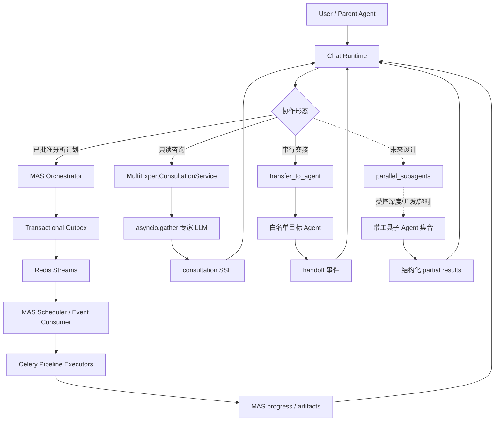
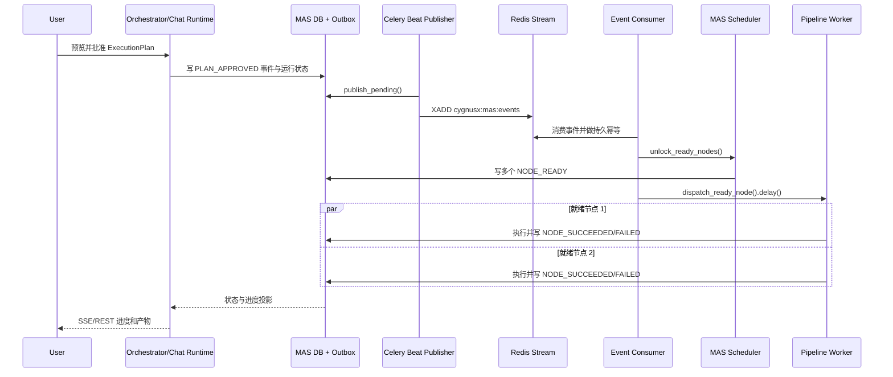

# CygnusX 多 Agent 并行协作：现状调查与对话内 Fan-out 设计

> **时点说明**：本文件为 2026-07-29 时点的调查/设计快照，所述调查结论与设计已执行或已演进，部分引用（路径、行号、测试文件）已失效；请勿按本文档再次执行，当前实现以代码为准。
>
> **2026-10-26 补充**：§9 为本域最新 as-built 全面调查（线上启用状态、三层闸门、全部调用方矩阵、子循环运行时演进、配置漂移与已知问题清单）；§0–§8 保留为历史设计依据与首版实施记录。

> 依据仓库当前实现整理，更新于 2026-07-29。本文先记录**已经运行的能力**（含 A2A 使用现状调查），
> 再给出**待实现设计**：一个 Agent 在对话中途临时拆出多个 LLM Agent 并行干活并汇总。
> 设计部分尚未落地，不应被当作现状引用。

---

## 这个多 Agent 协作模块如何发挥作用

当前平台的多 Agent 协作由三种执行形态组成。MAS DAG 面向经过确认的分析计划：编排器生成有向无环计划，用户批准后，outbox 事件经 Redis Streams 投递给调度器，所有就绪节点分别进入 Celery 队列，由固定 executor 执行并用状态机、版本号和 dedupe key 保证幂等。它能并行跑流程节点，但节点的执行体是注册的流水线 worker，不会启动第二个 LLM 对话循环。

多专家会诊是对话内的只读并行路径。`MultiExpertConsultationService` 使用 `asyncio.gather` 同时调用有限数量的专家模型，专家调用不挂工具，只返回短意见，由主 Agent 继续综合。`transfer_to_agent` 则把控制权串行交给一个白名单 Agent，不负责并行或汇总。三者都经过主 Chat Runtime 的事件流，因此前端看到的是 consultation、handoff 或 MAS progress 投影，而不是直接消费内部 A2A/Redis 事件。

MAS 的 A2A 命名实际是内部事务 outbox + Redis Streams 信封，服务于 plan/node 生命周期；它不是标准 A2A 联邦协议，也不承担普通 Chat 的 Agent 互操作。文档后面的 `parallel_subagents` 是待实现设计：如果未来启用，应作为父循环中的一个受控工具，在请求内启动深度为一的子 Agent，限制并发、超时、工具白名单和审计，并将部分结果回灌父 Agent；分钟级管道仍归 MAS。

### 运行架构图：现有协作路径与设计分支



### 实现图：MAS 计划批准到并行节点完成



## 0. 背景与目标

用户诉求：一个 Agent 跑到一半遇到可并行的子任务时，能**同时开启多个 Agent 协助干活**，
用并行换墙钟时间（例如：同时检索三个数据库、同时跑三段独立分析代码、同时起草报告的三个章节）。

当前系统**不具备**这个能力。本文：

1. §1 盘点现有三层"并行/协作"机制及其边界；
2. §2 专项回答「现阶段有没有使用 A2A」；
3. §3 定位缺口；
4. §4 给出新能力（下称 **Sub-Agent Fan-out**）的实现架构；
5. §5–§7 实施步骤、验收、风险。

---

## 1. 现状：三层协作机制盘点

| 机制 | 并行形态 | 执行体 | 能否干活 | 默认状态 | 关键代码 |
| --- | --- | --- | --- | --- | --- |
| **MAS DAG 执行** | 多节点真并行 | 固定管道 executor（Celery） | ✅ 但仅限注册过的管道任务 | `MAS_ENABLED=false` | `mas_scheduler_service.py` |
| **多专家会诊** | 多 LLM 并行 | LLM 单轮调用（`tools=None`） | ❌ 只出意见，禁止调工具 | `MULTI_EXPERT_CONSULTATION_ENABLED=false` | `multi_expert_consultation_service.py` |
| **Agent Handoff** | 无并行 | 单 LLM 接力 | ✅ 但单目标、串行 | 白名单 Agent 可用 | `agent_handoff_tool_service.py` |

### 1.1 MAS DAG —— 计划级并行（真并行，但执行体不是 LLM）

- 计划模型是经验证的 DAG：`ExecutionPlan.nodes` 带 `depends_on`，模型层强制无环校验
  （`src/cygnusx/domain/mas/models.py:124-158`）。
- 调度器一次放行**所有**就绪节点：`MASSchedulerService.eligible_nodes()` 返回所有上游已成功的
  pending 节点，`unlock_ready_nodes()` 为每个节点发 `NODE_READY` 事件
  （`mas_scheduler_service.py:27-75`）。
- 事件消费器逐个派发：`MASEventConsumerService` 收到 `NODE_READY` → `dispatch_ready_node()` →
  Celery `.delay()`（`mas_event_consumer_service.py:36-37`）。同层分支同时入队，**真并行**。
- 并发安全：乐观锁（`version` + `transition_node`）+ `dedupe_key` 幂等。

**限制（与本需求直接相关）**：

1. 节点执行体由 `resources.executor` 决定，只有 `fake / apptainer-rnaflow / deg-volcano /
   quality-gate / ebi-download / scanpy-qc` 六种（`mas_scheduler_service.py:108-131`）。
   节点上的 `agent_id` 只是归属标注，**不会起第二个 LLM 对话循环**。
2. 必须先由 orchestrator 经 `mas_plan_preview` 工具生成计划预览，**用户批准**后才入队
   （`mas_plan_adapter.py`、`mas_service.approve_run()`）。
3. 调度链延迟高：outbox 发布 beat 每 10 秒、消费 beat 每 5 秒（`celery.py:100-107`），
   面向分钟/小时级管道任务，不适合对话内的秒级 fan-out。

### 1.2 多专家会诊 —— 对话内唯一的并行 LLM 调用（只读）

`MultiExpertConsultationService.collect()` 用 `asyncio.gather` 并行调最多 3 位专家
（`multi_expert_consultation_service.py:17-28`），由 router 输出的 `consult_agent_ids` 触发
（`chat_service.py:1147, 1483-1495`）。意见注入主 Agent 的 system prompt，经 SSE
`consultation` chunk 透出前端。

**限制**：专家调用硬编码 `tools=None`、`max_tokens=400`、限 300 字——
协议上就禁止干活，只能给建议；且开关默认关闭（`config.py:86-87`）。

### 1.3 Agent Handoff —— 串行接力，不是 fan-out

`transfer_to_agent` 工具把控制权交给**一个**白名单目标 Agent（`agent_handoff_tool_service.py`、
schema 见 `tool_configs/tools_schema.yaml` 的 `transfer_to_agent` 条目）。
一次一个、不可并发、不可回流汇总。

### 1.4 父循环的一个关键事实

`chat_service.py:1844` 起的工具执行循环对同一轮的多个 `tool_calls` 是**串行 await**
（`for tc in round_tool_calls:`）。因此并行不可能发生在循环层——
**并行必须发生在一个工具的内部**：父 Agent 发出一次工具调用，工具实现内部 fan-out。
这正是本设计的接入缝隙。

---

## 2. A2A 使用现状调查

### 2.1 结论

**仓库里存在 A2A，但它是自研的内部事件协议命名，不是业界标准 A2A 互操作协议。**

- 全库搜索 `well-known / agent_card / jsonrpc`：**零命中**。没有 Agent Card 发布、
  没有 `/.well-known/agent.json` 发现端点、没有 JSON-RPC 传输、没有跨系统 Agent 联邦。
- 代码中的 "A2A" 专指 MAS 执行链的事件信封：`A2AEvent` / `A2AEventType`
  （`domain/mas/models.py:75-91, 294-320`），词汇借鉴了 Agent-to-Agent 的
  sender/recipient 概念（`kind: agent|worker|system|orchestrator`），实现是私有协议。

### 2.2 它实际是什么：事务型 Outbox + Redis Streams 事件总线

数据流（仅服务于 MAS Run/Node 生命周期）：

```
业务事务内
  A2AEventService.record()                    # begin_nested 写 outbox 表，dedupe_key 唯一→幂等
    → mas_a2a_events 表 (delivery_status=pending)
Celery beat: mas-outbox-publish  每 10s
  A2AEventService.publish_pending()
    → RedisStreamPublisher.xadd → stream "cygnusx:mas:events"（消费组 mas-scheduler，maxlen≈100k）
Celery beat: mas-event-consume   每 5s
  RedisStreamConsumer.read() → MASEventConsumerService.consume(event_id)   # 事件行即持久幂等记录
    → PLAN_APPROVED  → 运行 queued→running + unlock_ready_nodes
    → NODE_READY     → dispatch_ready_node → Celery .delay() 管道 executor
    → NODE_SUCCEEDED → mark_node_succeeded → 解锁下游
    → NODE_FAILED    → handle_node_failure → 重试/审批/失败
```

关键文件：`a2a_event_service.py`、`infrastructure/mas/redis_streams.py`、
`celery_app/tasks/mas.py:16-48`、`celery_app/celery.py:100-107`。

### 2.3 使用范围与开关

- **仅限 MAS 执行链**。普通聊天、Handoff、会诊都不经过 A2A 事件。
- 全链路受 `MAS_ENABLED` 门禁，**默认 False**（`core/config.py:67`）。
- 前端有 MAS 客户端（`frontend/src/api/mas.ts`：runs / approve / retry / progress / artifacts），
  但走 REST + SSE 进度轮询（`mas_service.stream_progress`，2 秒轮询投影），
  **A2A 事件不出后端**，前端不直接消费 A2A 流。

### 2.4 对本设计的含义

标准 A2A 协议（Agent Card 发现、任务生命周期 RPC）解决的是**跨组织/跨进程**的 Agent 互操作，
与本需求（同一进程内、同一请求生命周期内的秒级并行）不是一类问题。
本设计**不引入**标准 A2A 协议栈；但事件信封的 sender/recipient 词汇可以在 fan-out 的
审计记录中复用，保持术语一致。MAS 的 outbox+beat 链路延迟（≥15 秒节拍）对对话内
fan-out 不可接受，因此**不复用**该传输层（见 §4.8 边界划分）。

---

## 3. 缺口分析

| 场景 | 现状 |
| --- | --- |
| 多个**分析管道步骤**并行（下载 + QC + 多组学） | ✅ MAS DAG |
| 多个 **LLM 专家并行出主意** | ✅ 会诊（默认关、只读、无工具） |
| 一个 Agent 对话中途**拆出多个 LLM Agent 并行干活（带工具）并汇总** | ❌ 无工具、无协议、无运行时 |

缺口可精确表述为：缺少一个 built-in 控制工具，让父 Agent 用一次 tool_call 提交
`[{agent_id, task}]` 任务列表，由服务端在请求内并行运行**带工具的受控子循环**，
失败隔离、限时限额、结果结构化汇总回父上下文。

---

## 4. 设计：Sub-Agent Fan-out（`parallel_subagents` 工具）

### 4.1 目标 / 非目标

**目标**

- 父 Agent 一次 tool_call 即可 fan-out 至 N 个已注册 Agent 并行执行；
- 子 Agent **可以调用工具**（与只读会诊的本质区别）；
- 单个子任务失败不影响其余子任务与父链路（fail-isolated）；
- 全程可审计、可限额、可在前端看到并行进度。

**非目标（v1 明确不做）**

- 不做嵌套：子 Agent 不得再 fan-out（深度恒为 1）；
- 不做子 Agent 之间互相通信 / 辩论（需要时走会诊或 MAS）；
- 不做分钟级以上的长任务（那是 MAS 的职责；子循环有硬超时）；
- 不引入标准 A2A 互操作协议。

### 4.2 总体架构

```
父 Agent 对话循环 (chat_service, 工具串行 await)
  │
  └─ tool_call: parallel_subagents({tasks:[{agent_id, task}…], context_summary})
        │
        ▼
  ParallelSubAgentService (application/services/parallel_subagent_service.py)  ★新增
        │
        ├─ 1. 校验：flag 开 / 深度=0 / N≤上限 / agent_id∈可派生白名单 / task 长度
        ├─ 2. 顺序预组装：for t: AgentService.assemble_context(agent_id)      ← 复用现有调度中枢
        │      └─ 从子 Agent tools 中剥离 parallel_subagents 自身（防递归）
        ├─ 3. 并行执行：asyncio.gather(*[_run_child(...)], return_exceptions=True)
        │      ├─ Semaphore(MAX_CONCURRENT) 限并发
        │      ├─ asyncio.timeout(CHILD_TIMEOUT) 单子限时
        │      └─ SubAgentRunner: 迷你 ReAct 循环（≤MAX_ROUNDS 轮）
        │            provider_manager.chat_stream(...)  ←→  ToolBridgeService.execute(...)
        │            （每个子循环独占 DB session，见 §4.4 正确性约束）
        ├─ 4. 汇总：结构化 partial results（成功/失败/超时分组）
        └─ 5. 返回统一信封 {success, llm_payload, ui_payload}
              │
              ▼
        父循环回灌 tool_result → 父模型综合后答复用户
```

### 4.3 工具契约

**注册**（`tool_configs/tools_schema.yaml`，沿用 `transfer_to_agent` 的格式约定）：

```yaml
  - key: parallel-subagents
    name: parallel_subagents
    description: >
      将多个相互独立的子任务并行分派给已注册的专业 Agent 执行，等待全部完成后返回汇总。
      仅用于真正独立、单任务可在数分钟内完成的子任务；有依赖关系的步骤应串行调用；
      需要用户确认或长耗时管道任务应改用 MAS 计划。不得用于需要与用户交互澄清的场景。
    category: agent-orchestration
    invocation_mode: backend_sync
    service: cygnusx.application.services.parallel_subagent_tool_service.ParallelSubAgentToolService
    method: run_parallel_subagents
    requires_confirm: false
    annotations: {readOnlyHint: false, destructiveHint: false, openWorld: true, idempotent: false}
    extra: {user_scoped: true, control_tool: subagent_fanout}
    input_schema:
      type: object
      properties:
        context_summary: {type: string, description: 各子 Agent 共享的自包含背景（数据、约束、路径）}
        tasks:
          type: array
          minItems: 1
          maxItems: 5
          description: 相互独立的子任务列表，1–5 个
          items:
            type: object
            properties:
              agent_id: {type: string, description: 目标 Agent ID，须在可派生白名单内}
              task: {type: string, description: 自包含的子任务指令，≤2000 字}
              expect_readonly: {type: boolean, description: 声明该子任务只读（影响工具白名单）}
            required: [agent_id, task]
      required: [context_summary, tasks]
    llm_result_fields: [summary, results, success, error]
    ui_result_fields: [progress]
```

**工具包**（`data/ai/tools/subagents.yaml`，沿用 handoff.yaml 格式）：

```yaml
id: subagents
description: 在对话中将独立子任务并行分派给多个专业 Agent 并汇总结果。
builtin_tools:
  - parallel_subagents
```

**挂载策略**：不默认进任何 Agent 的 `tool_packs`；按 Agent YAML 显式追加
`tool_packs: [..., subagents]` 才获得派生能力。v1 建议先给 `general`、`code`、
`rnaseq` 挂载灰度。

### 4.4 SubAgentRunner 运行时与正确性约束

子循环是 chat_service legacy 工具循环的**受限克隆**（不是 LangGraph 路径），
复用两个现成部件：

- `AgentService.assemble_context(agent_id)`（`agent_service.py:447`）→
  `AgentContext(agent, model_config, system_prompt, tools, features, temperature, max_tokens)`；
- `ToolBridgeService.execute(user_id, tool_name, args, context)`
  （`tool_bridge_service.py:37`）执行工具并返回统一信封。

子循环伪代码：

```python
async def _run_child(self, ctx: AgentContext, task: str, user_id: str) -> ChildResult:
    messages = [{"role": "user", "content": task}]
    system = f"{ctx.system_prompt}\n\n{SUBAGENT_CONSTRAINT_SUFFIX}"
    for round_no in range(self._max_rounds):                      # 硬上限，如 6 轮
        async with asyncio.timeout(self._child_timeout):          # 如 180s
            text, tool_calls = await _collect_stream(
                provider_manager.chat_stream(
                    config=ctx.model_config, messages=messages,
                    system_prompt=system, temperature=0.3,
                    max_tokens=min(ctx.max_tokens, 2048),
                    tools=ctx.tools,                              # 已剥离 fan-out 工具
                )
            )
        if not tool_calls:
            return ChildResult.ok(agent_id=ctx.agent.agent_id, answer=text)
        messages.append({"role": "assistant", "content": text, "tool_calls": tool_calls})
        for tc in tool_calls:                                     # 子循环内工具可串行
            result = await self._bridge.execute(
                user_id, tc.name, tc.args,
                context=ToolInvocationContext(
                    db=self._new_session(),                       # ★ 每轮独占 session
                    user_id=user_id, agent_id=ctx.agent.agent_id,
                    session_id=self._child_session_id,
                ),
            )
            messages.append({"role": "tool", "tool_call_id": tc.id,
                             "content": _cap(result.llm_payload, 8000)})
    return ChildResult.budget_exhausted(...)
```

**正确性约束（必须全部满足，否则不能上线）**：

| # | 约束 | 理由 |
| --- | --- | --- |
| C1 | **每个子循环独占 AsyncSession**（经 `get_session_factory()()`，用完即关） | SQLAlchemy AsyncSession 非协程安全；父请求 session 被多子任务并发共享必崩。celery 任务已是此模式（`tasks/mas.py:21-28`），照抄 |
| C2 | 子 Agent 的 `tools` 中**剥离 `parallel_subagents`** | 防递归 fan-out，深度恒为 1 |
| C3 | 剥离所有 `control_tool` 类工具（handoff、ask_user） | 子任务无权切换父会话、无权向用户发问（无人应答会死锁） |
| C4 | `requires_confirm=true` 的工具在子循环内直接拒绝 | 子任务没有确认通道；父 Agent 提示词要求拆分时避开需确认的操作 |
| C5 | 单工具回灌内容截断（≤8KB）+ 子循环总轮数上限 | 防上下文爆炸与死循环烧 token |
| C6 | 子任务工作目录/产物写各自隔离子目录（`workspace/subagents/<run>/<i>/`） | 并发写同一工作区会互相踩踏 |
| C7 | 父循环调用该工具本身计入父轮次预算 | 一次 fan-out 对父循环只是一次 tool_call，天然成立，但文档显式说明 |

**可派生白名单**：复用 handoff 的治理思路——在目标 Agent YAML 增加
`subagents: { spawnable: true }` 标记，`ParallelSubAgentService` 校验
`agent.features.subagents.spawnable`，未标记者拒绝派生。（对照：handoff 用
`handoff.allowed_targets`，方向相反但机制同构。）

### 4.5 汇总与失败隔离

- `asyncio.gather(*children, return_exceptions=True)`——与会诊服务同款隔离策略
  （`multi_expert_consultation_service.py:27`）：任何子任务抛错/超时 → 该子标记
  `failed/timeout`，其余照常返回。
- 全部失败 → 工具返回 `success: false`，父模型看到结构化错误自行决策（重试/降级/告知用户）。
- 回灌父上下文的 `llm_payload` 必须自包含：

```json
{
  "success": true,
  "summary": "3/4 子任务成功，1 个超时（agent-scrna）",
  "results": [
    {"agent_id": "agent-code", "status": "ok", "answer": "...(≤6000字)", "artifacts": ["subagents/<run>/1/fig.png"], "elapsed_s": 42},
    {"agent_id": "agent-scrna", "status": "timeout", "answer": null}
  ]
}
```

### 4.6 SSE / 前端事件

新增 chunk 类型 `subagents`（对齐既有 `consultation` / `handoff` chunk 的接法，
`chat_service.py:1496-1502` 样式）：

- fan-out 开始时发一次 `type="subagents", metadata={phase:"started", tasks:[{index, agent_id, name, task}]}`；
- 各子任务结束发 `{phase:"child_done", index, status, elapsed_s}`；
- 全部结束发 `{phase:"aggregated", summary}`。

前端 `frontend/src/components/agent-workspace/` 可渲染并行泳道卡片（v1 可先只显示
进度条 + 状态文案，泳道 UI 后续迭代）。

### 4.7 配置项（`core/config.py`）

```python
subagent_fanout_enabled: bool = False        # 总开关，默认关
subagent_max_parallel: int = 4               # 单次 fan-out 最大子任务数（schema 里也卡 maxItems=5，取小）
subagent_max_concurrent: int = 3             # Semaphore 实际并发（留余量给主链路 LLM 调用）
subagent_child_timeout_seconds: int = 180    # 单子任务墙钟上限
subagent_max_rounds_per_child: int = 6       # 子循环工具轮数上限
subagent_max_children_per_message: int = 1   # 父单轮只允许一次 fan-out 调用（防 LLM 串行刷量）
```

### 4.8 与既有机制的边界（写进 orchestrator/父 Agent 提示词的决策表）

| 场景 | 用什么 |
| --- | --- |
| 秒~分钟级、独立、需要 LLM 推理或调工具、无需用户中途确认 | **parallel_subagents** |
| 多专家各出一段意见、不需要动手 | 多专家会诊 |
| 换一个更对口的 Agent 接手整段会话 | Handoff |
| 长耗时管道（RNAFlow/apptainer）、需要人工批准、需要断点重试与产物审计 | MAS DAG |

MAS 与 fan-out **长期共存、不互相替代**：MAS 是持久化、HITL、beat 节拍（≥15s 延迟）
的管道编排；fan-out 是请求内、秒级、临时的 LLM 劳动力池。子任务若识别出需要跑
RNAFlow 之类长管道，子 Agent 应在结果中建议父 Agent 走 MAS 计划预览，而不是自己硬跑。

---

## 5. 实施步骤

按仓库既有约定（新增工具 = schema 注册 + tool pack + 重启，见
`agent_framework_baseline.md` §8 的扩展流程，原 `agent_architecture_and_extension_guide.md` 已并入其中）：

**Phase 1 —— 运行时骨架（后端）**

1. 新建 `application/services/parallel_subagent_service.py`：
   `ParallelSubAgentService.run(user_id, context_summary, tasks) -> dict`，
   含 §4.4 全部约束 C1–C7；
2. 新建 `application/services/parallel_subagent_tool_service.py`：
   `ParallelSubAgentToolService.run_parallel_subagents(..., context: ToolInvocationContext)`，
   薄壳转调上条（对齐 `agent_handoff_tool_service.py` 的分层）；
3. `tool_configs/tools_schema.yaml` 注册 `parallel_subagents`；
   新建 `data/ai/tools/subagents.yaml`；
4. `core/config.py` 加 §4.7 六个开关；
5. chat_service 工具分发处识别 `control_tool: subagent_fanout`，
   发出 §4.6 的三段 SSE chunk；
6. **运行时冒烟**：`docker restart cygnusx-web` 后实跑一次双 Agent fan-out
   （py_compile 不够，见记忆「Runtime smoke after signature change」）。

**Phase 2 —— 治理与灰度**

7. 给 `general` / `code` 的 YAML 追加 `tool_packs: [..., subagents]` 与
   可派生标记 `subagents: {spawnable: true}`；提示词加 §4.8 决策表段落；
8. 审计落库：tool_result 的 `metadata` 内嵌完整子任务清单与耗时
   （v1 不新建表；若后续要统计 token 成本再评估 `subagent_invocations` 表）。

**Phase 3 —— 体验**

9. 前端 agent-workspace 并行泳道卡片（可后置）。

---

## 6. 验收标准

1. 开关打开后，父 Agent（general）收到「同时查 A/B/C 三个基因的功能」类请求时，
   一次 tool_call 派生 3 个子 Agent，SSE 依次出现 started → 3×child_done → aggregated；
2. 墙钟时间 < 最慢单子任务耗时 + 15 秒（并行成立的最低证据）；
3. 人为 kill 一个子任务的模型端点：其余子任务正常返回，父链路给出「2/3 成功」的汇总，
   不 500、不挂起；
4. 子 Agent 尝试调用 `parallel_subagents` → 工具不存在于其工具表（C2 生效）；
   尝试 `transfer_to_agent` → 同样不可见（C3）；
5. 子任务超过 180 秒 → 该子标记 timeout 且父链路继续（C5/超时生效）；
6. 并发 3 个子循环期间 `psql` 观察无 session 共享报错、无事务交叉（C1 生效）。

## 7. 风险与开放问题

| 风险 | 说明 | 缓解 |
| --- | --- | --- |
| **token 成本放大** | N 个子循环 × 多轮工具 ≈ 成本乘以 N 倍 | 默认关 + 按 Agent 白名单灰度；max_tokens/轮数上限；后续接用量统计 |
| **LLM 提供方并发限流** | 同一 apikey 并发请求可能触发 RPM 限制 | `subagent_max_concurrent` 保守取 3；失败分类后父模型可降级串行 |
| **子任务写副作用竞争** | 多个子 Agent 同时写 workspace / 数据库登记 | C6 隔离子目录；v1 建议子任务默认 `expect_readonly`，写操作工具后续按工具粒度审批 |
| **MCP server 连接并发** | 多个子循环同时打同一个 stdio MCP server 可能超出其并发假设 | v1 可派生 Agent 暂不挂 stdio 类 MCP；出现需求后在 ToolBridge 层加连接池信号量 |
| **与 MAS 语义混淆** | 用户/LLM 分不清何时用哪个 | §4.8 决策表写进提示词；orchestrator 提示词显式说明 fan-out 不能替代 MAS 审批 |
| **标准 A2A 演进** | 若未来要对接外部 Agent 生态，需另起 Agent Card / JSON-RPC 层 | 与 v1 正交；fan-out 的内部审计信封已用 sender/recipient 词汇，迁移时可映射 |

**开放问题（实施前定）**：

1. 子任务产物是否需要独立登记 `file_records`（记忆「下载产物需登记才可见」）——
   v1 倾向只在 tool_result 的 `artifacts` 字段列出路径，不进文件中心；
2. 父循环在 fan-out 进行中是否允许用户中断（现有 SSE 中断信号能否穿透到
   `asyncio.gather`）——需要给 gather 包一层 cancel scope 并透传取消；
3. 是否在 v1 就支持「同一 Agent 派生多份实例」（如 code agent ×3 各写一段）——
   技术上无阻碍（context 只读可复用），治理上建议允许，白名单按 agent_id 即可。

---

## 8. 实施记录（2026-07-29，Phase 1 + Phase 2 已落地）

### 改动清单

| 文件 | 改动 |
| --- | --- |
| `src/cygnusx/core/config.py` | 新增 §4.7 六个配置项 |
| `src/cygnusx/application/services/parallel_subagent_service.py` | ★ 新增核心运行时（校验 / 预组装 / 并行子循环 / 汇总） |
| `src/cygnusx/application/services/parallel_subagent_tool_service.py` | ★ 新增工具薄壳 |
| `tool_configs/tools_schema.yaml` | 注册 `parallel_subagents` 条目 |
| `data/ai/tools/subagents.yaml` | ★ 新增工具包 |
| `src/cygnusx/application/services/chat_service.py` | 特判分支 + `subagents` SSE chunk + 单轮配额 + 回灌上限放宽 |
| `data/ai/general.yaml` / `code.yaml` | 挂 `subagents` 包 + `subagents_spawnable: true` |
| `data/ai/rnaseq.yaml` / `scrna.yaml` | 仅 `subagents_spawnable: true`（可被派生、不可派生别人） |
| `data/ai/prompts/general.md` | 新增「并行子任务分派」使用纪律段落 |
| `tests/unit/test_parallel_subagent_service.py` | ★ 7 个无网络用例 |

### 与设计稿的偏差及原因

1. **调用路径改为特判直调（不经 ToolBridge）**：实施中发现
   `ToolBridgeService._package` 对 `llm_payload` 有 **3KB 硬上限**，超出即整体替换为
   占位文本——多子任务中文汇总必超。故采用 `mas_plan_preview` 同款先例：
   chat_service 特判分支直接调 `ParallelSubAgentToolService`。schema 注册保留
   （`schema_loader.to_openai_tools()` 是工具暴露给 LLM 的通行证）。
2. **C1 的真实验证点**：`ToolInvocationContext.db` 字段按 `isinstance(AsyncSession)`
   校验，子工具执行的独占 session 必须来自 `get_session_factory()` 的真会话
   （测试桩以不调 `super().__init__` 的 AsyncSession 轻子类通过校验）。
3. **spawnable 标记落在 `features.subagents_spawnable`**：复用 features JSON，
   agent_loader 零改动。
4. **单轮配额护栏在 chat 循环执行**（`subagent_calls_this_round` 计数器）：
   service 看不到轮次边界。
5. **父循环回灌上限**：fan-out 汇总由 4000 放宽到 12000 字符
   （技能正文 24000 档之下的独立档位）。
6. **v1 子循环工具域**：仅 `invocation_mode == backend_sync` 且无需确认的 builtin；
   MCP 工具、analysis_flow 长任务、`requires_confirm` 工具一律剥离。

### 验证状态

- 新增单测 7/7 通过（并行成立 / 失败隔离 / 防递归剥离 / 超时 / 工具回环独占 session / 开关 / 白名单 / 参数校验）；
- 全量 unit 套件 637 通过，14 个失败与改动前基线完全一致（存量问题，非本次引入）；
- 运行时冒烟：模块导入、schema → OpenAI 工具暴露、YAML 加载链路（tool_packs 合并 + spawnable）全部通过；
- `docker restart cygnusx-web` 后容器 healthy。

### 启用方式（双通道，任一为真即启用）

1. **管理端运行时开关（主开关）**：设置 → 平台设置 → 「对话内并行子 Agent」
   （管理员即可，**该灰度开关免 TOTP**，走 `PATCH /admin/platform-config`，持久化于
   `site_settings.subagent_fanout_enabled`，迁移 `i7j8k9l1m3n4`，改后即时生效无需重启；
   注：该端点对注册开关/2FA 策略等高敏感字段仍强制 TOTP，仅免验非敏感功能开关）；
2. **部署级开关**：`.env` 的 `SUBAGENT_FANOUT_ENABLED=true`（强制启用，
   此时管理端关闭不生效——UI 文案已注明）；
3. 可选调参：`SUBAGENT_MAX_PARALLEL` / `SUBAGENT_MAX_CONCURRENT` /
   `SUBAGENT_CHILD_TIMEOUT_SECONDS` / `SUBAGENT_MAX_ROUNDS_PER_CHILD`；
4. 灰度面由 Agent YAML 双标记控制：`tool_packs` 含 `subagents` = 能发起派生；
   `features.subagents_spawnable` = 能被派生。

**Phase 3（未做）**：前端 agent-workspace 并行泳道卡片；当前前端已能收到
`type="subagents"` 的 started / aggregated SSE chunk，渲染待迭代。

---

## 9. as-built 现状（2026-10-26 全面调查）

> 本节为代码 + 线上环境实测得出的当前实现基线，取代 §4/§8 中与现状冲突的描述。
> 调查方法：全链路代码实勘 + 单测执行 + 运行中容器 env/DB 核查。

### 9.1 线上启用状态（实测）

Sub-Agent Fan-out **当前处于真实开启状态**，双通道开关均为真：

| 检查项 | 实测值 |
| --- | --- |
| web 容器 env | `SUBAGENT_FANOUT_ENABLED=true`；另覆写 `SUBAGENT_MAX_ROUNDS_PER_CHILD=24`、`SUBAGENT_CHILD_TIMEOUT_SECONDS=1200` |
| DB `site_settings` | `subagent_fanout_enabled=true`；协作 preset = `full`（统一意图路由 / 多专家会诊 / Case 入口同步开启） |
| 可派生 Agent（DB `agent_templates`） | 13 个 `subagents_spawnable: true`（general/rnaseq/atacseq/scrna/scrna_upstream/scrna_integration/scrna_advanced/code/data/qc/delivery/cloud_ops/viz）；`explorer`、`agentteams-manager` 显式 false；`router`/`shania`/`mcp_builder`/`skill_builder` 未标记（缺省不可派生） |
| 前端消费 | `frontend/src/composables/useAgentChatStream.ts` `case 'subagents'` 已落地（started/aggregated 双相位，复用超频多 Agent 泳道 UI）——§8 末尾"渲染待迭代"已完成 |
| 生产运行记录 | 当前容器日志暂无真实 fan-out（栈于调查当日重启），待实测触发 |

### 9.2 三层闸门（工具可见 → 可调 → 可派生）

1. **暴露闸门（LLM 是否看到工具）**：`chat_service.py` 计算
   `effective_multi_agent = (用户 multi_agent 标记 or 管理端/env 开关) and 会话未绑定 AgentTeams Case`，
   为真则向 tools 注入 `MULTI_AGENT_TOOL_NAMES`（`parallel_subagents` + `create_agentteams_case`）
   并追加 `MULTI_AGENT_SYSTEM_PROMPT_SUFFIX`；Legacy 与 LangGraph 双引擎共用这份 tools
   （`chat_service.py:4226`），无引擎分叉。
   **已知缝隙**：`agent_service._filter_runtime_builtin_tools` 只按 Case 入口开关剥离
   `create_agentteams_case`，不按 fanout 开关剥离 `parallel_subagents`——因此 YAML `tool_packs`
   含 `subagents` 的 5 个 Agent（general/rnaseq/atacseq/code/cloud_ops）在开关关闭时仍向 LLM
   暴露该工具，调用后吃到"未启用"错误信封（受控失败，但浪费一轮调用且与
   `data/ai/prompts/general.md` 的可用性描述矛盾）。
2. **执行闸门**：`ParallelSubAgentService.run` 入口校验
   `runtime_authorized or env SUBAGENT_FANOUT_ENABLED or DB site_settings.subagent_fanout_enabled`
   任一为真（`parallel_subagent_service.py:243`）。
3. **派生授权**：目标 Agent 必须 `features.subagents_spawnable: true`；唯一豁免是
   AgentTeams 会诊的 `allow_non_spawnable_target`（仅 `safe_only` 且单任务时生效）。

### 9.3 全部调用方与执行路径

| 调用方 | 位置 | 受 fanout 开关约束 | 说明 |
| --- | --- | --- | --- |
| 普通聊天 Legacy 循环 | `chat_service.py:4471-4640` | 是 | 特判直调（§8 偏差 1）；单轮 1 次护栏（`subagent_max_children_per_message`）；Case 绑定会话拒绝并提示走 Work Item |
| 普通聊天 LangGraph | `chat/runtimes/langgraph_runtime.py:586-680` | 是 | 与 Legacy 逐点对齐；Goal 会话改走 `GoalFanoutAdapter` |
| 统一意图路由 fanout | `chat_service.py:4086` | 是 | `unified_intent_router` 判定 `intent=fanout` 且 ≥2 任务时预执行 fan-out，结果注入 system prompt 让主 Agent 汇总 |
| 超频前台 Wave / 交叉复核 | `chat_service.py:1996` / `:2471` | 是（经工具薄壳，无 `runtime_authorized`） | 与后台路径闸门不一致，见 §9.6-3 |
| 超频后台 Celery worker | `infrastructure/celery_app/tasks/overdrive.py:1135` | 否（`runtime_authorized=True`） | `max_rounds=overdrive_subagent_max_rounds`（25）；超频专家一律授予工作台工具 |
| AgentTeams 会诊 | `agent_consultation_service.py:427` | 否（`runtime_authorized=True`） | `safe_only` 只读模式；`allow_non_spawnable_target` 豁免 |
| Skill 路由审查（scout） | `skill_route_tool_service.py:180` | 否（`runtime_authorized=True`） | `safe_only`，单任务派 agent-general 做全文适配审查 |
| Goal fan-out | `goal_adapters/fanout_adapter.py` | 是（经工具薄壳）+ `GOAL_FANOUT_ENABLED` 暴露闸门（当前未开） | 父/子任务持久化为 Goal Work Unit，幂等键防重 |

### 9.4 子循环运行时演进（相对 §4.4 C1–C7 的新增护栏）

C1–C7 全部保留（独占 AsyncSession、剥离递归/会话控制/记忆写工具、确认类工具升级为
`approval_pending`、结果截断、隔离 workdir、父循环只计一次 tool_call）。此后新增：

- **空响应重试**：模型连续空正文（仅 reasoning）最多追问 2 次，兜底显式失败（`_MAX_EMPTY_RESPONSE_RETRIES`）；
- **长度截断续写**：`finish_reason=length` 最多续写 2 段，识别未闭合的 ` ```json ` 代码围栏并切换为"只续写 JSON 残片"提示（`_has_unfinished_json_fence`）；
- **双运行 Guard**：同一（工具+参数）签名连续 100 次 → `duplicate_tool_call` guarded；工具结果连续 2 次完全相同 → `no_progress`，以 `partial: true` 阶段性结论返回，不伪装完成；
- **结构化中断升级**：子任务 `ask_user` → `awaiting_input` packet（含 questions），确认类工具 → `approval_pending` packet（含 approval_requests），统一经 `_collaboration_packet` 契约回传 Manager/父 Agent；
- **检索证据协议**：子循环默认注入 `knowledge_search` + `web_search`（Agent `features.web_search` 可关），系统提示附"先知识库后联网、不虚构来源"后缀；
- **safe_only 只读模式**：仅放行 `ask_user`/`knowledge_search`/`web_search`/Skill 工具 + 声明 `readOnlyHint` 的 MCP 工具 + Manager 本人的记忆写白名单；
- **超频工作台授权**：`workspace_access=true` 时补授沙盒/工作区 9 工具（`_OVERDRIVE_WORKSPACE_TOOL_NAMES`），并在首次 `ensure_running` 前 `register_workdir_mount` 把宿主 workdir 挂进容器 `/workspace/workdir`（Gap 3 挂载断裂修复）；
- **交付协议**：答案上限 100K 字符，正式结论末尾必须带 `## 执行摘要`（≤1500 字）供下游折叠卡片读取；
- **审计**：每轮子调用经 `AgentTeamsTurnRecorder` 落 MinIO/PG，失败不影响模型路径；token usage 经 `merge_token_usage` 跨轮跨子任务合并回传父信封。

并发与配额现状：单批 ≤ `subagent_max_parallel`（4）任务；`asyncio.Semaphore` 实际并发
`subagent_max_concurrent`（3）；父单轮 fan-out 限 1 次；单任务重试（`retry.max_attempts` ≤5，
指数退避）仅对超时/5xx 类瞬断生效。

### 9.5 配置漂移

| 参数 | `config.py` 默认值 | `.env.example` | 线上 env 实测 |
| --- | --- | --- | --- |
| `SUBAGENT_CHILD_TIMEOUT_SECONDS` | 180 | 1200 | 1200 |
| `SUBAGENT_MAX_ROUNDS_PER_CHILD` | 6 | 24 | 24 |

代码默认值与示例/线上差一个量级：无 env 覆写的本地开发会拿到很小的子任务预算（3 分钟/6 轮），
与文档预期不符。另 `config.py:329` 注释称"按 Agent 白名单灰度"，代码中并无白名单实现
（实际为全局开关 + 用户标记兜底），注释待修正。

### 9.6 已知问题与偏差（按严重度）

1. **门禁内红测试**：`tests/unit/test_parallel_subagent_service.py::test_fanout_merges_token_usage_across_rounds_and_children`
   未隔离且失败——`merge_token_usage` 新增 `cached_tokens` 字段后测试断言未同步
   （`openai_compatible.py:205`）。会卡住全量门禁（`pytest tests/unit -m "not quarantine"`）与 CI，提交前必须先修。
2. **工具暴露缝隙**（§9.2-1）：fanout 开关关闭不隐藏工具，仅执行期报错。
3. **超频前后台闸门不一致**：前台超频 Wave/交叉复核经受约束的工具薄壳（开关关闭则全部
   Worker 报"未启用"降级），后台 Celery 超频以 `runtime_authorized=True` 绕过——同一功能的
   两种开关语义，关闭开关会造成行为分裂。
4. **quarantine 欠账**（隔离绕过门禁，会掩盖回归）：
   - `test_agent_consultation_service.py` 3 条——测试替身未 await `project_event` 协程导致断言失败
     （生产 `_emit_event` 正确 await，属测试替身问题，非生产 bug）；
   - `test_site_settings_collaboration.py` 4 条——fixture 缺新字段 `agent_memory_enabled`，
     触发 `SiteSettingsDTO` 校验失败。
5. **用户侧 `multi_agent` 实为死参数**：前端无任何 UI 设置入口（仅 `agentHub.ts` 透传），
   实际激活只靠管理端开关；API 表面易误导。
6. **子任务超时与 web 约定冲突**：1200s 单任务墙钟远超"web 进程 >600s 走 Celery"的平台约定；
   极端情况（4 任务 × 信号量 3）一次 fan-out 可让 SSE 请求挂约 20 分钟，且子任务执行长工具
   （如 sandbox_execute）期间无心跳事件。
7. **小瑕疵**：`parallel_subagent_service.py:979` duplicate guard 条件重复书写
   （`len >= N and len >= N`，冗余无害）。

### 9.7 本次调查验证记录

- 单测：`test_parallel_subagent_service.py` + `chat/test_runtime_feature_gates.py`
  35 条中 34 过 1 红（§9.6-1）；`test_langgraph_runtime.py` / `test_goal_runtime.py` /
  `test_agentteams_case_tool_service.py` / `test_mas_worker_policy.py` 73 条全绿；
  `test_overdrive_chat.py` 等 81 过（7 条失败均为 §9.6-4 的 quarantine 项）；
- 线上核查：`docker exec cygnusx-web printenv` + `site_settings`/`agent_templates` 表直查
  （结果见 §9.1）；`deploy/` 各 compose 无 SUBAGENT 注入，配置全部来自根 `.env`；
- 未覆盖：生产真实 fan-out 端到端（待实测，建议路径：通用助手发可拆子任务需求观察
  `subagents` SSE 与泳道卡片；超频开关验证 Wave 编排；临时关后台开关做负面对照可复现
  §9.6-2/3）。

### 9.8 安全边界核对（无红线问题）

子 Agent 无 shell、无流程 YAML/DB 写权限、不可递归派生（深度恒 1）、不可切换会话/建 Case、
不写长期记忆；确认类工具一律升级为审批请求由人类裁决；`workspace_access` 沙盒挂载遵循
uid 10001 + cap_drop=ALL 基线。与平台保护边界一致。
