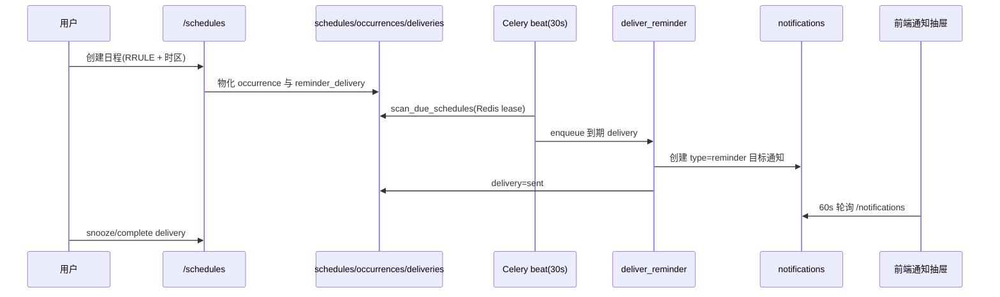

# CygnusX 通知、公告与站点运营架构（Engagement）

> **用途**：记录站内通知中心、公告横幅、定时提醒投递、欢迎语、站点内容/开关与首页快捷入口的 as-built 实现。
> **类型**：as-built（2026-10-21 代码基线）。
> **适用范围**：`/api/v1/notifications/*`、`/api/v1/announcements/*`、`/api/v1/reminders/*`、`/api/v1/site-settings`、`/api/v1/site-content`、`/api/v1/platform/config`、`/api/v1/admin/platform-config`、`notification`/`announcement`/`site_settings` 表、前端通知抽屉/公告横幅/管理端运营页。
> **不适用范围**：定时任务的 RRULE、occurrence 生成与调度器细节（见 [CygnusX_analysis_operations_architecture.md](CygnusX_analysis_operations_architecture.md)）；节日彩蛋（见 [CygnusX_festival_architecture.md](CygnusX_festival_architecture.md)）；用户认证（见 [CygnusX_identity_access_architecture.md](CygnusX_identity_access_architecture.md)）。

## 这个模块如何发挥作用

运营面由三条独立但共享前端的通道组成：

1. **通知中心**：持久化站内消息，支持全局广播或指定用户；来源包括管理员、提醒、AgentTeams 房间邀请、AI 指标告警、首次登录欢迎。无邮件/短信/Webhook 投递。
2. **公告横幅**：按时间窗展示的站点级横幅，支持优先级、图标、链接、按钮与关闭策略；与通知表完全独立。
3. **定时提醒**：用户创建 RRULE 日程，Celery 扫描到期 occurrence，生成提醒投递并落一条 `type="reminder"` 通知；用户可稍后提醒或完成。

站点内容与开关是"运营配置面"：`/site-content` 从 YAML 读取首页文案/引导；`/site-settings` 是数据库单例，控制注册、TOTP 策略、协作室入口、记忆开关、统一路由、首页快捷入口等。

## 1. 总体架构

```mermaid
flowchart TD
    subgraph Sources[通知来源]
        ADM[管理端创建/更新]
        REM[Celery 提醒扫描]
        ROOM[AgentTeams 邀请/成员加入]
        ALERT[AI 指标告警]
        WELCOME[首次登录欢迎]
    end
    N[(notifications)]
    A[(announcements)]
    S[(site_settings 单例)]
    Y[data/CygnusX.yaml<br/>site_content]
    ADM --> N
    REM --> N
    ROOM --> N
    ALERT --> N
    WELCOME --> N
    ADM --> A
    N --> API[/notifications]
    A --> API2[/announcements/active]
    S --> API3[/site-settings]
    Y --> API4[/site-content]
    API --> DRAWER[NotificationDrawer.vue<br/>60s 轮询]
    API2 --> BANNER[AnnouncementBanner.vue<br/>localStorage 去重]
    API3 --> STORE[stores/site-config.ts]
    API4 --> STORE
    STORE --> HOME[HomeView 快捷入口/注册开关]
```

### 实现图：提醒从日程到站内通知



## 2. 数据模型

### 2.1 `notifications`

| 字段 | 说明 |
| --- | --- |
| `title` / `content` | 标题 200、正文 Text |
| `level` | `info`（默认）/ `warning` / `error` |
| `type` | `general` / `reminder` / `agentteams_room_invite` / `agentteams_room_member_joined` |
| `payload` | JSONB，事件相关数据（room_id、invitation、schedule_id 等） |
| `created_by` | 创建者 FK，系统消息可空 |
| `is_global` | 全局广播 |
| `target_user_id` | 指定用户 |
| `read_by` | JSONB 用户 ID 列表（整列替换式更新） |
| `expires_at` | 过期时间 |

可见性：`is_global == true OR target_user_id == user`，并过滤已过期记录。`is_global` 优先于定向，二者同时设置时按全局处理。没有"每用户已读表"，已读状态存在行内数组。

### 2.2 `announcements`

`title`、`description`、`type`（info/success/warning/feature）、`icon`、`link`、`button_text`、`start_time`（必填）、`end_time`（可空）、`dismiss_behavior`（`daily` / `forever` / `none`）、`priority`、`is_enabled`。无受众定向，全站可见；是否展示完全由启用状态 + 时间窗决定，没有定时任务切换状态。

### 2.3 提醒相关表

- `schedules`：owner、标题/内容、RRULE、时区、起止、状态、`next_fire_at`。
- `schedule_occurrences`：日程 FK、occurrence 时间、投递状态，`(schedule, occurrence_key)` 唯一。
- `reminder_deliveries`：occurrence/schedule/user FK、渠道、状态（pending/sending/sent/failed…）、尝试次数、错误、发送时间、`notification_id` FK。

### 2.4 `site_settings`（单例 `id=1`）

`registration_enabled`、`totp_policy`、`subagent_fanout_enabled`、`agentteams_chat_entry_enabled`、`collaboration_preset`、`multi_expert_consultation_enabled`、`unified_intent_router_enabled`、`agent_memory_enabled`、降级文案/模板、`home_quick_entries`（1–8 条 JSON）。

### 2.5 站点内容

来源 `data/CygnusX.yaml` 的 `platform/storage/hero/quick_entries/guide_steps/registration/activation/easter_egg/ai_assistant` 段；服务层与内置默认值深合并。**没有写 API**，修改需改 YAML 并重启/重载。该文件同时是存储配置源，编辑首页文案会同时触碰存储配置，需谨慎。

## 3. 通知中心

### 3.1 创建与来源

- 管理端：`POST /notifications`，默认 `level=info`、`type=general`、`is_global=true`、`read_by=[]`；更新接口只能改标题/正文/级别/全局/目标/过期，不能改 `type`/`payload`。
- 首次登录欢迎：`AuthService.create_welcome_notification`，定向用户，标题"欢迎来到 CygnusX"；2FA 登录路径同样触发。
- AgentTeams：房间邀请与成员加入通知，payload 携带房间/邀请信息。
- AI 指标告警：后台任务为第一个管理员创建全局通知。
- 定时提醒：`deliver_reminder` 创建 `type=reminder` 的定向通知。

### 3.2 读取与已读

- `GET /notifications`：当前用户可见列表（无分页）。
- `PATCH /notifications/{id}/read`：把用户 ID 追加进 `read_by`；**不校验该通知是否对当前用户可见**。
- `DELETE /notifications/{id}`：同样无可见性校验。
- 未读数由前端计算，没有服务端 unread 计数器。
- 前端 `NotificationDrawer.vue` 打开时拉取 + `DefaultLayout.vue` 每 60 秒轮询；**没有通知 SSE/WebSocket**。提醒投递发布的 Redis 频道 `user:{uid}:notifications` 目前没有订阅方。

### 3.3 管理端

`GET /notifications/all`、`POST /notifications`、`PUT /notifications/{id}`，Admin 权限。`NotificationManager.vue` 提供创建/编辑；无删除 UI。

## 4. 公告横幅

- 公共接口 `GET /announcements/active`：只返回 `is_enabled` 且当前时间在 `[start_time, end_time]` 内的记录，按 `priority DESC, created_at DESC` 排序。
- 管理端 CRUD：`GET/POST/PUT/DELETE /announcements` 与 `GET /announcements/{id}`。
- `AnnouncementBanner.vue` 在 `HomeView.vue` 挂载；按 `dismiss_behavior` 使用 localStorage：
  - `daily`：按天记录关闭；
  - `forever`：永久关闭；
  - `none`：不可关闭。
- 站内链接走前端路由跳转，外链直接打开；`DashboardView.vue` 另有一块硬编码横幅，与公告表无关。

## 5. 定时提醒投递

- 创建：`POST /schedules` 或 AI `schedule` 工具（中文自然时间解析）。服务层校验 RRULE、时区，物化未来 30 天的 occurrence 与 delivery。
- 扫描：Celery beat 每 30 秒 `scan-due`，用 Redis lease `cygnusx:schedules:scan:lease`（60 秒）防并发；`FOR UPDATE SKIP LOCKED` 取到期日程，推进 `next_fire_at`。
- 投递：`_enqueue_due_deliveries` 把 pending 改为 sending 并入队；`deliver_reminder` 创建通知、标记 sent；失败按 60×2^n 退避，最多 `schedule_max_delivery_attempts`（默认 5）次。
- 重试：每 300 秒扫描失败投递。
- 用户操作：`POST /reminders/{delivery_id}/snooze`、`/complete`。
- 生产 compose 的 worker 只消费 `analysis,blast_search,blast_db_build`，`schedules` 队列**没有消费者**；提醒不会真正投递，除非部署侧调整队列路由/worker。修改部署时必须同步核对。

## 6. 欢迎语

已实现 DB 周内容池替代磁盘种子队列，详见 [欢迎语系统 as-built](CygnusX_welcome_architecture.md)。内部 welcome_copywriter 复用 LangGraph、默认 provider 与独立运行审计；现有 Beat 在 analysis 队列执行生成/发布/reconcile。登录仅领取 DB 内容，旧 `/llm/generate-welcome` 为管理员兼容入口。

前端 `useWelcomeToast` 在 onboarding 明确判定后触发，服务端每日 reservation/impression 控制跨设备次数；首次登录组件不变、普通用户默认关闭。通知公告管理新增欢迎语审核/生成/禁用/撤回/回滚 Tab。生产上线与真实周切换仍以验收报告记录为准。

## 7. 站点设置与首页快捷入口

- `GET /site-settings` 公共读；`PUT /site-settings` 管理员 + 条件 TOTP。
- `GET /platform/config`：公开的非敏感开关子集；`GET/PATCH /admin/platform-config`：管理端敏感配置，PATCH 可要求 `X-TOTP-Code`。
- 默认快捷入口 6 条；schema 限制 1–8 条，并校验路由/图标。
- `AdminHomeQuickEntriesView.vue` 编辑后 PATCH；但 `HomeView.vue` 当前只消费配置项的 `icon/icon_bg`，标签、路由、顺序仍用前端内置列表，新增项不会出现在首页。`guide_steps` 未被首页渲染。
- 注册页根据 `registration_enabled` 决定是否开放注册；登录页读取 `site-content` 的登录文案。
- 设置页可直接编辑平台开关（含协作模式预设级联、记忆/统一路由等），要求 TOTP。

## 8. API 汇总

| 域 | 方法与路径 | 权限 |
| --- | --- | --- |
| 通知 | `GET /notifications`、`PATCH /{id}/read`、`DELETE /{id}` | 登录 |
| 通知管理 | `GET /notifications/all`、`POST /notifications`、`PUT /{id}` | Admin |
| 公告 | `GET /announcements/active` | 公共 |
| 公告管理 | `GET/POST/PUT/DELETE /announcements`、`GET /{id}` | Admin |
| 提醒 | `POST /reminders/{delivery_id}/snooze`、`/complete` | 登录（投递所有者） |
| 设置 | `GET /site-settings`、`GET /platform/config`、`GET /site-content` | 公共 |
| 设置管理 | `PUT /site-settings`、`PATCH /admin/platform-config` | Admin（+TOTP） |
| 欢迎 | `POST /welcome/claim`、`/welcome/impression` | 登录 |
| 欢迎管理 | `/admin/welcome/*`，旧 `/llm/generate-welcome` 兼容入口 | Admin |

`/notifications`、`/announcements`、`/site-settings`、`/site-content`、`/platform`、`/llm`、`/welcome` 为共享基础设施，不进入模块门禁。

## 9. 前端映射

| 组件/视图 | 作用 | 挂载点 |
| --- | --- | --- |
| `stores/notification.ts` | 列表、已读、创建/删除、未读数 | 全局 |
| `NotificationDrawer.vue` | 通知抽屉、房间邀请操作、管理端创建表单 | `DefaultLayout.vue` |
| `AnnouncementBanner.vue` | 公告横幅与关闭策略 | `HomeView.vue` |
| `AdminAnnouncementsView.vue` | 公告/通知/节日三个管理 Tab | `/admin/announcements` |
| `useWelcomeToast.ts`（旧 composable 为兼容包装） | 已完成 onboarding 的合资格账号欢迎语 toast | `DefaultLayout.vue` |
| `stores/site-config.ts` | 拉取站点设置与内容 | 登录页/注册页/首页 |
| `AdminHomeQuickEntriesView.vue` | 快捷入口编辑 | `/admin/home-quick-entries` |
| `SchedulesView.vue` / `stores/schedule.ts` | 日程与提醒管理 | `/schedules` |

## 10. 配置、测试与已知缺口

- 配置：`schedule_scan_batch_size`、`schedule_max_delivery_attempts`、`site_content_yaml`、欢迎语路径/阈值。
- 测试：`tests/unit/test_site_content_service.py`；`test_site_settings_collaboration.py` 两个用例均被 quarantine（DTO/模型不匹配）；无通知/公告 CRUD 与日程扫描/投递测试。
- 缺口：
  - 通知无实时通道，仅 60 秒轮询；Redis 频道无订阅者。
  - `mark_read`/`delete` 不校验可见性，可操作他人通知 ID。
  - `is_global` 覆盖定向，定向与全局同时设置时语义不直观。
  - 通知列表无分页；`read_by` 整列替换存在并发丢失。
  - 公告无管理端预览/定时发布状态机；`DashboardView` 硬编码横幅与公告表重复。
  - 生产 worker 不消费 `schedules` 队列，提醒实际不投递（部署缺口）。
  - 站点内容与存储配置共用 `data/CygnusX.yaml`，无管理端编辑入口。
  - 首页快捷入口配置只有图标生效，标签/路由/顺序不生效。

## 11. 关键文件索引

| 层 | 文件 |
| --- | --- |
| 服务 | `application/services/{notification,announcement,welcome,site_content,site_settings,schedule}_service.py` |
| API | `api/v1/{notification,announcements,reminders,site_settings,site_content,platform_config,llm}.py`、`api/v1/admin/platform_config.py` |
| 数据 | `infrastructure/database/models/{notification,announcement,site_settings,schedule}.py` |
| 调度 | `infrastructure/celery_app/tasks/schedules.py`、`celery_app/celery.py`（beat 142–151） |
| 前端 | `frontend/src/components/{NotificationDrawer,AnnouncementBanner}.vue`、`components/admin/{AnnouncementManager,NotificationManager}.vue`、`stores/{notification,site-config,schedule}.ts`、`views/{AdminAnnouncementsView,AdminHomeQuickEntriesView,SchedulesView}.vue` |
| 测试 | `tests/unit/test_site_content_service.py`、`test_site_settings_collaboration.py` |

## 12. 修改验证清单

- 改通知表/读取逻辑：补可见性与已读并发测试；验证过期过滤与管理员广播。
- 改公告：验证时间窗、优先级排序、三种关闭策略与站内链接。
- 改提醒/日程：启动 beat + worker 消费 `schedules` 队列，端到端验证 occurrence → delivery → notification；验证 lease、重试与 snooze。
- 改站点设置：跑 site-settings 测试并修复现有 quarantine；确认前后端开关语义一致。
- 改 `data/CygnusX.yaml`：同时核对存储配置读取路径与首页/登录文案，避免只改一半。
