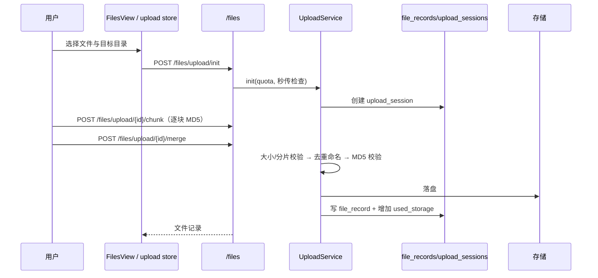

# CygnusX 项目空间与文件管理架构（Project Workspace & Files）

> **用途**：记录项目聚合、项目详情聚合、文件记录/目录/上传会话、聊天附件、文件解析引用、团队文件 ACL、项目归档与工作区归档的 as-built 实现。
> **类型**：as-built（2026-10-21 代码基线；2026-10-24 补充跨域生命周期核对）。
> **适用范围**：`/api/v1/projects/*`、`/api/v1/files/*`、`/api/v1/teams`、`/api/v1/admin/workspace-archive/*`、`/api/v1/admin/storage/usage`、`projects`/`file_records`/`upload_sessions`/`user_directories`/`samples`/`workspace_archives` 表、`ProjectsView`/`ProjectDetailView`/`FilesView`/`AdminWorkspaceArchiveView`。
> **不适用范围**：存储根解析、目录协议、`StoragePathFactory`、sync 反向对账与目录树元数据——以 [CygnusX_storage_architecture.md](CygnusX_storage_architecture.md) 为唯一权威；科研交付/导出 ZIP 的完整流程见 [CygnusX_research_delivery_architecture.md](CygnusX_research_delivery_architecture.md)；会话休眠/解包生命周期见 [CygnusX_research_loop_architecture.md](CygnusX_research_loop_architecture.md)。

> **2026-10-24 核对补注**：跨页面/API/数据/权限的全面梳理见 [项目管理审计快照](CygnusX_project_management_review.md)。审计快照的 F01（改名后 run 目录分叉）/F02（默认项目绕过 tombstone）/F03（科研 RESTRICT 引用未转换为删除冲突）已于同日修复：已绑定项目的运行入口（AgentTeams Case、Studio 产物登记、普通会话归档、Overdrive 归档）统一按稳定 slug 落盘；默认项目与显式创建共用 `ProjectService.reserve_project_identity`（owner 锁 + tombstone + 目录投影）；`delete_project` 对 10 类科研保留引用做开关无关的预检查并返回稳定 409（`PROJECT_HAS_RETAINED_REFERENCES`），数据库 RESTRICT 兜底并发写入。未绑定项目的旧名称入口（TaskService/生信工具的名称参数）与快照 F04–F10 仍待后续工作包。

## 这个模块如何发挥作用

项目是用户组织会话、运行与交付物的**单所有者聚合**：一个项目对应数据库一行与磁盘目录 `projects/{slug}`，没有项目成员表或项目级 RBAC。项目当前为刻意单所有者模型，无 project_members 表是设计决策而非缺陷。文件管理负责"平台内所有可见文件"的记录、配额、目录树、上传会话、下载/预览与引用解析；团队文件通过 `file_records.owner_scope/team_id` 共享，使用独立的 `owner/writer/reader` ACL，不经过平台角色系统。

项目详情页把三个数据源聚合为"项目工作台"：`chat_sessions.project_id`（会话）、AgentTeams 房间、磁盘 run 目录。项目归档负责在每个 run 目录写入确定性的 README/environment/manifest，并把分析记录追加到项目 `AGENTS.md`；会话工作区的休眠打包属于研究闭环，不在本文重复。

## 1. 总体架构

```mermaid
flowchart TD
    subgraph UI[前端]
        P[ProjectsView / ProjectDetailView]
        F[FilesView]
        W[AdminWorkspaceArchiveView]
    end
    subgraph API[REST /api/v1]
        PAPI[projects.py]
        FAPI[files.py]
        TAPI[teams.py]
        WAPI[admin/workspace_archive.py]
    end
    subgraph SVC[应用服务]
        PS[ProjectService]
        POS[ProjectOverviewService]
        PAS[ProjectArchiveService]
        FS[FileService]
        US[UploadService]
        DS[DirectoryService]
        MFR[ManagedFileResolver]
        WAS[WorkspaceArchiveService]
        ST[StorageService]
    end
    subgraph Data[数据与存储]
        DB[(projects / file_records /<br/>upload_sessions / user_directories /<br/>samples / workspace_archives)]
        DISK[用户目录 / projects/{slug}/runs]
    end
    P --> PAPI --> PS
    P --> PAPI --> POS
    F --> FAPI --> FS
    F --> FAPI --> US
    F --> FAPI --> DS
    W --> WAPI --> WAS
    PAPI --> PAS
    FS --> MFR
    FS --> DB
    US --> DB
    DS --> DB
    PS --> DB
    PS --> DISK
    POS --> DB
    POS --> DISK
    WAS --> DB
    WAS --> DISK
    WAPI --> ST
```

### 实现图：一次文件上传



## 2. 项目聚合

### 2.1 数据模型

- `projects`：`user_id` + `slug` 唯一、`status`（迁移后 NOT NULL DEFAULT active；NULL 读取兼容保留至 lifecycle02）、`settings` JSONB、名称/描述等。
- 没有 `project_members` 表；项目只属于创建者。项目读写在服务层校验所有者；`project_scope.resolve_agent_project_scope()` 另限制绑定项目的 Agent 不能改绑其他项目。
- 磁盘目录：`projects/{slug}`，由存储路径工厂创建；删除项目时保留物理目录，写入 project_tombstones 后删除项目行与根目录索引。显式创建、按名复用（`get_or_create_project_by_name`）与会话默认项目（`session_management._resolve_default_project_id`）共用 `ProjectService.reserve_project_identity` 统一身份预留：owner 行锁、tombstone 拒绝复用、目录投影登记；被删 slug 在复用语义下分配新 slug（`-2` 起），不复活旧身份。

### 2.2 状态与生命周期

- 状态值：active / completed / handed_over；project_lifecycle01 将存量 NULL 回填为 active 并设置 NOT NULL DEFAULT active，读取兼容分支保留至 lifecycle02。
- `create_project`：生成 slug、唯一性校验、建目录。
- `update_project_settings`：按 JSON Merge Patch 局部合并 settings；PATCH 也支持修改 name/description，slug 和历史路径保持不变。
- `mark_project_status`：改状态；进入 completed/handed_over 时触发 `_pack_project_sessions`，按字符串 `project_id` 匹配 Studio 会话并异步打包；忙碌会话跳过。
- `delete_project`：原子保留删除身份并删除项目行及**项目根**目录索引，物理文件保留。删除前对 10 类科研保留引用做**开关无关**的预检查（datasets、dataset_ingestions、research_plans、result_manifest_observations、download_execution_budgets/admissions、project_export_jobs/requests、project_report_jobs/requests），命中即返回稳定 409（`code=PROJECT_HAS_RETAINED_REFERENCES`，detail 列出各类中文计数）；预检查与删除之间并发写入由数据库 RESTRICT 兜底：IntegrityError 先完整回滚，再重新解释为同一业务冲突，仍无法识别的约束异常原样抛出。子目录与字符串关联（chat_sessions.project_id 等）未统一解绑，见审计快照 F08。

### 2.3 API（`/api/v1/projects`）

| 方法 | 路径 | 行为 |
| --- | --- | --- |
| GET | `/projects` | 当前用户项目列表 |
| GET | `/projects/count` | 数量 |
| POST | `/projects` | 创建（201） |
| GET | `/projects/{id}` | 详情 |
| GET | `/projects/{id}/overview` | 会话/房间/磁盘 run 聚合 |
| PATCH | `/projects/{id}` | 名称/描述/状态及 Merge Patch settings（空请求 422） |
| POST | `/projects/sync-from-disk` | JWT 显式同步本人目录，跳过删除身份和符号链接 |
| GET | `/projects/{id}/capability-status` | 当前用户的三项科研能力状态；不改变开关 |
| DELETE | `/projects/{id}` | 删除（204）；证据保留时冲突 |

### 2.4 项目详情聚合

`ProjectOverviewService.get_overview` 合并：

1. **会话**：`chat_sessions.project_id == str(project_id)`，按状态过滤；内存分页。
2. **房间**：AgentTeams 房间与状态映射。
3. **磁盘 run**：扫描项目 runs 下所有非隐藏一级子目录，检查 `AGENTS.md`、`README.md`、`environment.json` 文件存在性，递归统计文件数与字节数；不以命名或标记是否齐全过滤。

run 扫描所有非隐藏一级子目录，不依赖数据库或归档标记；正则仅用于解析时间，失败回退 mtime，目录重命名不会使其被过滤。

## 3. 项目归档

`ProjectArchiveService` 在 run 完成时写确定性归档文件（不调用 LLM）：

- `collect_environment()`：记录运行时、包版本、镜像等环境信息。
- `render_project_agents_md()`：生成项目级 `AGENTS.md`。
- `append_analysis_entry()`：以 `runs/{run_name}` 为幂等键追加分析记录。
- `archive_run()`：写 `README.md` + `environment.json` + `manifest.json`，并追加 `AGENTS.md`。
- `archive_studio_run()`：Studio 会话归档。
- `archive_overdrive_delivery()`：把协作室交付路径复制到 `create_project_run_dir()`；已绑定项目按稳定 slug 落盘（DB 记录缺失时按显示名推导 slug 兜底），无 `project_id` 时静默返回 `None`。

没有 HTTP 端点；由分析、交付、Studio 流程在服务层调用。修改归档结构时需同时核对寻宝鼠/交付文档中的 manifest 契约。

## 4. 文件管理

### 4.1 数据模型

- `file_records`：路径、文件名、大小、类型、状态、`directory`、来源、`task_id`、存储后端、`lifecycle_status/cleanup_after`、`owner_scope`（personal/team）、`team_id`。
- `upload_sessions`：分片上传会话、已上传分片、MD5、目标目录、状态、过期时间。
- `samples`：样本表（名称、分组、元数据），供流程提交与文件页使用。
- `user_directories`：`(user_id, path)` 唯一、`is_system`；目录树展示的权威索引。
- 配额：`users.storage_quota/used_storage`；上传/写入时校验，删除时回退。

### 4.2 路径与系统目录

- 路径规则以 `FileService` 文件头与 `StoragePathFactory` 为准：用户文件必须落在个人/团队根下，禁止绝对路径与 `..` 穿越。
- 系统目录（`SYSTEM_DIRECTORIES`）由 `ensure_directory_chain()` 自动登记；默认目录由 `DirectoryService.ensure_default_directories()` 创建。
- 目录树隐藏 `inbox`、`tasks` 顶层；聊天产物根为 `workspace/chat-output`。
- 删除目录会把其中文件的 `directory` 重置为空，不删除文件记录（避免误删实体）。

> 存储根解析、`/files/sync` 正向登记与幽灵目录反向对账、目录树展示元数据均以存储架构文档为准，本文不重复。

### 4.3 文件 API（`/api/v1/files`）

| 类别 | 方法与路径 | 说明 |
| --- | --- | --- |
| 列表/搜索 | `GET /files?q=` | 当前用户可见文件 |
| 配额 | `GET /files/quota`、`GET /files/storage-info` | 配额与使用量 |
| 预览 | `GET /files/preview` | 文本/图片预览 |
| 同步 | `POST /files/sync` | 磁盘 → DB 登记与反向对账 |
| 预签名 | `POST /files/presigned-download`、`presigned-upload`、`complete` | S3/MinIO 直传 |
| 目录 | `POST/PUT/DELETE /files/directories...` | 创建/重命名/删除 |
| 选择器 | `GET /files/picker` | 文件选择器数据 |
| 移动 | `PUT /files/{file_id}/move` | 目录移动 |
| 上传 | `POST /files/upload/init`、`/chunk`、`/merge`、`DELETE /upload/{id}` | 分片上传 |
| 聊天附件 | `POST /files/chat-upload`、`GET /files/chat-upload/{user}/{filename}` | 白名单/黑名单扩展名校验；测序原始数据与大体积二进制建议走文件管理 |
| 下载/删除 | `GET /files/{file_id}/download`、`DELETE /files/{file_id}` | 实体下载与删除 |
| 样本 | `/files/samples...` | 样本 CRUD |
| 已弃用 | `/files/search`、`/files/workspace`、`/files/tree` | 保留兼容，新代码不要使用 |

### 4.4 上传会话

`UploadService`：

1. `init`：校验配额、目录；通过 `_resolve_completed_file_id` 做秒传（同 MD5 已完成文件）检查；创建 `upload_session`。
2. `chunk`：逐块校验 MD5 并记录。
3. `merge`：校验总分片/总大小，文件名去重（冲突加后缀），计算整文件 MD5，落盘，写 `file_record`，增加 `used_storage`，清理临时文件；失败进入终态并释放会话。
4. `cancel`：清理临时文件与会话。

### 4.5 引用解析

`ManagedFileResolver` 支持 `upload://`、`file://`、`directory://`、`sample_sheet_ref://` 四类引用：

- 禁止模式（绝对路径、`..` 等）拒绝；
- 5 MB 文本引用上限；
- 解析时校验所有权与路径归属，防止通过引用读取他人文件。

### 4.6 团队 ACL

- `GET /api/v1/teams` 只列当前用户所属团队（owner/writer/reader）。
- 文件 ACL：个人文件仅本人可读写；团队文件按 `team_id` + 角色判断，reader 只读，writer/owner 可写。
- 团队模型独立于平台 RBAC；管理端没有团队管理界面。

## 5. 工作区归档（管理端）

- `WorkspaceArchiveService` 负责会话工作区的休眠打包（pack）、恢复解包（unpack）、删除（delete）；配额不足/会话忙碌有明确错误码；打包结果写 `sandbox_meta.workspace_archive` 并追加项目 `AGENTS.md`、写审计。
- `workspace_archives` 表：会话、包路径、大小、状态、保留期、`deleted_at/restored_at`；部分唯一索引保证同一会话最多一个活跃包。
- 管理 API：`GET /admin/workspace-archive/overview`（总量、配额、保留策略、7 天内到期、按用户）、`POST /sessions/{session_id}/dormant`、`DELETE /packages/{package_id}`、`PUT /config`。
- `PUT /config` 通过逐行改写 `studio.yaml` 后原子替换实现热更新，属于**脆弱的文本级配置写入**；改结构时需同步校验。
- Celery beat：`hibernate_dormant_workspaces`、`cleanup_expired_workspace_archives`。
- 前端 `AdminWorkspaceArchiveView.vue` + `api/admin/workspaceArchive.ts`。

> 休眠/解包的业务生命周期与 DTO 契约已在科研闭环文档给出；本文只补充管理端配置写入与部分唯一索引。

## 6. 存储用量与项目导出边界

- `GET /admin/storage/usage?top_n=`：5 分钟 Redis 缓存；`du -s --block-size=1` 统计目录，Python 回退；与数据库用户用量做映射。前端 `StorageMonitorPanel`。
- 项目导出（`project_delivery_service` + `project_export_jobs`/`project_export_requests`）默认关闭（`project_export_enabled=False`），要求 research 读权限、报告/任务模块与所有权；幂等 request_key + manifest digest；outbox + Celery reconcile。完整契约见科研交付文档。

## 7. 前端

- `ProjectsView.vue`：项目表格、创建弹窗、搜索、统计。
- `ProjectDetailView.vue`：项目概览、会话 Tab、run 表、交付入口；对异步加载做 generation guard。
- `FilesView.vue`（1300+ 行）：初始化目录/样本/配额/sync，目录树、上传队列、预览、下载、移动、删除、存储用量。
- `AdminWorkspaceArchiveView.vue`：归档总览、手动休眠、删除包、配置编辑。

## 8. 数据表与迁移

| 表 | 作用 |
| --- | --- |
| `projects` | 项目聚合 |
| `project_tombstones` | 被删项目身份与 slug 保留 |
| `file_records` | 文件记录（含生命周期/团队归属） |
| `upload_sessions` | 分片上传会话 |
| `user_directories` | 目录索引与系统目录标记 |
| `samples` | 样本 |
| `workspace_archives` | 工作区休眠包 |
| `project_export_jobs` / `project_export_requests` | 项目导出（见科研交付） |
| `project_report_jobs` / `project_report_requests` | 独立项目科学报告（见科研交付） |

迁移以 `alembic/versions/` 中 `projects/files/uploads/user_directories/workspace_archives` 相关版本为准；改模型后必须 `make check-migrations && make check-alembic-heads`。

## 9. 测试与已知缺口

- 测试：`test_project_get_or_create.py`、`test_session_project_binding.py`、`test_project_overview.py`、`test_project_archive_service.py`、`test_project_identity_wp1_wp2.py`（F01/F02/F03 回归：稳定 slug 落盘、默认项目身份预留、删除保留引用与 FK 兜底）、`test_file_service.py`、`test_file_service_presigned.py`、`test_upload_dedup_guard.py`、`test_team_file_acl.py`、`test_workspace_archive.py`、`test_workspace_env_restore.py`、`tests/integration/test_chat_upload.py`。
- 缺口：
  - 设计边界（非缺口）：项目刻意采用单所有者模型；团队 ACL 与项目完全独立。
  - 迁移后 status 显式化；NULL 读取兼容保留一个版本（至 lifecycle02）。
  - 删除保留物理目录及 tombstone；list/count 不再隐式回填，用户可通过 POST /projects/sync-from-disk 显式同步真正缺失的历史目录。证据保留冲突已覆盖全部科研引用类型（开关无关 409 + FK 兜底）；真实 PostgreSQL 并发引用写入与锁行为仍需集成验收（SQLite 回归不证明 PG 语义）。
  - 项目 run 通过目录扫描发现；重命名可能改变时间回退/排序，但不会因不匹配正则而消失。
  - `DirectoryService`、`StorageService` 无独立单测。
  - 文件记录 `directory` 与 `user_directories` 双投影，目录移动/删除需同时维护。
  - 工作区归档配置写回是逐行 YAML 文本改写，结构变化易破坏配置。
  - 聊天附件与普通文件使用两套上传入口，扩展名策略不同。

## 10. 关键文件索引

| 层 | 文件 |
| --- | --- |
| 项目 | `application/services/{project_service,project_scope,project_overview_service,project_archive_service}.py`、`api/v1/projects.py` |
| 文件 | `application/services/{file_service,upload_service,directory_service,managed_file_resolver,storage_service}.py`、`api/v1/files.py` |
| 团队 | `api/v1/teams.py`、`application/services/team_service.py`、`infrastructure/database/models/team.py` |
| 归档 | `application/services/workspace_archive_service.py`、`api/v1/admin/workspace_archive.py`、`api/v1/admin/storage.py` |
| 前端 | `frontend/src/views/{ProjectsView,ProjectDetailView,FilesView,AdminWorkspaceArchiveView}.vue`、`api/{projects,files,teams}.ts`、`stores/upload*` |
| 测试 | 见 §9 |

## 11. 修改验证清单

- 改项目模型/API：跑项目相关单测；验证创建/归档/删除、证据保留冲突与磁盘目录一致性。
- 改文件/上传：跑文件与上传测试；验证秒传、配额、MD5、分片续传、取消清理、团队 ACL 与 chat-upload 扩展名策略。
- 改目录：验证 `user_directories` 与 `file_records.directory` 双向一致、系统目录不可删、`inbox/tasks` 隐藏规则。
- 改工作区归档：端到端验证 pack → 休眠 → 恢复 → 删除；在本地验证 `studio.yaml` 写回后仍可被解析。
- 改存储路径/目录协议：回到 `CygnusX_storage_architecture.md` 的验证矩阵，不要只跑本文用例。
