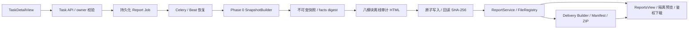
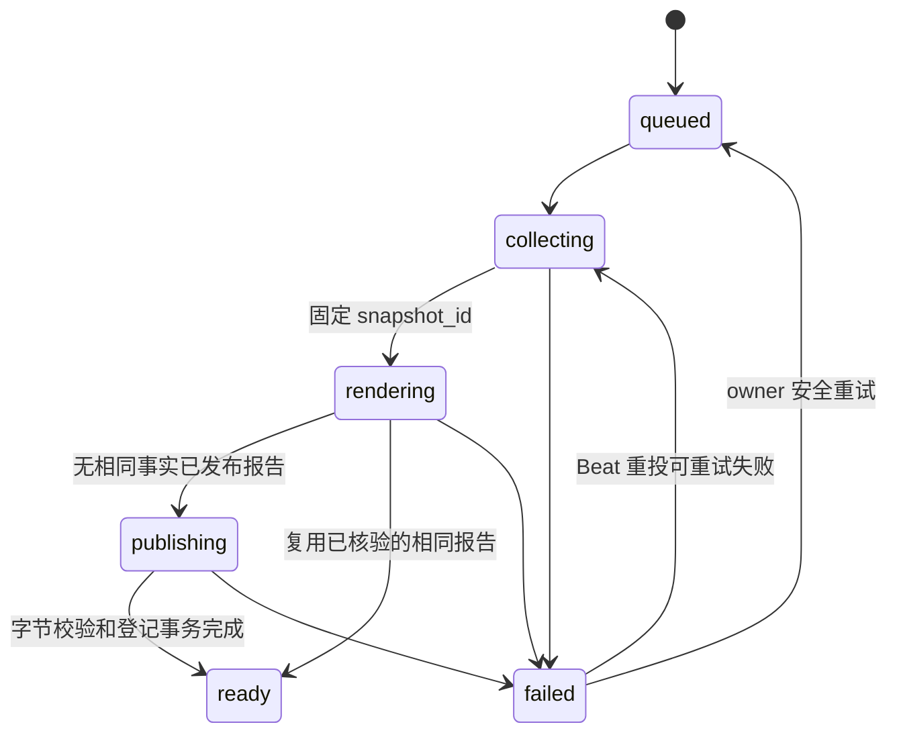

# CygnusX 报告中心与可复现执行证据报告

> 活动 as-built 基线。代码接入已实现；真实 RNA-seq / PostgreSQL / Celery / 对象存储部署验收仍未完成。验证与实施时点见 `docs/audits/reproducible-report-phase1-implementation.md`。

## 模块作用与架构

既有 RNAFlow / BioReport 科学报告保留。新增 `report_kind=reproducibility` 的独立执行证据交付物使用同一 `reports`、`report_files`、ReportsView 和下载 API，不替代科学结果渲染，也不调用分析执行器。Phase 2 增加 `report_kind=delivery`，将科学报告、执行证据报告和冻结快照整理为 owner-only 交付包。

| 边界 | 实现 |
|---|---|
| 协议、摘要、冻结 | `application/schemas/report_snapshot.py` |
| 来源、局部读文件、RNA ARDP 投影 | `report_snapshot_sources.py`、`report_snapshot_manifest.py`、`report_snapshot_builder.py` |
| 请求、去重、状态用例 | `application/services/reproducible_report_service.py` |
| 八模块 HTML、固定模板版本 | `application/services/report_audit_renderer.py` |
| 本地 FD 原子发布 / 对象存储适配 | `application/services/report_archive.py` |
| 报告登记、版本、预览、下载 | `application/services/report_service.py`、`infrastructure/database/repositories/report_repository.py` |
| ORM、迁移 | `infrastructure/database/models/report.py`、`alembic/versions/reportauditphase1_add_reproducible_report_tables.py` |
| 异步、锁、恢复扫描 | `infrastructure/celery_app/tasks/reports.py`、`celery_app/celery.py` |
| UI、轮询、鉴权下载 | `TaskDetailView.vue`、`ReportsView.vue`、`ReportViewerView.vue`、`useReproducibleReport.ts`、`api/report.ts`；旧 `ReportPreviewModal.vue` 保留静态隔离组件 |
| BioReport 受控渲染 | `application/services/bioreport_adapter.py`；HTML 可复用，科学 PDF 使用固定 CLI 合约，AI 明确关闭 |
| 审计 PDF | `application/services/report_audit_pdf_renderer.py`；冻结审计 HTML 经 Pandoc/Typst 转换，按 SHA-256 登记为第二个 ReportFile |
| 科研交付包 | `application/schemas/report_delivery.py`、`research_delivery_service.py`、`ReportService.build_delivery_package` |

## 身份与授权

只接受 RNA-seq 已结束的 Task（success / completed / failed / cancelled），查询先限定 `Task.user_id`。身份仍以 Task 为主；Run 可以缺失，指定 Run 则要求同 owner、同 Task、同 flow、有 confirmed_at。未指定 Run 的自动关联仅通过 Run.task_id；不按目录、名称或时间猜测。

鉴权依赖的用户 ID 为字符串，用例在边界归一为 UUID。任务没有通用可信 project_id，所以项目成员资格不能绕过 owner 约束；首版不开放团队或公开报告。FileRecord 必须同 owner、personal、显式 Task 关联。快照 API 同时 join 仍存在的 Report，并校验快照 owner / Task / Run / digest。删除 Report 后快照不可从旧 Report ID 访问，归档快照本体不覆盖。

客户端只能指定 Task / 可选 Run / 可选 UUID 请求键，不能传入服务器路径。导出的文件路径为安全引用；审计 ReportFile DTO 使用 `output/index.html`，不泄露存储根。

## Job 状态、幂等和恢复

Job 与分析 Task 的状态、时间和失败完全独立，保存 evidence_partial、snapshot_id、report_id、error_code、error_message、retryable、attempt_count、finished_at、template_version、archive_path。阶段不是百分比。

1. API 在 owner-scoped Task 行上 FOR UPDATE，复用同模板仍在生成中的 Job；部分唯一索引作数据库兜底。可选 `Idempotency-Key: UUID` 在 owner / Task / Run / 模板范围内绑定同一请求。
2. 已结束后不带请求键的新请求会重新采集，避免仅用 Task.updated_at 忽略新磁盘证据。最终按 `(owner, Task, snapshot_digest)` 复用快照，再按 `(owner, snapshot_id, template_version)` 复用已发布 Report。
3. 新事实或模板可创建新报告版本，通过已有 parent_id / version 树保存；不会替换原报告文件。
4. worker 用专属、无池连接持有 `pg_try_advisory_lock(hash(Task ID))`，覆盖状态提交、取证和发布；竞争投递返回 busy。锁不会随状态 commit 丢失，也不会带锁归还池。进程结束后 PostgreSQL 释放连接锁。
5. 先提交 Job 再尽力投递。Job queued 行作为持久 outbox；Beat 每分钟扫描 queued、超时活跃、可重试失败，以修复 commit 后崩溃、broker 暂不可用、worker 丢失。重复扫描仍受同一个 Task 锁保护。
6. 默认采集/交付预算 600 秒、最多 3 次尝试、每轮扫描 100 行；Settings 控制预算与扫描间隔。旧失败如果已有新活跃 Job，恢复等待新 Job 结束，避免违反活跃唯一约束。
7. 权限、身份冲突、协议/摘要损坏为不可自动重试；存储、超时、DBAPI 暂时错误可重试。返回固定错误码/信息，不回传原异常、凭据、路径。原 Task 状态不改变。

Celery 投递成功或 Celery task SUCCESS 不能代替 Job ready。应用错误可由 worker写入 failed 后返回；消费者必须以数据库 Job 状态判断。Beat 只重投审计 Job，不重跑 RNA 分析。

## 快照与历史事实

数据库证据采集使用 REPEATABLE READ READ ONLY 事务；冻结后结束读取事务再持久化。跨数据库和文件系统没有共同原子快照：有采集窗口、水位、当前字节指纹以及改写检测，不能宣称执行时取证或可信时间戳。

快照 JSON、schema/redaction/digest 版本、来源、时钟、水位均保存。ORM 禁止更新，PostgreSQL BEFORE UPDATE trigger 禁止原地修改；重试引用原 snapshot_id，不因新证据改变已冻结报告。内容摘要 stable_facts.v1 排除采集/生成时间等瞬态元数据，保留身份、事实、来源水位和状态；不是签名。兼容旧快照没有的 optional display_name：空值不进入事实摘要。

owner_allowlist.v2 不输出原始参数文本、日志、命令、请求、Prompt 或凭据。名称只允许有界 Unicode 展示标签（支持中文）；路径、长令牌或凭据状名称被省略，并标明脱敏/未记录。历史环境缺失不回填当前配置或 Flow 版本；科学报告原有 catalog 行为不改变，新审计报告 flow_version 保持空，历史声明在正文以证据状态呈现。

六状态为 verified / not_recorded / unavailable / not_applicable / verification_failed / estimated。verified 只代表注明范围的观察，不代表 QC 通过或复现成功。证据缺口允许生成报告，并令 evidence_partial=true。

读文件授权后使用逐级目录 FD、O_NOFOLLOW、普通文件校验，拒绝链接竞争、FIFO 等特殊文件。流式哈希检查前后 fstat，受时间和总字节预算（默认 16 GiB）约束；超预算为 unavailable。数据库 FileRecord 最多 2000、RunEvent 最多 1000，清单最多 4 MiB / 2000 条；截断显式留缺口。不扫描其他用户目录。

## 发布、归档和下载

通过 StoragePathFactory.create_project_run_dir 创建独立 `projects/<安全项目>/runs/audit-report-<UTC>[-序号]/output/index.html`。它是报告归档运行目录，不是新科研计算。可信项目标识缺失时使用 RNA-seq 报告归档分类，不将其当成原执行项目事实。新路径不包含任务 UUID，不写 legacy tasks 目录。

archive_path 在写入前提交，便于中断恢复。本地发布在 pinned 目录 FD 下写临时文件、fsync、原子 replace、目录 fsync；对象存储走 StorageBackend.write_stream 完成后回读。校验长度和 SHA-256 后，ReportService 在同一个事务内登记目录链、FileRecord、Report、ReportFile，Job 最后 ready。登记失败保留 private 未登记文件与冻结快照，下一次修复发布；没有 DB / 对象存储分布式事务，也没有自动公开分享。

审计 FileRecord source=report、Task 外键留空；Task 关联由 Report.task_id 保存。这样审计报告不会反过来进入自己的分析取证文件集，避免每次生成都因上一份报告产生新摘要。ReportFile 保存 SHA-256；报告预览、下载、事实去重重用都复核字节。已发布文件丢失/改写返回不可用或完整性错误，不静默改写历史报告。删除仅删除报告记录，沿用现有规则；快照和底层文件不覆盖，孤立归档/目录的自动 GC 未引入。

审计下载通过原 reports/files API 返回校验后的字节和 attachment，不让 FileResponse 在校验后再次打开可被替换的路径。原有科学报告本地 FileResponse 路径保留。对象存储输出适配已接入；历史 RNA 证据读取仍只支持本地，远程产物标 unavailable。

Phase 2 交付构建复核科学报告和执行证据文件，生成 `Scientific_Report.*`、`Reproducibility_Record.*`、`ReportSnapshot.json`、`README.md`、`EvidenceManifest.json`、`checksums.sha256` 和 ZIP。缺失文件显式标记 `partial`，不生成空占位文件。Manifest 自身和 checksums 文件不纳入自身哈希列表，以避免自引用循环；验证器仍校验 Manifest 中所有可用文件。

## 前端和 HTML 安全

TaskDetailView 一次请求后按阶段轮询；请求结束后导航到指定 Report ID，ReportsView 的旧 `?reportId=` 链接通过详情校验后进入 `/reports/:reportId/view`。轮询使用递归 setTimeout，避免重叠；暂时查询失败自动重试，权限拒绝停止，离页/切换 Task 使旧回调失效，sessionStorage 保存 Job ID 便于刷新后恢复。生成失败显示固定原因，可重试失败按钮复用原 Job。后台 Job 不依赖页面存活。

ReportsView 和卡片展示执行证据类型、报告版本、模板、证据缺口；可按 Task ID 筛选。下载使用统一 axios Bearer 鉴权。P1 新查看页挂 DefaultLayout，保留顶栏/侧栏、标题、流程、状态、生成时间、收藏、下载及打开同一平台查看路由的新窗口操作；列表拦截过期/未完成报告，直达页再次校验。交付 ZIP 保持下载语义。旧 `/{id}/preview` 文本 API 与空 sandbox 的 ReportPreviewModal 组件保留兼容；列表新入口改走以下受控预览链。

### 报告查看页 P1（代码及隔离验证，真实报告人工验收待完成）

`GET /api/v1/reports/{id}/preview-url` 只接受已登录的活跃 JWT 用户，通过 `ReportService.preview_html(strict=True)` 校验报告状态、归属、文件存在/完整性与大小后签发短时 report-only URL。短时效为 `REPORT_PREVIEW_TTL_SECONDS`（默认 300，30–900 秒），同时不得超过原 access token 的有效期。访问 URL 不是公开分享能力。

客户端用 `utils/reportPreviewSession.ts` 创建 256-bit 随机登录上下文 nonce（SameSite=Strict、HTTPS 下 Secure、Path=/）；签发端设置单独的 HttpOnly 预览会话 cookie（Path=/api/v1/reports，同样 Strict/Secure）。URL 和会话是不同 type 的签名，绑定 user_id/token_version/nonce 摘要，URL 另绑定 report_id 与随机加载通道。nonce 单独不是凭证；URL、HttpOnly 会话、nonce 必须同时匹配。新登录、退出及自动认证清理同步删除 nonce；旧会话 cookie 即使尚未过期，也不能单独继续访问。普通 Bearer/API Key 认证没有改为通用 cookie 认证。

AuthMiddleware 仅对 GET + 精确 UUID `/{id}/preview-content` 校验这些凭证并在 ModuleGate 前注入身份；其他路径不接受预览凭证。HTML 端点再次校验凭证、数据库中 active/token_version、动态模块注册表权限和 ReportService 的 owner/可选科研 scope。更改 ID、只复制 URL、删除/过期、禁用用户或撤销版本均拒绝。响应为 no-store/no-referrer/nosniff，且有响应级 CSP sandbox，不提供裸静态目录。

预览响应由 `report_preview_renderer.py` 生成受控外壳，原报告只进入嵌套 srcdoc iframe，不改写归档 HTML/SHA 或冻结快照。外壳及科学报告均没有 allow-same-origin/顶层导航/弹窗权限；CSP 禁止网络请求、远程资源、表单和对象。科学报告的内层只允许脚本，执行证据报告内层仍为空 sandbox；后者只有可信外壳的加载桥执行，不开放报告自身脚本。

ReportViewerView 只在收到当前外层 iframe、opaque origin、report ID 和随机通道均匹配的加载消息后退出加载态；onload 本身不证明成功。错误响应可发送有界 HTTP 状态，失联/鉴权拦截有 30 秒超时、重试和鉴权下载兜底。切换路由或退出使迟到请求/消息失效。新窗口只打开平台路由，不直接打开 HTML/Blob URL。

strict 读取复用无链接跟随的归档 FD 读法，并保留登记的词法路径以拒绝文件/父目录软链替换；`REPORT_PREVIEW_MAX_BYTES` 默认 32MiB（上限 128MiB），有 stat 检查及实际有界读取，超限提示下载。原预览 API 的兼容行为不改变。

新增 ASGI 验证使用真实 SQLite、合成文件、真实 AuthMiddleware/JWT 和报告服务；Chromium 验证使用实际 Vue 外壳、隔离 API 及合成可交互 HTML。已证明合成页签可切换、父页面读取/出网被阻断、URL 单独复制和退出失效；未证明真实三类 BioReport、生产代理/HTTPS、S3 或人工阶段验收。全仓后端门禁尚有其他域失败，不标为全绿。完整命令/结果见 [P1 施工记录](../docs/implementation/cygnusx-report-viewer-p1.md)。

### 报告 Copilot P2（代码及隔离验证，真实工作流人工验收待完成）

报告查看页接入可收起、可调宽的 Copilot 侧栏，按 report ID 保存普通 Chat 会话历史。专用会话创建只接受当前用户已完成的非交付报告，绑定关系存于 ChatSession `sandbox_meta.report_copilot`；每次流请求和工具执行均重新校验用户、活跃会话、报告归属及 Task 归属。普通聊天运行时对该绑定会话强制覆盖为三项只读工具 `read_report_section`、`list_artifacts`、`query_project_results`，关闭联网、MCP、代码执行、多 Agent 与其他能力。结果查询仅接受该 Task 已登记的 CSV/TSV，限制文件大小、行数、过滤列和字段长度；项目 ID 只从服务端已核验的数据集关联派生，无关联时降级到报告 Task scope。章节跳转通过查看页预览副本中的双层 `postMessage` 桥，不修改报告归档字节。

报告元数据以 `report.paths.json` 为源：平台注册阶段读取 2.0/2.1 sidecar，将新报告绑定到 Report/Task/owner 并升级为 schema 2.1；数据库保存身份、项目、统计、富集摘要及文件索引。Copilot 创建快照时校验 2.1 sidecar 与登记记录，旧 2.0 报告使用持久化 Task/文件索引并标记 `legacy_degraded`。`query_project_results` 和 `list_artifacts` 只查询登记文件及 role 索引，不在请求时遍历目录。存量盘点/回填由 `scripts/backfill_report_paths_registry.py` 输出 success/failed/manual 清单；当前仅实现脚本，未对真实报告目录或数据库执行。前端报告路由已无 mock 数据源引用。SQLite 合成隔离测试通过不代表真实 LLM 工具循环、三类生产报告数据正确性或人工验收已完成。P3 沙箱执行未接入。实现边界与验证记录见 [报告路径索引 2.1 实施记录](../docs/implementation/cygnusx-report-paths-schema-2.1.md) 和 [P2 施工与验证记录](../docs/implementation/cygnusx-report-copilot-p2.md)。

HTML M1 概要、M2 输入环境、M3 时间线、M4 工具调用、M5 QC、M6 产物、M7 来源关系、M8 限制均由冻结快照渲染，有导航、响应式布局、明确状态、转义和 CSP，没有外部资源或脚本。未记录的输入指纹、QC 测量解释/阈值/豁免、工具调用均不补造；复现验证恒为 not_run。

## 验证边界

Phase 0 回归、离线 HTML、安全、生命周期、去重、发布失败恢复、ASGI 请求到下载与前端轮询/隔离测试已建立。Phase 2 增加交付包缺口、Manifest、ZIP slip、篡改拒绝和大小/数量上限测试。隔离集成使用 SQLite 和合成 RNA 目录；不证明真实 PostgreSQL 行锁、现场 Celery 投递、S3、BioReport 生产镜像、真实 RNA 结果或浏览器手工 E2E。

`tests/integration/test_reproducible_report_postgres.py` 仅使用显式 CYGNUSX_REPORT_TEST_DATABASE_URL，数据库名必须以 report_test 开头，创建并清理随机 test schema；验证迁移触发器、并发唯一约束、跨 commit advisory lock。无授权测试 DSN 时明确跳过，不读取生产 DATABASE_URL。上线前须执行授权 PostgreSQL / broker / 存储检查、迁移及真实成功 Task 的交付验收；不得用模拟数据代替。

## Phase 2 交付边界

本地 BioReport 核验版本为 `2.0.0`，源码提交 `cb2911a`；当前未核验 CygnusX 生产 BioReport 镜像 digest。`BioReportAdapter` 接受受控 JSON/YAML 配置，固定 single layout，禁用 AI module，不注入平台凭据。HTML 可复用已登记科学报告；交付构建仅在存在 owner 配置且渲染器可用时尝试科学 PDF，失败则保留 HTML 并标记 partial。审计 PDF 使用冻结 HTML 的 Pandoc/Typst 转换，不重新采集事实。

`POST /api/v1/reports/{report_id}/delivery` 可以从科学报告或执行证据报告发起；科学报告入口会查找同一 owner/Task 的最新执行证据报告，并用其冻结快照绑定交付包。重复请求复用同一 delivery 记录。未发现 Phase 1.5 live-validation 审计记录；真实 RNA Task、PostgreSQL、Celery、对象存储、BioReport PDF、ZIP 下载和浏览器闭环仍需授权环境验收。

## 受保护的 Dataset 科研交付扩展

Phase4 增加可选 ResultObservation 关联和 Snapshot.research_delivery；无扩展字段的历史快照保持原 digest。Counts 可在受保护路径排独立科学 BioReport job 和执行证据 job，继续复用本报告中心与队列；科学模板只展示完成结果，渲染失败不重跑计算。Report 读取/发布在开关启用时复核当前项目权限。默认主路径与旧 API 保留，新增运行能力仍 BLOCKED，详见 [科研交付架构](CygnusX_research_delivery_architecture.md)。

## RI04 单任务交付角色与校验修复

`ReportService.build_delivery_package`现按实际report_kind分别查询同owner/Task、已发布且适用观察/时间范围的科学与执行证据报告；实际Task校验及行锁在打包前执行。证据入口不再将自己命名为Scientific_Report。显式快照/观察冲突拒绝；缺科学/证据/PDF标partial，不触发分析。修复模板为delivery-v1.1.0，避免复用旧错误角色包，旧包/快照不覆盖。

没有冻结快照时只交付实际存在的报告和缺口，不创建假快照：EvidenceManifest使用cygnusx.evidence_manifest.v1.1、snapshot_id/digest=null；有快照的包保留v1格式。验证器支持两版，严格校验成员唯一/路径/链接/数量/展开大小、Manifest列出文件与缺失状态、checksums一致性和额外成员；不是外来科研归档执行器。

SQLite+真实ReportService/临时文件覆盖双入口、缺失、版本、权限、摘要、幂等、ZIP异常及不重算；真实PG锁/存储/浏览器下载仍未认证。证据与回滚见`docs/implementation/cygnusx-research-lifecycle-ri01-ri04-implementation.md`。

### RI13 新执行证据的报告投影

对包含合法 `_execution_evidence` 的新Task，ResearchProvenance.runtime包含definition_digest、execution_binding_digest及前后观察，原ResultObservation捕获这一投影。ReportSnapshotBuilder对新捕获增加对应摘要事实和未观察环境缺口；旧无证据Task不做当前环境回填，已冻结快照和digest不改写。Manifest v1/v1.1及缺失partial语义保持。这里证明的是关联和时点采集，不是发布包/镜像/工具/参考已认证或历史复现成功。

### 项目科研成果导出 RI06–RI09（代码/隔离层）

ProjectDetailView新增ProjectResearchDelivery卡片，复用既有报告、快照和只读Provenance；独立ProjectExportJob整理已有成果，不触发报告生成或计算。默认证据包，小型结果及复现材料明确选择；缺口partial、当前权限、冻结摘要、真实Job状态及下载SHA分开显示。默认关闭project_export_enabled，真实环境/浏览器未验收。完整现状、关联/容量/授权边界和恢复设计以[科研交付架构](CygnusX_research_delivery_architecture.md)的RI06–RI09节为准。

### RI10追溯与项目综合报告只读原型

现有ClaimService的DEG单元格读取已增加显式Report/Snapshot/Observation/定义/Version只读追溯投影；数值核验与自由文本解释分层，旧报告缺失历史关联不取最新记录补齐。界面入口复用项目成果卡片，旧报告及快照字节不改。

report_audit_renderer现有HTML/CSP/表格/样式被用于项目Manifest的14章只读原型，summary-preview不创建Report或生成Job，不生成PDF，不修改Frozen Manifest/旧ZIP；不能当作正式Project Scientific Summary。原Task-first Report/Job模型的非空Task约束仍存在，正式项目源须先评审兼容契约和迁移，禁止伪造Task。详见[科研交付架构](CygnusX_research_delivery_architecture.md)和`docs/design/cygnusx-project-scientific-summary-report.md`。真实运行验收仍BLOCKED。

### RI095 正式项目报告增量（代码与隔离层）

原 summary-preview 保持 prototype。新增独立 ProjectReportJob 身份绑定冻结 M0 与服务端核验的 Claim selection；Task Report／GenerationJob／Snapshot 的非空 Task 身份不变。ReportFile 追加 project_report_job_id，与 report_id 用 XOR CHECK 互斥，继续复用 ReportService／FileRegistry／StoragePathFactory／原子发布。追加 projectreport01 迁移尚未应用业务库。

scientific-summary 的 Prepare 只读，Create 需人类 JWT；独立 outbox／Celery／reconcile，发布真实 HTML 后 ready，下载复核当前授权、登记和字节。固定 14 章项目模板经 BioReportAdapter 静态边界；可选 PDF 复用原 Pandoc／Typst 转换器，默认关闭且失败保留 HTML。renderer_runtime=NOT_OBSERVED，真实渲染镜像、PG／Worker／浏览器准入 BLOCKED。M1 使用显式 project_delivery.v2，引用 M0 digest 和报告产物，不改旧 v1／ZIP。详见 docs/implementation/cygnusx-ri095-project-scientific-report-phase1-4.md 与对应 ADR／运行门禁。
