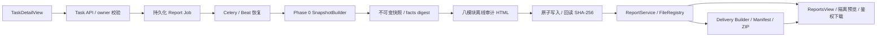
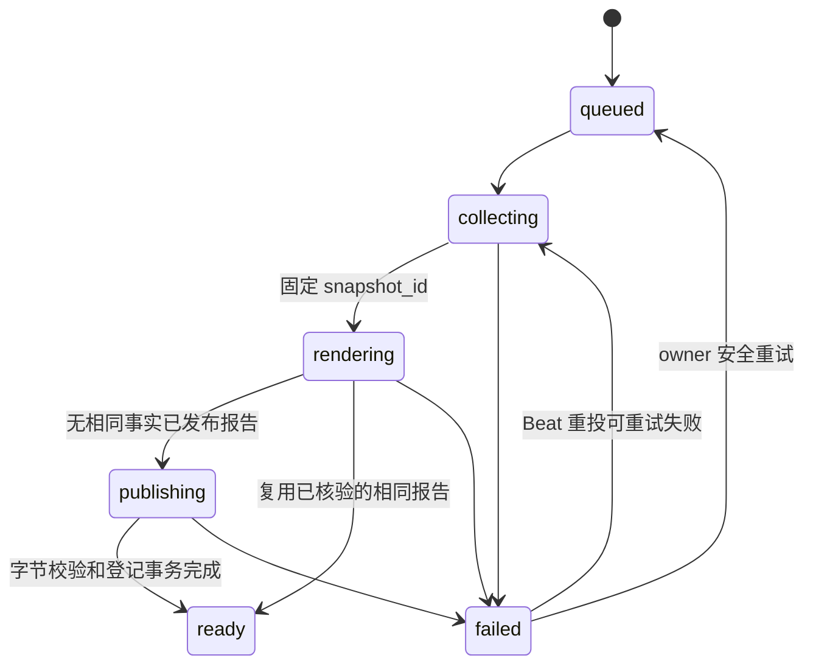
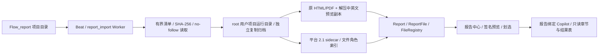

# CygnusX 报告中心与可复现执行证据报告

> 活动 as-built 基线。代码接入已实现；真实 RNA-seq / PostgreSQL / Celery / 对象存储部署验收仍未完成。验证与实施时点见 `docs/audits/reproducible-report-phase1-implementation.md`。

## 模块作用与架构

既有 RNAFlow / BioReport 科学报告保留。新增 `report_kind=reproducibility` 的独立执行证据交付物使用同一 `reports`、`report_files`、ReportsView 和下载 API，不替代科学结果渲染，也不调用分析执行器。Phase 2 增加 `report_kind=delivery`，将科学报告、执行证据报告和冻结快照整理为 owner-only 交付包。

| 边界 | 实现 |
|---|---|
| 协议、摘要、冻结 | `application/schemas/report_snapshot.py` |
| 来源、局部读文件、RNA ARDP 投影 | `report_snapshot_sources.py`、`report_snapshot_manifest.py`、`report_snapshot_builder.py` |
| 请求、去重、状态用例 | `application/services/reproducible_report_service.py` |
| 八模块 HTML、固定模板版本 | `application/services/report_audit_renderer.py` |
| 本地 FD 原子发布 / 对象存储适配 | `application/services/report_archive.py` |
| 报告登记、版本、预览、下载 | `application/services/report_service.py`、`infrastructure/database/repositories/report_repository.py` |
| ORM、迁移 | `infrastructure/database/models/report.py`、`alembic/versions/reportauditphase1_add_reproducible_report_tables.py` |
| 异步、锁、恢复扫描 | `infrastructure/celery_app/tasks/reports.py`、`celery_app/celery.py` |
| UI、轮询、鉴权下载 | `TaskDetailView.vue`、`ReportsView.vue`、`ReportViewerView.vue`、`useReproducibleReport.ts`、`api/report.ts`；旧 `ReportPreviewModal.vue` 保留静态隔离组件 |
| BioReport 受控渲染 | `application/services/bioreport_adapter.py`；HTML 可复用，科学 PDF 使用固定 CLI 合约，AI 明确关闭 |
| 审计 PDF | `application/services/report_audit_pdf_renderer.py`；冻结审计 HTML 经 Pandoc/Typst 转换，按 SHA-256 登记为第二个 ReportFile |
| 科研交付包 | `application/schemas/report_delivery.py`、`research_delivery_service.py`、`ReportService.build_delivery_package` |

## 身份与授权

只接受 RNA-seq 已结束的 Task（success / completed / failed / cancelled），查询先限定 `Task.user_id`。身份仍以 Task 为主；Run 可以缺失，指定 Run 则要求同 owner、同 Task、同 flow、有 confirmed_at。未指定 Run 的自动关联仅通过 Run.task_id；不按目录、名称或时间猜测。

鉴权依赖的用户 ID 为字符串，用例在边界归一为 UUID。任务没有通用可信 project_id，所以项目成员资格不能绕过 owner 约束；首版不开放团队或公开报告。FileRecord 必须同 owner、personal、显式 Task 关联。快照 API 同时 join 仍存在的 Report，并校验快照 owner / Task / Run / digest。删除 Report 后快照不可从旧 Report ID 访问，归档快照本体不覆盖。

客户端只能指定 Task / 可选 Run / 可选 UUID 请求键，不能传入服务器路径。导出的文件路径为安全引用；审计 ReportFile DTO 使用 `output/index.html`，不泄露存储根。

## Job 状态、幂等和恢复

Job 与分析 Task 的状态、时间和失败完全独立，保存 evidence_partial、snapshot_id、report_id、error_code、error_message、retryable、attempt_count、finished_at、template_version、archive_path。阶段不是百分比。

1. API 在 owner-scoped Task 行上 FOR UPDATE，复用同模板仍在生成中的 Job；部分唯一索引作数据库兜底。可选 `Idempotency-Key: UUID` 在 owner / Task / Run / 模板范围内绑定同一请求。
2. 已结束后不带请求键的新请求会重新采集，避免仅用 Task.updated_at 忽略新磁盘证据。最终按 `(owner, Task, snapshot_digest)` 复用快照，再按 `(owner, snapshot_id, template_version)` 复用已发布 Report。
3. 新事实或模板可创建新报告版本，通过已有 parent_id / version 树保存；不会替换原报告文件。
4. worker 用专属、无池连接持有 `pg_try_advisory_lock(hash(Task ID))`，覆盖状态提交、取证和发布；竞争投递返回 busy。锁不会随状态 commit 丢失，也不会带锁归还池。进程结束后 PostgreSQL 释放连接锁。
5. 先提交 Job 再尽力投递。Job queued 行作为持久 outbox；Beat 每分钟扫描 queued、超时活跃、可重试失败，以修复 commit 后崩溃、broker 暂不可用、worker 丢失。重复扫描仍受同一个 Task 锁保护。
6. 默认采集/交付预算 600 秒、最多 3 次尝试、每轮扫描 100 行；Settings 控制预算与扫描间隔。旧失败如果已有新活跃 Job，恢复等待新 Job 结束，避免违反活跃唯一约束。
7. 权限、身份冲突、协议/摘要损坏为不可自动重试；存储、超时、DBAPI 暂时错误可重试。返回固定错误码/信息，不回传原异常、凭据、路径。原 Task 状态不改变。

Celery 投递成功或 Celery task SUCCESS 不能代替 Job ready。应用错误可由 worker写入 failed 后返回；消费者必须以数据库 Job 状态判断。Beat 只重投审计 Job，不重跑 RNA 分析。

## 快照与历史事实

数据库证据采集使用 REPEATABLE READ READ ONLY 事务；冻结后结束读取事务再持久化。跨数据库和文件系统没有共同原子快照：有采集窗口、水位、当前字节指纹以及改写检测，不能宣称执行时取证或可信时间戳。

快照 JSON、schema/redaction/digest 版本、来源、时钟、水位均保存。ORM 禁止更新，PostgreSQL BEFORE UPDATE trigger 禁止原地修改；重试引用原 snapshot_id，不因新证据改变已冻结报告。内容摘要 stable_facts.v1 排除采集/生成时间等瞬态元数据，保留身份、事实、来源水位和状态；不是签名。兼容旧快照没有的 optional display_name：空值不进入事实摘要。

owner_allowlist.v2 不输出原始参数文本、日志、命令、请求、Prompt 或凭据。名称只允许有界 Unicode 展示标签（支持中文）；路径、长令牌或凭据状名称被省略，并标明脱敏/未记录。历史环境缺失不回填当前配置或 Flow 版本；科学报告原有 catalog 行为不改变，新审计报告 flow_version 保持空，历史声明在正文以证据状态呈现。

六状态为 verified / not_recorded / unavailable / not_applicable / verification_failed / estimated。verified 只代表注明范围的观察，不代表 QC 通过或复现成功。证据缺口允许生成报告，并令 evidence_partial=true。

读文件授权后使用逐级目录 FD、O_NOFOLLOW、普通文件校验，拒绝链接竞争、FIFO 等特殊文件。流式哈希检查前后 fstat，受时间和总字节预算（默认 16 GiB）约束；超预算为 unavailable。数据库 FileRecord 最多 2000、RunEvent 最多 1000，清单最多 4 MiB / 2000 条；截断显式留缺口。不扫描其他用户目录。

## 发布、归档和下载

通过 StoragePathFactory.create_project_run_dir 创建独立 `projects/<安全项目>/runs/audit-report-<UTC>[-序号]/output/index.html`。它是报告归档运行目录，不是新科研计算。可信项目标识缺失时使用 RNA-seq 报告归档分类，不将其当成原执行项目事实。新路径不包含任务 UUID，不写 legacy tasks 目录。

archive_path 在写入前提交，便于中断恢复。本地发布在 pinned 目录 FD 下写临时文件、fsync、原子 replace、目录 fsync；对象存储走 StorageBackend.write_stream 完成后回读。校验长度和 SHA-256 后，ReportService 在同一个事务内登记目录链、FileRecord、Report、ReportFile，Job 最后 ready。登记失败保留 private 未登记文件与冻结快照，下一次修复发布；没有 DB / 对象存储分布式事务，也没有自动公开分享。

审计 FileRecord source=report、Task 外键留空；Task 关联由 Report.task_id 保存。这样审计报告不会反过来进入自己的分析取证文件集，避免每次生成都因上一份报告产生新摘要。ReportFile 保存 SHA-256；报告预览、下载、事实去重重用都复核字节。已发布文件丢失/改写返回不可用或完整性错误，不静默改写历史报告。删除仅删除报告记录，沿用现有规则；快照和底层文件不覆盖，孤立归档/目录的自动 GC 未引入。

审计下载通过原 reports/files API 返回校验后的字节和 attachment，不让 FileResponse 在校验后再次打开可被替换的路径。原有科学报告本地 FileResponse 路径保留。对象存储输出适配已接入；历史 RNA 证据读取仍只支持本地，远程产物标 unavailable。

Phase 2 交付构建复核科学报告和执行证据文件，生成 `Scientific_Report.*`、`Reproducibility_Record.*`、`ReportSnapshot.json`、`README.md`、`EvidenceManifest.json`、`checksums.sha256` 和 ZIP。缺失文件显式标记 `partial`，不生成空占位文件。Manifest 自身和 checksums 文件不纳入自身哈希列表，以避免自引用循环；验证器仍校验 Manifest 中所有可用文件。

## 前端和 HTML 安全

TaskDetailView 一次请求后按阶段轮询；请求结束后导航到指定 Report ID，ReportsView 的旧 `?reportId=` 链接通过详情校验后进入 `/reports/:reportId/view`。轮询使用递归 setTimeout，避免重叠；暂时查询失败自动重试，权限拒绝停止，离页/切换 Task 使旧回调失效，sessionStorage 保存 Job ID 便于刷新后恢复。生成失败显示固定原因，可重试失败按钮复用原 Job。后台 Job 不依赖页面存活。

ReportsView 和卡片展示执行证据类型、报告版本、模板、证据缺口；可按 Task ID 筛选。下载使用统一 axios Bearer 鉴权。P1 新查看页挂 DefaultLayout，保留顶栏/侧栏、标题、流程、状态、生成时间、收藏、下载及打开同一平台查看路由的新窗口操作；列表拦截过期/未完成报告，直达页再次校验。交付 ZIP 保持下载语义。旧 `/{id}/preview` 文本 API 与空 sandbox 的 ReportPreviewModal 组件保留兼容；列表新入口改走以下受控预览链。

### 报告查看页 P1（代码及隔离验证，真实报告人工验收待完成）

`GET /api/v1/reports/{id}/preview-url` 只接受已登录的活跃 JWT 用户，通过 `ReportService.preview_html(strict=True)` 校验报告状态、归属、文件存在/完整性与大小后签发短时 report-only URL。短时效为 `REPORT_PREVIEW_TTL_SECONDS`（默认 300，30–900 秒），同时不得超过原 access token 的有效期。访问 URL 不是公开分享能力。

客户端用 `utils/reportPreviewSession.ts` 创建 256-bit 随机登录上下文 nonce（SameSite=Strict、HTTPS 下 Secure、Path=/）；签发端设置单独的 HttpOnly 预览会话 cookie（Path=/api/v1/reports，同样 Strict/Secure）。URL 和会话是不同 type 的签名，绑定 user_id/token_version/nonce 摘要，URL 另绑定 report_id 与随机加载通道。nonce 单独不是凭证；URL、HttpOnly 会话、nonce 必须同时匹配。新登录、退出及自动认证清理同步删除 nonce；旧会话 cookie 即使尚未过期，也不能单独继续访问。普通 Bearer/API Key 认证没有改为通用 cookie 认证。

AuthMiddleware 仅对 GET + 精确 UUID `/{id}/preview-content` 校验这些凭证并在 ModuleGate 前注入身份；其他路径不接受预览凭证。HTML 端点再次校验凭证、数据库中 active/token_version、动态模块注册表权限和 ReportService 的 owner/可选科研 scope。更改 ID、只复制 URL、删除/过期、禁用用户或撤销版本均拒绝。响应为 no-store/no-referrer/nosniff，且有响应级 CSP sandbox，不提供裸静态目录。

预览响应由 `report_preview_renderer.py` 生成受控外壳，原报告只进入嵌套 srcdoc iframe，不改写归档 HTML/SHA 或冻结快照。外壳及科学报告均没有 allow-same-origin/顶层导航/弹窗权限；CSP 禁止网络请求、远程资源、表单和对象。科学报告的内层只允许脚本，执行证据报告内层仍为空 sandbox；后者只有可信外壳的加载桥执行，不开放报告自身脚本。

ReportViewerView 只在收到当前外层 iframe、opaque origin、report ID 和随机通道均匹配的加载消息后退出加载态；onload 本身不证明成功。错误响应可发送有界 HTTP 状态，失联/鉴权拦截有 30 秒超时、重试和鉴权下载兜底。切换路由或退出使迟到请求/消息失效。新窗口只打开平台路由，不直接打开 HTML/Blob URL。

strict 读取复用无链接跟随的归档 FD 读法，并保留登记的词法路径以拒绝文件/父目录软链替换；`REPORT_PREVIEW_MAX_BYTES` 默认 32MiB（上限 128MiB），有 stat 检查及实际有界读取，超限提示下载。原预览 API 的兼容行为不改变。

新增 ASGI 验证使用真实 SQLite、合成文件、真实 AuthMiddleware/JWT 和报告服务；Chromium 验证使用实际 Vue 外壳、隔离 API 及合成可交互 HTML。已证明合成页签可切换、父页面读取/出网被阻断、URL 单独复制和退出失效；未证明真实三类 BioReport、生产代理/HTTPS、S3 或人工阶段验收。全仓后端门禁尚有其他域失败，不标为全绿。完整命令/结果见 [P1 施工记录](../docs/implementation/cygnusx-report-viewer-p1.md)。

### 报告 Copilot P2（代码及隔离验证，真实工作流人工验收待完成）

报告查看页接入可收起、可调宽的 Copilot 侧栏，按 report ID 保存普通 Chat 会话历史。专用会话创建只接受当前用户已完成的非交付报告，绑定关系存于 ChatSession `sandbox_meta.report_copilot`；每次流请求和工具执行均重新校验用户、活跃会话、报告归属及 Task 归属。普通聊天运行时对该绑定会话强制覆盖为三项只读工具 `read_report_section`、`list_artifacts`、`query_project_results`，关闭联网、MCP、代码执行、多 Agent 与其他能力。结果查询仅接受该 Task 已登记的 CSV/TSV，限制文件大小、行数、过滤列和字段长度；项目 ID 只从服务端已核验的数据集关联派生，无关联时降级到报告 Task scope。章节跳转通过查看页预览副本中的双层 `postMessage` 桥，不修改报告归档字节。

报告元数据以 `report.paths.json` 为源：平台注册阶段读取 2.0/2.1 sidecar，将新报告绑定到 Report/Task/owner 并升级为 schema 2.1；数据库保存身份、项目、统计、富集摘要及文件索引。Copilot 创建快照时校验 2.1 sidecar 与登记记录，旧 2.0 报告使用持久化 Task/文件索引并标记 `legacy_degraded`。`query_project_results` 和 `list_artifacts` 只查询登记文件及 role 索引，不在请求时遍历目录。存量盘点/回填由 `scripts/backfill_report_paths_registry.py` 输出 success/failed/manual 清单；当前仅实现脚本，未对真实报告目录或数据库执行。前端报告路由已无 mock 数据源引用。SQLite 合成隔离测试通过不代表真实 LLM 工具循环、三类生产报告数据正确性或人工验收已完成。P3 沙箱执行未接入。实现边界与验证记录见 [报告路径索引 2.1 实施记录](../docs/implementation/cygnusx-report-paths-schema-2.1.md) 和 [P2 施工与验证记录](../docs/implementation/cygnusx-report-copilot-p2.md)。

HTML M1 概要、M2 输入环境、M3 时间线、M4 工具调用、M5 QC、M6 产物、M7 来源关系、M8 限制均由冻结快照渲染，有导航、响应式布局、明确状态、转义和 CSP，没有外部资源或脚本。未记录的输入指纹、QC 测量解释/阈值/豁免、工具调用均不补造；复现验证恒为 not_run。

### 外部 Flow 接入前的故障定位（历史核查）

2026-10-28 接入前对 `/data/omichub/Flow_report/X101SC26098749-Z01-J001` 只读核查：该目录当时未自动接入报告中心。原链路是 `analysis.py` 在平台 Task 完成后调用 `ReportService.create_report_from_task()` 登记，再由 ReportsView 查询数据库；刷新按钮仅重新请求列表和统计。当时没有消费 `Flow_report` 的目录监听器、启动扫描或定期导入任务。以下为修复前快照，修复后的当前实现见下一节。

- `backfill_report_paths_registry.py` 必须先匹配已经存在、同 owner 的 Report 和 Task；匹配不到写入 manual，不创建报告，也不是自动导入器。现有 Report 的 `task_id` 非空，不能用随机任务 ID 代替真实执行来源。
- 样本 `report.paths.json` 为 2.0.0，包含项目业务编号、client、物种和 15 个样本，但没有平台 owner/Task/Report 身份和 `platform.html_entry`。`client=jzhang` 不能自行当作平台授权身份。样本提供 `delivery_manifest.json`（旧构建机绝对路径映射），平台主登记路径读取的则是 `result_manifest.json`（结构化 ARDP 清单）；二者不等价。
- 当前存储根配置为 `/data/omichub`，样本虽在该根下，却不在 `users/<owner>/` 下。`ReportPathsRegistryService.register()` 和 2.1 Copilot 均要求 owner 存储域；仅增加 Docker 挂载或回填 Report 行不足以接通。外部目录需要经过明确归属、可信来源关联、受控归档与文件索引登记。
- 实际 HTML 为 85,887,929 字节，超过当前 `report_preview_max_bytes=33,554,432`。即使登记完成，strict 预览和 Copilot 章节读取仍会返回 `REPORT_TOO_LARGE`。它还是 gzip/base64 双语加载器：在 opaque-origin sandbox 中读取子 iframe 的 `contentDocument.querySelector` 会失败；划选事件不会从该正文自动冒泡到加载器，服务端 `_VisibleText` 也不能从压缩脚本提取正文。需要适配真实报告格式，不能只调大上限或放开 `allow-same-origin`。
- 已修复 `report_preview_renderer.py` 内层桥在 `const channel` 后缺少分号导致的 `SyntaxError`。新增 Node 执行回归覆盖划选、章节跳转和消息身份/长度拒绝；修复前新增用例失败，修复后通过。Chromium 在真实 CSP 下验证普通正文划选可转发；使用样本原始加载器脚本和缩小的合成 gzip 正文，复现 `Cannot read properties of null (reading 'querySelector')`。这不代表完整 82 MiB 报告、生产部署或真实 LLM 已验收。

本轮专项后端 39 个用例、前端 13 个用例及变更文件 Ruff/mypy 通过；交付审计另有存量 `multiqc.log` 缺失，相关用例 xfail。浏览器证据及最小复现位于 `/tmp/omichub-report-breakpoint/`，交付物审计位于 `/tmp/flow_report_test/`。最初核查时平台 API/数据库未启动；后续运行状态发生变化，以下记录来自真实容器和只读数据库查询，未执行导入、更改源交付文件或重启应用。

2026-10-28 20:28 运行核验：`8888/health` 返回 200，版本 `b7482e6f`；Web 已将宿主 `/data/omichub` 挂载到同名路径，容器能读取该交付目录，预览上限仍为 32 MiB。数据库共有 159 条 Report、16 条 ReportFile；137 条带编号的演示报告全部没有 ReportFile。截图中的 `#031/#051/#061/#121` 标题逐条匹配且文件数均为 0；没有 ReportFile 路径或 Task 的 work_dir/result_path 匹配 `Flow_report` 或该项目编号。用户 `root` 为管理员且持有全部现有报告，另有普通用户 `JZHANG`；不能仅凭 client 或当前列表自行决定新交付的归属。

在 Web 容器执行现有回填脚本 dry-run，并以 asyncpg `default_transaction_read_only=on` 约束数据库连接，结果为 success=0、failed=0、manual=1，理由是无法匹配 owner-scoped Report 和 Task。清单位于容器 `/tmp/flow-report-registry-audit/`。双语正文实际解压大小为中文 83,509,021 字节、英文 81,752,833 字节，因此仅去除压缩加载器也不能满足当前 32 MiB 限制。源码桥接修复在 bind mount 上可见；长驻 Uvicorn 进程是否已加载该修复尚未验证，未将磁盘可见等同于部署完成。

完整真实文件（SHA-256 `3bebc871b1bf9fd8985102294928929ff70f8f0fa55aca225b5fc7cd14ac3a3d`）已在隔离 Chromium/HTTP fixture 中复现原加载器失败。进一步将解压的完整中文正文交给同一 renderer/CSP：可找到标题，但 data: 脚本/样式及 blob: 动态模块被当前 CSP 拒绝，报告脚本还因 localStorage 的 opaque-origin 限制报错；划选转发未通过，不能把该试验记为可用预览。完整结果在 `/tmp/omichub-report-breakpoint/full-browser-results.json`，复现脚本同目录。该验证绕过文件大小和业务身份门禁，仅用于定位格式兼容问题，不代表鉴权 API、生产页面、图表或真实 LLM 已验收。后续适配须保持原归档不变，并分别验证格式解包、资源加载、隔离、章节读取与划选链路。

### 外部 Flow 交付自动导入（当前实现）

用户明确指定归属 `root` 后，新增 `FlowReportImportService`，以 `Settings.flow_report_import_*` 控制启用、用户名、源目录、间隔及预算。默认关闭、owner 为空；本机 `.env` 已显式启用并设 owner=root，默认源目录从 `StoragePathFactory.data_root / Flow_report` 派生。识别源根下含 `report.paths.json` 的直接子项目，每 60 秒由 Beat 投递到独立 `report_import` 队列，`report-importer` 服务复用已有 Beat 镜像、独立单并发 Celery Worker。已有分析 Worker 未重启。扫描持有专属 PostgreSQL session advisory lock，覆盖提交；单项目失败回滚并继续处理其他项目。

迁移 `flowreportimport01` 已应用本机业务库。Report 增加 `external_source_key/digest`，唯一约束为 owner/key/digest；数据库 CHECK 仅允许带外部来源的 scientific 报告省略 task_id，原 Task 源、执行证据和交付包不通过伪造 Task 接入。DTO/前端显式区分 source_kind=external；无 Task 的外部报告不能伪装平台执行证据或生成 Task-first 交付包。报告优化 Context Pack 的 run_id 为 null，不填写随机执行身份。

每个项目按真实文件字节计算摘要，拒绝链接、特殊文件、路径穿越、源文件读写竞争；默认最多 2000 文件/2 GiB。无变化不重复登记，新摘要建立版本树。归档由 `create_project_run_dir()` 创建，复制到 owner 项目的 output，目录链及文件通过统一 Registry 登记；源目录、原 HTML/PDF、旧版本均不覆盖。平台绑定保存于独立 `.cygnusx-report.paths.json`，保留原 2.0 JSON；external sidecar 的 task_id=null、source_kind/key 必须与 Report 匹配，Copilot 仅接受当前 owner 的已登记索引，不扫描外部源目录，也不把业务项目编号当成已验证的平台 Project 身份。

BioReport 双语 gzip/base64 仅在导入时有界解包，原加载器不在平台执行，原始 HTML 仍可下载。中文/英文预览分别登记 SHA-256，外部预览预算默认 128 MiB、加载超时 120 秒；原普通报告仍为 32 MiB/30 秒。预览语言经 Literal 参数校验并写入签名 grant，页面语言选择器和原报告语言按钮都走平台鉴权 URL。外部 CSP 额外允许内嵌 data:/blob: 脚本/样式，仍无 allow-same-origin、HTTP 出网、表单或顶层导航；Quarto storage 使用当前文档内存替身，不访问平台持久存储。划选桥提前注入 head，避免复杂报告尾部内容吞掉桥脚本；Copilot 首次挂载立即接收选区草稿。

本机真实验证：Report `c53da70c-b357-4989-a004-f3c85e96b0a4` 归属 root，状态 completed，15 样本、124 个源文件索引；首轮定时任务 imported=1，后续多轮 unchanged=1。PostgreSQL schema drift 检查通过。Chromium 使用实际 8888 入口、生产前端构建、真实 JWT/签名预览/数据库及完整交付文件，已验证列表显示、正文加载、划选预填、报告绑定会话、真实 SSE/LLM 回复、章节读取和原生中英文切换，相关 API 无失败响应。证据位于 `/tmp/omichub-report-breakpoint/live-results.json`、`root-live-copilot.png`、`root-live-ai-answer.png`；测试凭据另存私有临时文件，不进入证据/提交。验证不代表科学结论已认证，也不宣称所有嵌入图表/表格组件均通过。

完整页面对照还发现 Quarto/DataTables 的序列化回调需要动态求值：原始 HTML 直接加载无错误，受限预览在缺少 eval 支持时出现 `c.apply is not a function`；仅对外部预览追加 unsafe-eval 后同一完整页面无错误。该兼容能力仍处于 opaque-origin sandbox，HTTP 出网/同源/表单限制不变，普通报告策略不变；对应完整文件对照证据为 `source-baseline-results.json` 与 `full-browser-eval-results.json`。这不开放任何平台 Agent 代码执行能力。

最终真实入口复验见 `/tmp/omichub-report-breakpoint/live-final-results.json` 与 `root-live-final.png`：3 个 DataTables 容器初始化、样本信息页导航正常，页面 JavaScript 错误为 0；读取父页面被阻断、匿名复制预览链接返回 403，原始 HTML Range 下载返回 206。源 HTML SHA-256 与接入前一致。此前 `live-results.json` 中的 c.apply 错误属于修复前记录，以 final/eval 对照为准；真实 LLM 只验证一次，后续兼容复验不重复调用模型。

专项验证：49 个后端报告/导入用例通过；57 个旧报告生命周期/交付用例在显式 `RESEARCH_DELIVERY_READ_ENABLED=false` 的隔离配置下通过（默认本机开关打开时有一个旧 fixture 缺失 User 的存量失败）；前端报告 14 个用例及 type-check/build 通过，变更域 Ruff/mypy 和迁移链检查通过。全仓 mypy 尚有其他域 983 个错误，不能宣称全量门禁全绿；未提交其他域脏文件。

### Copilot 结构化读取与显著性修复

2026-10-28，用户在同一 root 报告的只读会话请求提取火山图并解释显著基因/通路，出现“当前报告数据暂不可读取”、清单截断和章节读回目录。已用真实数据库/归档逐项复现；不是挂载或 owner 权限丢失：

- 角色索引按目录分类，`data/res/DEG/MD5.txt`、`Enrichments/MD5.txt` 也带 deg/enrichment 角色。原查询采用 role **或** basename 的首项匹配，先命中 MD5；完整相对路径又不能和 basename 相等，指定表格也无法可靠收窄。模型使用 diff_expr/enrichment_go 别名时同样无法匹配。
- DEG CSV 实际约 3.1 MB，超过原 2 MiB 整文件读取限额；QC 的 tab-delimited TXT 也被格式白名单拒绝。统一捕获再把所有参数/格式错误显示成“不可读取”，导致模型误判权限故障。
- 原章节算法在全页纯文本上找首次子串，首先匹配 TOC/导航；124 个条目的清单和元数据直接回灌模型，清单可能被上层上下文截断。`artifacts` 还被通用信封识别成“新生成产物”，实际只是既有文件。
- 元数据 GO-UP term_count=751 是输入行数；真实 `Salt_A_vs_WTSalt_GO_UP.csv` 中只有 30 行满足 p.adjust<0.05。原回答把条目总数当显著数、并从富集数量推断整体下调，缺少表格证据。

新增 `report_copilot_readers.py`：仅在已核验的当前报告索引内选择文件，完整路径优先、无精确路径时仅接受唯一 basename；角色和 artifact 同时收窄，支持受控别名，排除 checksum，多个比较组返回明确歧义错误。支持 CSV/TSV 和有表头的 QC tab-TXT，默认单文件最多 64 MiB、扫描 200000 行；有限数值筛选、绝对 fold-change 条件及数值排序以原始字符串返回值，不重算分析。Top-N 返回扫描/匹配/输出行数、具体阈值、排序列和截断标记，列与输出预算明确；NA/非有限数不作为显著证据。默认输出预算 10000 字符，正文预算 4000 字符，均走 Settings/env。

list_artifacts 支持 role/keyword/offset/limit，返回 items、next_offset、has_more；显式 generated=false，不再触发通用 artifact_manifest 的“生成”投影。旧消息中的清单属于历史记录，不改写。初始上下文只保留角色计数、少量文件示例和有界富集概要；input_term_count 标为未核验显著性，提示查询具体表。ReportSections 按真正的 h1–h6 正文边界索引，跳过导航、页眉、aside、脚本和样式，不按目录首次子串截取；歧义/未匹配返回可用标题。参数错误返回安全 code/修正建议，授权错误和未知故障分别处理，不回传服务器路径。

执行面仍是 report-bound chat_langgraph，仍然仅三项只读工具；LangGraph 分发只改该受限分支的错误投影。报告专用系统约束要求区分原始/校正 P、输入/显著条目数、各比较组与方向，不能把富集数量等同整体抑制。此入口没有绘图导出、代码执行或写回报告能力；重绘/优化应进入 Studio，不给 Copilot 放开沙箱权限。

真实验收：通过 8888 API 为该报告创建独立验证会话，实际 LLM 以 chat_langgraph 完成 6 次成功只读调用，无 SSE error；读到 Volcano 正文、DEG/GO_UP/KEGG_UP 实际表，DEG 在 padj<0.05 且 abs(log2FoldChange)>1 下为 4620/21989 行，GO-UP 在 p.adjust<0.05 下为 30/751 行，并返回对应基因、条目名及原始校正 P 值。列表的 artifact_manifest 为空；源表和旧报告未改动。初始摘要 5959 字符，受控请求 usage 为 23406 tokens；该请求不同于原失败请求，不作为同提示词性能对照。证据在 `/tmp/report-copilot-repair/live-events.json`、`live-results.json`，测试凭据另存私有临时文件并在验证后删除。

报告读取、导入、预览及 Chat golden 专项合计 80 个用例通过，新增读取模块 Ruff/mypy 通过。扩展 Chat/sandbox 回归有 34 通过/8 失败，涉及既有 seq 断言及 sandbox fixture 缺少 _db；选取两个失败在 HEAD 原始 Runtime 的独立进程中再次复现，未修改共享源码或生产历史。Chat 两个大文件另有 68 个存量 mypy 错误，未将本次专项通过表述为全仓门禁通过。相关日志在 `/tmp/report-copilot-*.log`。

## 验证边界

Phase 0 回归、离线 HTML、安全、生命周期、去重、发布失败恢复、ASGI 请求到下载与前端轮询/隔离测试已建立。Phase 2 增加交付包缺口、Manifest、ZIP slip、篡改拒绝和大小/数量上限测试。隔离集成使用 SQLite 和合成 RNA 目录；不证明真实 PostgreSQL 行锁、现场 Celery 投递、S3、BioReport 生产镜像、真实 RNA 结果或浏览器手工 E2E。

`tests/integration/test_reproducible_report_postgres.py` 仅使用显式 CYGNUSX_REPORT_TEST_DATABASE_URL，数据库名必须以 report_test 开头，创建并清理随机 test schema；验证迁移触发器、并发唯一约束、跨 commit advisory lock。无授权测试 DSN 时明确跳过，不读取生产 DATABASE_URL。上线前须执行授权 PostgreSQL / broker / 存储检查、迁移及真实成功 Task 的交付验收；不得用模拟数据代替。

## Phase 2 交付边界

本地 BioReport 核验版本为 `2.0.0`，源码提交 `cb2911a`；当前未核验 CygnusX 生产 BioReport 镜像 digest。`BioReportAdapter` 接受受控 JSON/YAML 配置，固定 single layout，禁用 AI module，不注入平台凭据。HTML 可复用已登记科学报告；交付构建仅在存在 owner 配置且渲染器可用时尝试科学 PDF，失败则保留 HTML 并标记 partial。审计 PDF 使用冻结 HTML 的 Pandoc/Typst 转换，不重新采集事实。

`POST /api/v1/reports/{report_id}/delivery` 可以从科学报告或执行证据报告发起；科学报告入口会查找同一 owner/Task 的最新执行证据报告，并用其冻结快照绑定交付包。重复请求复用同一 delivery 记录。未发现 Phase 1.5 live-validation 审计记录；真实 RNA Task、PostgreSQL、Celery、对象存储、BioReport PDF、ZIP 下载和浏览器闭环仍需授权环境验收。

## 受保护的 Dataset 科研交付扩展

Phase4 增加可选 ResultObservation 关联和 Snapshot.research_delivery；无扩展字段的历史快照保持原 digest。Counts 可在受保护路径排独立科学 BioReport job 和执行证据 job，继续复用本报告中心与队列；科学模板只展示完成结果，渲染失败不重跑计算。Report 读取/发布在开关启用时复核当前项目权限。默认主路径与旧 API 保留，新增运行能力仍 BLOCKED，详见 [科研交付架构](CygnusX_research_delivery_architecture.md)。

## RI04 单任务交付角色与校验修复

`ReportService.build_delivery_package`现按实际report_kind分别查询同owner/Task、已发布且适用观察/时间范围的科学与执行证据报告；实际Task校验及行锁在打包前执行。证据入口不再将自己命名为Scientific_Report。显式快照/观察冲突拒绝；缺科学/证据/PDF标partial，不触发分析。修复模板为delivery-v1.1.0，避免复用旧错误角色包，旧包/快照不覆盖。

没有冻结快照时只交付实际存在的报告和缺口，不创建假快照：EvidenceManifest使用cygnusx.evidence_manifest.v1.1、snapshot_id/digest=null；有快照的包保留v1格式。验证器支持两版，严格校验成员唯一/路径/链接/数量/展开大小、Manifest列出文件与缺失状态、checksums一致性和额外成员；不是外来科研归档执行器。

SQLite+真实ReportService/临时文件覆盖双入口、缺失、版本、权限、摘要、幂等、ZIP异常及不重算；真实PG锁/存储/浏览器下载仍未认证。证据与回滚见`docs/implementation/cygnusx-research-lifecycle-ri01-ri04-implementation.md`。

### RI13 新执行证据的报告投影

对包含合法 `_execution_evidence` 的新Task，ResearchProvenance.runtime包含definition_digest、execution_binding_digest及前后观察，原ResultObservation捕获这一投影。ReportSnapshotBuilder对新捕获增加对应摘要事实和未观察环境缺口；旧无证据Task不做当前环境回填，已冻结快照和digest不改写。Manifest v1/v1.1及缺失partial语义保持。这里证明的是关联和时点采集，不是发布包/镜像/工具/参考已认证或历史复现成功。

### 项目科研成果导出 RI06–RI09（代码/隔离层）

ProjectDetailView新增ProjectResearchDelivery卡片，复用既有报告、快照和只读Provenance；独立ProjectExportJob整理已有成果，不触发报告生成或计算。默认证据包，小型结果及复现材料明确选择；缺口partial、当前权限、冻结摘要、真实Job状态及下载SHA分开显示。默认关闭project_export_enabled，真实环境/浏览器未验收。完整现状、关联/容量/授权边界和恢复设计以[科研交付架构](CygnusX_research_delivery_architecture.md)的RI06–RI09节为准。

### RI10追溯与项目综合报告只读原型

现有ClaimService的DEG单元格读取已增加显式Report/Snapshot/Observation/定义/Version只读追溯投影；数值核验与自由文本解释分层，旧报告缺失历史关联不取最新记录补齐。界面入口复用项目成果卡片，旧报告及快照字节不改。

report_audit_renderer现有HTML/CSP/表格/样式被用于项目Manifest的14章只读原型，summary-preview不创建Report或生成Job，不生成PDF，不修改Frozen Manifest/旧ZIP；不能当作正式Project Scientific Summary。原Task-first Report/Job模型的非空Task约束仍存在，正式项目源须先评审兼容契约和迁移，禁止伪造Task。详见[科研交付架构](CygnusX_research_delivery_architecture.md)和`docs/design/cygnusx-project-scientific-summary-report.md`。真实运行验收仍BLOCKED。

### RI095 正式项目报告增量（代码与隔离层）

原 summary-preview 保持 prototype。新增独立 ProjectReportJob 身份绑定冻结 M0 与服务端核验的 Claim selection；Task Report／GenerationJob／Snapshot 的非空 Task 身份不变。ReportFile 追加 project_report_job_id，与 report_id 用 XOR CHECK 互斥，继续复用 ReportService／FileRegistry／StoragePathFactory／原子发布。追加 projectreport01 迁移尚未应用业务库。

scientific-summary 的 Prepare 只读，Create 需人类 JWT；独立 outbox／Celery／reconcile，发布真实 HTML 后 ready，下载复核当前授权、登记和字节。固定 14 章项目模板经 BioReportAdapter 静态边界；可选 PDF 复用原 Pandoc／Typst 转换器，默认关闭且失败保留 HTML。renderer_runtime=NOT_OBSERVED，真实渲染镜像、PG／Worker／浏览器准入 BLOCKED。M1 使用显式 project_delivery.v2，引用 M0 digest 和报告产物，不改旧 v1／ZIP。详见 docs/implementation/cygnusx-ri095-project-scientific-report-phase1-4.md 与对应 ADR／运行门禁。
