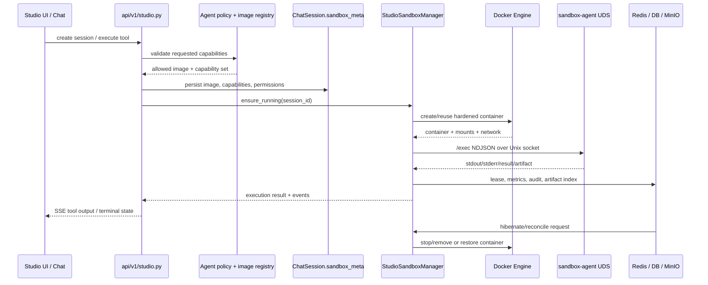
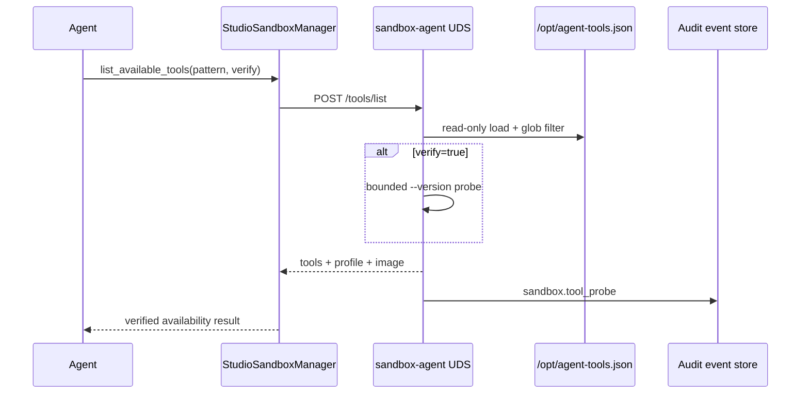

# CygnusX 沙箱增强架构（安全基线与 Capability 路由）

> **时点说明**：本文件为 2026-10-04 的 as-built 记录，所述实现以代码、配置和构建验证为准；生产 Docker/egress 验收状态见 8.8。

**版本**：v1.3
**日期**：2026-10-04
**状态**：阶段 0–2 代码已落地；六个分析运行时 profile 与 Agent 声明已同步；生产 Docker/egress 真机验收待执行；浏览器/文档工具待后续阶段实现；整改落地见 8.8。

## 这个沙箱模块如何发挥作用

沙箱模块把 Agent 的代码、文件、浏览器和文档操作限制在按会话创建的运行环境中。用户请求先经过 Agent 的 `features.studio.sandbox_capabilities` 和会话模式校验，平台据此选择能力集合最小匹配的镜像，并把实际镜像、能力、权限模式和工作区信息写入 `ChatSession.sandbox_meta`。客户端不能通过请求参数直接扩大能力，也不能访问宿主机 Docker 控制面。

`StudioSandboxManager` 负责容器的创建、预热、复用、重建、租约和休眠；容器内 `sandbox-agent` 只通过 `/workspace/.agent.sock` 接受执行和文件操作请求。创建时统一应用 UID/GID 10001、只读根、`cap_drop=ALL`、no-new-privileges、CPU/内存/PID/磁盘配额、受控挂载和网络策略；旧容器若不符合当前基线会被销毁重建。`/workspace` 是会话唯一写入面，用户数据按策略只读挂载，出站请求只能经过允许的代理路径。

执行结果、stdout/stderr、产物、环境探针、配额事件和生命周期审计回到 Chat/Studio 事件流及数据库/对象存储。普通 Chat 轻量沙箱池和 Studio 一会话一容器是两条隔离路径，二者共享安全原则但不共享容器、挂载或会话状态。该模块因此同时提供“能执行”的工作区和“可证明受限”的安全边界。

### 运行架构图：能力授权到受限容器

```mermaid
flowchart TB
    Request[Chat / Studio 请求] --> Policy[Agent features.studio\nsandbox_capabilities 授权]
    Policy --> Meta[ChatSession.sandbox_meta\nimage · capabilities · permissions]
    Meta --> Manager[StudioSandboxManager\n选择镜像 · 生命周期 · 租约]
    Manager --> Container[Studio Container\nUID 10001 · read-only rootfs\ncap_drop · CPU/Memory/PID quota]
    Container --> Agent[sandbox-agent\n/workspace/.agent.sock]
    Agent --> Workspace[/workspace\ninput · work · output]
    Container --> Mount[/data/platform\n当前用户只读挂载]
    Container --> Network[none / egress proxy\n域名白名单]
    Agent --> Events[stdout · artifacts · quota\nlifecycle audit events]
    Events --> Store[(PostgreSQL · Redis · MinIO)]
    Events --> UI[Studio / Chat SSE UI]
```

### 实现图：会话创建、容器执行与回收



## 1. 目标与边界

本设计在不替换现有 OmicStudio 编排体系的前提下，强化容器隔离，并引入由平台控制的运行能力（capability）到镜像的映射。它覆盖 Studio 会话沙箱；旧版 `/api/v1/sandbox` 继续保持兼容，不接入新的浏览器/文档能力。

目标：

- 每个 Studio 会话仍只有一个独立 Docker 容器和一个工作区。
- 普通数据分析继续使用代码能力镜像；浏览器和文档能力只能分配到独立镜像。
- 用户请求不能绕过 Agent 授权直接取得浏览器或文档能力。
- 容器默认使用硬 CPU、内存、PID、Linux capability 和只读根文件系统限制。
- 容器控制面仍为宿主经工作区 Unix Socket 连接 sandbox-agent；不对外发布 agent 端口，也不把平台密钥带入容器。

非目标：

- 本阶段不实现 Playwright 浏览器操作、LibreOffice 文档转换、noVNC 或容器内 MCP Server。
- 本阶段不把 Docker 容器宣传为 VM 级强隔离；不可信代码和高敏数据仍需要评估 gVisor、Kata 或 MicroVM。

## 2. 总体架构

```text
Vue Studio UI / Agent Chat
          │ JWT + Studio REST/SSE
          ▼
FastAPI Studio API ─── Agent policy (studio.sandbox_capabilities)
          │                         │
          │ creates session metadata │ rejects unauthorized escalation
          ▼                         ▼
ChatSession.sandbox_meta: {image, sandbox_capabilities}
          │
          ▼
StudioSandboxManager
  ├─ resolve configured image by requested capability set
  ├─ create/rebuild one container per session
  ├─ mount /workspace rw and /data/platform ro (current user only)
  ├─ communicate with sandbox-agent over /workspace/.agent.sock
  └─ keep activity and busy leases in Redis
          │
          ├── code → configured base/bio image
          └── code,browser,document → cygnusx-sandbox-browser-office
```

## 3. Capability 和镜像选择

### 3.1 运行能力

允许值固定为：`code`、`browser`、`document`。

- `code` 是基础能力，所有请求和所有镜像定义都会自动包含它。
- 浏览器或文档请求仅在 Agent 的 `features.studio.sandbox_capabilities` 明确授权时可创建。
- 未授权请求返回业务错误；客户端参数不能提升会话权限。

> 注意：当前代码在 Agent 未配置 `sandbox_capabilities` 时默认放行 `code`/`browser`/`document` 三种能力（`api/v1/studio.py` 创建会话处 `studio_cfg.get("sandbox_capabilities") or ["code", "browser", "document"]`），与本节"明确授权才可创建"的设计契约不一致，属待确认的实现偏差。
> **数据层面现状（2026-10-03 实勘）**：`data/ai/` 全部 Agent YAML 中 `sandbox_capabilities` 声明数为 **0**——所有 Agent 均未显式声明，实际全部走默认放行 `[code, browser, document]`。授权源机制存在但数据层未使用。
- `sandbox_meta.sandbox_capabilities` 专门保存运行时沙盒能力，不能和已有的 `sandbox_meta.capabilities` 混用；后者用于 MCP/Skill 的渐进加载状态。

### 3.2 配置

`data/ai/studio.yaml` 的 `studio.images` 定义可部署镜像：

```yaml
images:
  bio:
    image: cygnusx-sandbox-bio:v0.0.2dev
    capabilities: [code]
  browser-office:
    image: cygnusx-sandbox-browser-office:v0.0.2dev
    capabilities: [code, browser, document]
```

创建会话时，代码能力沿用 Agent 配置的 `studio.image` 或默认镜像；请求浏览器/文档能力时，平台选择覆盖请求能力且能力集合最小的已配置镜像。镜像配置缺失时拒绝创建，不回退到普通代码镜像。

## 4. 容器安全基线

`StudioSandboxManager.ensure_running()` 创建容器时设置：

| 控制项 | 当前设置 | 目的 |
| --- | --- | --- |
| CPU | `nano_cpus = cpu × 1_000_000_000` | 使用硬 CPU 上限，不再仅使用相对 `cpu_shares` |
| 内存 | `mem_limit` | 限制每会话内存 |
| PID | `pids_limit`，默认 512 | 限制 fork bomb 和进程滥用 |
| Linux capabilities | `cap_drop=["ALL"]` | 删除容器默认 capability |
| 特权提升 | `security_opt=["no-new-privileges:true"]` | 阻止 setuid/file capability 取得新权限 |
| Seccomp | 配置为 `default` 时 `_seccomp_security_opt("default")` 返回 `None`，不下发显式 `security_opt` 条目（`manager.py:73-86`） | Docker daemon 自动应用内置默认 profile，语义等价于 `seccomp=default`；`docker inspect` 看不到 `seccomp=default` 条目 |
| 运行用户 | `user=10001:10001`，镜像 `USER 10001` | sandbox-agent 和会话进程不以 root 运行 |
| 根文件系统 | 默认 `read_only=true` | 避免镜像层被会话代码篡改 |
| 临时写入 | `/tmp` tmpfs，默认 512 MiB，`nosuid,nodev,noexec` | 为 Chromium、LibreOffice 与临时文件保留受限可写空间 |
| 工作区 | `/workspace` 读写 bind mount | 唯一会话持久化写入面 |
| 平台数据 | `/data/platform` 只读、仅当前用户目录 | 防止跨租户读取和修改 |
| 网络 | 默认 `none`；可选 per-session internal network + egress proxy | 控制面不依赖网络，白名单模式必须由代理强制执行 |
| 工作区配额 | 默认 10 GiB；agent 30 秒统计并保护写操作 | 跨文件系统兜底方案；XFS project quota 可用时升级为硬配额 |

容器复用时会重新校验网络与安全基线。发现旧容器缺少硬 CPU、PID、只读根、`cap_drop=ALL` 或 `no-new-privileges` 时，管理器停止并删除它，然后以当前基线重建，避免旧容器绕过新策略。

### 4.1 统一运行身份与挂载目录授权

沙盒镜像、分析运行时镜像和聊天沙盒统一使用数值身份 `UID=10001`、`GID=10001`，
组名为 `cygnusx-sandbox`。镜像构建阶段负责创建该用户/组，并将镜像内的
`/workspace`、缓存目录和 agent 文件设置为 `10001:10001`；运行时注册表同步记录
`runtime_uid`、`runtime_gid` 和 `runtime_group`，供编排器和验收工具核对。

必须区分镜像层权限与挂载层权限：Docker bind mount、named volume 或 Kubernetes
volume 会覆盖镜像中的目录及属主，镜像 Dockerfile 中的 `chown` 对挂载源无效。因此，
`StudioSandboxManager`、`SandboxPool`、`ScratchVolumeManager` 以及其他运行时编排器在创建容器前都必须预创建并授权
挂载目录。`workspace/output`、日志和临时交付目录至少对 `cygnusx-sandbox` 组可写，
`workspace/input` 按数据策略只读；容器始终以 `10001:10001` 运行，不通过 root 运行时
修复权限。

Kubernetes 部署使用 `runAsUser: 10001`、`runAsGroup: 10001` 和适用的 `fsGroup: 10001`；
Docker host bind mount 则由宿主编排器在启动前执行 `chown 10001:10001` 或等价的组/ACL
授权。启动前写入探针必须检查实际 mount source、owner、group 和 mode，权限不符合时拒绝
执行并给出可定位的审计信息。该规则是防止 `/workspace/output`、`/tmp/chat_output`
出现 root:root、`0755` 导致 uid 10001 无法交付产物的必要基线。

挂载源路径必须同时被 Web 编排进程和 Docker daemon 看见。生产默认使用
`${STORAGE_PATH}/.sandbox-pool`（`SANDBOX_POOL_HOST_DIR`），而不是 Web 容器私有的
`/tmp`。若控制面在容器内创建了 daemon 不可见的 `/tmp/cygnusx-sandbox-*`，Docker 会
自动补建宿主源目录并赋予 `root:root 0755`，即使 sandbox 镜像内的用户和 `chown` 完全
正确，运行时仍会得到 `PermissionError`。

沙盒池收养旧 warm 容器时还必须重新检查 `/tmp/chat_output`、`/workspace/output` 和
`/workspace/input` 的实际 bind mount source。若 source 缺失、不是 `10001:10001` 且不可
组/其他用户写入，容器不得继续复用，必须销毁并按当前挂载契约重建。原因是 bind mount
会遮蔽镜像层目录，单独重建镜像无法修复已经运行容器中的 `root:root 0755` 挂载目录。

镜像构建使用 BuildKit cache mount 保留 conda package cache 和 pip cache；依赖层不应反复
执行 `mamba clean --all` 或关闭 pip cache，否则每次依赖变更都会重新下载大型科学计算包。

## 5. 独立 browser-office 镜像

`deploy/studio/browser-office.Dockerfile` 从生信镜像构建，额外提供 Chromium、Playwright、LibreOffice、`python-docx` 和 `python-pptx`。它只有在 capability 路由选择时才会启动；普通 Studio 会话不承担额外体积和浏览器攻击面。

镜像继续使用现有 sandbox-agent/UDS 启动方式。浏览器进程不得公开调试端口；实施 Playwright 工具时应由 agent 在容器内维护浏览器会话，并通过现有 UDS API 返回受限的文本、截图和产物。

构建命令：

```bash
bash deploy/studio/build.sh
```

该命令按顺序构建 base、bio、browser-office 三个镜像。部署前应将 `studio.images.*.image` 标签与实际推送的镜像标签同步。

Studio 三层 Dockerfile 的 pip 安装统一消费 `PIP_INDEX_URL`、`PIP_TIMEOUT`、
`PIP_RETRIES` 构建参数。默认阿里云源，`deploy/studio/build.sh` 仅在识别到 pip 安装进程的
下载网络/哈希错误时，切换 `PIP_FALLBACK_INDEX_URL`（默认清华）并从 base 重试整条链。每次尝试只用
一个源，继续保留 pip 哈希校验与 BuildKit 下载缓存；不会用 `extra-index-url` 混合选包。
任一备用源构建失败仍返回非零退出码。传入空的 `PIP_FALLBACK_INDEX_URL` 可禁用回退，
便于定位非 PyPI 构建错误；只执行 `docker build` 的调用方需自行控制重试。
Docker/BuildKit frontend、APT、依赖冲突和安装后的权限错误保持原退出码，不触发换源。
每层原始日志写入 `logs/studio-build/`（可用 `STUDIO_BUILD_LOG_DIR` 覆盖），主源和备用源
失败日志均保留，避免后一次错误掩盖首个错误。

```bash
# 指定源并禁止自动回退；不需要清空整个 Docker/pip 缓存
PIP_INDEX_URL=https://mirrors.aliyun.com/pypi/simple/ \
PIP_FALLBACK_INDEX_URL='' make docker-build-studio-sandboxes
```

2026-10-25 的 `matplotlib-venn` 构建错误中，实际哈希
`e3b0c44298fc1c149afbf4c8996fb92427ae41e4649b934ca495991b7852b855`
对应空文件，不应通过改预期哈希或关闭校验绕过。随后对三个源的相同 wheel 实测均为
33,191 字节，SHA-256 与日志预期一致；源故障可恢复，不能仅因稍后下载成功排除当时的空响应。

本轮先以隔离标签 `pipfix-9664dded` 完成三层实际 Docker 构建，再通过默认
`make docker-build-studio-sandboxes` 重建 `v0.0.2dev` 的三个镜像，未重启主栈。
生信镜像的 `pip check`、scanpy/anndata/pysam/bioinfokit/matplotlib-venn 导入、
sandbox-agent 导入及 samtools/bedtools/blast/seqkit 版本探针通过；browser-office 的
Playwright/docx/pptx 导入与 Chromium/LibreOffice 版本探针通过，两个镜像均以
`10001:10001`、只读根和禁网运行验证。相关 32 项单测、17 个镜像映射、19 个 Agent
运行时校验通过。构建失败停止、整链换源、禁止/重复备用源及备用源失败退出码均有离线回归。

重复失败的 BuildKit 历史记录进一步显示：阿里云下的 bio 层已成功，browser-office 的
首次失败发生在 Dockerfile frontend，错误为 `Unknown frontend grpc server closed unexpectedly`。
旧版控制脚本对任意构建错误都回退中科大，继而触发空 wheel 错误，掩盖了 frontend 原因；
现增加了非下载错误不得换源的回归，并将已重复出错的中科大源移出默认备用路径。

## 6. 后续阶段

1. **Browser MVP**：在 sandbox-agent 添加 URL 校验、导航、截图、点击和填写接口；所有调用先由 Studio 工具路由鉴权并写审计日志。
2. **Document MVP**：以 `python-docx`、`openpyxl`、`python-pptx` 生成文档，LibreOffice 仅用于受控 headless 转换；输入和输出必须限制在 `/workspace`。
3. **网络与审计验证**：以集成测试验证 `none` 模式无出站、白名单模式仅经代理访问允许域名，并记录会话、调用者、能力、工具、策略结果、资源峰值和回收原因。
4. **资源与运行时增强**：补充硬磁盘配额、OOM/清理告警、镜像签名/漏洞扫描；高风险场景评估更强隔离运行时。

## 7. 验收清单

- [x] Studio 配置可声明镜像、能力和安全参数。
- [x] capability 请求受 Agent 配置授权，未授权时拒绝。
- [x] 新容器带硬 CPU、内存、PID、cap drop、no-new-privileges、只读根和 `/tmp` tmpfs。
- [x] 不符合新基线的旧容器不会被复用。
- [x] browser-office 使用独立 Dockerfile 和构建目标。
- [x] 生命周期审计事件和 quota_exceeded 事件框架已接入。
- [ ] browser/document UDS 工具和前端面板。
- [ ] Docker 真机和白名单出口集成验证。

## 8. 安全施工版更新（2026-08-22）

本节记录《CygnusX沙箱安全加固实施手册_Codex施工版》的最新落地状态。

### 8.1 阶段 0：容器加固标准件

Studio 容器现在显式设置：

- `security_opt=["no-new-privileges:true"]`；seccomp 配置为 `default` 时 `_seccomp_security_opt("default")` 返回 `None`（`manager.py:73-86`），不下发显式条目，由 Docker daemon 自动应用内置默认 profile（语义等价，`docker inspect` 看不到 `seccomp=default` 条目）。
- `user=10001:10001`；镜像本身的 `USER 10001` 与编排参数双重约束。
- `nano_cpus`、`mem_limit`、`pids_limit`、`cap_drop=["ALL"]`、只读根文件系统和 `/tmp` tmpfs。
- 工作区创建时优先 `chown 10001:10001`，无权限时才退化为目录权限放宽，以保持本地开发环境可用。
- 容器复用时校验 `Config.User`、`HostConfig.SecurityOpt`、`ReadonlyRootfs`、`CapDrop`、`NanoCpus` 和 `PidsLimit`；不符合基线的旧容器会被停止、删除并重建。

**宿主探测结果**：当前执行环境无法访问 `/var/run/docker.sock`（Docker CLI 返回 `permission denied`），因此未能确认生产 daemon 的实际 `Storage Driver`、`SeccompProfile` 或运行中容器 `Config.User`。代码级默认值是显式 `seccomp=default` 与 `10001:10001`，生产验收仍必须执行手册中的 `docker inspect` 检查。

**browser-office 兼容结论**：本阶段不启用浏览器功能。Chromium/Playwright 在 Docker 默认 seccomp 下可能需要 `--no-sandbox` 或经审查的自定义 profile；当前独立镜像仅提供依赖，不代表浏览器工具已上线。后续 Browser MVP 必须单独验证这一点，禁止公开调试端口。

### 8.2 阶段 1：生命周期审计事件

新增 `src/cygnusx/infrastructure/studio/audit.py`，采用结构化 loguru 事件，不引入第二套数据库审计设施，也不让审计写入失败阻断主流程。事件字段通过 `event` 和 `component=studio_sandbox` 供日志采集器检索：

| 事件 | 已接入位置 | 关键字段 |
| --- | --- | --- |
| `sandbox.create` | 新容器创建成功 | 会话、用户、Agent、请求/授予能力、镜像、容器、CPU/内存/PID、网络模式 |
| `sandbox.rebuild` | 旧容器安全基线不符 | 会话、用户、Agent、能力、镜像、旧容器、重建原因 |
| `sandbox.capability_denied` | Studio 创建请求能力授权失败 | 用户、Agent、请求能力、允许能力、拒绝原因 |
| `sandbox.reuse` | 容器安全与网络校验通过 | 会话、容器、网络/CPU/PID/rootfs/capability/seccomp 基线结果 |
| `sandbox.reclaim` | `stop()` 实际删除容器 | 会话、容器名、回收原因、最近活跃时间、资源峰值占位 |
| `sandbox.quota_exceeded` | sandbox-agent 周期探测超过配额 | 当前使用量、配额；结构化 warning，不阻断 watcher |

### 8.3 阶段 2：工作区配额兜底

由于当前宿主 Docker daemon 不可访问，无法确认 `overlay2 + xfs pquota` 是否可用；本次采用跨文件系统可工作的 **方案 B**：

- `studio.sandbox.workspace_quota_bytes` 默认 10 GiB，设为 `0` 可关闭。
- `workspace_quota_check_interval_seconds` 默认 30 秒。
- Manager 将这两个参数注入容器环境变量。
- sandbox-agent 对工作区递归统计普通文件大小，后台 watcher 记录 `sandbox.quota_exceeded`；`write`、`mkdir`、`rename`、`edit` 等文件变更接口在超过配额时返回 HTTP 413 和 `code=quota_exceeded`。
- 删除大文件后下一次检查恢复正常写入。

该方案不能限制用户代码通过 `/exec` 直接写入文件时的瞬时增长，因此它是跨文件系统兜底而非内核硬配额。生产环境若确认 XFS project quota 可用，应优先增加 Docker/宿主硬配额，并保留 agent 检查作为第二层防线。

### 8.4 普通 AI 助手的执行归档边界（2026-09-22 as-built）

普通 AI 助手使用 `infrastructure/sandbox/pool.py` 的 warm pool，不复用 Studio 的一会话一容器工作区。为保留分析可追溯性，`chat_sandbox_execute` 在执行完成后将会话内容归档到项目 run 目录：

- `input/` 保存会话注入的输入文件副本；`work/` 保存每次执行的原始 Python/R/Bash 脚本；`output/` 保存会话累计产物。
- 平台生成 `README.md`、`environment.json`、`manifest.json`，格式复用 `project_archive_service.archive_run()`。
- 环境快照记录助手沙箱镜像、注册表 Profile/软件声明、容器内实际 Python 包版本、CPU/内存/PID、网络策略和容器 UID。
- `sandbox_meta.analysis_archive` 是会话级索引；文档同时登记到统一 `FileRegistry`，供消息产物窗口和会话管理下载。
- 归档失败必须是非阻塞 warning；代码执行结果、审批语义和 warm pool 回收不能因文档生成失败而改变。

该设计只扩展平台侧 provenance，不把普通助手升级成 Studio：普通助手仍没有 Studio 文件操作、持久化容器或 Studio 审批面板；复杂多文件分析仍应进入工作台。

### 8.5 隔离层升级触发条件

当业务形态变为“接受未认证输入生成任意代码”，或沙箱正式对外开放多租户不可信执行时，启动 gVisor `runsc`（OCI 运行时直接替换）评估；涉及高敏数据、浏览器下载或强对抗租户时，同时评估 Kata Containers/MicroVM。该条件应触发计划内迁移，而不是等到安全事件后应急响应。

### 8.6 当前验收状态

- [x] seccomp、固定非 root、硬 CPU、内存、PID、cap drop、no-new-privileges、只读 rootfs、tmpfs 已进入创建参数。
- [x] 工作区 uid 10001 权限处理已存在并保留。
- [x] 旧容器安全基线漂移检测和重建已接入。
- [x] capability 拒绝、创建、复用、重建、回收事件已接入代码路径。
- [x] 工作区配额配置、agent watcher 和写操作保护已接入。
- [ ] 生产 Docker inspect：daemon seccomp、存储驱动、实际用户和旧容器存量。
- [ ] Docker 真机 egress T1–T7：当前环境无 Docker daemon 权限，尚未执行。
- [ ] XFS project quota 可用性：需在生产宿主执行 `docker info` 与文件系统探测后决定是否升级为方案 A。

### 8.7 镜像与 Agent 声明对账修复（2026-10-01 as-built）

对 `deploy/runtime-images/`（core→plot→scrna）、`deploy/studio/`（base→bio→browser-office）、`deploy/sandbox/`（copilot）全部 Dockerfile/build.sh/image-mapping，19 个 Agent YAML 的 runtime_profile/capabilities、`shared/sandbox_protocol.md` 与各 prompt 的工具声明做了逐声明对账，并用本地新构建镜像 `docker run` 实测验证。工作目录与权限体系（uid 10001、`/workspace` 预建、`/workspace/.agent.sock`）完全对齐；差异项已按 P0/P1/P2 全部修复：

| 级别 | 问题 | 修复 |
| --- | --- | --- |
| P0 | `analysis-scrna` 镜像未安装 Agent 声明的 Scanpy/Seurat 栈 | `scrna.Dockerfile` 补装 scanpy 1.10.4 / anndata 0.11.1 / leidenalg / python-igraph / r-seurat 5.5.1 / bioconductor-singlecellexperiment 1.28.0，并加构建期 import/library 强制校验层。关键坑：micromamba 不执行 conda post-link，须显式 `RUN PREFIX=/opt/conda micromamba run -n base installBiocDataPackage.sh genomeinfodbdata-1.2.13`（随包 tarball 是 0 字节占位符）。`data/ai/runtime_images.yaml` 声明同步改为 5.5.1/1.28.0（原声明 5.1.0/1.28.1 无 r44 构建） |
| P0 | 共享沙箱协议教 Agent `micromamba install` 现场装包，但 Studio 只读 rootfs + network none 使其必然失败 | `sandbox_protocol.md` 重写"现场装包"为"只读不支持装包 + 缺包上报流程"；同类漂移清扫：`bio_packages.md`（表头 + 81 处 install 指令改为 `channel/包名` 坐标）、`prompts/skills/index.md`、`prompts/skills/wrapper.md`、`prompts/visualization.md`、`prompts/scrna.md` |
| P1 | `agent-code` prompt 声明的 NGS CLI（samtools 等）在目标镜像 analysis-core 中不存在 | `prompts/code.md` 改为"默认无 NGS CLI，先查能力目录，不具备则如实转交" |
| P1 | `general.md` 镜像名文字与装配不符 | 改为 analysis-scrna（与 general.yaml 有意绑定一致） |
| P2 | `studio.yaml` 残留已不存在的 `base` 镜像条目 | 移除该条目；`deploy/image-mapping.yaml` sandbox-base 的 config_files 改为 `[deploy/studio/base.Dockerfile]`；`tests/unit/test_studio_loader.py` 同步删断言 |
| P2 | copilot 镜像基于已EOL的 mambaforge，旧 BuildKit 缓存混有失效 channel 元数据致 `mamba install` 崩溃 | `deploy/sandbox/Dockerfile` 改 `condaforge/miniforge3:24.3.0-0`（apt sed 改 Debian 兼容写法），4 处 cache mount 固定 `id=cygnusx-copilot-pkgs`，pip 层加 `"anndata>=0.11.1,<0.12" "zarr<3" "setuptools<81"` 修复 scvi/squidpy 预存在的 import 失败 |

**验证**（本地构建后 `docker run` 实测）：scrna 镜像 scanpy/anndata/leidenalg/igraph、Seurat 5.5.1/SCE 1.28.0 全部可导入；copilot 镜像 scvi 1.4.2 / squidpy 1.6.6 / celltypist / decoupler + Seurat/scater/ggtree 正常；uid=10001、WORKDIR /workspace 符合契约。104 个相关单测通过；`deploy/validate_image_mapping.py` 通过（14 images）；`scripts/test_studio_agent_runtime.py` PASS。

> 历史快照（2026-10-01 施工记录）：以上“14 images”是当时验证值，不随清单更新而回写。当前镜像数量以 `deploy/image-mapping.yaml` 与 `make validate-image-mapping` 为准。

**遗留**（不在本轮范围）：

- `workspace_env_restore_service.py` 的科研模式还原脚本 `micromamba install --name base` 在 Studio 只读 rootfs 下必然失败且被静默降级，需单独立项处理。
- 提示词改动须经管理端 API 发布才写入 DB 生效。

### 8.8 沙箱整改落地（2026-10-04 as-built）

本轮按 `docs/info/26.10.3/agent-sandbox-remediation-plan.md` 落地 P1–P4，且不扩大
`analysis-core` 的职责。三个领域 Agent 已从通用运行时迁移到专用运行时：

| Agent | Runtime profile | 镜像 | 主要构建期校验 |
| --- | --- | --- | --- |
| `agent-rnaseq` | `analysis-rnaseq` | `cygnusx-analysis:rnaseq-v0.0.1dev` | STAR、Salmon、RSEM、samtools、fastp、MultiQC、featureCounts |
| `agent-atacseq` | `analysis-atacseq` | `cygnusx-analysis:atacseq-v0.0.1dev` | Bowtie2、Chromap、MACS2、samtools、bedtools、deepTools、fastp、MultiQC |
| `agent-qc` | `analysis-qc` | `cygnusx-analysis:qc-v0.0.1dev` | FastQC、fastp、MultiQC、samtools、bcftools、deepTools、Qualimap、fastq-screen |

六个 `analysis-*` 镜像（core、plot、scrna 及上述三个领域镜像）均在构建时生成
`/opt/agent-tools.json`。`render_tools_manifest.py` 从实际 PATH、Python import 和 R namespace
探针生成版本、路径、来源和探针状态；子镜像合并父镜像清单，任一声明工具缺失或探针失败都会
使构建失败。随后 `validate_manifest.py` 将实测工具名和版本与 profile 声明逐项比对，发现缺项或
版本约束冲突时同样阻断构建。清单还包含稳定的 `manifest_digest`；运行时注册表的
`tools_manifest_digest` 字段由发布构建回填，`StudioSandboxManager.ensure_running()` 在容器就绪后
读取清单并将摘要缓存到会话，发现不一致时写入 `sandbox.rebuild` 审计并在 prompt 标记
`manifest_stale: true`。清单是镜像内事实来源，运行时注册表仍负责能力路由和 Agent 选择。

发布构建完成后使用 `deploy/runtime-images/scripts/sync_manifest_digests.py` 回填注册表：脚本支持
`--manifest PROFILE=PATH` 离线输入或 `--image PROFILE=IMAGE` 从 Docker 镜像只读提取，默认 dry-run，
只有显式传入 `--write` 才修改配置；同时传入 `--mapping` 时会同步更新
`deploy/image-mapping.yaml`。因此开发树保留 `null` 不会伪造摘要，而发布树可以把实际镜像摘要
固定在运行时注册表和部署清单中供运行期漂移检测。

```mermaid
flowchart LR
    Registry[data/ai/runtime_images.yaml] --> Mapping[deploy/image-mapping.yaml]
    Mapping --> Build[build.sh + profile Dockerfile]
    Build --> Probe[render_tools_manifest.py]
    Probe --> Manifest[/opt/agent-tools.json]
    Manifest --> Agent[sandbox-agent /tools/list]
    Agent --> Audit[sandbox.tool_probe audit]
    Agent --> Prompt[Agent runtime prompt disclosure]
```

新增的 `POST /tools/list` 仅读取镜像清单，支持 glob `pattern` 和可选的 `verify=true`。验证只对
清单中的工具执行固定的 `--version` 探针，不接受任意命令、安装参数或写入路径；结果通过
`StudioSandboxManager.list_available_tools()` 暴露给已注册的 `list_available_tools` Studio 工具，
并记录 `sandbox.tool_probe` 审计事件。网络仍保持镜像 profile 的 `network: none` 约束。



**验证状态**：`deploy/validate_image_mapping.py`、`scripts/test_studio_agent_runtime.py`、运行时加载器和
Studio 工具分发测试已通过；manifest 生成器的 CLI 探针和摘要测试已通过。当前环境没有可用 Docker
daemon，rootless `buildah`/`nerdctl` 也因 user-namespace 权限不可用，因此六个镜像的实际构建、
`docker run` 权限探针、发布构建回填 digest 和生产 egress T1–T7 仍须在构建宿主补做。运行时提示已
明确 `/opt/agent-tools.json`、实际摘要和 `list_available_tools(verify=true)` 的复核入口。
