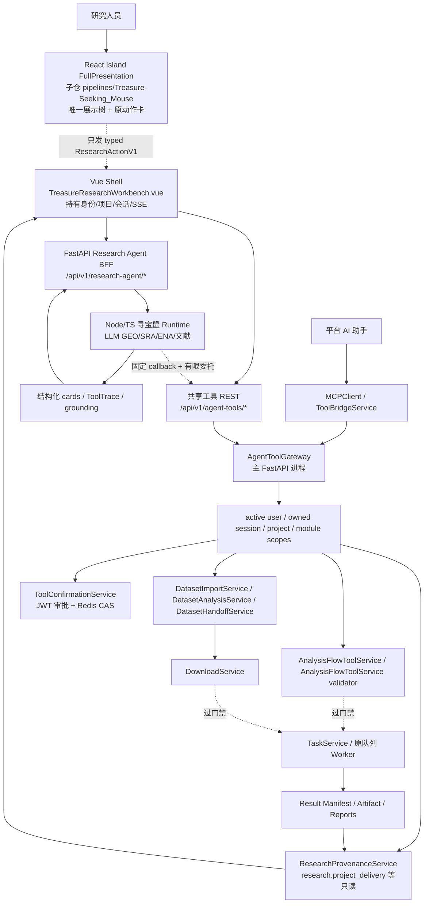
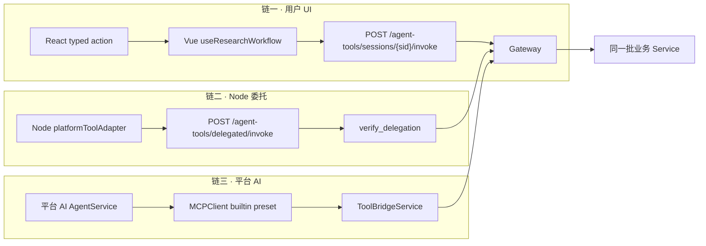

# CygnusX 科研寻宝鼠端到端科研链路架构

类型：as-built（代码现状）+ 运行准入 BLOCKED。本文描述"科研寻宝鼠 → 最终分析结果"这条链路在**当前源码**里的真实实现与边界，不声明任何真实运行/生产交付能力。基线：2026-10-16，分支 `feat/research-agent-phase5`。

> 事实来源优先级：**代码 / 配置 / 迁移 > 本文 > `docs/implementation/` 下的施工报告**。`docs/implementation/` 是逐轮施工记录与证据，本文是该域的**活动架构入口**；两者冲突时以代码为准，本文"§16 文档与代码核对"列出已发现的偏差。
> 相关入口：[`CygnusX_agent_tool_gateway.md`](CygnusX_agent_tool_gateway.md)（共享工具层）、[`CygnusX_dataset_architecture.md`](CygnusX_dataset_architecture.md)（Dataset 资产）、[`CygnusX_research_delivery_architecture.md`](CygnusX_research_delivery_architecture.md)（证据与报告交付）、[`CygnusX_flow_architecture.md`](CygnusX_flow_architecture.md)（Flow 接入）、[`CygnusX_report_architecture.md`](CygnusX_report_architecture.md)（双报告）。

---

## 1. 定位与目标链路

本文回答一个问题：**研究人员在原版"科研寻宝鼠"界面里发现一个真实科研数据集之后，它是如何在不丢证据、不绕过权限、不误认数据类型的前提下，被安全地交给平台已有的下载 / 分析 / 报告能力的。**

目标链路（W0–W7 工作包分解见 `docs/implementation/CygnusX_TreasureMouse_End_to_End_Implementation_2026-10-16.md`）：

```
GEO / 文献发现 → 数据集详情核验 → Dataset/Download Prepare → 人工审批 → 已授权执行
→ DatasetVersion/Handoff → FlowFrame 分析 Prepare → 单独人工审批 → 已授权分析执行
→ 真实 Task / Artifact / 科学报告 / 执行证据报告
```

### 1.1 关键不变量

1. **单一展示树**：原 React Island `FullPresentation` 是唯一科研展示层，Vue 只做外壳（项目/会话/认证/审批/路由）。没有第二套 Markdown/科研卡渲染器。
2. **单一业务边界**：任何写操作都必须落到**同一个** `AgentToolGateway` → 既有 Service，禁止"来自寻宝鼠"和"来自 AI 助手"两条平行执行链。
3. **身份不来自模型**：owner/project/scopes 全部从认证态与会话派生，永不作为工具入参。
4. **三段分离**：`PREPARE`（生成预案，无副作用）→ `DECIDE`（人类 JWT 批准）→ `EXECUTE`（消费一次性确认 + 过源码运行门禁）。批准权 ≠ 执行 readiness。
5. **Task success ≠ Dataset READY ≠ 报告已交付 ≠ 可复现**。报告失败不得触发已成功的分析任务重跑。
6. **缺失即缺失**：无本地/运行证据时输出 `UNKNOWN` / `NOT_GENERATED` / `PARTIAL`，不得由模型编造。

### 1.2 非目标

不改写 Node 检索内核与平台 Agent Runtime；不新建第二套 DownloadService / TaskService / 审批系统 / Dataset 库 / 报告引擎；不把 TPM/FPKM/CPM/变换值自动当作 counts 交给 DESeq2；不在运行门禁未闭合时开放 Agent 写操作。

---

## 2. 组件与责任边界



**实线** = 责任边界与既有接口复用；**虚线** = 需可信审批 + 运行环境 + 源码执行门禁的业务动作。

### 2.1 目录/文件落点

| 层 | 位置 |
|---|---|
| React 展示树 | 子仓 `src/components/chat/*` 为共享组件；`archive/island/src/island/` 提供冻结适配器与 `contract.ts`；父仓 `frontend/treasure-island/{index,FullPresentation}.tsx` 为当前平台展示覆盖层（由构建脚本暂存到 `src/island`） |
| React→Node 平台工具 | `pipelines/Treasure-Seeking_Mouse/functions/seqout-chat/platform-tools.ts` |
| Vue 外壳 | `frontend/src/views/TreasureMouseView.vue`（薄壳）→ `TreasureResearchWorkbench.vue`（工作台） |
| Vue 展示桥 | `frontend/src/components/research/TreasureOriginalDisplay.vue`、`treasureIslandLoader.ts`（`public/treasure-island/treasure-island.js` 动态 import） |
| Vue 工作流适配 | `frontend/src/components/research/adapters/useResearchWorkflow.ts`、`researchPresentation.ts` |
| Vue 平台卡 | `DatasetWorkspace.vue`、`DatasetImportCard.vue`、`AgentToolProposalCard.vue`、`AgentToolPanel.vue`、`DiscoveryProposalCard.vue` |
| BFF 路由 | `src/cygnusx/api/v1/research_agent.py` |
| 共享工具路由 | `src/cygnusx/api/v1/agent_tools.py` |
| Dataset REST | `src/cygnusx/api/v1/datasets.py` |
| Gateway | `src/cygnusx/application/services/agent_tool_gateway.py` |
| 委托 | `src/cygnusx/application/services/agent_tool_delegation.py` |
| 能力契约 | `src/cygnusx/application/schemas/agent_tools.py` |
| Dataset 服务 | `dataset_import_service.py` / `dataset_analysis_service.py` / `dataset_handoff_service.py` / `dataset_service.py` |
| Flow 服务 | `analysis_flow_tool_service.py` + `src/cygnusx/domain/flow/submission_validator.py` |
| 审批 | `src/cygnusx/application/services/tool_confirmation_service.py` |
| 只读证据 | `research_provenance_service.py`、`research_delivery_service.py`、`report_service.py` |
| GEO 证据 | `src/cygnusx/infrastructure/geo/adapter.py` + `geo_processed_data_service.py` |
| 数据模型 | `src/cygnusx/infrastructure/database/models/dataset.py`、`agent_tool_invocation.py` |

---

## 3. 三条调用链



- **链一（用户 UI）**：React 只发出 `ResearchActionV1`（`frontend/src/types/treasureIsland` / 子仓 `contract.ts`）。Vue 的 `useResearchWorkflow.action()`（`useResearchWorkflow.ts:33`）把意图翻译成 `agentToolsApi.invoke(session_id, capability, args)`，身份取自当前认证会话，**不传 owner/project**。
- **链二（Node 委托）**：`ResearchTreasureService.stream_message` 在 `tool_gateway_read_enabled` 时构造 `platform_tools = {catalog, delegation}`（`research_treasure_service.py:400-409`），随 Node 请求下发。Node 侧 `platformToolAdapter`（`platform-tools.ts:3`）只保留 `side_effect ∈ {none, confirmation}` 且 `tool_name` 以 `bioops_` 开头的能力，**主动剔除 `.submit` 与 `tasks.cancel`**，并用 operator 配置的 `callbackUrl`（不来自请求/模型/目录）回调。委托 token 不进入模型 messages。
- **链三（平台 AI）**：`AgentService` 与 MCP `cygnusx-platform` preset 都用 `capability_catalog(...)` 生成同一份工具视图（`agent_service.py:1015`、`mcp/presets.py:2477`），经 `ToolBridgeService`（`tool_bridge_service.py:58`）进入同一 `AgentToolGateway`。

> 三者共享同一个 Gateway 与同一套业务 Service，是"寻宝鼠与平台 AI 不重复建链"的落地点。

### 3.1 平台能力向模型传递与部署配置

平台 BFF 每轮向受信 Node 入口传递 `platform_tools`，即使共享工具开关关闭，仍包含空
`catalog` 和认证会话派生的 `project_selected`。开启共享工具后才追加有限委托与权限裁剪后的
目录。Node 适配器把本轮实际可用工具名、通道是否可用、项目是否选择及
`write_execution=false` 投影为系统消息中的 `platform_tool_context`；委托凭证不进入模型消息。
普通独立入口不获得该系统上下文。双语提示词据此区分独立检索、平台预案、人工审批和真实执行，
避免把平台请求一概回答成“只能提供链接、需要用户本地下载”。

平台 Compose 的 `CYGNUSX_TOOL_CALLBACK_URL` 空值默认解析为固定内网地址
`http://web:8000/api/v1/agent-tools/delegated/invoke`，允许运维显式覆盖。
此默认地址不启用共享工具或任何执行能力。只读/预案接入仍需在对应迁移与权限校验通过后
显式启用 `TOOL_GATEWAY_READ_ENABLED`；Dataset 发现另需 `DATASET_DISCOVERY_READONLY`。

2026-10-27 运行排查：当时 Web 容器的上述两个开关均为 false，Node 回调地址为空；
Agent 下载/分析写开关也均为 false，且源码写门禁未验收。该环境因此没有平台预案工具，
也不能执行下载或提交分析。上述状态传递、提示词与 Compose 默认地址修复仅在工作树完成，
不代表已重建部署或已开放执行。验证覆盖 BFF 真实会话上下文、Node handler 模型请求与
受限回调的隔离 I/O；未用模型桩或隔离测试证明真实 Worker/传输/分析运行验收。

### 3.2 通用下载与分析预案的页面恢复

`useResearchWorkflow` 现消费共享 Gateway `related[].proposal` 中的 `downloads.prepare` 与
`analysis.prepare` 记录，和已有 `dataset_import` / `dataset_analysis` 一起投影到同一 React
工作流面板。通用预案的会话、项目、operation 与 capability 必须匹配当前上下文；Vue 用
持久记录维护私有审批路由映射，通用预案调用会话 Gateway `approve/reject`，Dataset 预案
继续调用各自 API。页面仅投影白名单摘要，不传递 confirmation secret、身份字段或执行路径。

恢复与流结束后的刷新按本轮真实目录里的 `tasks.list_related` 判断，不再依赖 Dataset
导入开关。SSE 提示产生预案后，Vue 从持久 API 恢复并打开面板；不把模型返回文字当作
可批准预案。审批仍是用户点击动作，不自动创建 Task。会话/项目切换、目录撤权和错误会
清理私有路由映射，迟到响应不更新新上下文。

父仓 `frontend/treasure-island/ResearchWorkflowPanel.tsx` 是新增的平台展示覆盖层，构建时
覆盖冻结适配器的同名组件，归档源码保持原样。审批按钮按每条预案的真实 prepare 能力
判断；过期预案显示 `EXPIRED` 并禁用。浏览器脚本
`scripts/poc/treasure-platform-proposals-browser.mjs` 使用真实 Vue 工作台与构建后 Island、
隔离 HTTP，覆盖通用预案的自动提示、人工下载批准/分析拒绝、刷新恢复、过期和撤权。
证据在 `evidence/treasure-platform-tools-20261027/shared-proposals-browser.json`，不证明真实执行。

实际配置模型另有一次能力问答验证：使用当前 Node 源码、Python 权威目录及真实下载能力
描述，模型调用 `downloads.describe_capabilities` 并说明预案可用、真实执行受阻；回调为隔离
适配，未调用真实 Gateway/Worker。结果在同目录 `live-model-download-capability.json`。
当前数据库只读 schema 对账通过；宿主只读探针仍缺可写 cgroup 子树、可见 cgroup.kill 与
项目硬配额挂载条件，真实下载/分析运行验收继续未完成。

---

## 4. 身份、项目与权限

### 4.1 Gateway 上下文派生（`agent_tool_gateway.py:77-144`）

`AgentToolGateway.context(user_id, session_id, *, expected_agent)` 每次调用重新执行：

1. `tool_gateway_read_enabled` 关闭即抛 `FEATURE_DISABLED`（`:84`）。
2. `UserModel.status == "active"` 校验（`:86`）。
3. 按 `session_id + user_id + status=active` 取 `ChatSessionModel`（`:89-98`）。
4. `agent_kind` 由 `session.sandbox_meta["research_agent"]` 判定为 `research_treasure_mouse` 或 `platform_ai`；`expected_agent` 不匹配即拒绝（`:99-105`）。
5. project 从 `session.project_id` 派生并校验 `ProjectModel.user_id == user_id`（`:106-110`）——**不从 `projects/<slug>` 路径判断授权**。
6. scopes 基线为 `read:discovery / read:tasks / read:datasets / read:research / read:workflows / prepare:download / prepare:analysis`，再按 `user.disabled_modules` 逐项裁剪（`:114-132`，admin 视为全开）。

`invoke` 内部还会**再调一次** `context(...)`（`:174`），保证 builtin 调用方也拿到执行时刻的 fresh 校验。

### 4.2 委托 token（`agent_tool_delegation.py`）

- 独立 JWT key domain（`sha256(jwt_secret + ":bioops-delegation-v1")`），固定 `iss=cygnusx-agent-tools` / `aud=cygnusx-node-read-tools`，HS256。
- claims 含 `sub / session_id / project_id / scopes / token_version / jti / iat / exp`（TTL = `agent_tool_delegation_ttl_seconds`，默认 300s，`config.py:106`）。
- `verify_delegation`（`:54`）重新派生 context、比对 `token_version`、`project_id` 与 `scopes`，并用 Redis `SET NX` 对 `jti+call_id` 防重放（`:98-107`）；Redis 不可用 → `DependencyUnavailableError`（fail-closed，不回退内存）。

### 4.3 会话与项目边界（BFF）

`ResearchTreasureService`（`research_treasure_service.py`）：
- 会话复用 `ChatSessionModel`（`sandbox_meta.research_agent = "research-treasure-mouse"` 标记），**新会话绝不隐式继承默认项目**（`:283-300`，区别于普通 Chat）。
- `ensure_access` 校验 `treasure-mouse` 模块未禁用 + `treasure_native_ui_enabled`（`:238-242`）。
- `_owned_project` 校验项目归属（`:244-258`）；`_owned_session` 同时校验会话归属与项目归属（`:318-330`）。

---

## 5. 能力目录与契约

**唯一 schema 权威**：`src/cygnusx/application/schemas/agent_tools.py`。`scripts/export_agent_tool_contracts.py` 生成 JSON 交付视图；Node **不维护业务 schema 副本**。

`CAPABILITY_MODELS`（`:146-175`）登记全部能力与其入参模型；所有入参模型继承 `ToolArgs(extra="forbid", strict=True)`——**任何未声明的 owner/project/`_confirmed` 字段都会被拒绝**。

能力分类（scope 由 `capability_catalog`，`:204-224` 推导）：

| 类别 | 能力 | scope | side_effect | 审批 |
|---|---|---|---|---|
| 只读发现 | `downloads.describe_capabilities` | `read:discovery` | none | 无 |
| 只读任务 | `tasks.get_status`、`tasks.list_related` | `read:tasks` | none | 无 |
| 只读 Flow | `analysis.list_workflows`、`analysis.get_workflow_schema` | `read:workflows` | none | 无 |
| 只读 Dataset | `dataset.discover / inspect / list_files / list_project_assets` | `read:datasets` | none | 无 |
| 只读证据 | `research.task_provenance / report_provenance / dataset_provenance / project_delivery` | `read:research` | none | 无 |
| 研究计划 | `research.plan.*` | `read:research` | none | 无（`research_plan_enabled` gated） |
| Prepare | `downloads.prepare`、`dataset.prepare_import`、`analysis.prepare`、`analysis.prepare_from_dataset` | `prepare:*` | confirmation | 生成待审批记录 |
| 分析兼容 | `analysis.list_compatible_workflows` | `read:datasets` | none | 无 |
| **写（执行）** | `downloads.submit`、`analysis.submit`、`tasks.cancel`、`dataset.execute_import` | `execute:*` | **task** | 人类 JWT + 运行门禁 |

`AgentToolGateway.catalog()`（`:146-165`）按 `include_dataset` / `include_research` / `include_plans` 三个开关裁剪，并再次按 `context.extra["scopes"]` 过滤。写能力默认**不出现在目录里**（`include_write` 默认 False，`capability_catalog:198`）。

---

## 6. 业务状态机（UI 语义视图）

这是**业务视图状态集合**，不直接覆盖现有 DB enum；实际状态分散在 `dataset_ingestions` / `DatasetAnalysisLink` / `TaskModel` / `handoff.validation` 中，由只读投影拼出。

```mermaid
stateDiagram-v2
  [*] --> DISCOVERED
  DISCOVERED --> INSPECTED: accession/来源/样本复核
  INSPECTED --> PROPOSED: 选项目 + 选文件/预算
  PROPOSED --> APPROVED: 人类 JWT 批准
  PROPOSED --> REJECTED: 拒绝/超时
  APPROVED --> EXECUTION_BLOCKED: 源码/配置/Worker 门禁未过
  APPROVED --> SUBMITTING: 消费确认 + 持久预留
  SUBMITTING --> QUEUED: 返回真实 Task ID
  SUBMITTING --> RECONCILIATION_REQUIRED: 提交结果未知
  QUEUED --> DOWNLOADING --> DOWNLOADED
  DOWNLOADING --> PARTIAL: 部分失败
  DOWNLOADED --> VERIFYING: 摘要/metadata/样本审阅
  VERIFYING --> REVIEW_REQUIRED: 语义或样本缺口
  VERIFYING --> DATASET_READY: 通过并冻结版本
```

分析侧同理：`DATASET_READY → FLOW_PROPOSED → INPUT_REVIEW_REQUIRED → ANALYSIS_APPROVED → ANALYSIS_QUEUED → ANALYSIS_RUNNING → ANALYSIS_SUCCEEDED → OUTPUT_VALIDATING → REPORTS_READY / DELIVERY_PARTIAL`。

**当前实现状态**：`APPROVED → EXECUTION_BLOCKED` 是**唯一可达的写路径**——源码常量 `WRITE_RUNTIME_ACCEPTED = False` 使 `SUBMITTING` 之后的迁移在任何环境变量组合下都不可达（见 §13）。

---

## 7. 数据模型与迁移

新增五张 BioOps 相关表（除 Dataset 七表中的五张外，另加调用关联表），迁移链**单一 head**（已用静态脚本核对，`alembic heads` = 1）：

```
reportauditphase1 → bioopsphase2 → bioopsphase3 → bioopsphase4 → bioopsphase5
```

| 表 | 迁移 | 职责 | 关键唯一约束 |
|---|---|---|---|
| `agent_tool_invocations` | bioopsphase2 | 调用/预案持久关联（owner/project/conversation/capability/参数摘要/确认引用/task 引用/状态/有限预览） | — |
| `datasets` | bioopsphase3 | 数据集（owner/project/assay） | — |
| `dataset_versions` | bioopsphase3 | 版本（序号、source_snapshot、review_annotations、校验、冻结 handoff） | `uq_dataset_version_number` |
| `dataset_sources` | bioopsphase3 | 来源关系/证据 | — |
| `dataset_assets` | bioopsphase3 | FileRecord / Task 引用、用途、类型、实测 checksum | `uq_dataset_asset_file` |
| `dataset_samples` | bioopsphase3 | 既有 Sample 引用与版本映射/人工分组 | `uq_dataset_sample_key` |
| `dataset_ingestions` | bioopsphase3 | 导入预案/确认/调用/Task 与幂等键 | `uq_dataset_import_request (user, project, request_key)` |
| `dataset_analysis_links` | bioopsphase3 | 冻结版本 → 分析预案 → 真实 Task | `uq_dataset_analysis_task (task_id)` |
| analysis 执行绑定 / result observation / report 关联 | bioopsphase4 | `AnalysisLink.execution_binding`、`result_manifest_observations`、`Report.result_observation_id`、`ReportFile.file_record_id` | observation `(task_id, evidence_digest)` |
| research plans | bioopsphase5 | 受控研究计划（PLAN_ONLY） | — |

`dataset_analysis_links.normalized_request` 里绑定 `owner_id / project_id / session_id / dataset_version_id / handoff_hash / invocation_id`，是 execute 阶段二次校验的全部依据。

> 迁移仅做过 SQLite upgrade/downgrade 与静态链校验；**真实 PostgreSQL 的并发、row-lock、trigger 与 schema drift 未验收**（发布前必须在隔离 PG 执行）。

---

## 8. GEO / ENA 证据适配（只读发现）

`src/cygnusx/infrastructure/geo/adapter.py`：
- 使用官方 **GEO SOFT** 与 **ENA file-report**，**不拼猜下载 URL**。
- 严格 accession 校验，支持 `GSE → GSM → SRX → 多 SRR` 展开；保留原始样本特征/处理说明与 `source_evidence`（URL、响应 SHA-256、时间）。
- HTTPS 固定主机、禁重定向、有界响应（`dataset_geo_max_response_bytes`）、速率限制（`dataset_geo_request_interval`，进程内非分布式）、404/429/timeout 返回明确不可用。
- 无 FASTQ 不虚构；超限/无法关联保留 `confidence_flags`。

`GeoProcessedDataService.candidates()` 从 supplementary / Series Matrix 等**权威附件**中列出候选，只标候选、不当科学类型。`DatasetImportService.discover`（`dataset_import_service.py:78-93`）把两者合并返回，并标注 `raw.download_engine = existing_EBIDownload`、`raw.runtime_verified = False`。

---

## 9. 数据获取：Prepare → 审批 → 执行

> 本节只描述寻宝鼠链路上的**接入点**；下载模块本身（四阶段边界、三条传输、Worker/CLI 分发、FileRegistry 登记、源码门禁与 DL-RG 验收）**详见 [平台下载模块架构](CygnusX_download_architecture.md)**。两者口径冲突时，下载实现以该文为准。

### 9.1 Prepare（无副作用）

`DatasetImportService.prepare`（`dataset_import_service.py:136-280`）：
1. `require_dataset_read()` + 项目归属 + `downloads` 模块校验（`:144-146`）。
2. **request_key 幂等**：同 `(user, project, request_key)` 已存在时，参数一致则复用，不一致抛 `IDEMPOTENCY_CONFLICT`（`:150-162`）。
3. 调 GEO adapter 复核来源；`UNAVAILABLE` 直接返回不可用（`:163-170`）。
4. 目标目录由项目 slug 派生 + 现有 `DownloadService._normalize_directory` + realpath containment（`:173-180`）；**不 mkdir、不 dry_run、不入队**。
5. 两条路径：
   - **raw**：从 GEO/ENA 元数据实际展开的 SRR/run 选择（`:181+`），只有解析得到的 SRR 才走原 `sra/ftp` adapter。
   - **processed**：从补充文件候选选择，复用原 `direct_link` DownloadService。
6. 产出持久 `DatasetIngestionModel` + 确认记录（绑定 owner/project/session/来源摘要/选定文件/预算/request_key）。

### 9.2 审批（人类 JWT）

`ToolConfirmationService`（`tool_confirmation_service.py`）：
- `create_for_tool` 绑定 owner/project/conversation/operation/parameters，计算参数 hash（`:305`）。
- `approve_by_human` 只接受人类 JWT 主体（模型无 approve 工具）；`consume_tool_confirmation` 一次性消费 + 参数 hash 复核（`:462`）。
- store 为 Redis（`_RedisStore`），CAS 语义；Redis 不可用 fail-closed（`:255`）。

REST 决策端点均为 `CurrentJwtUserId`：
- 导入：`POST /projects/{pid}/import-proposals/{id}/{decision}`（`datasets.py:244-260`，支持 `approve / reject / execute / reconcile`）。
- 分析：`POST .../analysis-proposals/{id}/{decision}`（`datasets.py:305-334`）。
- Gateway 侧：`POST /agent-tools/sessions/{sid}/proposals/{id}/approve|reject`（`agent_tools.py:66-95`，**JWT-only**）。

`AgentToolGateway.decide`（`:544-574`）批准后仍返回 `write_enabled=False`、`gate="WRITE_GATE_BLOCKED"`——**批准权不等于执行 readiness**。

### 9.3 执行（当前硬阻断）

`DatasetImportService.execute`（`dataset_import_service.py:343-424`）与 `AgentToolGateway.execute`（`:761-819`）完整实现了"消费确认 → 持久 `SUBMITTING` 预留 → 调 `DownloadService.submit` → 回写 `task_id`/`QUEUED`"的两阶段提交，**但第一行就是门禁**：

```python
def require_import_write() -> None:
    require_agent_write_gate("downloads.submit")   # WRITE_RUNTIME_ACCEPTED=False → 直接拒绝
    if not get_settings().dataset_import_write: ...
```

即：无论配置开关如何组合，只要 `WRITE_RUNTIME_ACCEPTED` 为 `False`（源码常量，`agent_tool_gateway.py:47`），执行一律抛 `WRITE_GATE_BLOCKED`，**且在确认消费、目录、DB 变更、入队之前**。

---

## 10. DatasetVersion / 冻结 Handoff

`DatasetHandoffService.manifest()` 生成 typed manifest（契约 `docs/contracts/cygnusx-dataset-handoff-v1.md` + 同名 schema JSON，由严格 Pydantic DTO 生成）：
- 含 project/dataset/version、Source、FileRecord/asset ID、SHA/可用性、Sample 映射、Ingestion/Task、审阅与缺口。
- 固定顺序 + 规范化 JSON hash；**冻结后持久化**，每次访问重查归属。
- `validation.worker_paths_verified` 硬编码 `False`（`dataset_handoff_service.py:313`、`dataset_analysis_service.py:282`）——本地可见路径**不**代表 Worker 可见。

冻结前置：FileRecord 实测 SHA-256、样本审阅、类型/组学适用性、`REVIEW_REQUIRED` 处理。归档展开做受限流式（拒 ZipSlip / symlink / hardlink / 特殊文件 / 压缩炸弹 / 超量），保留父 archive 记录与 SHA。

---

## 11. 分析：Prepare → 审批 → 执行

### 11.1 Prepare

`DatasetAnalysisService.prepare`（`dataset_analysis_service.py:75+`）：
1. `require_dataset_read()` + `flows` 模块校验（`:83-84`）。
2. 从**冻结的** `DatasetVersion` + Handoff 取输入；物种/参考/链特异性/比较组由**人工输入**，模型不默默指定生物学分组。
3. 经 `AnalysisFlowToolService` 与统一 `FlowSubmissionValidator` 校验。
4. 产出持久分析预案 + `DatasetAnalysisLink` + 待审批记录，**不创建 Task**。

### 11.2 数据类型 → Flow 匹配

| 输入 | 候选 Flow | 必拒 |
|---|---|---|
| FASTQ | `rna_seq`（v2.3.0，bulk RNA-seq，STAR+RSEM+DESeq2） | 矩阵传给 FASTQ 输入 |
| 原始整数 counts | `counts_deg`（v0.1.0，独立 DESeq2，默认隐藏） | TPM/FPKM/CPM/log、未经核验的整数外观 |
| TPM/FPKM/标准化 | 仅已验证适用的下游探索 Flow | 直接 DESeq2 |
| Series Matrix | 先识别实物 | 凭扩展名当 counts |

`flows/rna_seq.yaml` 声明版本 2.3.0；`flows/counts_deg.yaml` 声明 0.1.0。`counts_deg` 默认隐藏：`FlowService` 的 `_visible` 判定 `flow_id != "counts_deg" or settings.counts_deg_flow_enabled`（`flow_service.py:85`）。

`FlowSubmissionValidator`（`submission_validator.py`）最终校验：必填字段、类型、枚举、不允许参数、条件规则、样本表唯一性与样本数上限、比较组合法性（对照组/实验组存在）、文件引用可解析、**最终路径必须在用户根内**，RNA/ATAC 拒绝 counts/TPM/FPKM 矩阵输入（`:575`）。

### 11.3 审批与执行

分析审批与下载审批**必须分开**：下载批准只授权下载指定文件，分析批准绑定 `dataset_version_id` / `handoff_hash` / `flow_id` / 样本表 / 对比组 / 参考 / 资源 / 幂等键。

`DatasetAnalysisService.execute`（`:455-532`）：
1. `require_agent_write_gate("analysis.submit")` → `WRITE_RUNTIME_ACCEPTED=False` 直接拒绝（`:463`）。
2. `analysis_submit_from_dataset` 开关二次校验（`:464`）。
3. 复核 `handoff_hash` 未变（`:479`）、`worker_paths_verified`（`:481`，恒 False → `WORKER_PATHS_NOT_VERIFIED`）。
4. 逐文件复核 SHA-256（`:486-493`，`INPUT_CHANGED`）。
5. 复核确认上下文一致 → 消费确认 → `SUBMITTING` 预留 → `TaskService.submit` → 回写 `task_id`。

`validate_counts_task_request`（`:535-562`）是 counts 的**最终 Task 边界**：`idempotency_key` 必须以 `dataset:` 开头，且对应 `DatasetAnalysisLink` 处于 `SUBMITTING/QUEUED`、`flow_id == counts_deg`——**模型自报的 `source_reviewed` 布尔值不构成证据**。

### 11.4 幂等与对账

- 唯一键 + row lock + 消费确认 + `SUBMITTING` durable reservation。
- 投递结果未知 → `RECONCILIATION_REQUIRED`，**禁止自动重放**（`dataset_import_service.py:351`、`agent_tool_gateway.py:775`）。
- Celery Beat 每 60s 做 reconcile-only（最多 20 条），仅检查已存在 Task，不重投；门禁关闭时不创建 DB engine。
- 无 FileRecord → `RECONCILIATION_REQUIRED`；Task 失败但有文件 → `PARTIAL`，不置 READY。

---

## 12. 证据、报告与交付（只读投影）

`ResearchProvenanceService`（`research_provenance_service.py`）提供四个只读能力，经 Gateway 暴露为 `research.*`：
- `project_delivery`：项目级交付图（Dataset × 版本 × 分析 × 报告），带截断上限（最多 20 Dataset × 5 版本、累计 20 analysis 详情）。
- `dataset / task / report_provenance`：单点证据图。

**双报告**（`architectures/CygnusX_report_architecture.md`）：
- **科学报告（BioReport）**：QC、表达/差异/富集结果、图表、方法说明。
- **执行证据报告**：DatasetVersion、原始来源、文件哈希、Flow/config、软件版本、任务与产物、缺失项、环境证据。

两者各有独立 `ReportModel.report_kind` 与 generation job，通过 `ResultObservation` 关联，**可独立成功/失败/重试**。报告渲染失败只重试交付 job，**不重跑分析**。`ResultObservation` 唯一键 `(task_id, evidence_digest)`——同事实复用、变化追加，读取按当前事实匹配而非"最新一条"。

前端"交付读取"动作 `delivery.read` → `research.project_delivery`（`useResearchWorkflow.ts:113-127`），无报告时置 `NOT_GENERATED`。

---

## 13. 前端：唯一展示树与 typed action

### 13.1 组件层级

```
TreasureMouseView.vue（8 行薄壳）
  └─ TreasureResearchWorkbench.vue（身份/项目/会话/SSE 编排）
       ├─ TreasureOriginalDisplay.vue → 动态 import public/treasure-island/treasure-island.js（子仓 React 构建物）
       │     └─ FullPresentation.tsx（唯一展示树：四场景 / Composer / ChatMessage /
       │           DatasetCard / LiteratureCard / ToolTrace / GroundingNotice / 桌宠 / 主题 / 双语）
       └─ useResearchWorkflow.ts（把 ResearchActionV1 → agentToolsApi.invoke）
```

`TreasureOriginalDisplay` 只做 mount/update/unmount 与 ShadowRoot 外观同步（`TreasureOriginalDisplay.vue:20-45`），**不持有 token、不持有业务状态、不直连 HTTP**。

### 13.2 React 只发什么

`ResearchActionV1`（子仓 `contract.ts:42-53`）：

```ts
| { type: 'dataset.inspect'; discoveryRef }
| { type: 'dataset.prepare_import'; discoveryRef; mode: 'raw'|'processed'; selectedIds; maxBytes; requestKey }
| { type: 'dataset.list' } | { type: 'dataset.version'; datasetId; versionId }
| { type: 'analysis.prepare'; datasetId; versionId; flowId; parameters; reference; treatment }
| { type: 'records.refresh' } | { type: 'delivery.read' }
| { type: 'proposal.decide'; proposalId; kind: 'import'|'analysis'; approve }
| { type: 'task.open'; taskId } | { type: 'report.open'; reportId } | { type: 'workflow.close' }
```

**只传前端意图与安全资源引用**：无内部委托密钥、无 `owner_id`、无可直接执行的绝对服务器路径、无确认凭证。Vue 侧 `useResearchWorkflow` 每次从当前认证会话派生 owner/project，并用 `generation` 快照丢弃跨会话/跨项目/跨动作的迟到响应（`useResearchWorkflow.ts:21,44,46`）。

`DatasetCard` 的核验入口按钮仅在 `presentation.onResearchAction` 存在且 accession 匹配 accession 正则时渲染（子仓 `DatasetCard.tsx:180`）。

### 13.3 不可用状态要诚实

- 无项目：允许全局只读发现（BFF 显式不禁用默认项目，`research_treasure_service.py:283`）；Prepare 需先选项目。
- 写门禁关闭：可查看/准备，执行按钮为 disabled（`DatasetWorkspace.vue:145` "分析执行尚未开放"）。
- Worker 路径未验收：数据就绪与"可真正运行分析"分开提示（`handoff.validation.worker_paths_verified`）。
- 无匹配 Flow：不显示"立即分析"，展示原因。
- 报告尚无：显示真实未生成状态，不显示占位下载链接。

### 13.4 SSE 事件与无损投影

BFF 流式端点 `POST /research-agent/sessions/{sid}/messages:stream`（`api/v1/research_agent.py`）转发 Node 的 `delta / tool / cards / polariseq / grounding / end / error / cancel` 事件，并提供同一 generation 的恢复：
- 客户端生成稳定 `request_id`；user/assistant 消息存入该 ID 和请求指纹，`chat_messages` 部分唯一索引防止同会话重复创建 user generation。
- 每个事件按 assistant `message_id` 追加到 `chat_message_events`，以单调 `seq` 为 SSE `id`；每条事件提交后才写入响应。
- 重试携带相同 `request_id` 和 `Last-Event-ID`。服务端按 owner/session 重新授权后，仅回放游标之后的事件；已有 generation 不会再次调用 Agent。相同 ID 配不同请求指纹返回冲突。
- Vue 客户端在连接中断后以相同请求 ID 和最后接收序号有限重试；SSE parser 忽略游标覆盖的重复 frame。
- 终态 assistant snapshot 与事件日志共同落库；取消时将部分回复和终态提交，避免请求依赖回滚丢失结果。
- Agent 生成由 Web 进程内独立 asyncio producer 和独立数据库会话驱动，SSE 响应只订阅已提交事件；客户端断流不会取消 producer，同一进程重连从持久事件游标继续回放。
- producer 注册表仍是进程内存状态：进程退出会中断生成；另一进程看到 `streaming` 消息时可以发出持久取消信号，但不能接管或恢复计算。跨进程任务租约、崩溃恢复与超时收敛尚未实现。
- `/cancel` 优先通过 Web 进程内的会话活动事件通知生成任务；无本地 producer 时，会把取消请求写入现有 `streaming` assistant message 的 metadata，远端 producer 在事件周期重读并发布终止事件。响应 `accepted` 仅表示信号已发出或持久化，不证明 producer 已停止；无对应 `streaming` generation 时返回 `unknown`。producer 注册表和计算租约仍是进程内状态，跨进程接管、进程重启恢复与 OS 级停止尚未实现。

以上断流行为目前有 SQLite/ASGI 隔离测试，尚无真实 PostgreSQL、部署 API、网络断流或 Chromium 证据；不能据此宣称 Runtime/E2E 验收通过。

`merge_discovery_cards`（`:89`）在终态快照里折叠重复卡但保留来源 meta——**实时与历史投影等价**。
`card_to_proposal`（`:53`）：`metadata_status` 恒为 `unverified`，`source_links` 只接受已知 accession 家族（`_source_link` 永不信任上游 URL，`:41-50`）。

### 13.5 跨入口会话标题

寻宝鼠使用平台 `chat_sessions` 持久会话。新会话标题为“新对话”；与 AI 助手和 AI 工作台共用 `frontend/src/utils/sessionTitle.ts` 的触发策略及 `chatApi.generateSessionTitle()`，在首轮成功完成后生成，在第 3、6、9、12 条用户消息成功完成后刷新，标题锁定或超过第 12 轮时停止。服务端统一经 `ChatSessionManagement.generate_session_title()` 生成，遇到旧会话“科研发现”占位值也按默认标题处理；用户重命名会锁定标题。

---

## 14. 功能开关与双重门禁

### 14.1 源码硬门禁（不可由环境变量绕过）

| 常量 | 位置 | 值 | 作用 |
|---|---|---|---|
| `WRITE_RUNTIME_ACCEPTED` | `agent_tool_gateway.py:47` | `False` | 所有 Agent 写操作（downloads.submit / analysis.submit / tasks.cancel / dataset.execute_import）在副作用前一律拒绝 |
| `worker_paths_verified` | `dataset_handoff_service.py:313`、`dataset_analysis_service.py:282` | `False` | 冻结 Handoff 不声称 Worker 可见，阻塞分析 execute |

### 14.2 配置开关（默认全 false，`core/config.py`）

| 开关 | 行 | 默认 | 作用 |
|---|---|---|---|
| `treasure_native_ui_enabled` | 69 | false | 寻宝鼠原生入口总开关 |
| `treasure_agent_write_tools_enabled` | 71 | false | **当前零代码消费**（预留） |
| `tool_gateway_read_enabled` | 72 | false | Gateway context/catalog 总闸；同时决定 BFF 是否下发委托 |
| `research_delivery_read_enabled` | 82 | false | `research.*` 只读证据能力可见性 |
| `research_delivery_write_enabled` | 83 | false | 证据写（`research_provenance_service.py:66`） |
| `research_plan_enabled` | 75 | false | `research.plan.*` 能力 |
| `dataset_discovery_readonly` | 88 | false | Dataset 只读能力可见性 |
| `dataset_import_write` | 89 | false | 导入执行配置门禁（在源码门禁之后） |
| `analysis_submit_from_dataset` | 90 | false | 分析执行配置门禁（在源码门禁之后） |
| `counts_deg_flow_enabled` | 91 | false | counts_deg 在 Flow catalog 的可见性 |
| `agent_download_write_enabled` | 103 | false | `downloads.submit` 运行开关 |
| `agent_analysis_write_enabled` | 104 | false | `analysis.submit` 运行开关 |
| `agent_task_cancel_enabled` | 105 | false | `tasks.cancel` 运行开关（取消未实现，保持禁止） |

### 14.3 BFF capabilities 投影

`ResearchTreasureService.capabilities()`（`:212-236`）综合模块禁用、总开关、Node 配置、`tool_gateway_read_enabled`、`dataset_discovery_readonly` 推导 `enabled / read_sessions / read_discovery / prepare_import / prepare_analysis / reason_code`。

---

## 15. 运行准入（RG）与当前能力状态

**RG-01–RG-12**（镜像 SHA/子仓一致、Worker 二进制、PG 迁移、Redis CAS 双进程、Node callback 传输、双用户全链、下载安全、下载→Asset→Version→Handoff、分析→Task→Manifest、双报告、浏览器视觉）目前**全部未闭合**；证据记录见 `docs/audits/`（如 `treasure-e2e-release-gates.md`）。

| 能力状态 | 当前结论 | 依据 |
|---|---|---|
| `DISCOVERY_READY` | 否（运行未验收） | 代码/隔离通过；当前 Dataset/Gateway read 开关默认关闭 |
| `PREPARE_READY` | 否 | 只读/Prepare 服务与 UI 隔离通过；真实 Redis/PG 前置未通过 |
| `APPROVAL_READY` | 否 | JWT 与 Store 隔离通过；真实 Redis CAS 未通过 |
| `DOWNLOAD_EXECUTION_READY` | 否 | `WRITE_RUNTIME_ACCEPTED=False`，源码门禁关闭 |
| `ANALYSIS_EXECUTION_READY` | 否 | Worker 路径/镜像/真实 Task 未验收 |
| `REPORT_DELIVERY_READY` | 否 | 只读记录可展示，不等于真实双报告交付 |
| `VISUAL_RELEASE_READY` | 否 | 真实浏览器视觉验收待补 |

---

## 16. 文档与代码核对

逐项核对 `docs/implementation/` 的任务书与递归施工报告，与当前源码一致的部分已在 §3–§14 落位。以下是**已发现的不一致或需要读者注意的点**：

| # | 项 | 文档/前端期望 | 代码现状 | 影响 |
|---|---|---|---|---|
| D1 | `/research-agent/capabilities` 字段 | 前端 `ResearchCapabilities` 与服务端需共享 `enabled / read_sessions / read_discovery / prepare_import / prepare_analysis / reason_code` 等字段 | 已闭合：服务端 `ResearchAgentCapabilities` 声明能力投影及 `write_execution: Literal[False]`；`ResearchTreasureService.capabilities()` 计算模块、Node 与 Prepare 状态；HTTP 路由返回该 DTO。后端隔离测试检查能力裁剪，前端访问层类型声明对应 | 当前源码不再存在 Pydantic 丢字段问题；仍以运行配置和真实 API 环境验证为准，不能将隔离 DTO 测试升级为 Runtime |
| D2 | Widget/Node 委托 transport | 任务书 §6 描述 Node 用固定 callback 回落 Gateway | 已闭合：父仓记录的子仓提交 `b780b7c2f01fb3ea9aaaef82c6eb91e41cde57db` 包含 `index.ts` 接线与 `platform-tools.ts` adapter；adapter 只暴露 `bioops_*` 的 `none`/`confirmation` 能力并剔除 `.submit`/`tasks.cancel`，callback URL 仅来自服务端 operator 配置。`server/local.mjs` 只在 `/cygnusx/discovery` 校验内部 token 后注入信任标记，其他路径会剥除该标记。子仓定向离线 Node 测试通过 | 实际运行镜像/tag/digest 是否包含该提交仍 `UNKNOWN`；源代码与离线测试不构成部署或真实 callback 验收 |
| D3 | Network 化后的 count summ | 任务书列 `downloads.prepare` 与 `dataset.prepare_import` | 二者均存在于能力目录（`agent_tools.py:154,168`），职责按 W2 文档划分：前者绑下载资源/运输参数，后者绑科研来源/DatasetVersion；**`downloads.prepare` 不走 `dataset_import_write` 门禁**（仅校核目录 containment） | 需评审确认二者不重复审批（当前不重复） |
| D4 | Island 构建产物 | 前端动态 import `public/treasure-island/treasure-island.js` | 子仓已将平台展示适配器移至 `archive/island/`。父仓构建脚本在临时目录组合当前 `src/`、`shared/`、冻结归档适配器及父仓 `frontend/treasure-island/` 展示覆盖层，执行 Island TypeScript 检查、Vite 构建及禁止导入 SPA 业务实现的边界检查；完成后清理临时目录，不复制服务配置，公开产物移除模块路径清单。Docker 上下文同步复制当前目录布局。旧 PoC 命令已改为测试实际构建产物 | 本地构建、Vue/React 接入与 Chromium 的 4 视口×2 语言×2 主题检查通过（fixture props，无真实科研后端）；不据此改变端到端运行准入状态 |

> 其余文档声明（WRITE_RUNTIME_ACCEPTED=False、worker_paths_verified=false、迁移链 bioopsphase2→5、Flow 版本号、幂等/对账语义）均与源码一致，不再逐条列出。

---

## 17. 验证与回滚

**改动本域的最小验证**（详见 `AGENTS.md` §5 与任务书 §16 T01–T45）：

```bash
uv run pytest tests/unit/test_dataset_gateway_phase3.py tests/unit/test_dataset_geo_validation.py \
  tests/unit/test_dataset_import_handoff.py tests/unit/test_dataset_phase3.py \
  tests/unit/test_dataset_phase3_review.py tests/unit/test_agent_tools_phase2.py \
  tests/unit/test_phase0b_confirmation.py tests/unit/test_research_delivery_phase4.py \
  tests/unit/domain/test_flow_submission_validator.py -q
cd frontend && npx vitest run src/components/research && npx vue-tsc --noEmit
```

**回滚原则**（任务书 §19）：
1. **先关开关，保留事实**：关闭 `tool_gateway_read_enabled` / 各 write flag / Node callback，保留全部 FileRecord / DatasetVersion / Task / Report / 证据。
2. 只按**本轮 hunk** 逆向撤回，禁止 `reset --hard` / `clean` / 整文件覆盖共享 dirty 文件。
3. 数据库 downgrade 需先备份并确认无在途关联，**不删用户文件**。
4. 不得回退到布尔确认或进程内生产审批。
5. 不自动重放不确定的 submit；`SUBMITTING` / `RECONCILIATION_REQUIRED` 持续人工对账。

---

## 18. 一句话结论

**代码层面**，从寻宝鼠发现 → 数据核验 → 导入/下载预案 → 人类审批 → DatasetVersion/冻结 Handoff → Flow 分析预案 → 独立分析审批 → TaskService 提交 → 结果清单 → 双报告读取的**完整链路已经落地**，且身份、审批、幂等、对账、只读证据投影均按"单一 Gateway + 既有 Service"实现；**运行层面**，`WRITE_RUNTIME_ACCEPTED=False` + `worker_paths_verified=false` 两道源码门禁与全部默认关闭的配置开关，使真实下载与分析执行在任何环境下都保持**不可达**——这正是任务书要求的"可在受限环境完成 M0–M5、不得据此宣称 M6/M7 通过"的现状。
