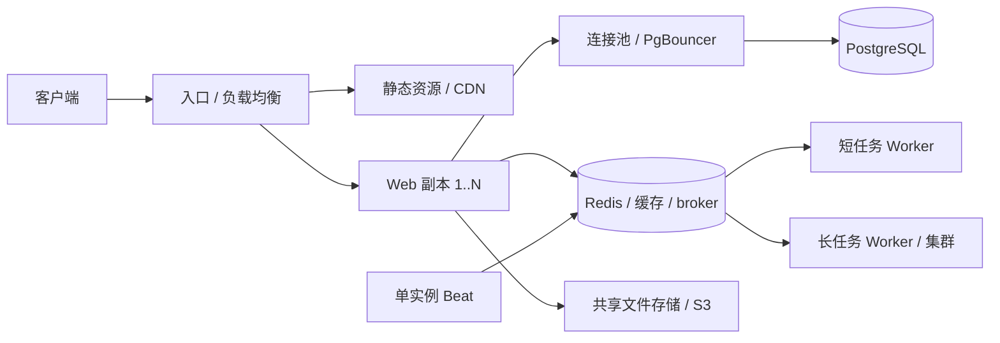

# CygnusX Web / Celery 容量实测与扩容评估

> 类型：2026-10-27 运行快照与目标态建议。实测与建议分别标注，**10000 RPS 未验收通过**。
> 范围：当前 Web、Nginx 静态资源/业务 API、Redis/Celery；不执行 LLM 生成、生信计算或沙箱任务。

## 1. 实测环境与口径

16 核、约 93 GiB 内存的同一宿主机上压测现有 Docker 部署；同时运行其他服务，
这不是专用压测集群。一个 Web 容器、两个 Uvicorn 进程，`APP_DEBUG=true`，无容器 CPU/
内存限制；Worker 为 16 个 prefork 进程，prefetch=1，每子进程 10 个任务后回收。
PostgreSQL `max_connections=100`，Web 每进程 pool=10、overflow=20。

创建了本次专属的 100 个普通账号，逐个签发 JWT。业务请求轮询：个人信息、项目列表、
最近任务、会话列表、模块注册表；经过真实认证、权限校验与数据库。账号无历史业务数据，
项目/任务/会话列表为空；这是轻数据基线，不能推广到重数据用户。
JWT 预先签发，未覆盖登录密码校验、2FA、上传、SSE 长连接与中断恢复。

闭环测试每个用户最多一个在途请求，10/20/50/100 用户每档 60 秒，5 秒预热不计入结果。
“操作间隔”每次请求后等待约 0.5–1.5 秒；“持续请求”无等待。
非 200、错误 JSON、HTML 冒充 API 响应均计失败；成功 RPS 不包含拒绝请求。
默认基线门槛为错误率 ≤1%、成功请求 P95 ≤1000ms，不等于未来万级负载的验收门槛。

## 2. 实测结果

### Web 直连业务接口

| 并发用户 | 有间隔成功 RPS | 有间隔 P95 ms | 持续请求成功 RPS | 持续请求 P95 ms | 持续请求 P99 ms | 两组错误率 |
| ---: | ---: | ---: | ---: | ---: | ---: | ---: |
| 10 | 9.91 | 14.82 | 220.38 | 101.64 | 154.38 | 0% / 0% |
| 20 | 19.99 | 16.03 | 214.52 | 197.60 | 486.10 | 0% / 0% |
| 50 | 49.58 | 28.52 | 180.55 | 601.12 | 703.33 | 0% / 0% |
| 100 | 96.67 | 142.54 | 178.26 | 941.68 | 1027.22 | 0% / 0% |

### Nginx 实际入口与静态资源

入口业务每档 20 秒、每请求后约 1 秒等待；静态资源每档 15 秒，轮询实际 HTML 引用的 JS/CSS 与首页 HTML，同样有操作间隔，不执行页面 JS。

| 用户 | 入口业务成功 RPS | 入口业务失败率（503） | 静态资源成功 RPS | 静态 P95 ms | 静态失败率 |
| ---: | ---: | ---: | ---: | ---: | ---: |
| 10 | 10.24 | 0.00% | 10.41 | 46.68 | 0.00% |
| 20 | 10.72 | 47.56% | 20.60 | 43.80 | 0.00% |
| 50 | 9.98 | 80.58% | 51.08 | 59.28 | 0.00% |
| 100 | 10.03 | 90.21% | 101.36 | 60.00 | 0.00% |

### Celery 真实 Worker 与专用队列对照

每用户顺序投递并等待 10 个任务；每组四档共 1800 个任务，三组均全部成功。

| 并发提交用户 | 现有 Worker 空任务 /s | 现有 Worker 端到端 P95 ms | 专用 4 进程回收 10 次 /s | 专用 4 进程回收 1000 次 /s |
| ---: | ---: | ---: | ---: | ---: |
| 10 | 30.36 | 2061.92 | 118.00 | 255.72 |
| 20 | 27.91 | 3233.80 | 54.93 | 297.45 |
| 50 | 30.64 | 4641.43 | 49.73 | 306.31 |
| 100 | 31.15 | 4632.38 | 97.88 | 306.34 |

### 固定到达率复核

k6：3000 请求 / 30 秒，实测 100.00 RPS，成功率 100%，
P95 25.31ms，dropped_iterations=0；所有验收阈值通过，进程退出码 0。

`8000` 为 localhost 直连，走完整后端链路，但内网 IP 在后端限流的 trusted networks
中；因此未计入公网 IP 的 Redis 限流路径成本。`8888` 为当前实际 Nginx 入口。
同一来源 IP 的 Nginx 限流为 10r/s、burst=20，超额默认返回 503；表中的入口失败
是此次限流拒绝，不能归因于后端崩溃，也不能把这些快速失败计为业务处理能力。
校园/实验室 NAT 下多个用户共享 IP 时也可能遇到这个约束。

持续负载增加时 Web 吞吐没有线性增长，延迟明显上升。资源采样中 Web 接近两个 CPU 核
占满，而数据库/Redis CPU 较低；这支持优先剖析 Web CPU、调试日志和请求开销的判断，
但不是单个函数的性能归因。100 用户持续负载时数据库采样有 63 个连接，说明当前的
连接预算也不适合直接无限增加 Web 进程。

开放到达率使用 k6 v2.3.0（官方发布包 SHA-256 已核验），固定 100 RPS、30 秒，
逐请求轮换 100 个测试身份。该实测无丢弃到达，独立于服务变慢后的闭环降速。
这仍只是短时基线，不是 10000 RPS 或长时间稳定性证明。

## 3. Celery 的解释与局限

现有 Worker 测试使用内置 `celery.accumulate(1)` 空任务，走实际 `analysis` 队列和
配置中的 Redis result backend，全部验证返回值。队列深度含既有定时任务；
不替代业务任务、HTTP 提交、事务一致性、失败重试或故障恢复验收。

专用队列对照则使用同一 broker/backend、临时 4 进程 Worker、10ms 合成任务。
只改变每子进程最大任务数：10 对比 1000，其余测试配置相同。100 并发档本次吞吐
约 98 → 306 tasks/s（约 3.13 倍），说明频繁重建进程对短任务有明显开销。
生产 Worker 同时有任务日志/遥测与后台任务，不能拿专用 Worker 的结果直接推算生产收益。
调整回收间隔前仍须验证内存增长；生信长任务和短维护任务应分别配置队列/Worker。

最初多线程客户端通过 Redis pubsub 等待结果出现阻塞，Worker 已执行成功而客户端未
收齐结果；该轮已中止，不计入结果。最终版本显式轮询 Redis 元数据，端到端延迟包含
约 10ms 轮询粒度；所有表格来自修正后的完整运行。
临时 Worker 已停止，其专属队列/结果已清理；没有修改生产 Worker 配置。

## 4. 多 Web 扩容路径（建议，未部署）

可以用负载均衡将请求分给多个 Web 副本；单进程还可通过 Uvicorn workers 使用多核。
这些机制本身不能保证数据库或业务链路线性扩展。
参见 [NGINX 官方负载均衡文档](https://docs.nginx.com/nginx/admin-guide/load-balancer/http-load-balancer/)
与 [FastAPI 多进程部署文档](https://fastapi.tiangolo.com/deployment/server-workers/)。

当前不能直接执行 `--scale web=N`：`docker-compose.yml` 固定了 `container_name:
cygnusx-web` 和宿主端口，Nginx upstream 也只有 `web:8000`。Worker 编排同样有固定
container_name。扩容需先形成可复核的部署变更：

1. 副本取消固定容器名/对外端口绑定，入口连接多个健康的实例，处理服务发现及下线摘流。
   普通 HTTP 可使用 round-robin；长 SSE 可评估 least_conn、关闭响应缓冲和优雅退出。
2. 迁移与 schema drift 检查由独立发布步骤执行，Web 副本不同时运行迁移。
   现有 entrypoint 会在 `RUN_MIGRATIONS=1` 时迁移；增加副本前先拆解这一步。
3. 核算总连接数：`副本数 × 每副本进程数 × (pool_size + max_overflow) + Worker/后台连接`
   必须小于数据库可用预算，预留运维连接。当前一个副本理论最多 60 个 Web 连接，
   两个副本理论 120 个，已经超过数据库 100 的总限制。不要只增加 overflow。
   已部署 PgBouncer 不代表 Web 已走它；先分离迁移直连，再验证池化模式与驱动兼容性。
4. 保持共享 JWT 配置、数据库、Redis、用户存储与对象存储；校验进程本地缓存的失效、
   SSE 取消/重连、会话恢复和多副本权限变更。不能把进程内状态当作跨副本协调器。
5. 审计启动副作用：当前 lifespan 有 Provider/Agent 同步、目录补偿、沙箱预热、
   Provider 探测等。新增副本会执行同样逻辑；已有部分路径有锁，并非所有初始化都可
   无条件并行。Beat 保持单实例，其他后台调度使用明确的幂等/租约或独立 Worker。
6. 对可信代理正确提取真实 IP，按认证用户设置业务额度、保留入口反滥用策略。
   校准共享 NAT 用户体验；不在生产通过伪造 X-Forwarded-For 或全关限流获取高分。

## 5. 10000+ RPS 的验收路线（尚未达成）

暂按**真实动态业务 API**严格口径，静态资源、健康检查、AI SSE 连接数、任务投递/执行
分别计量。10000 个 HTTP 请求/秒不等于 10000 个分析任务/秒，也不等于 10000 个
LLM 同时生成回复。Celery 需要按任务到达率和耗时单独核算容量与积压。
[Celery 官方优化指南](https://docs.celeryq.dev/en/stable/userguide/optimizing.html)
特别要求持续观察队列长度，避免到达速度长期超过处理速度。

建议先在预发布环境关闭 SQL debug、剖析实际热点，再评估请求内重复鉴权/权限查库、
站点配置/注册表缓存与精准失效、SQL 查询计划和结果分页。当前 `TaskService.list_tasks`
先读取/合并全部任务再切 `limit`，项目列表也没有分页；空账号结果不能证明大列表性能。
这些是待实施的候选，必须保留 token_version 吊销、用户停用和模块禁用的即时语义。

随后验证 1 / 2 / 4 个 Web 副本的扩展效率，配合连接预算、共享状态与真实用户数据，
用独立压测机逐级施加 100 / 500 / 1000 / 2000 / 5000 / 10000 / 12000 RPS。
使用固定到达率而非只加并发数，并要求压测机没有丢弃到达。
建议目标门槛：成功率 >99%、P95 <300ms、P99 <1s；10000 RPS 至少 30 分钟，
覆盖高峰、突发、降载后的队列消退、Web 下线与 Worker 重启。门槛仍待业务确认。

固定到达率脚本为 `tests/performance/k6_web.js`，具体复跑和凭证清理命令见
[性能测试说明](../tests/performance/README.md)。10000 参数已准备，尚未在该速率下运行。

## 6. 证据与验证

原始证据位于 `evidence/web-capacity-20261027/`（运行产物，不入提交）：

- `business-paced.json` / `business-saturated.json`：直连业务四档结果与分接口延迟。
- `nginx-business.json` / `static.json`：实际入口业务与 HTML/JS/CSS 结果。
- `celery-production.json`：现有 Worker 的空任务测试。
- `celery-isolated.json` / `celery-recycle1000.json`：专用 Worker 参数对照。
- `k6-100-rotating-summary.json` / 对应 log：100 RPS、轮换测试账号的固定到达率验收。
- `environment.json` / `runtime-config.json` / `production-worker-baseline.json`：脱敏基线。
- `resources.jsonl` / `database-*.json`：容器资源与数据库连接采样。
- `cleanup.json`：账号、凭证、临时进程/队列与服务健康的收尾验证。
- `scripts-ruff.txt` / `scripts-format.txt` / `scripts-mypy.txt` / `generator-tests.txt`：工具校验。

生成器测试覆盖真实并发、401/503 错误和 200 HTML 冒充 API，4 项通过；
三个脚本的 Ruff、格式及 strict mypy 定向校验通过，k6 脚本完成真实运行。
未修改生产业务代码、部署配置、依赖锁文件，未执行发布或提交其他工作区改动。
