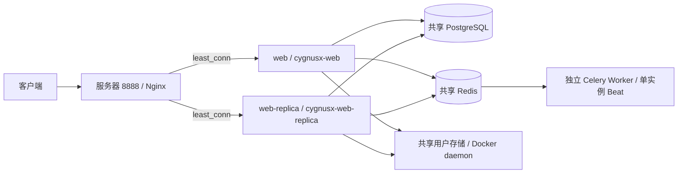
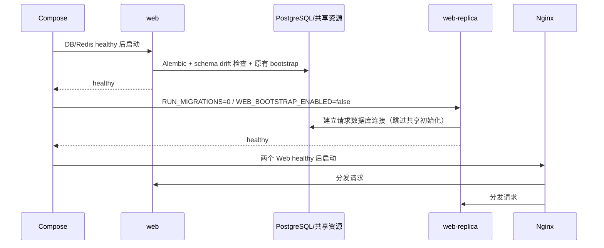

# Web 双容器与 Nginx 负载均衡

本文记录主栈的双 Web 部署实现，范围是同机 Web 容器故障冗余，不代表数据库、
Redis、Nginx 或宿主机已具备高可用。运行验证日期：2026-10-29。

## 1. 架构与请求路径

前端静态文件由 Nginx 直接提供；API、健康检查和后端静态路径通过
`cygnusx_backend` 分发。两个容器各运行 4 个 Uvicorn 进程，使用同一个
`CYGNUSX_WEB_IMAGE`，没有引入第二种 Web 镜像。保留主容器名称及宿主 8000
端口以兼容现有运维命令；副本没有宿主端口，入口继续使用 8888。

`web-replica` 使用 Compose `extends` 复用主服务。Compose 会在合并 overlay 前
解析继承，因此生产、跨机和 Bridge overlay 中的 Web 环境/网络设置同步声明到副本；
不能只改 `web` 并假定副本自动继承 overlay 的所有变化。需要支持 `!reset` 的
Compose，本机验证版本为 v2.39.1。

## 2. 启动与关闭

主实例保留原有初始化职责；副本跳过 Provider/Agent/MCP/知识库同步、目录补偿、
欢迎词入队、知识库增量索引和启动时沙盒收养/预热，避免增加一套共享资源初始化。
副本仍加载模块注册表、验证 embedding 配置，并维护请求所需的本地 Provider 健康状态。
该开关不关闭请求内的沙盒能力，也不把主实例已有的多进程初始化改写成全局单例。

`RUN_MIGRATIONS=1` 仅在主实例执行，副本等待主实例 healthy 后才启动。
因此首次启动仍依赖主实例；启动完成后主实例退出不会自动停止副本。
新版本若包含不兼容 schema 变更，仍需要单独设计数据库发布步骤，不能直接视为
无停机滚动升级。`make docker-dev-refresh` 会先重启主实例并等待健康，再重启副本。

Uvicorn 优雅退出窗口为 90 秒，Compose 停止宽限为 120 秒。已有 SSE/WebSocket
连接属于接收它的具体进程；进程故障或超过退出窗口时连接会中断，需要客户端重连。
连接无法透明迁移，AI 正在执行的轮次也不能仅靠 Nginx 自动恢复。

## 3. 分流、故障避让与服务发现

开发和生产 Nginx 配置使用相同的双节点 upstream：

- `least_conn` 按当前连接数分流，适合存在 SSE/WebSocket 的入口。
- 共享 upstream zone 让各 Nginx worker 共用节点状态。
- `max_fails=1 fail_timeout=5s` 被动避让连接失败的节点。
- Docker DNS `127.0.0.11` 配合 `resolve` 和 5 秒缓存刷新容器地址。
- 连接超时 2 秒，最多尝试两个节点；只在响应尚未发给客户端且符合安全重试规则时切换。
- 不启用 `non_idempotent`，避免已经送达后端的写请求被重放。
- 关闭响应缓冲以透传 SSE，保留原有 API 限流与 WebSocket Upgrade。
- JSON 访问日志新增 `upstream_addr` / `upstream_status`，用于核实分流与失败重试。

动态 `resolve` 需要开源 Nginx >= 1.27.3，本机验证版本为 1.31.2。
机制和重试边界见 [Nginx upstream 官方文档](https://nginx.org/en/docs/http/ngx_http_upstream_module.html)
及 [proxy_next_upstream 官方文档](https://nginx.org/en/docs/http/ngx_http_proxy_module.html#proxy_next_upstream)。
Compose healthcheck 负责启动顺序和观测，Nginx 使用被动故障检测，二者不是主动健康摘流系统。
应用已接收连接但长时间不响应、共享数据库失效等情形不等价于容器连接失败。

## 4. 连接预算与容量边界

Web 容器内默认覆盖 `DATABASE_POOL_SIZE=4` / `DATABASE_MAX_OVERFLOW=0`：

`2 个容器 × 4 个进程 × (4 + 0) = 32 个主库池连接`。

使用 `.env` 的 `CYGNUSX_WEB_DATABASE_POOL_SIZE` 与
`CYGNUSX_WEB_DATABASE_MAX_OVERFLOW` 调整此预算。Worker、后台独立引擎、运维连接
仍需另外预留；如果配置只读数据库，还需核算只读池。保留 `SERVICE_NAME=web`，
避免副本错误切换到为 Celery 设计的 NullPool。

增加容器能分摊 Web 请求、提供容器级冗余；同机 CPU/内存、数据库、AI Provider、
计算 Worker 容量和入口限流不会随容器数翻倍。此变更不宣称吞吐翻倍、万级 RPS、
宿主机容灾或 AI 轮次断点恢复。旧容量快照的历史数据保持不变。

## 5. 验证与运行证据

证据目录：`evidence/web-redundancy/`（不入版本控制；不保留测试令牌）。

- 四种 Compose 组合解析：主/副本镜像、命令、卷、认证环境与网络一致，副本无宿主端口。
- 8888 入口 30 次健康/真实鉴权只读业务请求全部 200，两个 Web 各处理 15 次；
  同一个临时用户 JWT 在两个容器都有效。
- 主 Web 重建期间 30 次请求全部 200，日志确认副本承接及失败重试；最大延迟约 9 秒，
  不等于切换期间延迟不变或所有写操作都可重试。
- 副本停止时 30 次请求全部 200（最大延迟约 2 秒）；副本 IP 从
  `192.168.80.10` 变为 `192.168.80.11` 后，无需 Nginx reload 即恢复接收请求，
  新地址阶段 30 次请求全部 200。测试占位容器已清理，两个 Web 均恢复 healthy。
- 两条真实聊天 Case SSE 订阅分别命中两个 Web，通过共享 Redis 收到同一合成事件；
  两条流均在发布操作开始后约 580ms 收到数据（含 Docker exec/进程启动开销，无 LLM 调用）。
- `test_web_replica_startup.py` 验证副本不执行共享初始化；连接池与 embedding 相关
  专项与 Compose 存储契约检查共 24 项通过。镜像映射与迁移链校验通过。
- 临时用户、聊天会话、空用户目录与令牌文件均已清理；原 JWT 在两个 Web 上均返回 401。
  最终审计确认两个容器 healthy、镜像 digest/共享挂载/认证配置一致，8888 首页和健康检查均 200。

首次全仓检查记录：Ruff 267 项、mypy 983 项错误；unit 4244 通过、13 失败、16 跳过。
其中 Compose `!reset` 的 PyYAML 解析兼容问题已修复并复验，其他失败记录见日志；
不能把专项通过表述为全仓全绿。独立 Bridge 的无 MinIO 凭证断言也与当前配置不符，
未为本次 Web 冗余变更修改其凭证策略。
