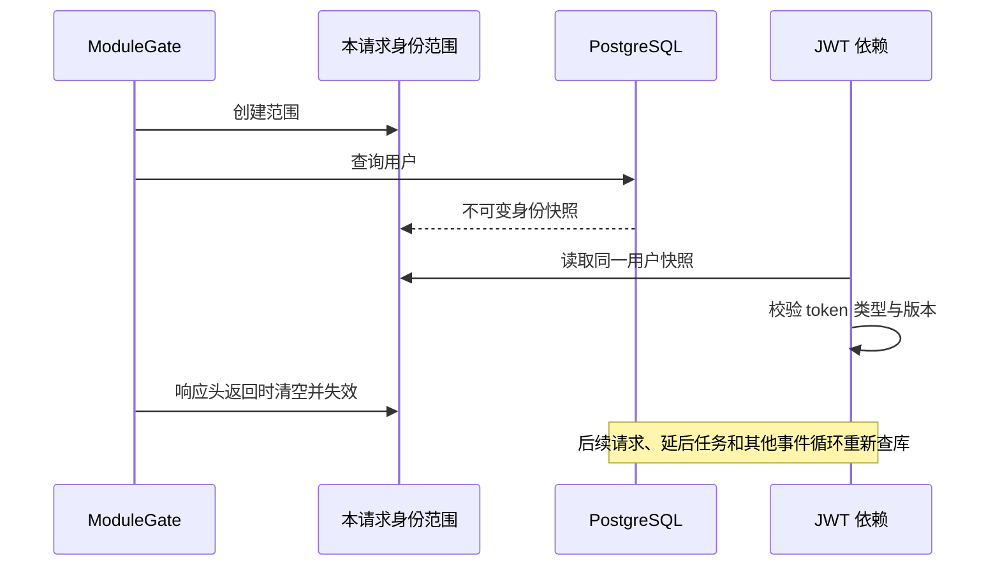

# 请求内身份复用与 4/8/16 进程容量验证

> 类型：2026-10-27 第三轮运行快照；候选代码未重启发布到现有 Web。
> 前置：[首轮压测](CygnusX_web_capacity_assessment.md)、[中间件与多进程对照](CygnusX_web_capacity_optimization.md)。
> 结论：同机 16 进程固定 1000 RPS / 30 秒通过，2000 RPS 未通过；**10000+ RPS 尚未达成**。

## 1. 身份查询的复用边界

`application/services/request_identity.py` 提供不可变的用户身份快照，包含用户 ID、角色、
状态、token_version 和被禁用模块集合。`ModuleGateMiddleware.dispatch` 为每次 HTTP
请求创建独立 ContextVar 范围，模块门禁与 JWT 依赖在这个范围内复用一次用户查库。
JWT 签名、access 类型和 token_version 比较仍逐次执行，不把身份快照当作认证证明。

范围结束时，同时重置 ContextVar、清空快照并标记失效。BaseHTTPMiddleware 返回响应头
后，延后的流式/后台子任务即使继承上下文，也必须重新查库。不同请求或不同数据库
会话工厂不共享快照；
复制到其他事件循环的上下文不复用快照或 asyncio.Lock；非 HTTP 调用没有范围时也每次查库。
数据库错误不缓存，缺失用户不会通过 JWT 依赖。没有引入 Redis 身份 TTL 或跨请求缓存。

## 2. 同配置交替对照

两个真实应用实例均关闭 APP_DEBUG，保留真实路由、JWT、模块权限和遥测，pool=4、
overflow=0。使用 100 个独立普通测试账号中的前 20 个，每用户最多一个在途请求，
无操作间隔，每档预热 3 秒、测量 30 秒。两个实例只在是否启用请求内复用上不同。
`--disable-request-identity-cache` 仅供隔离容量入口对照，不是生产授权开关。

| 轮次 | 不复用成功 RPS | 复用成功 RPS | 不复用 P95 ms | 复用 P95 ms | 错误率 |
| --- | ---: | ---: | ---: | ---: | ---: |
| 1 | 232.87 | 242.85 | 147.22 | 132.23 | 均 0% |
| 2 | 225.33 | 241.25 | 154.38 | 137.55 | 均 0% |

本次平均吞吐提升约 5.7%，P95 降低约 10.6%。更明确的效果是数据库事务/查询减少：

| 模式 | 完成 HTTP 请求 | users SELECT | users SELECT / 请求 | 全部 SELECT / 请求 |
| --- | ---: | ---: | ---: | ---: |
| 不复用 | 15074 | 24124 | 1.6004 | 2.4009 |
| 请求内复用 | 15964 | 19153 | 1.1998 | 1.9998 |

用户查询约减少 25%，全部 SELECT 约减少 16.7%。计数通过 SQLAlchemy
`after_cursor_execute` 事件取得，包含预热、健康探测和安全验证请求；不包含驱动底层
ping 等绕过该事件的语句。不是对 PostgreSQL 全部网络往返的计数。

## 3. 真实 HTTP 撤销与权限验证

只操作本次标记明确的专用普通账号，关闭复用/启用复用两个实例的结果完全相同：

| 变化或凭证 | 下一请求状态 |
| --- | ---: |
| 正常用户、有效 JWT | 200 |
| 禁用 ai-assistant 模块 | 403 |
| 用户改为 inactive | 401 |
| token_version 递增后继续使用旧 JWT | 401 |
| 签发匹配新版本的 access JWT | 200 |
| 恢复原测试状态与凭证 | 200 |
| 修改 JWT 签名 | 401 |
| 使用 refresh token 访问业务接口 | 401 |

变更在数据库提交后逐请求验证，结束时恢复测试行。延后子任务、不同事件循环、并发请求
隔离和数据库失败恢复另由定向测试覆盖。这里的“即时生效”指后续请求重新读取已提交状态，
不宣称取消所有已经开始的请求或正在生成的 SSE 回复。

## 4. 同机 4 / 8 / 16 进程

宿主机为 AMD Ryzen 7 8845HS，**8 个物理核心 / 16 线程**，约 93 GiB 内存。
使用真实应用的独立 Python/Uvicorn 进程，位于同一个现有容器内的私有端口，
不是 16 台服务器或跨主机集群。临时非 root Nginx 使用 least_conn 分流，未修改生产入口。
所有实例 pool=3、overflow=0，16 个进程理论最多额外使用 48 个 Web 数据库连接。

100 个独立测试用户、无操作间隔、预热 3 秒、测量 30 秒：

| 独立 Web 进程数 | 成功 RPS | P95 ms | P99 ms | HTTP 错误率 |
| ---: | ---: | ---: | ---: | ---: |
| 4 | 657.16 | 330.31 | 505.04 | 0% |
| 8 | 1019.83 | 146.82 | 455.76 | 0% |
| 16 | 1310.25 | 119.42 | 173.50 | 0% |

Nginx 访问日志确认 16 个目标都处理了真实请求。进程数增加四倍，吞吐只增加约两倍，
显示同机扩展的边际收益已经下降。末段资源采样 Web 容器最高约 1419.84% CPU，
数据库最高约 77.92%；这些是容器聚合采样，不能单独作为每个函数的归因。

## 5. 固定到达率验收

对同一 16 进程入口使用 k6，预分配 200 VU、最多 500 VU，100 个测试身份轮换，
五个只读接口等权混合。门槛为错误率 <1%、有效业务响应 >99%、P95 <300ms、
P99 <1s、dropped_iterations=0；每档 30 秒。

| 目标 RPS | 完成请求数 | 实际完成 RPS | P95 ms | HTTP 错误率 | 丢弃到达 | 结论 |
| ---: | ---: | ---: | ---: | ---: | ---: | --- |
| 1000 | 30001 | 999.75 | 10.84 | 0% | 0 | 通过 |
| 2000 | 35116 | 1161.89 | 890.34 | 0% | 24885 | 未通过 |

不能把配置的 2000 标为已达到，也不能因完成请求均为 200 而忽略丢弃到达。
16 进程结果不是 10000 RPS 的证明，不应直接线性推算为增加几台机器就必然达标。
正式万级验收仍需明确部署资源/预算、真实数据规模、多机共享状态及连接预算，并通过
10000 RPS 至少 30 分钟和故障场景测试。资源口径已向用户询问，尚未取得确认。

## 6. 限制、验证与收尾

本轮使用无历史项目/任务/会话的测试账号，只覆盖内网 Web 只读 API；不包含公网限流
Redis 路径、密码登录、上传、SSE 负载、LLM 生成和计算任务。保留
`scripts/web_capacity_server.py` 的隔离只读启动约束，未把它用作生产入口。

定向回归 42 项通过，包括同请求并发复用、跨请求/会话工厂隔离、失效后的后台任务、跨事件循环、
撤销与版本检查；4 个相关源文件的 strict mypy 校验通过，Ruff 定向检查通过。
最终全量 unit/e2e 为 4205 通过、16 失败、22 跳过、63 隔离排除，包含新增隔离分支；
失败集合与第二轮完全一致，并有真实 HTTP smoke 与真实 SQL 控制验证。全仓 mypy 986 项错误，比
第二轮少 6 项且无新增错误；全仓 Ruff 仍有 265 项错误。全仓门禁不绿，尚未发布。

本轮所有临时进程/入口与 100 个专用账号、凭证均已清理，收尾状态以 cleanup.json 为准。
最后一轮有界 smoke 曾因实例定时退出与测试窗口重叠而失效，已保留为
`discarded-expired-*`，不计入容量结论；最终 smoke 由同一控制程序负责就绪、测试与退出。

运行证据位于 `evidence/web-capacity-request-identity/`（不入提交）：

- `baseline{1,2}.json` / `optimized{1,2}.json`、实例 manifests：交替对照。
- `baseline-sql.json` / `optimized-sql.json`：SQL 与 HTTP 完成计数。
- `live-revocation.json`：真实 JWT、权限变更与撤销验证。
- `scale-{4,8,16}.json`、`scale-run.json`、`gateway-distribution.json`：实际扩展与分流。
- `k6-{1000,2000}-summary.json` 与 logs：固定到达率通过/失败证据。
- `scale_probe.py`、`nginx-{4,8,16}.conf`、`scale-resources.jsonl`：复跑逻辑与采样。
- `final-smoke.json` / `final-smoke-controller.log`：最终同循环资格检查后真实 HTTP 验证。
- `final-live-sql.json`：真实会话工厂隔离、ModuleGate + JWT 每请求只读一次用户表的验证。
- `tests.txt`、`mypy.txt`、`ruff.txt`、`unit-e2e-final.txt`、`baseline-comparison.json`：最终回归与基线对照。
- `cleanup.json`：临时进程、测试身份与原服务健康验证。
