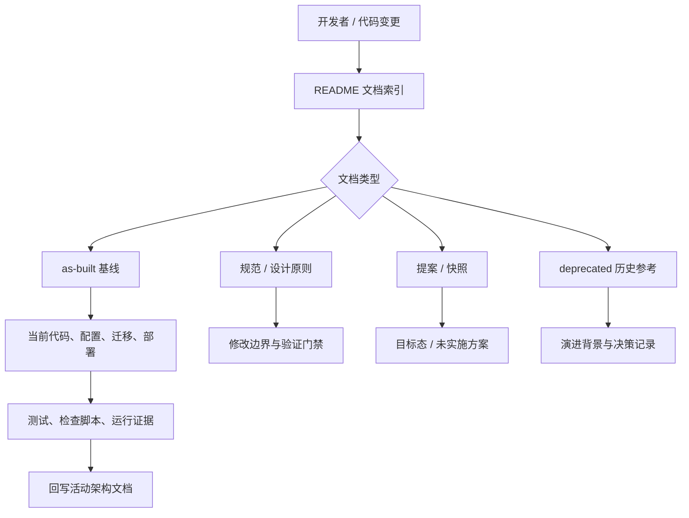
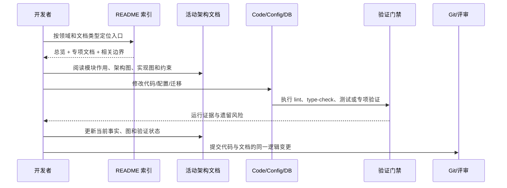

# 架构与设计文档索引

本目录集中存放 CygnusX 的项目级架构、设计规范和实施方案。修改相关功能前，请先阅读对应文档，确保实现与既有约束保持一致。

> 科研寻宝鼠端到端链路现状入口：[CygnusX_treasure_mouse_architecture.md](CygnusX_treasure_mouse_architecture.md)（as-built；发现→Dataset→下载/分析预案→双报告读取，全部写执行运行门禁 BLOCKED）。

> 科研寻宝鼠界面与更新接入：[CygnusX_treasure_mouse_ui.md](CygnusX_treasure_mouse_ui.md)（共享 UI/平台业务/运行镜像更新边界、归档布局构建修复、960px 回复区与视觉验证）。

> 科研交付链现状入口：[CygnusX_research_delivery_architecture.md](CygnusX_research_delivery_architecture.md)（Phase4 受保护代码；运行准入 BLOCKED）。

> 项目科研成果与导出现状同见科研交付架构的RI06–RI09节：ProjectDetail只读聚合、版本化Manifest、独立ProjectExportJob与授权下载已接代码/隔离验证；默认关闭；真实隔离 PG/Worker 已启动、浏览器预览已验，非空科研成果/ZIP 导出仍受 corpus 门禁阻断。

> 受控研究计划现状：[CygnusX_research_plan_architecture.md](CygnusX_research_plan_architecture.md)（Phase5 PLAN_ONLY；真实执行与评测发布未准入）。

> 三项科研功能运行验收：[CygnusX_Research_Feature_Runtime_Acceptance.md](CygnusX_Research_Feature_Runtime_Acceptance.md)（2026-10-20；真实隔离 Docker/PG、计划审阅及浏览器预览部分通过；真实科研记录/ZIP 因 corpus 门禁 BLOCKED，生产未准入）。

> **平台经营面入口（2026-10-21 补齐）**：用户与权限 → [CygnusX_identity_access_architecture.md](CygnusX_identity_access_architecture.md)；管理控制台 → [CygnusX_admin_console_architecture.md](CygnusX_admin_console_architecture.md)；饼干经济 → [CygnusX_cookie_economy_architecture.md](CygnusX_cookie_economy_architecture.md)；节日彩蛋 → [CygnusX_festival_architecture.md](CygnusX_festival_architecture.md)；通知/公告/提醒/站点内容 → [CygnusX_notification_engagement_architecture.md](CygnusX_notification_engagement_architecture.md)；项目/文件/团队 → [CygnusX_project_workspace_architecture.md](CygnusX_project_workspace_architecture.md)；目标运行时 → [CygnusX_goal_architecture.md](CygnusX_goal_architecture.md)；Skill/MCP 接入面 → [CygnusX_skill_mcp_integration_architecture.md](CygnusX_skill_mcp_integration_architecture.md)；调度与分析运维 → [CygnusX_analysis_operations_architecture.md](CygnusX_analysis_operations_architecture.md)。覆盖对账与残余缺口见 [CygnusX_architecture_coverage_audit.md](CygnusX_architecture_coverage_audit.md)。

> **项目管理全面梳理（2026-10-24 审计快照）**：[CygnusX_project_management_review.md](CygnusX_project_management_review.md) 汇总页面/API/模型/权限、会话与运行归属、科研成果、生命周期和改进优先级；隔离复现改名目录分叉、默认项目绕过删除身份、科研引用删除约束三项问题。建议尚未实施，专项测试不代表生产运行验收。

## 0. 这个架构文档目录如何发挥作用

> Web / Celery 容量实测：[CygnusX_web_capacity_assessment.md](CygnusX_web_capacity_assessment.md)
> （2026-10-27 运行快照：10/20/50/100 用户、入口限流、固定 100 RPS、Celery 对照；
> 多 Web 与 10000+ RPS 为待实施/待验收目标，不是已达到的容量）。
> 后续对照与同机多进程扩展：[CygnusX_web_capacity_optimization.md](CygnusX_web_capacity_optimization.md)
> （中间件非活跃路径优化、1/2/4 进程实测、固定 500 RPS 短时通过；万级目标尚未通过）。
> 请求内身份复用与 4/8/16 进程：[CygnusX_web_request_identity_capacity.md](CygnusX_web_request_identity_capacity.md)
> （身份查询减少约 25%，固定 1000 RPS 短时通过；2000 与万级目标尚未通过）。
> 静态路由监控标签优化：[CygnusX_web_telemetry_capacity.md](CygnusX_web_telemetry_capacity.md)
> （同配置吞吐约增 8%，固定 1250 RPS 短时通过；1500/2000 与万级目标尚未通过）。

`ARCHITECTURE_DESIGN` 是代码现状、修改规范和历史方案的文档索引层。开发者先依据本 README 按领域定位文档，再阅读对应的 as-built 基线或规范；修改代码时以代码、配置和迁移为事实来源，用架构文档解释模块边界、数据流、权限和验证门禁。`as-built` 文档描述当前实现，规范文档约束应该如何修改，提案/快照记录目标态或某一时点，`deprecated/` 只保留历史参考，不能覆盖活动基线。

目录中的文档不是运行时注册表，也不会被 Agent 自动加载执行。它们通过索引、交叉引用和每份文档开头的模块作用说明帮助开发者从请求入口追到应用服务、领域逻辑、基础设施、数据库、队列和前端投影；每份文档的架构图展示组件关系，实现图展示一次请求或任务的时序。修改涉及多个边界时，先读总览和对应专项文档，再按文档内验证矩阵执行测试、迁移、镜像或前端门禁，并把新的事实回写到活动文档。

### 0.1 目录架构图：文档索引到代码边界

### 0.2 实现图：一次架构变更的文档使用流程

> **2026-09-18 文档整合说明**：本目录对内容重复的文档做了一次合并，共移除 10 个文件（合并去向见文末"合并记录"，历史内容可查 git）。各目标文档头部均有"合并说明"标注吸收来源。
>
> **2026-10-03 命名规范说明（现行，取代 2026-09-18 版）**：目录内文件统一按 `CygnusX_<领域>_<xxx>.md` 命名（更名对照见文末"命名规范记录"）：
> 1. 统一 `CygnusX_` 前缀 + snake_case 主体，不使用连字符（`multi-agent` 类）与中文文件名；
> 2. 领域段紧随前缀：`CygnusX_agent_*` / `CygnusX_chat_*` / `CygnusX_database_*` / `CygnusX_frontend` / `CygnusX_knowledge_*` / `CygnusX_log_*` / `CygnusX_mcp_*` / `CygnusX_memory_*` / `CygnusX_network_*` / `CygnusX_platform_*` / `CygnusX_sandbox_*` / `CygnusX_skill_*` 等；
> 3. **文件名一律不带日期**——基线日期/快照日期写在文档头部与本 README 各条目描述中（原"快照以 `_YYYY-MM` 结尾"规则废止，时点性文档仍只增不改）；
> 4. **不再演进方向**的文档移入 `deprecated/` 子目录原样保留，同样按本规则命名，登记到文末"废弃归档"；
> 5. 新增文档请沿用本规则，并同步登记到本 README。
>
> **2026-09-20 新增说明**：新增 `CygnusX_agent_architecture.md`（单 Agent 技术架构备忘录，as-built）。与 `CygnusX_agent_execution_framework.md` 的分工：本文回答"Agent 这个对象由什么构成、接口长什么样、状态存在哪、依赖什么"，后者回答"一次执行怎么流转、怎么观测、怎么保护"。两者互补，不合并。
> **2026-10-04 新增说明**：新增 `CygnusX_storage_architecture.md`（存储层架构，as-built）。落地 `docs/info/26.10.3/存储层优化实施方案.md` Phase 0–3（GC 路径修复、会诊 workdir 容器挂载接通、宿主侧硬编码全部派生化 + CI 守卫、幽灵目录 DB 清理 + sync 反向对账、目录树 D1–D3 展示元数据）。Gap 审计（`CygnusX_storage_workspace_gap_audit.md`）中 Gap 1/2/4（部分）已修复，Gap 3 前缀统一待裁决；存储相关改动以新文档为基线。
> **2026-09-22 更新说明**：普通 AI 助手已补齐会话级分析归档。`chat_sandbox_execute` 的 input/work/output、`README.md`、`environment.json`、`manifest.json`、实际包版本探针和 `sandbox_meta.analysis_archive` 契约，以 `CygnusX_agent_architecture.md`、`CygnusX_agent_execution_framework.md` 与 `CygnusX_sandbox_architecture.md` 的新增 as-built 小节为准。
> **2026-09-22 更新说明**：新增 `CygnusX_token_billing_architecture.md`，记录 Provider usage 归一化、缓存 token 计费、工具循环累计、会话落库、饼干扣费、元估算和对账排查流程。涉及 token、费用、余额或模型价格的修改，必须以该文档为当前实现基线。
> **2026-10-03 更新说明**：
> 1. `CygnusX_network_architecture.md` 补登记（§1.1，快照类）；
> 2. `CygnusX_skill_first_sandbox_execution_proposal.md` 补登记（提案 v2，非 as-built）；
> 3. 外部独立文档统一进架构库：`mcp-server/ARCHITECTURE.md`（独立权威文档，保留原位，登记于"相关文档"）、`tool_configs/tools_design.md`（工具页面专项规范，保留原位，登记于"相关文档"）；`pipelines/Flow_framework.md`（v1，已被 `Protocol/FlowFrame/flow-framework` v2.0 取代）与 `tool_configs/tools_update.md`（提案已全部落地，现状见 `CygnusX_mcp_architecture.md`）移入 `deprecated/`（见"废弃归档"与"合并记录"）；
> 4. `CygnusX_memory_architecture.md` 补 mem0 遗留现状更正（引擎代码 2026-08-19 已删除，`mem0_memories` 遗留表 + `MEM0_*` 配置段为受保护迁移残留，见其 §1）。
>
> **2026-10-21 覆盖补齐说明**：对 `api/v1`（49 个路由模块）、`application/services`（196 个服务文件）与前端入口做全覆盖对账后，新增 9 份 as-built 文档，补齐此前只有代码、没有架构汇总的平台经营面：`CygnusX_identity_access_architecture.md`（认证/用户/RBAC/模块门禁）、`CygnusX_admin_console_architecture.md`（系统管理 12 菜单与 18 个 admin 路由模块）、`CygnusX_cookie_economy_architecture.md`（账户/账本/定价/任务结算/AI 扣费）、`CygnusX_festival_architecture.md`（节日彩蛋）、`CygnusX_notification_engagement_architecture.md`（通知/公告/提醒/站点内容）、`CygnusX_project_workspace_architecture.md`（项目/文件/团队/归档）、`CygnusX_goal_architecture.md`（目标运行时）、`CygnusX_skill_mcp_integration_architecture.md`（Skill 路由与 MCP 资源接入面）、`CygnusX_analysis_operations_architecture.md`（调度/工作流监控/运行记录/统计）。覆盖矩阵、本轮纠正的事实与残余缺口（legacy AI 对话、MAS 房间骨架、research claims API 等）见 `CygnusX_architecture_coverage_audit.md`。
> **2026-10-21 异步队列补充说明**：新增 `CygnusX_async_task_queue_architecture.md`，补齐 Celery 应用配置、6 个逻辑队列、25 条 `task_routes`、34 条 Beat 注册表、Worker/Beat/Flower 部署矩阵、任务级超时/重试、RocketMQ 可选传输与可靠性缺口。`CygnusX_analysis_operations_architecture.md` 只保留调度业务面；worker、queue、`schedules` 消费缺口与 RocketMQ 细节以新文档为准。

**文档类型口径**：
- **as-built**：记录仓库当前已落地架构，可信度最高；
- **规范**：约束"应该怎么改"，修改前必读；
- **提案/规划**：目标态设计，未（完全）实施，不得当作现状证据；
- **历史快照**：带"时点说明"的施工/评审/交接记录，部分引用已失效。

---

### `CygnusX_dataset_architecture.md` — Dataset 与 Flow 输入资产（as-built，运行准入 BLOCKED）
新增版本化 Dataset/Source/Asset/Sample、GEO/ENA 只读证据、导入预案和原服务对账、受控 Handoff；统计本地验收与 Worker/写门禁分开，详见该活动基线。

### `CygnusX_treasure_mouse_architecture.md` — 科研寻宝鼠端到端科研链路（as-built，运行准入 BLOCKED）
该域活动架构入口：React Island 唯一展示树 + Vue 外壳 + FastAPI BFF 三层边界；三条调用链（UI typed action / Node 有限委托 / 平台 AI ToolBridge）汇入同一 `AgentToolGateway`；身份/项目/scope 派生、能力目录、委托 token、Dataset 七表与 Alembic 链（单一 head）；GEO/ENA 只读证据适配；Prepare→人类 JWT 审批→执行三段分离与幂等对账；DatasetVersion/冻结 Handoff；FASTQ→RNAFlow / raw counts→counts_deg 匹配与统一 `FlowSubmissionValidator`;双报告只读投影；`WRITE_RUNTIME_ACCEPTED=False` + `worker_paths_verified=False` 两道源码门禁与默认关闭开关矩阵；RG-01–12 与能力状态；**§16 文档与代码核对**列出发现的不一致（含 `/research-agent/capabilities` 字段漂移）。

### `CygnusX_download_architecture.md` — 下载与公共数据接入（as-built，**平台下载模块单一权威文件**）
三来源人工下载链（EBIDownload、三云 CLI、aria2c/ftplib）与云盘 UI 占位；前端→REST→Service→Task→Worker→FileRecord→Dataset/Handoff 的职责、源码写门禁与已证 task_id/source/checksum 断点；区分子模块 EBIDownload 1.4.0、旁仓 Polariseq 1.4.3、宿主程序和未知运行容器。**下载模块的全部细节以本文为准**；Agent 工具层、寻宝鼠链路、Dataset 三份文档只在各自域内保留接入点并回指本文。调查矩阵与逐协议/Agent 发布门禁见文内专项调查链接，不能将代码存在视为运行认证。附录 A 附"数据下载与多 Agent 工具化"目标态参考图（提案，非现状依据）。

## 1. 平台总览与总体规范

### `CygnusX_platform_next_stage_roadmap.md` — 平台下一阶段推进路线（规划，非 as-built）
聚焦协作室向真实多智能体协作闭环完善、现有记忆系统微调，以及科学推理（Scientific Reasoning）、科学验证（Scientific Validation）、研究演进（Research Evolution）三项能力建设；记录架构调整候选、分阶段交付和验收标准。工程准备与 M1 收口衔接，保留根 README 的 M2 正式启动日期；不能据此宣称功能已实现或运行门禁已通过。

### `CygnusX_platform_architecture_maps.md` — 当前平台架构图汇总（简练版 + 详细版，2026-09-26）
以仓库现状为依据，提供一页简图，以及部署拓扑、Chat 请求、Agent 工具边界、Studio 沙箱、AgentTeams/Worker、FlowFrame、生信分析链和数据/事件横切面的 Mermaid 详细图。该文档是看图入口，具体契约仍以各领域 as-built 文档为准。

### `CygnusX_chat_openai4s_integration_architecture.md` — Chat 与 OpenAI4S 融合架构调查（as-built，2026-09-26）
记录 OpenAI4S 契约在 OmicHub 中的实际衔接边界：上下文估算、校准、滚动摘要、handoff、大输出外置、双熔断和归档；同时按一次请求的时序串联前端 SSE、FastAPI、Agent 装配、LangGraph、OpenAI-compatible Provider、MCP、Skill、Chat/Studio 沙箱、AgentTeams 和 Workflow/Worker。明确“数据库原文权威、压缩视图只供模型请求”的差异，以及已实现能力和 Docker/Postgres/外部服务待验收项。本文是跨子系统调查导航，专项契约仍以 `CygnusX_agent_execution_framework.md`、`CygnusX_mcp_architecture.md`、`CygnusX_skill_architecture.md` 和沙箱基线文档为准。

### `CygnusX_platform_architecture.md` — 平台架构总览（as-built 导航，2026-08-22）
全系统"一页地图"：Vue3 前端 → FastAPI → Application/Orchestration → AI/MCP、Celery/Worker、持久化 → Docker 沙箱/MinIO/Nginx 的总体分层；四条执行链路（Chat/Agent、Studio、AgentTeams、Pipeline/Worker）各自的请求路径；第 5 章 Agent 五形态（Legacy ReAct / LangGraph / Studio / Worker ReAct / AgentTeams）与 loop guard、`llm_payload`/`ui_payload` 双通道；第 6–10 章摘要 AgentTeams 四层拓扑、Studio 沙箱安全基线与 capability、MCP 三层体系、记忆/知识分层、Worker 边界与任务状态机；第 11–14 章前端、日志审计、部署发布、安全隔离模型；第 15 章区分"已具备主干能力"与"待验收项"；第 16–17 章为全目录文档索引。本文是导航与摘要，详细契约以各领域文档为准。

### `CygnusX_platform_design.md` — 模块设计与接入规范（规范，2026-07-29）
"先设计后编码"的项目级基线：六条设计原则（分层清晰、契约优先、渐进接入、配置外置、默认安全、可验证）；目录级架构基线（`api/v1`/`application`/`domain`/`infrastructure`/`tools` 五层）与模块类型选择表；生信工具强制基线（`tools_setting.yaml` 注册、group 五分类透传、图形工具数据闭环、分组配色色板、PNG/SVG 导出 DPI）；新模块设计文档模板；后端（DTO/服务/领域/迁移/权限）与前端（Naive UI、`@/api/client`、Pinia 边界、主题响应式）规范；配置可运营性；实施流程、提交拆分、DoD 清单；附录 A"任务中心体验增强"设计实例。与 architecture.md 职责互补（规范 vs 描述），不合并。

### `CygnusX_platform_vision.md` — L4 协作室目标态愿景（提案，2026-08-19）
描述设计目标而非现状：L1 工具箱 / L2 助手 / L3 工作台 / L4 协作室四层架构，协作室定义为"生物信息部门"；Manager 五项职责（接单/派单/验收/交付/例外处理）；专家层四段能力契约（capabilities / not_suitable_for / handoff_when / preferred_inputs）与 agent-data/qc/delivery 内部职能；甲方完整回路、共享地基（统一存储、分层记忆、单一能力目录、统一审计总线）；L4 判定"能且是正解"的四个必要条件及状态，附 token 成本风险提示。

---

## 2. Agent 执行架构

### `CygnusX_agent_tool_gateway.md` — BioOps 共享 Agent 工具层（as-built）
记录 Phase 2 主进程 Gateway、Node 有限委托、MCPClient/ToolBridge 复用、prepare/人工审批、
最小调用关联及恢复边界。当前 IMPLEMENTED / WRITE BLOCKED，运行 Gate 未通过，所有
Agent 下载/分析/取消保持后端禁用；不代表部署验收。

### `CygnusX_agent_architecture.md` — 单 Agent 技术架构备忘录（as-built，2026-09-20）
回答"一个 Agent 在 CygnusX 里到底怎么定义、怎么调用、怎么维持状态、怎么调工具、怎么跑起来、依赖什么、怎么和别的 Agent 协作"的实现细节层快照。Agent 是**数据驱动**（20 个 `data/ai/*.yaml` → `agent_templates` 表）而非基类继承；入口为 `POST /api/v1/chat/stream` SSE，出入参是 OpenAI 消息 dict 列表 → `AsyncIterator[ChatChunk>`；辨析两个同名 `AgentContext` 的职责边界；对话历史由**前端显式传入**、后端 per-request 无会话状态机，三层上下文裁剪；`AgentState` TypedDict 刻意不引入 LangChain 消息封装（reducer 用 `operator.add`）；checkpoint 仅编排图启用、单 Agent ReAct 图不用；工具调用的 OpenAI Function Calling 规范、tool_packs 请求级裁剪、MCP 三传输与 circuit breaker、双通道 `llm_payload`/`ui_payload`；轻量 Docker 沙箱（warm pool + Docker SDK exec）与 Studio 沙箱（一会话一容器 + Unix Socket）两种执行环境、MAS 执行准入策略、supervised 审批闸五步链路；全异步全流式与并发治理参数；依赖生态实测版本（langgraph 1.2.10 / langchain-core 仅间接依赖 / mcp 2.0.0 / 自研 httpx Provider，**无 Anthropic SDK、LlamaIndex、mem0**）；四种多 Agent 协同模式（Supervisor / Handoff / Map-Reduce / Group Chat）的落地位置。附关键实现位置索引（26 项）与 9 条改造约束。另记录一处配置漂移：`.env.example` 仍有 `MEM0_ENGINE_ENABLED=true` 但代码已无 mem0 引擎（实际为自研 Postgres FactStore + fastembed）。

### `CygnusX_agent_execution_framework.md` — 当前执行框架（as-built 主文档，2026-08-18；已吸收 observability 文档）
Agent 执行面的唯一现状快照：多入口、共享工具契约、分路径执行；`execution_path` 实际发射五路径登记表（chat_legacy / chat_langgraph / studio_chat_loop / agentteams_worker_react / agentteams_tool_execution，含 degraded 降级语义；`agentteams_manager_consultation` 是早期文档中的规划值，当前代码未发射，Manager 会诊的事件投影记录为 `agentteams_worker_react`）；Legacy ReAct、LangGraph 节点（`llm_call_node`/`tool_exec_node`/双 route）、Worker 受限 ReAct（独立 child_session、五条禁止）三类闭环；AgentTeams 协助室意图四态判定与 Case 执行链；统一事件框架（七字段、生命周期事件 + 已并入的 `agent_tool_call`/`agent_tool_started`/`agent_tool_result` 三级工具事件链、`tool_call_id` 贯穿、Worker→房间证据投影表、前端事件→文案映射与"默认展开底层事件"）；运行保护（轮次治理、`StudioLoopGuard`、`duplicate_tool_call` 与无进展 Guard 语义）；消息/Case/Workspace 状态边界；修改扩展规则与验证清单。

### `CygnusX_model_routing_architecture.md` — 动态模型路由架构（as-built，2026-10-11）
记录 Router 专家意图路由与模型选型的边界、Provider 档位和成本配置、complexity 难度、健康监控、LangGraph 接入、级联与决策审计；明确默认关闭、覆盖路径和真实调用验收缺口。动态模型调度相关改动先读本文，并以代码、配置和迁移核对现状。

### `CygnusX_agent_framework_baseline.md` — AI 助手基线与工具契约（as-built + 操作指南，2026-07-26/29；已吸收 extension_guide）
配置驱动 Tool Agent 的规范基线：`data/ai/` 配置 → `ensure_builtin_agents()` → 数据库运行时链，改 md 提示词必须经营理端 API 发布；七个内置 Agent 清单与请求执行链路；工具与提示词契约——工作区五工具白名单一致性约束、Skill 三层渐进披露、时效检索降级契约、记忆与 Handoff 契约（`allowed_targets`、`max_hops_per_session`）、ask_user 全执行器统一中断语义与数据缺失澄清、会话隔离（`.s{session_id}` 标记）；Router/双执行器/Studio 边界；MAS 启用五前置条件；修改扩展流程与"不要采用的方式"反模式清单（prompt 假装执行、shell 拼接、任意 subprocess、高权限工具全发）；发布验收清单与验证证据；P1–P4 能力状态历史与优化方案实施边界（附录）。

### `CygnusX_agent_architecture_review.md` — 架构评审细读 + RAP 提案（历史快照/提案，2026-07-28）
前半为带 `path:line` 引用的评审细读：三层形态（Chat 专家、Studio 十工具与双通道、MAS 六步链路）、web_search 双触发与 knowledge_search 子串匹配现状、Prompt Registry 热重载、mermaid 时序图、四层治理机制（轮次治理与 `round_limit` 续轮、历史附件继承、256K 上下文压缩与 `context_compressed` 事件、会话文件治理）。后半为**未实施**的 RAP（检索增强计划生成）三层提案：提示词策略层、代码强制预检索注入、向量检索质量层，含实施顺序与验收清单。as-built 部分多数机制已被 `CygnusX_agent_architecture.md` / `CygnusX_agent_execution_framework.md` / `CygnusX_agent_framework_baseline.md` 三份承接，行号引用易腐化。

### `CygnusX_chat_execution_layers.md` — Chat Runtime 分层与事件契约（施工快照，2026-08-23）
Chat Runtime 重构的实施记录：HTTP → ChatService/AgentRuntimeGateway → ChatRouterService → ChatRuntime → 编排层 → ChatEventService SSE 出口的分层边界；`request_preparation.prepare_agent_request()`、`AgentContextBuilder`、`DelegatingAgentRuntime`、`DirectChatRuntime`；事件契约与 `ChatEventService` 唯一状态机校验点、`StudioLoopGuard` 熔断降级 supervised；`chat_runtime_refactor_enabled` 灰度回退、`agent.runtime.legacy_entry` 退役依据、golden record + `DualRunComparator` 双跑门禁；当前边界（ChatService 未瘦身至 <1000 行）与 99 项回归验证。

### `CygnusX_skill_first_sandbox_execution_proposal.md` — Skill-First 沙箱执行架构提案（提案 v2，2026-09-30/v2 2026-10-01，未实施）
"将平台全部 Skill 暴露给全部 Agent、以 Skill 引导沙箱代码生成"的目标架构与实施路径。§1 记录三个已核实的问题（Skill 库与 Agent"两个平行宇宙"、`.agents/skills/` 561 个 bio-* 与平台业务 Skill 互不可见、沙箱执行缺乏 Skill 引导）；§2+ 目标态设计与开放问题的 2026-10-01 评审决策。**落地完成前不得作为现状依据**；关联现状文档为 `CygnusX_agent_execution_framework.md` 与沙箱基线文档。

### `CygnusX_skill_mcp_integration_architecture.md` — Skill/MCP 接入面与资源装配（as-built，2026-10-21）
补齐 `CygnusX_skill_architecture.md`（Skill 生命周期）与 `CygnusX_mcp_architecture.md`（MCP 通道）之间的"接入面"：`skill_route` 内置工具的分词/打分/20 候选截断/前 5 正文 6000 字预算、scout 子 Agent、五入口导入（JSON/ZIP/Markdown/GitHub/阿里云）与预览确认、管理端 skills/assistants/agents 三套表面、`user_agent_capabilities` 用户级覆盖、Agent 装配时的工具与资源合并、资源中心六 Tab 与 MCP/Skill 目录。附"对旧文档的校正"表（10 技能上限、YAML 覆盖、`UserAgentCapabilityModel`、`features` ORM/迁移漂移、legacy assistants 等），修改 Skill/MCP 接入前先读本文再回看两份领域基线。

---

## 3. 多智能体编排与记忆

### `CygnusX_mas_a2a_plan.md` — MAS/A2A 实施方案（提案评审稿，2026-07-18，Phase 0–4 核心链路已落地）
把"单 Agent + MCP 工具闭环"升级为可审计多智能体系统的蓝图：MAS 控制面（Intent Router → Orchestrator → DAG Scheduler → HITL Gate + State/Artifact Registry + A2A Outbox）；数据模型 `MASRun/MASPlan/MASNode/MASArtifact/A2AEvent/MASApproval/MASRetry` 与 `mas_*` 迁移表、Run/Node 状态机（乐观锁）；A2A 事件协议（Redis Stream + Transactional Outbox、`dedupe_key` 幂等、`node.rework_requested` 修复指纹限环）；共享工作区 `/data/cygnusx/runs/<run_id>` 与内容寻址缓存、Context Packager；首批 MCP 工具与容器隔离约束；端到端场景、错误重试/HITL、Phase 0–5 实施、测试矩阵与灰度回滚。与根目录通用 `plan-ai.md` 不是同一文件。

### `CygnusX_multi_agent_fanout.md` — 多 Agent 现状调查 + Sub-Agent Fan-out 设计（调查+设计+as-built，2026-07-29 初版 / §9 2026-10-26 全面调查）
§1 三层协作机制现状（MAS DAG 固定管道执行、多专家会诊 `asyncio.gather` ≤3 LLM 无工具、Handoff 串行接力；父循环对 tool_calls 串行 await）；§2 A2A 定性：自研内部事件协议而非业界标准 A2A；§4 Sub-Agent Fan-out 设计：`parallel_subagents` 工具请求内并行迷你 ReAct 子循环、`ParallelSubAgentService`/`SubAgentRunner`、七条正确性约束（独占 AsyncSession、剥离递归工具、隔离子目录）、六个灰度开关、`subagents` SSE chunk；§8 首版实施偏差记录；**§9 as-built 全面调查（2026-10-26，当前实现基线）**：线上双通道开关实测开启、三层闸门（暴露/执行/派生授权）与暴露缝隙、8 个调用方矩阵（含超频前后台闸门不一致）、子循环新增护栏（空响应重试/截断续写/双 Guard/审批与澄清 packet 升级/检索证据协议/超频工作台挂载）、配置漂移表、已知问题清单（含门禁内红测试）与安全边界核对。与 CygnusX_mas_a2a_plan.md 互补共存（分钟级编排 vs 秒级请求内并行）。

### `CygnusX_domain_prompt_sedimentation.md` — 领域知识渐进沉淀设计（提案草案 v1，2026-08-06，未实施）
注意：主题是"提示词/领域资产沉淀"而非 agent 并行。四环闭环：感知层 `DomainMissEvent`（`domain_miss_events` 表、脱敏）→ 候选聚合（指纹聚类、`domain_candidates`、浮现阈值）→ 沉淀层（轻=知识库条目/中=skill/重=Domain Pack，LLM 起草+人审+回放测试）→ 生效层（`data/ai/domains/<domain>.yaml` 热重载、灰度、回滚）。依赖 Domain Pack 设计，V0–V3 分阶段，附四条反模式红线。

### `CygnusX_memory_architecture.md` — AI 记忆系统（as-built，2026-10-22；核心接通已验，质量与观测仍待验）

[当前记忆架构](CygnusX_memory_architecture.md)：记录数据库长期记忆、Studio 文件记忆与知识库证据检索的职责边界；覆盖 user/agent/project 分区、同模型过滤与 RRF 混合召回、预算注入、显式写入、SQL 游标 settle/尾批、周度整理与按 run 回滚、遗忘残留提示、TTL 回执、管理 API/UI 和迁移回退。v2 代码默认关闭，当前目标环境已启用并完成真实写召、合成 settle 与 11 条受控回填；25 案例质量、生产指标导出与人工体验仍待验。知识与记忆共用 Qwen/1024 维 Provider，分表维护；不以记忆接通替代知识库入库验收。

### `CygnusX_memory_embedding_operations.md` — 记忆模型切换运行手册（as-built，2026-10-22；受控回填已验）

[运行手册](CygnusX_memory_embedding_operations.md)：同模型向量过滤的默认关闭开关、旧模型词面补位、显式 DSN 与目标库二次确认、dry-run/分批重嵌入、显式历史状态范围、同库 Provider 选择、覆盖率/样本新鲜度指标及回退边界。目标库已完成 11 条备份后受控回填；完整恢复演练、质量基线与生产观测仍需独立确认。此手册的安全维护契约不能直接套作知识库重建脚本已有能力。

### `CygnusX_memory_optimization_audit.md` — 记忆系统现状审计与优化路线（审计+路线，2026-10-20；非 as-built）
对 v2 记忆链路的代码、配置、运行数据与前端投影做三方对账：配置矩阵（`MEMORY_V2_ENABLED` / embedding / 抽取模型 / 站点开关 / 工具包授权）、读取-工具写入-settle-管理端-Studio-L4 全链路图、`memory_blocks`/`memory_facts`/`memory_settlements` 数据模型与分区语义、本机运行证据（0 blocks / 10 条事实且全无向量 / 82 次 settlement）；按 P0–P2 列出 4 个 P0（召回恒空、v2 遗忘工具失效、项目隔离缺失、抽取失败永久跳区间）与共享分区、block 生命周期、管理端 gate、embedding 模型耦合、Studio 跨会话等 P1/P2；给出 Phase 0–4 修复顺序、验收清单与需人工决策项（D1–D7）。**现状基线仍以 `CygnusX_memory_architecture.md` 为准，本文用于优化排期与回归验收。**

---

## 4. Studio 与沙箱

### `CygnusX_studio_handover.md` — OmicStudio 实施进度与交接文档（历史快照，2026-07-17）
P0–P3 全阶段建设记录：sandbox-agent 端点协议（/exec NDJSON、文件 API、路径防护）、StudioSandboxManager 与三个已修复 bug、`studio.yaml`、10 个 Studio 内置工具（`sandbox_execute`/`workspace_*`/`datahub_import`/`artifact_register`/`update_plan` 等）、SSE 事件协议、Studio REST API 全表与前端清单；P1 per-user 只读挂载安全决策、Context Packager、报告版本树；P2/P3 diff 回滚、Celery 长任务、MCP/Skills 渐进披露、egress 代理、分享导出、Skill 提炼。已声明"勿按本文档再次执行"，现行沙箱基线见下一份。

### `CygnusX_sandbox_architecture.md` — 沙箱强化架构（规范+进度，v1.3）
不替换 OmicStudio 编排前提下的容器隔离强化与 capability 路由：`code`/`browser`/`document` 三运行能力、Agent `features.studio.sandbox_capabilities` 授权源、`sandbox_meta` 持久化与 `studio.images` 镜像选择（含"未配置默认放行"实现偏差记录）；容器安全基线表（nano_cpus、pids_limit、cap_drop=ALL、no-new-privileges、uid 10001、只读根、tmpfs、network 白名单、10GiB 配额）；独立 browser-office 镜像；阶段 0–2 施工记录（`audit.py` 六类生命周期事件、配额兜底方案）与 gVisor/Kata 升级触发条件、验收状态；§8.7 镜像 ↔ Agent 声明对账修复与 §8.8 Agent 专用 NGS 镜像、构建期工具清单、运行期 `/tools/list` 复核和 manifest 漂移审计。沙箱安全与 capability 的唯一规范来源。

### `CygnusX_research_loop_architecture.md` — 科研闭环 as-built（WP0–WP4，2026-09-18）
会话工作区生命周期（休眠打包/平台侧归档/解包恢复/到期清理/管理页）、不可变执行历史（`chat_message_events` 事件表 + 双读重建 + 信封 payload_hash + 产物 sha256 对账）、声明式环境还原（micromamba 一次性还原 + 科研模式门控）、长任务 job 三契约（先落盘/终态不可重开/reconcile-only）、科研形态（cell 投影 / .ipynb 确定性导出 / research_mode 三开关）、PTC llm_query（system 锚定 + 同窗审计）、chat warm pool 硬化对齐 Studio 基线、LangGraph 审批闸（ADR-0002）。含新增配置/迁移/beat/API 速查表与已知限制（生产只读 rootfs 下 env restore 降级等）。施工依据 `docs/info/26.9.18/OmicHub科研闭环-实施手册.md`。

---

## 5. 专项子系统

### `CygnusX_storage_architecture.md` — 存储层架构（as-built，2026-10-04）
存储根单根原则与解析链（`get_storage_config()` 三级回退 + 配置默认值 storage_path 派生化）；用户区/平台区目录体系（系统目录清单、inbox 逻辑-物理分离、tasks legacy 只读）；sync 双向对账（正向登记 + 反向幽灵目录根治 `_reconcile_ghost_directories`）与 skip 名单（含沙盒 shell 残留模式）；目录树展示元数据（`visible_in_tree`/`aggregated`，后端驱动 D1–D3）；防复发三门禁（`/data/` 字面量 CI 守卫、worker 配置 fail-fast、path_factory 唯一构造入口清单）；会诊 workdir 容器挂载链路（Gap 3 挂载断裂修复，`/workspace/workdir`）；验证矩阵与遗留决策点（Gap 3 前缀统一待裁决、Phase 4 注册表延后）。改存储路径、目录协议、sync 或新增自动建目录前必读。

### `CygnusX_storage_workspace_gap_audit.md` — 存储与四级入口工作目录 Gap 审计（时点快照，2026-10-03）
存储层 Gap 调查的原始证据存档：Gap 1 换根硬编码五处、Gap 2 worker_config 与 .env 数据根不一致、Gap 3 会诊工作目录三种矛盾前缀 + 挂载断裂、Gap 4 chat 产物目录游离协议外、Gap 5 /data/platform 提示词未告知、Gap 6 协作室 Worker 零挂载、Gap 7 文档口径漂移；每条附 文件:行号 与 live 实勘。Gap 1/2/挂载断裂已修复（见上份文档），其余以本审计为决策输入。

### `CygnusX_mcp_architecture.md` — MCP 子系统（as-built + 已吸收 MCP 构建师 as-built）MCP 三层体系（内置 Preset / 外部 Server / 管线专属）：`presets.py` 工具清单（cygnusx-platform 22 个、pipelines 10 个、seqout 公共数据库检索 26 个、BioThings 10 个、research-data 28 个）、注册发现流程（`ensure_presets` → `mcp_servers` 表 → Agent YAML `mcp_ids`）、`MCPClient` 三层安全校验、`/api/v1/mcp/*` 端点与 `mcp_servers`/`mcp_logs` schema；MCP 外部通道与内置 preset 共享 provider service 的边界、17项科研数据库覆盖、隔离身份下的部分正向验收及剩余provider/Agent限制见 2026-10-19 补充；双沙箱体系与 Egress 白名单；AI 模型接入（ProviderManager）。§4 为 Agent 自生成 MCP 提案的历史注记；§5 为已并入的 **MCP 构建师 `agent-mcp-builder` as-built**：六阶段生成流水线、`POST /api/v1/mcp-builder/builds` → `MCPBuilderService`、AST StaticSafetyChecker 12 条规则、sandbox_agent `/mcp/start|call|stop|list` STDIO 执行层、`mcp_builds`/`mcp_versions`/`mcp_visibility`/`mcp_reviews` 数据模型与状态机、15 条 Builder API、TTL/审核运维；§6–§10 独立 mcp-server、管线 MCP、约束红线；§11 为 **MCP 工具固定化**目标接入架构（固定 4 能力 + 动态 Flow 目录，工具清单不随 Flow 数增长；阶段 0/1 已完成：冻结政策、旧四件套与 per-flow 自动生成工具 `[DEPRECATED]` 软弃用标注、固定 `cygnusx_prepare`/`cygnusx_submit` 内外双端落地并复用同一 `AnalysisFlowToolService` + 确认凭证链；阶段 2–4 路线与红线：校验对等矩阵、兼容包装下线、插件机制）；§12 为 **2026-10-16 架构审查响应**（实验池 invoke 门禁 + 输出限额、目录分页与 llm_payload 预算已落地并测试；版本治理差距清单——契约指纹/依赖锁定/generation 原子激活/回退制品语义——诚实记录为后续 P1/P2 路线）。mcp-server 外部通道的"整改后终态"（确认门状态机、核心不变式、双端一致防线）以 `mcp-server/ARCHITECTURE.md` 为准（见"相关文档"，§9 含 Flow 工具冻结政策）。

### `CygnusX_database_architecture.md` — 数据库基础设施基线（as-built + 规范；2026-10-22 补充 pgvector 部署核验）
`session.py` 按进程分流引擎（Web AsyncAdaptedQueuePool / Worker NullPool）、只读副本回退、连接池 OTel 指标；ORM 契约（`models/__init__.py` 全量注册 116 表、模型↔schema 对齐规则、pgvector 自实现 `vector.py`、relationship 懒加载纪律）；仓储两级分层（核心域 Protocol+实现、轻量域直连模型的升格判据）；迁移治理（Alembic 唯一事实来源、`check_migrations.py`/`check_schema_drift.py` 零漂移、外部表清单）；管理端 `/admin/database` 健康页；§11 参考基因组模块（SQLite/FTS5、CDS/UTR、GO Slim、JBrowse/BLAST）；新附录：Terminal 与参考基因组模块更新记录（自 LOG_ARCHITECTURE §9.2–9.6 迁入）。§4.4.1 记录当前 `omichub` 实例、知识/记忆向量表、宿主机 `/data/omichub/omichub_data/_pgdata` 持久化挂载，以及数据库与原始附件分别备份的边界。

### `CygnusX_token_billing_architecture.md` — Token 与饼干消耗架构（as-built + 对账规范，2026-09-22）
记录模型 Provider `usage` 到消息、会话、饼干流水、统计 API 和前端元估算的完整数据流；统一字段映射与多轮合并规则；输入/输出缓存 token 的识别、子集约束和分项价格公式；`ai_token_cookie_rate` 的逐消息舍入、幂等扣费、余额封顶与折扣语义；平台饼干和供应商元账单的边界；token/金额不一致时的逐步对账流程与修改验证清单。该文档是 token、缓存、费用、余额相关改动的唯一架构基线。

### `CygnusX_log_architecture.md` — 统一日志架构（as-built + 更新规范）
统一日志根 `/data/cygnusx/logs/`（app/celery/nginx/snakemake/audit 五域）；`core/logging.py` loguru 四 sink 与 `CYGNUSX_LOG_*` 环境变量、trace_id 注入；`LoggedTask` 单任务日志、DB `tasks.logs` 截断；Nginx `cygnusx_json` 格式、Snakemake 落盘、审计 `audit_logs` 表 + JSON 备份；Docker 挂载矩阵、Loki/Promtail 预留、清理策略与容量治理、排障速查。与日志无关的 terminal/参考基因组记录已迁至 CygnusX_database_architecture.md 附录。

### `CygnusX_flow_architecture.md` — 分析中心 Flow 接入架构（as-built，2026-10-03；§8 接入清单 2026-10-16 按 MCP 工具固定化更新）
L1 分析中心流程接入链路现状：仓库根 `flows/*.yaml` 六段 FlowConfig schema（meta/ai/parameters/sample_sheet/execution/pipeline_mapping，`domain/flow/` 严格模式权威定义）；`FileSystemFlowRepository` 磁盘扫描 + mtime 热重载（无 DB 注册、免重启）；`ai.enabled` 流程由 `FlowToolSchemaCompiler` 运行时编译为 `cygnusx_prepare_{tool_slug}_submission` 动态工具（确认门 PENDING→APPROVED→消费）；表单与 AI 双通道在 `TaskService.submit()` 九步链汇合（`GenericFlowBuilder` 按 `pipeline_mapping` 生成 analysisyaml/samples.csv/contrasts.csv → Celery `run_snakemake`）；与 FlowFrame analysisyaml 的键一致性约定（人工对齐、无交叉校验，改键须同 PR）；非 YAML-only 通道的硬编码边界（`/api/v1/pipelines/*` Literal、mcp-server preset、前端 union、`data/ai/flows/` 第二注册表）与新流程接入清单。前身 `flows/flows_design*.md` 提案已全部落地（见"相关文档"）。

### `CygnusX_toolbox_architecture.md` — 生信工具箱子系统（as-built，2026-10-03）
L1 生信工具箱（`/tools`）的后端框架与跨链路全景：`src/cygnusx/tools/` 子包自动发现挂载机制（`register_tool_routers`，零侵入 router.py）与三处命名映射（kebab-case key ↔ snake_case 子包）；双注册表解耦（`tools_setting.yaml` 前端卡片 19 工具 / `tools_schema.yaml` 静态 45 个 LLM function，动态 Flow 工具由 `FlowToolSchemaCompiler` 在运行时生成、不计入该文件；互不自动对齐，lint + 检索评测门禁）；12 项 `*_config_yaml` 配置加载器范式（单例 + mtime 热重载 + 失败回退）；异步任务体系（共享 `tasks` 表按 flow_id 域隔离 + BLAST 独立 `blast_tasks` 表、`enqueue_task` 统一投递、Celery include/task_routes 手动登记清单、分析容器镜像契约与 `tool_configs/terminal/docker/` 存量豁免、`create_project_run_dir()` 目录协议）；ToolBridge 五种 invocation_mode 分发与 `upload://file_id`/双 payload 通道；工具域修改验证矩阵与已知缺口（FASTQ QC 待接 API、phylo 下线、config_dir 无对账）。工具**页面**规范仍以 `tool_configs/tools_design.md` 为唯一详细来源。

### `CygnusX_worker_images_plan.md` — Worker 轻量镜像计划（提案）
`Dockerfile.worker` 边界：python:3.11-slim + Celery + Snakemake + Micromamba，不打包流程/参考基因组/Conda 环境；运行时挂载约定（`/opt/cygnusx/pipelines:ro`、`.conda_envs` 按内容哈希复用）；六步实施（依赖盘点、compose 挂载、`SNAKEMAKE_CONDA_PREFIX`、PUID/PGID 与并发预热、构建验证）；验收标准、风险与 Rule 级容器化/Slurm/K8s 演进方向。

### `CygnusX_knowledge_architecture.md` — 知识库架构（as-built，2026-10-22；Qwen 隔离小样本通过，正式库未批量向量化）
“一份内容、页面与 AI 两个消费方”：`docs/knowledge` 原始资料、修订正文与 `kb_chunks` 向量的分层存储；Qwen/Qwen3-Embedding-8B + 1024 维 pgvector/HNSW；发布索引、当前关闭的 Web 启动异步对齐及手动重建入口。记录知识/记忆共享 Provider 但分表、分权限和分预算的现状，以及模型标签过滤、私有附件、工具结果截断等边界。§9 包含正式库 367 篇/2778 个无向量 chunk 的时点快照，以及三篇正文/6 个块/3 次向量召回的隔离验证与清理证据；未宣告全库入库、可靠后台任务或生产规模性能通过。物理数据目录见数据库架构 §4.4.1。

### `CygnusX_network_architecture.md` — 平台网络配置架构（as-built 快照，2026-09-21）
梳理平台所有出站/入站网络路径、白名单与 SSRF 校验标准：五条独立网络路径（chat 工具出站、Studio 沙盒每会话内网 + CONNECT 代理、终端沙盒 `cygnusx-sandbox-net`、web_search 后端 SearchProvider、宿主机翻墙客户端 fake-ip DNS）；各沙盒 network 白名单与 Egress Proxy 域名清单；fake-ip（198.18.0.0/15）误判问题的根因与修复记录。涉及沙盒网络、出站白名单或代理配置的修改前必读。

### 平台经营与用户域（2026-10-21 新增）

> 以下 8 份文档补齐此前没有架构汇总的平台经营面；路由/服务/前端入口与文档的逐项对应见 [CygnusX_architecture_coverage_audit.md](CygnusX_architecture_coverage_audit.md)。

### `CygnusX_identity_access_architecture.md` — 身份、认证与用户管理（as-built，2026-10-21）
登录/注册/审批、JWT（access 30m + refresh 7d）、bcrypt、TOTP（±1 步）、API Key（`omh_...` + SHA-256）、`token_version` 吊销、登录限流与锁定、实时查库 RBAC、`data/MODULE_LOCKED.yaml` 模块门禁（19 模块 / 17 可锁定）、管理端用户 CRUD/角色/额度/模块/状态/删除，以及前端登录态与路由守卫。记录中间件实际入站顺序（`CookieRequired` 在 Auth 之前、实际空转；`ModuleGate` fail-open）与 JWT 类型、`rejected` 枚举、bcrypt 72 字节等已知缺口。

### `CygnusX_admin_console_architecture.md` — 管理控制台（as-built，2026-10-21）
"系统管理"12 菜单 → 17 个 `/admin/*` 视图 → 19 个 `api/v1/admin/*` 路由模块的完整映射；五套 `AdminRequired` 实现与 TOTP 实际覆盖面（仅删用户、站点设置、平台敏感字段三处）；用户/饼干/AI 配置与资源/可观测（会话日志、AI 指标、数据库健康、统计、存储、终端）/公告节日/工作区归档/BLAST 各管理面；配置写入与热生效方式、`AuditMiddleware` 审计、前端实现要点与 12 项已知偏差。改管理端菜单、权限或敏感操作前必读。

### `CygnusX_cookie_economy_architecture.md` — 饼干经济（as-built，2026-10-21）
账户余额/冻结/状态、交易类型（EARN/SPEND/ADJUST/REFUND/FREEZE/UNFREEZE）、定价与折扣、任务冻结-结算-退款、AI token 扣费（按 `message_id` 幂等）、Redis PubSub + WebSocket 余额推送、日账本与异常监控（02:30）。明确与 `CygnusX_token_billing_architecture.md` 的分界（平台饼干 vs 供应商元账单），并记录 `cookie_consumption_logs` 休眠、`cookie_sandbox_base_cost` 未消费、`TaskCookieConsumer` 未接线、任务级扣费无幂等键等缺口。

### `CygnusX_festival_architecture.md` — 节日彩蛋（as-built，2026-10-21）
`data/festival_config.yaml` 37 个节日定义、SOLAR/LUNAR/SOLAR_TERM 三类日历、2025–2035 节气预计算、按 `(priority, name)` 只激活一个节日、`festival_claims` 唯一 `(user, festival, year)`、领取走饼干 EARN（`source=festival`）；`/festival/today|claim` 与 `/admin/festivals` 管理端；首页弹窗/背景/动效/主题与 `localStorage` 去重。记录容器 `/app/data` 只读、UTC 时区、孤儿领取等风险。

### `CygnusX_notification_engagement_architecture.md` — 通知、公告与站点运营（as-built，2026-10-21）
站内通知（`read_by` JSON 数组、全局/定向 OR 语义、60s 轮询无 SSE）、公告（时间窗 + 本地去重）、提醒调度（RRULE → occurrences → deliveries → notifications）、注册欢迎通知、站点设置单例与站点内容 YAML、首页快捷入口。记录可见性校验缺口、生产 worker 未消费 `schedules` 队列、快捷入口 label/route 被忽略等问题。

### `CygnusX_project_workspace_architecture.md` — 项目、文件与团队协作（as-built，2026-10-21）
单属主项目（slug + 磁盘目录、无成员表）、项目概览聚合、归档导出边界；文件记录/目录/上传会话/样本、分块上传（MD5 秒传/去重/配额）、受管引用 `upload://`/`file://`/`directory://`/`sample_sheet_ref://`（5 MB 上限）、团队 ACL（owner/writer/reader）、工作区归档打包/解包。存储路径与目录协议细节回指 `CygnusX_storage_architecture.md`，科研会话归档回指 `CygnusX_research_loop_architecture.md`。

### `CygnusX_goal_architecture.md` — 目标运行时（as-built，2026-10-21）
默认关闭（`goal_runtime_enabled=false`）的显式目标执行链：`agent_goals`/work units/events 数据模型、生命周期与状态机、单步 Chat 执行器、评估器解析 `goal_result` 围栏 JSON、`goal_complete`/`goal_blocked` 终态工具（仅 manager）、Sub-Agent Fan-out 适配、Redis 租约 + DB 租约 + Celery 续跑/恢复、API/SSE 与前端。记录 Redis/DB 租约不一致、死状态、前端恢复口径与 SSE 未关闭等风险。

### `CygnusX_analysis_operations_architecture.md` — 调度、工作流监控与分析运维（as-built，2026-10-21）
定时任务（RRULE）与提醒调度、工作流监控 ingest（token + 可选 HMAC）、WebSocket + 5s 轮询、平台运行记录 plan/confirm/events/artifacts、任务/流程/绘图统计缓存与 AI 指标告警。记录生产 worker 缺 `schedules` 队列、ingest HMAC 可选等缺口；AI 指标告警实际由 Beat `ai-metrics-alert-check` 每 5 分钟触发。与 `CygnusX_flow_architecture.md`（Flow 接入）和 `CygnusX_log_architecture.md`（日志）互补，队列拓扑与 Worker 细节回指 `CygnusX_async_task_queue_architecture.md`。

### `CygnusX_async_task_queue_architecture.md` — 异步任务队列与 Celery 调度（as-built，2026-10-21）
平台异步执行主干的完整架构：`Celery("cygnusx")` 应用配置（Redis DB1 broker / DB2 result backend、JSON、Asia/Shanghai、全局 6h/5h 超时、prefetch=1、max tasks/child=10、默认队列 `analysis`）、27 个 include 模块与 26 条 `task_routes`、6 个逻辑队列（`analysis`/`blast_search`/`blast_db_build`/`phylo_tree`/`mas_apptainer`/`schedules`）及消费方、34 条 Beat 注册表、主栈 Beat/Flower 与独立 Worker 栈/phylo/MAS systemd/跨机/验收部署矩阵、`run_snakemake` 幂等领取与 early ack/late ack 语义、日程扫描状态机、RocketMQ 信封/主题/重试/状态镜像与 at-least-once 边界、`LoggedTask` 每任务日志与 OTel 传播。记录 `schedules` 无消费者、GSEA 注册修复的 Worker 重启验收、RocketMQ 不覆盖直接派发与忽略 `task_routes`、Beat 单实例、无队列积压告警等风险。改队列/Worker/Beat/`TASK_QUEUE_BACKEND` 前必读。

---

## 6. 前端

### `CygnusX_frontend.md` — 前端设计系统与实现规范（规范，37 章）
CygnusX 前端唯一权威规范：设计目标与非协商原则、技术边界；设计令牌（色彩/字体/间距/圆角/阴影）；页面结构与材质层级、设计质感基线（§33"被设计过"而非"被生成出来"）；组件实现契约与状态规范；动效与交互、响应式与可访问性、跨平台迁移；Hero 背景动画系统（§32 OmicBackgroundAnimation）；数据可视化规范（§13 图表配色/导出）；实时通信与 WebSocket、API 层与数据请求、状态管理（Pinia 边界）、文件操作；**AI 对话与流式界面（§18）**、终端与代码沙箱（§19）、AI 助手主入口设计与优化（§35–36）；知识库阅读页三要素冻结规范（§34）；分析产物与代码输出统一协议（§37）；代码组织与命名、性能预算、测试策略、安全规范、国际化、错误边界、路由与权限、通知、打印导出、长任务监控、叠层与定位选择器；实施流程与变更验收清单、可复用 Skill 入口、工具详情页对齐规范。

---

## 7. 其他

### `CygnusX_project_management_review.md` — 项目管理全面梳理（审计快照，2026-10-24）
覆盖项目功能矩阵、数据关系图、稳定目录身份、生命周期、前后端入口、权限与科研交付成熟度；记录 10 项问题/改进及分阶段验收建议。3 项身份/删除衔接问题已离线复现，46 项后端与 18 项前端专项测试通过；异步线程等待相关扩大回归未完成，未认定生产准入。活动架构仍见项目空间、存储及科研交付专项文档。

### `ARCHITECTURE_DISCOVERY_REPORT.md` — 单文件架构审计与批量测试计划（审计快照，2026-10-18，进行中）
首轮只读架构调查：架构全景、三条纵向切片、架构核验、分层测试策略与批量测试计划；批量测试全部未执行，结论均为静态证据，不得当作运行验收。证据根目录见文档内 `evidence/architecture-audit/arch-audit-20261018T1940+0800-e78fd1ef/`。

### `CygnusX_architecture_coverage_audit.md` — 架构文档覆盖审计（审计快照 + 索引，2026-10-21）
将 49 个路由模块、196 个服务文件与前端入口逐项映射到架构文档：平台经营面 9 个领域的深度覆盖矩阵、既有 AI/执行链/科研链文档对照、本轮新增 9 份文档清单、核实并纠正的 10 项事实（中间件顺序、五套管理员依赖、前端无 admin 守卫、TOTP 覆盖面、节日 YAML 驱动等），以及 7 项残余缺口与建议（legacy AI 对话/浮动助手、MAS 房间骨架、research claims API 面等）。新增模块或发现文档过期时先更新本文。

### `CygnusX_skill_architecture.md` — CygnusX Skill 体系全生命周期（as-built，2026-09-18）
由代码实勘得出的 Skill 子系统权威文档：两套 Skill 体系辨析（Kimi CLI Agent Skills vs 平台 Skill）；双层存储（`data/ai/skills/` 磁盘真相源 + skills/skill_versions/skill_invocations DB 三表索引）；SKILL.md 解析规范与 skill_store 读写；Agent `skill_ids` 声明式绑定与三层渐进披露发现；运行时工具路由、事件流与审计；五入口"预览→确认"导入管线、管理端创建、Studio 提炼、阿里云官方源同步（`ALIYUN_SKILLS_ENABLED` 默认关闭）；双轨版本管理；管理端 API 清单、数据表与迁移、前端组件；对旧文档的修正记录。

---

## 8. 废弃归档(deprecated/)

> **2026-09-18 归档说明**:AgentTeams 协作室(部门协作/超频/房间体系)这一方向不再继续演进,相关三份设计/架构文档移入 `deprecated/` 子目录原样保留,仅作历史参考,不再更新。**注意区分**:`CygnusX_agent_execution_framework.md` 中登记的 `agentteams_*` 执行路径与相关代码是平台现状的一部分,是否下线以代码与该文档为准;本目录仅废弃"设计文档"。

| 文件 | 内容简介 |
| --- | --- |
| `deprecated/CygnusX_agentteams_room_architecture.md` | 协作室历史基线(as-built,已归档,基线 2026-08-21,已吸收 room_plan、framework_research、manager_role):Web→Bridge/Matrix/MinIO→Gateway→Worker 四层拓扑;房间/Case 意图路由四态;多人模型 A1+ 平台代持与 `agentteams_room_members` 邀请状态机;全量过程记录(`AgentTeamsTurnRecorder`、MinIO turns + PG + OTel 三层);流程 HTML 报告;§15 模块清单、§16 演进史与遗留问题、§17 架构决策档案、附录 A Manager 双身份与红线 |
| `deprecated/CygnusX_agentteams_department_collaboration.md` | 部门协作架构当前稿(Phase 1/2/3 落地回写):用户—Manager—领域 Agent—并行 Worker 组织模型与五原则;`@` 点名群聊协议、任务冻结/变更决策状态机、dispatch_mode 与 `room.agent_handoff` 交接事件、产物声明与写冲突串行化 |
| `deprecated/CygnusX_agentteams_overdrive.md` | 超频模式(Overdrive)设计与实施全记录:`overdrive` 请求字段与 `mode_changed`/`room_speech` SSE 契约、第一期 B1–B5/F1–F5 详案、第二期 Matrix Gateway、第三期提前实现、风险清单与第 10 章审查修复记录 |
| `deprecated/CygnusX_flow_framework_v1.md` | Flow 家族框架规范 v1(原 `pipelines/Flow_framework.md`,2026-10-03 移入):基于 RNAFlow v0.1.9 / ATACFlow v0.0.6 梳理的骨架规范;已被 `Protocol/FlowFrame/flow-framework` v2.0 取代 |
| `deprecated/CygnusX_tools_update.md` | AI 助手与工具联动架构设计(原 `tool_configs/tools_update.md`,2026-10-03 移入):2026-07-12 可行性评审 + 分阶段落地计划;方案已全部落地,现状见 `CygnusX_mcp_architecture.md` |

---

## 报告中心

### `CygnusX_report_architecture.md` — 科学报告与可复现执行证据报告（as-built）
记录 Phase 1 Task-first RNA 证据采集、不可变快照、独立 Celery Job、幂等与恢复、原子归档、ReportService 登记、同一报告中心、安全预览与下载。实现与真实部署验收分开描述；真实 RNA / PostgreSQL / Celery / S3 验收仍未完成。

## 合并记录（2026-09-18）

| 已移除文件 | 合并去向 | 处理方式 |
| --- | --- | --- |
| `agent_execution_loop_observability_2026-08.md` | `CygnusX_agent_execution_framework.md` §4/§5.1/§6.1/§6.4/§6.5/§7.3/§10.1 | 独有内容并入 |
| `agent_architecture_and_extension_guide.md` | `CygnusX_agent_framework_baseline.md` §2.2/§8.4/§11/§12/§13 | 独有内容并入 |
| `agentteams_department_collaboration_architecture_2026-08.md` | `CygnusX_agentteams_department_collaboration.md` | 评审稿被当前稿完全覆盖，删除（历史查 git） |
| `agentteams_implementation_prompt.md`、`agentteams_review_fixes_prompt.md` | — | 纯转述提示词、零独有内容，删除 |
| `agentteams_review_fixes.md` | `CygnusX_agentteams_overdrive.md` 第 10 章 | 有效裁决并入 |
| `agentteams_room_framework_research_2026-08.md` | `CygnusX_agentteams_room_architecture.md` §2.1/§4.5/§15/§16 | 独有内容并入 |
| `agentteams_room_plan.md` | `CygnusX_agentteams_room_architecture.md` §17 | 决策档案并入，施工流水账归档 git |
| `manager_role_bioinfo_department_manager_2026-08.md` | `CygnusX_agentteams_room_architecture.md` 附录 A | 双身份辨析与红线并入 |
| `mcp_builder_agent.md` | `CygnusX_mcp_architecture.md` §5 | 两代文档合一，被取代的提案段压缩为历史注记 |

## 合并记录（2026-10-03）

| 原位置 | 去向 | 处理方式 |
| --- | --- | --- |
| `pipelines/Flow_framework.md` | `deprecated/CygnusX_flow_framework_v1.md` | v1 框架规范已被 `Protocol/FlowFrame/flow-framework` v2.0（"由旧 Flow_framework.md 合并而成"）完全取代；全仓无代码/文档引用 |
| `tool_configs/tools_update.md` | `deprecated/CygnusX_tools_update.md` | 2026-07-12 提案已全部落地（cygnusx-tools builtin preset + ToolBridge + 摘要回灌），现状以 `CygnusX_mcp_architecture.md` 为准；`flows_design*.md`、`tools_design.md` 引用已同步更新 |

另：`CygnusX_log_architecture.md` §9.2–9.6（与日志无关的 terminal/参考基因组记录）迁至 `CygnusX_database_architecture.md` 附录。

## 命名规范记录（2026-09-18）

| 原文件名 | 新文件名 | 更名理由 |
| --- | --- | --- |
| `fontend.md` | `CygnusX_frontend.md` | 修正拼写错误 |
| `LOG_ARCHITECTURE.md` | `CygnusX_log_architecture.md` | 全小写 |
| `ARCHITECTURE_skill.md` | `CygnusX_skill_architecture.md` | 全小写 + 领域前缀统一 |
| `agent_current_execution_framework_2026-08.md` | `CygnusX_agent_execution_framework.md` | 活文档去日期（"current"由基线日期表达） |
| `agent_framework_final_baseline.md` | `CygnusX_agent_framework_baseline.md` | 活文档去"final" |
| `agentteams.md` | `CygnusX_agentteams_overdrive.md` | 实名化：本文只讲超频模式 |
| `agentteams_department_collaboration_architecture.md` | `CygnusX_agentteams_department_collaboration.md` | 去冗余 architecture 后缀 |
| `agentteams_room_current_architecture_2026-08-21.md` | `CygnusX_agentteams_room_architecture.md` | 活基线去日期与"current" |
| `cygnusx_sandbox_enhancement_architecture_2026-08-22.md` | `cygnusx_sandbox_architecture_2026-08-22.md` | 简化，保留快照日期 |
| `cygnusx_sandbox_architecture_2026-08-22.md` | `CygnusX_sandbox_architecture.md` | 快照日期随 v1.2 as-built 更新前移 |
| `cygnusx_studio.md` | `CygnusX_studio_handover.md` | 时点快照实名化并补日期 |
| `execution_layers.md` | `CygnusX_chat_execution_layers.md` | 补领域前缀与快照日期 |
| `knowledge_db.md` | `CygnusX_knowledge_architecture.md` | 子系统命名统一为 *_architecture |
| `multi-agent.md` | `CygnusX_multi_agent_fanout.md` | 去连字符；实名化（核心是 Fan-out 设计）并补日期 |
| `multi-agent-prompt.md` | `CygnusX_domain_prompt_sedimentation.md` | 原名误导（内容与 agent 并行无关，实为领域沉淀设计） |
| `plan_ai.md` | `CygnusX_mas_a2a_plan.md` | 与根目录通用 `plan-ai.md` 区分，实名化并补日期 |
| `平台愿景定义.md` | `CygnusX_platform_vision.md` | 中文转英文 + 提案补日期 |

未更名（已符合规范）：`README.md`、`CygnusX_platform_architecture.md`、`CygnusX_platform_design.md`、`CygnusX_database_architecture.md`、`CygnusX_mcp_architecture.md`、`CygnusX_memory_architecture.md`、`CygnusX_agent_architecture_review.md`、`CygnusX_worker_images_plan.md`。
`docs/` 目录下的历史日期文档仍引用旧文件名，作为当时的事实记录保留，不再回改。

## 命名规范记录（2026-10-03）

按新规范 `CygnusX_<领域>_<xxx>.md` 全目录更名，**文件名中的日期全部移除**，日期信息保留在文档头部与本 README 各条目描述中：

| 原文件名 | 新文件名 | 说明 |
| --- | --- | --- |
| `agent_architecture.md` | `CygnusX_agent_architecture.md` | 补统一前缀 |
| `agent_architecture_review_2026-07.md` | `CygnusX_agent_architecture_review.md` | 前缀 + 去日期（时点信息在文档头部） |
| `agent_execution_framework.md` | `CygnusX_agent_execution_framework.md` | 补统一前缀 |
| `agent_framework_baseline.md` | `CygnusX_agent_framework_baseline.md` | 补统一前缀 |
| `chat_execution_layers_2026-08.md` | `CygnusX_chat_execution_layers.md` | 前缀 + 去日期 |
| `chat_openai4s_integration_architecture.md` | `CygnusX_chat_openai4s_integration_architecture.md` | 补统一前缀 |
| `cygnusx_architecture.md` | `CygnusX_platform_architecture.md` | 领域实名化（platform） |
| `cygnusx_design.md` | `CygnusX_platform_design.md` | 领域实名化（platform） |
| `cygnusx_platform_vision_2026-08.md` | `CygnusX_platform_vision.md` | 前缀去冗 + 去日期 |
| `cygnusx_sandbox_architecture_2026-10-01.md` | `CygnusX_sandbox_architecture.md` | 领域实名化 + 去日期 |
| `cygnusx_studio_handover_2026-07.md` | `CygnusX_studio_handover.md` | 前缀去冗 + 去日期 |
| `database_architecture.md` | `CygnusX_database_architecture.md` | 补统一前缀 |
| `domain_prompt_sedimentation_2026-08.md` | `CygnusX_domain_prompt_sedimentation.md` | 前缀 + 去日期 |
| `frontend.md` | `CygnusX_frontend.md` | 补统一前缀 |
| `knowledge_architecture.md` | `CygnusX_knowledge_architecture.md` | 补统一前缀 |
| `log_architecture.md` | `CygnusX_log_architecture.md` | 补统一前缀 |
| `mas_a2a_plan_2026-07.md` | `CygnusX_mas_a2a_plan.md` | 前缀 + 去日期 |
| `mcp_architecture.md` | `CygnusX_mcp_architecture.md` | 补统一前缀 |
| `memory_architecture.md` | `CygnusX_memory_architecture.md` | 补统一前缀 |
| `multi_agent_fanout_2026-07.md` | `CygnusX_multi_agent_fanout.md` | 前缀 + 去日期 |
| `network_architecture_2026-09.md` | `CygnusX_network_architecture.md` | 前缀 + 去日期 |
| `platform_architecture_maps.md` | `CygnusX_platform_architecture_maps.md` | 补统一前缀 |
| `research_loop_architecture_2026-09.md` | `CygnusX_research_loop_architecture.md` | 前缀 + 去日期 |
| `skill_architecture.md` | `CygnusX_skill_architecture.md` | 补统一前缀 |
| `skill_first_sandbox_execution_proposal_2026-09.md` | `CygnusX_skill_first_sandbox_execution_proposal.md` | 前缀 + 去日期 |
| `token_billing_architecture.md` | `CygnusX_token_billing_architecture.md` | 补统一前缀 |
| `web_search.md` | `CygnusX_web_search.md` | 补统一前缀 |
| `worker_images_plan.md` | `CygnusX_worker_images_plan.md` | 补统一前缀 |
| `deprecated/agentteams_department_collaboration.md` | `deprecated/CygnusX_agentteams_department_collaboration.md` | 废弃归档同规则 |
| `deprecated/agentteams_overdrive.md` | `deprecated/CygnusX_agentteams_overdrive.md` | 废弃归档同规则 |
| `deprecated/agentteams_room_architecture.md` | `deprecated/CygnusX_agentteams_room_architecture.md` | 废弃归档同规则 |
| `deprecated/Flow_framework_v1.md` | `deprecated/CygnusX_flow_framework_v1.md` | 废弃归档同规则 |
| `deprecated/tools_update_2026-07.md` | `deprecated/CygnusX_tools_update.md` | 废弃归档同规则 + 去日期 |

全仓引用（AGENTS.md、根 README、代码注释、tool_configs/flows 文档、wiki）已同步更新；`docs/` 历史快照按当时事实保留，不作回改。

## 相关文档（目录外）

- `flows/flows_design.md` / `flows/flows_design_detailed.md`：分析中心与 AI 助手整合的原始设计提案（2026-07，v1.0/v1.1）。方案已全部落地——动态 Flow 工具编译、`AnalysisFlowToolService` 确认门、复用 `TaskService.submit()` 标准任务链均已实现；现状 as-built 见 `CygnusX_flow_architecture.md`（本目录 §5），本文仅作历史设计依据保留。

- `docs/26.7.22/ai_assistant_single_entry_architecture.md`：AI 助手模块详细架构（统一入口「智能助手」、双引擎分流 LangGraph/手写循环、智能路由、MCP preset、Studio HITL、SSE 事件协议、前后端组件链）及优化待办清单与落地记录。
- `mcp-server/ARCHITECTURE.md`：mcp-server 外部通道的"整改后终态"权威文档（2026-09 一致性整改后）：双端全景与核心不变式（模型永不能自证确认、凭证一次性 + 绑 SHA-256 参数哈希、内外同名同能力）、人类确认门状态机（PENDING→APPROVED→CONSUMED/EXPIRED/INVALID/REJECTED）、builtin 通道加固与运行时可靠性设计、目录结构与扩展指南。与 `CygnusX_mcp_architecture.md` §6（历史快照）互补，终态以本文档为准。
- `tool_configs/tools_design.md`：生信工具箱前端工具页面设计规范（2026-08-07 基线，持续维护）：所有 `/tools` 工具页面的架构、布局、样式、交互强制约定；火山图为完整样板、JBrowse 为全屏画布特例；新工具接入 6 步 checklist（含 tools_setting + tools_schema 双注册表登记）与命名约定。是 `CygnusX_platform_design.md` §2.2 生信工具基线的唯一详细来源；工具箱**后端框架与跨链路** as-built 见 `CygnusX_toolbox_architecture.md`（本文档 §5），两者互补不重叠。
- `tool_configs/README.md`：`tool_configs/` 配置根目录导读——三类内容分治（前端注册表/LLM 注册表/工具功能配置）、命名映射规则、12 个后端子包入口表、新增工具模块化流程与部署契约。改动该目录结构前先读。
- 开发环境热刷新约定见根目录 `README.md`「Docker 部署」一节：日常改代码/YAML/前端用 `make docker-dev-refresh`（秒级，bind mount 免重建镜像），仅依赖（`uv.lock`/Dockerfile）变更才用 `make docker-reload`。

### `CygnusX_welcome_architecture.md` — 内部欢迎语 Agent 与 PostgreSQL 周内容池

记录受限 LangGraph 系统 Agent、lease/run 审计、原子周发布与回滚、账号每日 reservation/impression、Onboarding 优先、管理员灰度、Celery reconcile 与管理界面。实现与真实生产周切换验收分开记录。
