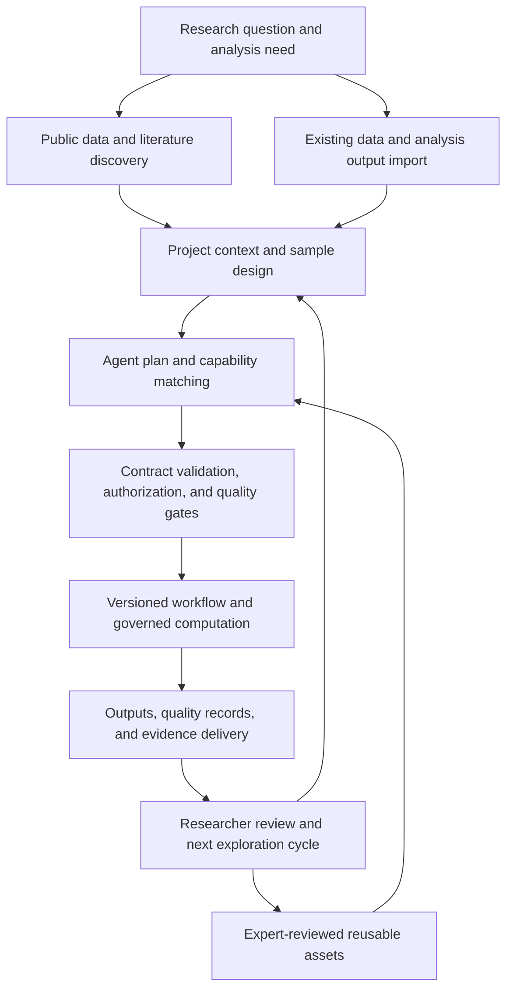
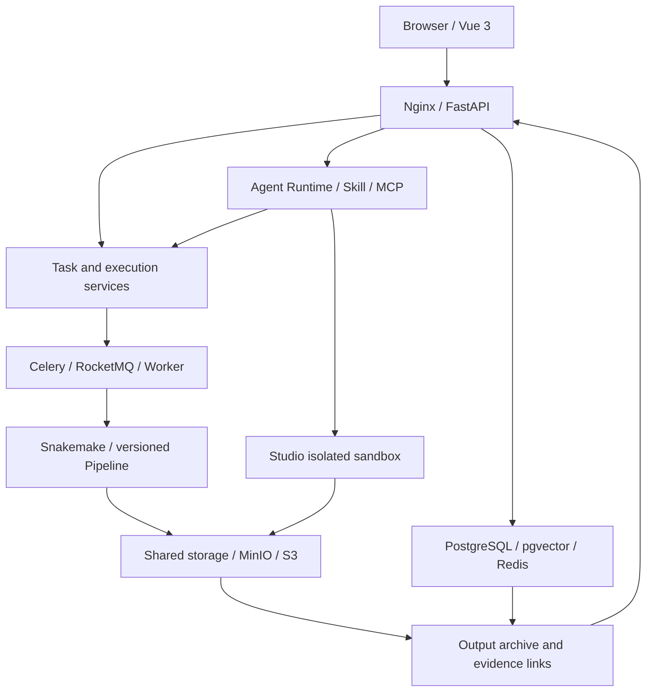
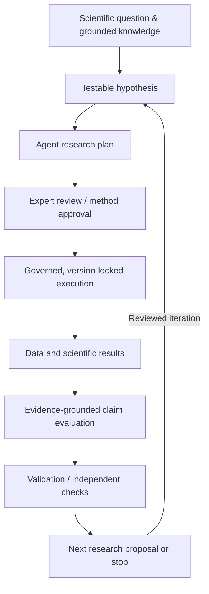

# CygnusX BioOps · Intelligent Research Platform

<p align="center">
  
</p>

<p align="center"><strong>FROM STARDUST, TO DISCOVERY</strong></p>
<p align="center"><strong>AI for Science Infrastructure for Life Sciences</strong></p>
<p align="center">Governed research Agents and trustworthy computational delivery for reproducible life-science research.</p>
<p align="center"><a href="docs/README.zh-CN.md">中文文档 / Chinese version</a></p>

---

**CygnusX BioOps aims to build a researcher-led, evidence-driven scientific research system, advancing AI from tool use toward framing scientific questions, proposing testable hypotheses, executing computational experiments, and continually evaluating scientific conclusions.**

Beginning in life sciences, the long-term goal is an iterative research cycle: **question → hypothesis → method → computation → evidence → new question**, grounded in reproducible computation and traceable evidence. The current engineering priority is to validate the trustworthy computation and delivery chain that supports this goal.

Research Agents connect scientific questions, domain knowledge, and professional tools. A versioned Flow Framework carries standard analyses. Skill contracts, permissions, approvals, and quality gates constrain formal execution. Project records and evidence metadata connect data, decisions, processes, and deliverables, providing a foundation for future iterative research.

> **From Research Questions to Reproducible Scientific Evidence.**
>
> Researchers guide the inquiry and judge the evidence; the system is being developed to support hypothesis formulation, computational experiments, evidence evaluation, and reviewed follow-up exploration.

**The long-term research goal is an expert-governed, evidence-grounded scientific collaborator.** Researchers retain responsibility for method approval and scientific conclusions. Iterative scientific discovery remains a research direction requiring independent validation; the implemented capabilities and their acceptance boundaries are described below.

## Project origin

At **00:08:16 on June 25, 2026**, the first commit (`bb13fd2b`) marked the birth of OmicHub, the predecessor of CygnusX. Started by a PhD researcher in the life sciences, the project began as a private multi-omics analysis platform addressing cumbersome workflows, complex computing environments, and poor reproducibility.

CygnusX has evolved into an ecosystem for **research data discovery, Agent orchestration, standardized scientific computing, and verifiable delivery**. Its long-term direction is a verifiable and reproducible Scientific Agent Framework, beginning in life sciences and progressively examining what can be reused across research domains.

> Start from real research needs, build on reliable engineering, and pursue original technical innovation.

## Why CygnusX?

An omics study crosses databases, download tools, analysis scripts, clusters, visualization software, and reporting systems. The real delay is often the handoff between steps: repetitive transfer and reconciliation that researchers must perform even though it adds little scientific value.

| Research difficulty | Platform response |
| --- | --- |
| Research intent is hard to map to database fields; data and papers must be searched separately | Conversational exploration connects public omics data, sample metadata, and literature sources. |
| Sample sheets, parameters, and environments are repeatedly configured, so errors surface late | Declarative workflows, parameter validation, and preflight checks organize standard analyses. |
| Adding a contrast, enrichment analysis, or chart can require an expert to rewrite a script | Incremental exploration aims to reuse existing outputs within reviewed Skill boundaries. |
| AI-generated code and explanations are difficult to verify | Tool permissions, statistical assumptions, quality checks, and provenance are included in the execution design. |
| Scripts, environments, parameters, and decisions become scattered after delivery | Projects and run records organize inputs, outputs, environments, and rerun information. |

## A cumulative intelligent research infrastructure

1. **Make research tasks executable.** Turn research needs into explicit analysis objects, parameters, and governed tasks.
2. **Make results verifiable.** Record provenance, workflow versions, runtime environments, quality metrics, and outputs.
3. **Make research experience reusable.** Preserve reviewed methods, quality rules, and delivery templates as Flows, Skills, MCP tools, and domain knowledge.

The intended cycle is: research needs drive tool building; real delivery produces engineering assets; verified run records improve reusable capabilities. A laboratory's most valuable asset is methodological judgment accumulated through research and review.

## Current development stage and evidence boundaries

**Current position (engineering snapshot: October 18–19, 2026):** CygnusX has an implemented core platform and an expanding life-science tool ecosystem. Selected project-delivery paths have historical real-runtime evidence. **A current-source, continuous discovery → acquisition → FlowFrame/RNAFlow computation → scientific BioReport → independent replay has not yet been demonstrated end to end.** This is an engineering/R&D project, not a claim of production readiness or autonomous scientific discovery.

The statuses below separate **implemented code**, **isolated tests**, **historical real-runtime verification**, and **remaining acceptance gates**. Evidence is scoped to its recorded Run ID, commit, image digest, and environment; a historical pass does not certify a changed working tree.

| Area | What exists or has been demonstrated | Current evidence boundary / next gate |
| --- | --- | --- |
| **Platform foundation** | Vue 3 frontend, FastAPI services, projects, tasks, relational models, migrations, queues, and deployment configurations are implemented. | Re-run full-stack integration against a frozen current-source build and approved disposable environment. |
| **Research Agents, Skills, and MCP** | Declarative Agents, Skill organization, tool integration, role-oriented execution paths, and isolation/contract tests exist. | Real governed Agent → approval → execution → artifact lifecycle is not accepted as a complete current-source E2E. |
| **Data discovery and acquisition** | Treasure-Seeking Mouse, download-service contracts, Dataset/FileRegistry integration, and Polariseq components exist across repositories. | The download and Agent write paths remain gated in the active architecture baselines; real Worker execution requires separate acceptance. |
| **Versioned scientific workflows** | FlowFrame conventions and RNAFlow/ATACFlow pipeline implementations exist; the README records internal workflow build/validation. | An integrated, version-frozen scientific run from platform admission to scientific results and independent replay needs evidence. |
| **Governed execution** | Approval, Admission, Budget, revocation/epoch controls, and constrained-execution mechanisms have code and isolated-test coverage. | The active architecture baselines retain source-level write gates and deployment acceptance requirements; isolated tests do not establish runtime enforcement. |
| **Scientific reporting** | BioReport is developed as a separate Python/Quarto-based reporting engine; platform adapters also support project-summary delivery. | A prior RI09.5 acceptance run generated a real **project-summary** HTML/PDF; this does **not** establish the complete RNAFlow → scientific BioReport workflow. |
| **Verifiable project delivery** | Project/Run, FileRegistry, Evidence/Manifest and ExportSelectionV2 are implemented. A prior RI09.5 run exercised HTML/PDF → M1 → ZIP → JWT download and integrity checks. | RC04-Core remained partial in the October 18 audit: current-source freeze, 34/34 browser assertions, targeted fault injection, and independent evidence/security review were not closed. |
| **Agentic scientific discovery** | The architecture contains planning, evidence, review, and follow-up exploration concepts. | Structured hypothesis evaluation and multi-round evidence-grounded discovery remain **research goals**, not validated autonomous capabilities. |

**Evidence anchors:**

- `ri095-authorized-20261017-attempt1`: historical isolated runtime for project-summary HTML/PDF, V2 ZIP, integrity checks, and JWT delivery; tied to its recorded source and image versions. See [RI09.5 authorized results](docs/audits/RI095-Authorized-Runtime-Acceptance-Results.md).
- **RC04 audit (2026-10-18):** Core **PARTIAL / NOT ACCEPTED**; historical browser result **31/34**, no new accepted FI01–FI06 run, and current source/image freeze not yet proved. See the [RC04 completion gate matrix](docs/audits/RI095-RC04-Completion-Gate-Matrix.md).
- **Protected execution:** the [download baseline](ARCHITECTURE_DESIGN/CygnusX_download_architecture.md), [Agent tool gateway](ARCHITECTURE_DESIGN/CygnusX_agent_tool_gateway.md), and [research delivery baseline](ARCHITECTURE_DESIGN/CygnusX_research_delivery_architecture.md) describe the closed write gates and outstanding runtime acceptance.

> **Release rule:** `implemented ≠ isolated-tested ≠ runtime-verified ≠ end-to-end-verified ≠ production-approved`. Protected download, Agent write, and `worker_paths_verified` gates remain closed until their own current-source acceptance requirements are satisfied. Never substitute a project-summary report for validated scientific analysis or an independent reproduction experiment.

## From data entry to evidence delivery

Research can start from **public data discovery** or **existing experimental data and analysis outputs**. Both are intended to enter a shared project context for standard analysis or incremental exploration.



**Target workflow, not an all-gates-passed statement.** Availability depends on the component, version, and deployment. The computational path connects data, tasks, execution, quality control, and outputs. The exploration path adds external evidence, interpretation, and follow-up research. Researchers remain responsible for hypothesis quality, experimental validation, and critical scientific conclusions.

## How the ecosystem works together

**CygnusX BioOps is designed to organize discovery, acquisition, standard analysis, and reporting through a shared project context.** Independent ecosystem components provide specialist capabilities, while the Flow Framework supplies common workflow and integration conventions.

<p align="center">
  
</p>

| Component | Role in the research chain |
| --- | --- |
| **[CygnusX BioOps](https://github.com/CygnusX-Labs)** | Project context, Agents, permissions, tasks, data, delivery, run records, archives, and evidence links. |
| **[Treasure-Seeking Mouse](https://github.com/xsx123123/Treasure-Seeking_Mouse)** | Conversational public omics data discovery, literature search, and provenance checks. |
| **[Polariseq](https://github.com/xsx123123/polariseq)** | Resumable sequencing-data transfer with integrity checks. |
| **[FlowFrame](https://github.com/xsx123123/FlowFrame)** | General omics workflow architecture and standardized integration. |
| **[RNAFlow](https://github.com/xsx123123/RNAFlow)** | Bulk RNA-seq QC, alignment, quantification, and differential analysis. |
| **[ATACFlow](https://github.com/xsx123123/ATACFlow)** | ATAC-seq QC, alignment, peak calling, differential accessibility, and motif analysis. |
| **[AnnoFlow](https://github.com/xsx123123/kegg_annotation)** | Functional annotation using eggNOG-mapper and KofamScan with KO cross-validation. |
| **[BioReport](https://github.com/xsx123123/bioreport)** | Python/Quarto-based interactive HTML and PDF reporting. |

**Intended research path:** discover data and papers → acquire or import data → select a reviewed, versioned analysis capability → compute and check scientific results → generate a scientific report → link runs, outputs, and evidence in CygnusX.

Independent repositories may have different release cycles and acceptance scopes. A validated component does not automatically imply a validated integration.

## Four technical pillars

| Pillar | Engineering meaning | Research value |
| --- | --- | --- |
| **Research Agents** | Requirement parsing, task decomposition, role routing, and governed tool dispatch. | Inspectable analysis plans. |
| **Reproducible Workflows** | Declarative Flows, Snakemake, versioned workflows, and environment records. | Fewer failures from ad hoc scripts and environment drift. |
| **Governed Execution** | Skill contracts, tool allowlists, isolated sandboxes, approvals, and quality gates. | Authorized, verifiable automation. |
| **Verifiable Evidence** | Links between projects, runs, Cases, Artifacts, Evidence, and Manifests. | Clear provenance, checks, and rerun requirements. |

## The Agent × Skill × Flow model

- **Agents organize tasks:** understand requests, identify missing information, select capabilities, propose plans, and interpret actual tool results.
- **Skills constrain professional actions:** describe scope, inputs, outputs, prerequisites, versions, failure handling, assumptions, and quality requirements.
- **Flows carry standard computation:** reviewed methods become declarative, versioned workflows run by controlled execution systems.

Formal delivery is designed around dispatching reviewed workflows and tools, not arbitrary Agent shell access or unrestricted database writes. OmicStudio can support exploratory code in a capability-controlled sandbox; exploratory results must satisfy the relevant checks before becoming formal scientific deliverables. Actual enforcement depends on the accepted runtime and deployment profile.

## L1–L4 research work styles

| Entry point | Suitable work | Boundary |
| --- | --- | --- |
| **L1 Bioinformatics toolbox** | Repeatable tool operations and lightweight visualization. | Managed tool registration, parameters, and state. |
| **L2 Stardust AI Assistant** | Requirement clarification, retrieval, and lightweight calls. | Tool allowlists; researchers review critical judgments. |
| **L3 OmicStudio** | Interactive deep analysis. | Capabilities run in restricted environments. |
| **L4 Multi-Agent workspace** | Planning, delegation, quality review, and delivery. | Feature-gated preview path requiring independent acceptance. |

**Naming note:** L1–L4 describe **CygnusX product interaction/work styles**, not the four levels of scientific autonomy described in Agentic Science literature. In particular, product L4 does not imply fully autonomous scientific discovery.

## Quality and evidence in delivery

Trusted computation must answer who may execute, where results came from, which checks ran, how to rerun them, and what actually happened.

| Stage | Focus |
| --- | --- |
| **Before submission** | Input completeness, samples, groups, parameter ranges, workflow fit, and resources. |
| **During execution** | Workflow state, resource anomalies, and analysis-specific QC. |
| **Before delivery** | Output integrity, statistical design, quality results, and provenance. |

Formal delivery aims to link **Project/Run**, **Case**, **Artifact**, **Evidence**, and **Manifest** records. Target outputs include methods, parameters, workflow version, environment snapshot, software inventory, quality records, checksums, audit events, and a rerun entry point. Interpretations distinguish platform results, external sources, and analytical synthesis.

## System architecture



*Conceptual component topology; enabled services, message brokers, isolation properties, and external storage integrations depend on deployment and acceptance state.*

| Layer | Technologies |
| --- | --- |
| **Frontend** | Vue 3, TypeScript, Vite, Naive UI, Pinia. |
| **Backend** | Python 3.11, FastAPI, SQLAlchemy, Alembic. |
| **Data and knowledge** | PostgreSQL/pgvector, Redis, MinIO/S3. |
| **Agent runtime** | Declarative assembly, ReAct/LangGraph, MCP, role-based tools. |
| **Workflow execution** | Flow YAML, GenericFlowBuilder, Snakemake, governed workers. |
| **Isolation and observability** | Capability sandboxes, resource/network limits, logs, audit, OpenTelemetry. |

## Development roadmap and long-term vision

CygnusX follows a staged research and engineering program. **M1 is the near-term acceptance target; M2 is the next scientific-agent research phase, formally starting on January 1, 2027; M3 is a long-term cross-domain hypothesis to validate.** These milestones are not declarations that the full functionality is currently available.

### M1 — Reproducible Multi-Omics Infrastructure

**Goal:** Deliver a dependable, auditable life-science computation platform that can connect actual research inputs to validated scientific analyses and independent reproduction.

**Current position:** The platform core, workflows, reporting components, and project delivery mechanisms exist. Historical real-runtime evidence covers selected project-summary delivery operations. The **current-source integrated scientific workflow** and several protected runtime gates remain open.

**Acceptance path:**


**Milestone evidence:** approved real datasets and study design, frozen workflows and parameters, input and image digests, execution records, scientific result checks, actual BioReport output, delivery manifest, and independent replay against predefined numerical/statistical tolerances. Start with a small RNA-seq case, then assess transfer to a second omics workflow.

### M2 — Expert-Governed, Provenance-Aware Iterative Scientific Discovery

#### Next-stage research direction — Scientific Discovery Core

**Formal start: January 1, 2027.** This phase will advance CygnusX BioOps from reproducible scientific computing toward expert-governed, evidence-driven scientific discovery. Scientific Discovery Core is the focus of the M2 research program, with three complementary capabilities:

| Capability | Research focus |
| --- | --- |
| **Scientific Reasoning** | Transform research questions into testable hypotheses and scientifically reviewable study designs. |
| **Scientific Validation** | Evaluate analytical results, methodological validity, and evidence-backed scientific claims. |
| **Research Evolution** | Preserve research knowledge and propose evidence-grounded follow-up investigations. |

Together, these capabilities aim to establish a closed-loop research framework:

**Hypothesis → Planning → Expert Review → Controlled Execution → Evidence Evaluation → Validation → Iteration**

The start date marks the formal launch of this research phase. Capabilities will be introduced incrementally after the underlying scientific computing and execution infrastructure meets its acceptance requirements. The long-term objective is general-purpose, expert-governed, provenance-aware agentic scientific computing infrastructure, initially validated through real multi-omics research.

**Goal:** Extend validated computation into a human–AI scientific collaboration loop in which Agents can formulate **testable** hypotheses, propose methods, submit plans for expert review, analyze results, evaluate claims against evidence, and suggest warranted follow-up studies.



**Research directions (planned, not yet validated):** structured `Hypothesis`, `Scientific Claim`, `Research Decision`, and `Validation Result` relationships; scientific memory tied to evidence; methods-aware interpretation; expert-controlled iteration; and evidence-grounded **Next Shovel** proposals. A result may be *supported*, *contradicted*, or *inconclusive*. New execution requires renewed authorization where appropriate; Agents do not automatically promote hypotheses into established conclusions.

**Milestone evidence:** at least one multi-round real-study case, explicit hypothesis/claim provenance, scientifically reviewed evaluation criteria, independent verification, and comparisons against free-code Agents and fixed workflows where practical. Measure method validity, evidence coverage, reliability, review cost, and meaningful improvement from iterative feedback.

### M3 — General-Purpose Agentic Scientific Computing

**Long-term vision:** Test whether CygnusX's **domain-agnostic core** can serve additional scientific disciplines without rewriting governance and provenance infrastructure.

| Reusable core (hypothesis) | Domain-specific extensions |
| --- | --- |
| Project/research context, Agent planning, Skill contracts, authorization, Admission/Budget, compute scheduling, lifecycle, provenance, scientific memory, and delivery verification. | Biological workflows and interpretation first; later potentially agriculture, chemistry, materials, simulation, or other domains with their own tools and scientific validation rules. |

**Milestone evidence:** a working second-domain case, documented adapter boundaries, comparable provenance and access controls, domain-specific scientific validation, and a measured account of core reuse versus required modifications. Supporting another tool is not equivalent to demonstrating general scientific reasoning.

**Evolution in one line:**

**CygnusX BioOps (trusted life-science computation) → CygnusX Discovery (expert-governed iterative research) → General-Purpose Agentic Scientific Computing (long-term research vision).**

### Near-term engineering priorities

The next platform development cycle has three connected priorities (planned; not a statement of current availability):

| Priority | Next-step scope | Acceptance focus |
| --- | --- | --- |
| **Complete the collaboration room as a multi-agent system** | Strengthen role-based delegation, dependency-aware parallel work, shared project context, handoffs, review, interruption and recovery. | Demonstrate distinct Agents cooperating on an approved real case, with traceable contributions, controlled execution and failure recovery. |
| **Fine-tune the memory system** | Improve retrieval, reliable settlement, project isolation, correction/forgetting, and consistent Chat/Studio/L4 semantics. This means system and retrieval tuning; model-weight fine-tuning is not assumed. | Verify relevant recall, isolation, retry safety, deletion behavior, latency and token cost against a fixed evaluation set. |
| **Implement the three scientific capabilities** | Scientific Reasoning produces testable hypotheses and reviewable designs; Scientific Validation evaluates methods, results and claims; Research Evolution preserves evidence-linked knowledge and proposes justified follow-up studies. | Connect hypothesis, reviewed plan, controlled execution, validation and expert-reviewed iteration with reproducible evidence. |

These priorities may require incremental changes to orchestration, memory boundaries, research-state contracts and evidence provenance. The detailed [next-stage platform roadmap](ARCHITECTURE_DESIGN/CygnusX_platform_next_stage_roadmap.md) records the proposed boundaries, sequencing and acceptance criteria. Engineering preparation can proceed before M2's formal research launch; it does not change the January 1, 2027 milestone or bypass M1 runtime acceptance.

Before claiming M1 completion or moving protected workflows to production, close the current runtime/evidence gaps: freeze the source and image baseline; validate real PostgreSQL migrations and transaction/concurrency behavior; verify execution isolation and authorization in the deployed runtime; complete RC04 browser and fault-injection evidence; and demonstrate the first real RNAFlow → scientific BioReport → independent replay chain. External prerequisites (legacy database baseline, historical frozen artifacts, approved S3 test resources) must be recorded as blocked rather than fabricated.

## Deployment and data boundaries

CygnusX supports local/LAN deployment and configured cloud deployment, with a hybrid design direction that separates local data storage, cloud inference, and compute under access policy. External models, MCP servers, download sources, and logs require separate configuration. The platform is for research and development; clinical, regulatory, and industrial certification claims require independent assessment.

## Quick start

Requirements: Python >= 3.11, Node.js >= 18, Docker with Compose, and uv. Use the lockfiles and deployment configuration for exact dependency versions. Configure `.env` from `.env.example`, replace example secrets, and check database, storage, and service connections before starting. See the [Docker deployment guide](deploy/docker/README.md).

```bash
uv sync --frozen
cd frontend && npm ci && cd ..
make docker-up
make migrate
make dev
```

In another terminal:

```bash
cd frontend
npm run dev
```

Open `http://localhost:5173` for the frontend and `http://localhost:8000/docs` for the local API documentation. **Proxy setup:** `frontend/vite.config.ts` sends `/api`, `/treasure-mouse/`, and `/docs-static` to `http://localhost:8888` by default, served by the Compose Nginx stack. To use the local backend started by `make dev`, change the relevant proxy targets to `http://localhost:8000` in your local configuration. `make docker-up` starts the main application stack, not just infrastructure; analysis workers require separate setup. See the [wiki](wiki/) and [Docker deployment guide](deploy/docker/README.md) for full instructions. **These are documented development commands, not a substitute for environment preflight, authorized database targets, or release acceptance.**

## Technical details

- Agent identity, prompts, models, tool allowlists, and runtime capabilities are declared in `data/ai/*.yaml`.
- MCP is layered across built-in Presets, external Servers, and pipeline-specific Servers; generated tools require static checks, sandbox tests, and human review.
- `flows/*.yaml` describes workflow metadata, parameters, sample sheets, execution, and pipeline mapping. `tool_configs/tools_schema.yaml` maps tools to LLM functions.
- Platform Skills (`data/ai/skills/`) and development Skills (`.agents/skills/`) are physically and logically isolated.
- The cloud terminal uses xterm.js, WebSocket, and container ttyd; Studio provides a separate capability-controlled execution path. Its sandbox baseline includes non-root execution, read-only root filesystem, `cap_drop=ALL`, resource limits, and restricted networking; actual runtime enforcement must be verified for each deployment profile.

## Project structure

```text
src/cygnusx/          Backend Python package (DDD layers)
frontend/             Vue 3 frontend
flows/                Flow YAML declarations
pipelines/            RNAFlow / ATACFlow / scRNA implementations
tool_configs/         Toolbox and terminal configuration
data/                 Agent, Skill, and runtime configuration
integrations/         AgentTeams Bridge / Gateway
deploy/               Docker Compose and runtime images
alembic/              Database migrations
ARCHITECTURE_DESIGN/  Project architecture and design index
tests/                Unit / integration / E2E tests
```

## Documentation

- [Architecture index](ARCHITECTURE_DESIGN/README.md)
- [Platform architecture](ARCHITECTURE_DESIGN/CygnusX_platform_architecture.md)
- [Agent execution framework](ARCHITECTURE_DESIGN/CygnusX_agent_execution_framework.md)
- [Flow integration architecture](ARCHITECTURE_DESIGN/CygnusX_flow_architecture.md)
- [MCP architecture](ARCHITECTURE_DESIGN/CygnusX_mcp_architecture.md)
- [Sandbox architecture](ARCHITECTURE_DESIGN/CygnusX_sandbox_architecture.md)
- [Usage and deployment](wiki/)
- [Docker deployment guide](deploy/docker/README.md)
- [Tool-page specification](tool_configs/tools_design.md)
- [Chinese README](docs/README.zh-CN.md)

## Repository scope and license

Public, competition-archive, and internal versions may differ. Use the relevant commit, release notes, and configuration as the authority for runnable behavior, deployment requirements, and test results. Independent ecosystem components are maintained in their own repositories.

The project README records the accumulation of **600+ bioinformatics and research-analysis Skills** and private laboratory deployment. This is a project inventory and deployment statement, **not a claim that 600+ individual Skills, all ecosystem integrations, or every research mode has independently passed runtime/E2E acceptance**. Quantitative inventory and deployment claims should be checked against release-specific evidence.

See the complete [LICENSE](LICENSE). The license file contains **Apache License 2.0 with the Commons Clause addition**, including restrictions on selling the software and providing certain commercial services. Read the complete terms before reuse or distribution.

---

<p align="center"><strong>FROM STARDUST, TO DISCOVERY · From stardust toward scientific discovery</strong></p>
