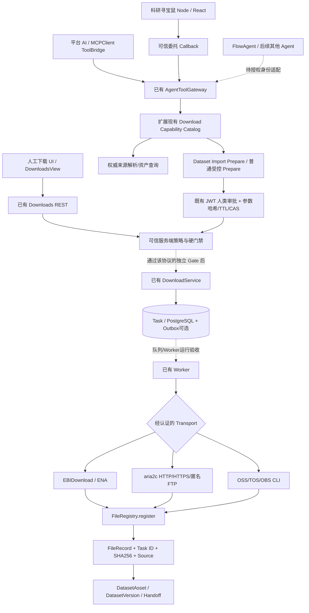

# CygnusX BioOps · 统一下载运行时与多 Agent 接入后续优化实施方案

**版本：** v1.0 · 2026-10-16  
**适用范围：** S0/S1/S2 已完成、S3 部分完成后的**增量优化**（S3 Closure → S4 → S5 → S6 → S7）  
**配套：** `CygnusX_Download_Runtime_Optimization_Codex_Prompts_2026-10-16.md`  
**依据：** 用户提供的 `download-completed-work-summary-2026-10-16.md` 和此前 `cygnusx-platform-download-capability-and-agent-tool-readiness-audit-2026-10-16(1).md`。  
**文档性质：** 后续实施设计；**不是**代码已修改、服务已部署或真实运行验收通过的证明。

## 0. 决策摘要：不重做 S0–S2，不跳过 G3

当前已确认的实施事实（以最新总结为准）：

| 阶段 | 既有成果 | 本文处置 |
|---|---|---|
| S0 | 变更前 `task_id=None` 红测、工作树快照与证据索引；G0 隔离通过 | **保留**；不重新执行全面审计，仅增量复核差异 |
| S1 | Worker 已改用现有 `FileRegistry.register`，登记 Task/source/实际 SHA 和大小，测试走生产登记函数到 Dataset reconcile；G1 隔离通过 | **保留与回归**；把真实 PG/Worker 并发放到 S7，不重新建注册体系 |
| S2 | `domain/download_contract.py` 收敛 protocol/method，Worker 再校验；版本来源 manifest；前端不实按钮收敛 | **保留**；S7 再验证真实 image/binary、人工体验及独立协议 |
| S3 | URL 基础语法、FTP 递归上限、stdout/stderr 响应脱敏已部分落地 | **本轮第一优先级：完成 G3** |
| S4 | 事务/任务幂等/取消/对账尚未完成 | G3 后实施；不以简单重试代替可靠提交 |
| S5 | 逐协议运行状态 Catalog 尚未完成 | G4 后实施；扩展已有 Gateway/Capability，不增新系统 |
| S6 | 所有 Agent 的受限工具连接尚未完成 | G5 后接线，依然不可直接开放 Agent 写入 |
| S7 | 真实 PostgreSQL/Redis/Worker/协议/两 Agent/E2E 未验 | 独立运维授权的隔离环境验证，分协议、分身份放行 |

**警戒事实：** 当前 `DOWNLOAD_TRANSPORT_RUNTIME_ACCEPTED=False` 和现有 Agent 写门禁均关闭；人工下载同样受影响。隔离测试使用 SQLite、fake FTP、伪进程、内存确认/HTTP doubles，不能宣称实际 HTTP/FTP/SRA Worker 可用。2026-10-16 最新总结的测试行存在重叠，不能简单相加：S1 103 PASS、S2 155 PASS、S3 110 PASS、登记/证据回归 42 PASS、专项 19 PASS；并非 429 个独立测试。

### 0.1 成功定义与不变量

1. **无重复引擎**：复用现有 `DownloadService`、Task/队列、`FileRegistry.register`、DatasetImportService、Gateway、ToolConfirmationService；不新增第二套下载器或审批服务。
2. **安全优先**：在任何真实传输路径上，不能把 URL 文本校验、下载后文件大小检查或日志脱敏当成完整的运行时安全保证。
3. **数据可追溯**：文件登记必须保留真实 Task、可信来源、checksum、归属、源文件身份，并可被 Dataset reconcile 查回。
4. **状态不可偷换**：`Task.SUCCESS` ≠ `FILES_REGISTERED` ≠ `Dataset READY` ≠ `Analysis READY` ≠ `Report DELIVERED`。
5. **人工与 Agent 分层授权**：允许被授权的人工用户和 Agent 各自有独立策略；同一未认证传输后端不能通过人工例外绕开运行安全门禁。
6. **每种协议独立认证**：HTTPS、HTTP、匿名 FTP、EBIDownload `aws/ftp`、OSS、TOS、OBS 分别给出结果；FTPS、通用 S3/COS、云盘仍保持明确未支持，不能被目录默默释放。
7. **不破坏既有成果**：保护脏工作树、子仓、真实文件、历史 Task、已记录 DatasetVersion；禁止 `git reset --hard`、`git clean`、未经允许推送/部署/改生产库。

## 1. 推荐架构与责任边界



**实线**代表已有责任与预期复用边界，**虚线**表示还需要运行认证、接入或有安全门禁的路径；图不是当前生产已连通证明。

| 层 | 责任 | 不属于该层的事情 |
|---|---|---|
| GEO/ENA Resolver | Accession 展开、权威候选、来源证据与不确定性 | 创建下载 Task、猜测 FASTQ 或 raw counts |
| Agent Gateway/Catalog | 目录发现、Agent scope、调用上下文、prepare 与受控委托 | 下载二进制执行、授予自己人工批准 |
| DatasetImportService | 科研来源/样本/文件选择、预算、项目绑定与唯一 ImportProposal | 在内部为同一预案重复生成通用 `downloads.prepare` 确认 |
| DownloadService | 运输请求合法性、目录/配额/Task 关联、可信写准入 | 以目录名代替项目授权、替代 Dataset 科学审核 |
| Worker/Transport | 出站连接、实际字节硬限制、取消、真实状态和文件交付 | 将下载完成等同科研分析准备完成 |
| FileRegistry | 受控文件登记、Task/source/SHA/owner、配额一致性 | 新建独立 Asset/Task 系统 |
| Dataset/Handoff | 来源、资产、样本审阅、冻结输入、Flow 兼容性 | 将 TPM/FPKM/UNKNOWN 当 raw counts |

## 2. 代码定位与最新成果保护

下面为**来源报告中的已知定位线索**，Codex 在开始时必须重新定位当前源码的实际函数/文件；不承诺与工作树一字不差：

| 代码域 | 优先核对路径/符号 | 所属阶段 |
|---|---|---|
| Worker | `src/cygnusx/infrastructure/celery_app/tasks/download.py` | S1 保留、S3–S4 扩展 |
| 下载安全/输出/来源 | `src/cygnusx/infrastructure/download/{outputs,provenance,policy}.py`；`src/cygnusx/domain/download_security.py` | S3 |
| 协议契约 | `src/cygnusx/domain/download_contract.py`、`src/cygnusx/application/schemas/download.py` | S2 保留 |
| 提交服务 | `src/cygnusx/application/services/download_service.py` | S3–S4 |
| 文件登记 | 已有 `FileRegistry.register`、FileRecord、Dataset reconcile | S1 回归 |
| Gateway、Dataset、审批 | `agent_tool_gateway.py`、`dataset_import_service.py`、`tool_confirmation_service.py` | S5–S6 |
| 外部/内置 MCP | `src/cygnusx/infrastructure/mcp/presets.py`、`mcp-server/tools/downloads.py` | S3 信息泄漏回归、S6 |
| 前端 | `frontend/src/views/DownloadsView.vue`、任务页面、React Island 的 typed callback | S3 人工兼容、S5–S6 |
| 运行溯源 | `scripts/inspect_download_runtime.py`、`docs/contracts/cygnusx-download-runtime-manifest-v1.md` | S2 保留、S7 实测 |
| 配套文档 | `ARCHITECTURE_DESIGN/CygnusX_download_architecture.md`、`docs/implementation/download-s3-network-budget-safety.md` | 现状基线/接续依据 |

**先做一次差异检查：** `git status --short`、HEAD/子仓状态、上轮 G1/G2/G3 证据与本轮新增 diff；若最新工作树已包含某项修复，则直接验证而不是重复实现。

---

## 3. S3 Closure · 网络、真实传输硬预算、敏感信息与人工兼容

> **第一轮实际开发范围。G3 未通过前，不开展 S4–S7 的依赖开发。** 可以做分析设计与测试计划，但不能宣称已达到下一阶段执行准入。

### 3.1 S3-A：来源准入与实际网络出口一致性

1. 统一并复用 `DownloadSecurity`/Policy 的来源分类、host/port/scheme 限制；旧 DTO、直接 Service 调用、Worker 重放都必须重新校验。
2. 对 HTTP(S) 检查：IDNA/Unicode、IPv4 十进制及混合表达、IPv6、用户信息、非默认端口、DNS CNAME/多 A/AAAA、公网/私网/回环/链路本地/元数据地址、代理 `HTTP_PROXY` 等环境变量影响。
3. **网络安全不能停留在 DNS 预检查**：证明实际连接与允许的解析地址一致，重定向每跳重新准入；无法把连接地址强绑定到 aria2c 等 CLI 时，使用经过验证的隔离网络 egress proxy/防火墙/受控连接器；不能简单声称 `validate_dns_resolution=true` 已经防止 DNS rebinding。
4. HTTP→HTTPS 或 HTTPS→HTTP 的跳转策略必须显式并记录准入结果；既有 `allow_redirect`/aria2 行为如不受控，应拒绝该传输模式直至认证。
5. 对匿名 FTP：检查控制连接、PASV/EPSV 数据连接 IP/port、服务器提供的备用连接地址、DNS 与主动模式风险。FTP 的连接路径若无法被现有客户端和网络层可靠约束，应**禁用 FTP 递归/Agent FTP execute**，保留只读/预案说明，不能用 `ftplib` 的默认行为作为证明。
6. FTPS 仍然不支持，不能为统一而把它映射为 FTP；`s3://`、COS、云盘同理。
7. 对 GEO/ENA authority resolver 继续使用可信源且保留其已有响应大小、重定向和来源快照策略；不要把普通 direct_link 赋予同等权威性。

### 3.2 S3-B：真正的运行时字节、时长和配额预算

按每种传输器绘制“下载前检查 → 连接 → 字节流 → 写文件 → 完成登记”的执行时序：

- 源声明 `Content-Length`、文件列表 metadata 和 `max_bytes` 只是**估算**，不能代替硬限制。
- 明确实际接收的**网络字节与落盘字节**如何采集，定义压缩/解压、SRA 转换、重试/断点导致的统计差异；存储配额以实际占用/受控预留治理，网络账本单独计量。
- 要求下载过程中达到预算即停止，限制每任务总字节、单文件、超时、并发、连接数、FTP 展开条目；无可靠 instrumentation 的协议不得开放 execute。
- 对 aria2c、Rust、OSS/TOS/OBS CLI 分别调查是否提供可验证的硬限制/可观察进度；如果 CLI 缺乏可靠控制，优先采用可信的网络/容器/文件系统层限额与进程组终止，**不把轮询目录大小冒充绝对安全硬限制**。
- 以 PostgreSQL 及现有配额系统为权威，设计可回滚的预留/结算/释放边界，不能仅下载完成后 `add_used_storage`；与 S4 并发事务能力的依赖必须在报告中明确。
- 处理未知大小、chunked、恶意 Content-Length、FTP 目录暴涨、多文件批量、磁盘 quota 近界、Worker crash、磁盘挂满等负例。
- 解压安全沿用 Dataset 受限 staging + ZipSlip/bomb 限制，不要把下载后登记上限误写为传输上限。

### 3.3 S3-C：凭据、URL 与日志/模型上下文分级

报告已经完成“响应副本脱敏”和 BinaryExecutor 下载专用过滤；后续只补缺口：

| 敏感面 | 修复与验证目标 |
|---|---|
| Task 原始 parameters | 必需可执行密文/受控密钥引用与显示投影分开；先评估已有 secret store，**不盲目新造 vault** |
| URL query 与预签名地址 | 可信校验、分级遮罩；当前实现拒绝部分签名查询，必须保持策略明确，不宣称已支持 presigned URL |
| Worker stdout/stderr | 下载器启动、异常、退出、日志回调全过程无原始凭据回显；源日志与脱敏日志权限分离 |
| API/Pydantic 错误 | 使用稳定 error code 与脱敏 trace id，避免 raw `input/ctx/msg` |
| MCP ToolTrace / tool response | 模型可见参数和持久历史仅最小必要数据，不得暴露签名 URL、目标绝对路径或内部委托 token |
| Node callback / 诊断事件 | 验证签名、JWT、确认凭据不可跨权限层投影；历史恢复不能再泄漏 |

历史数据若已经含敏感字段，给出**不破坏确认哈希、不删除原始 Task 的安全迁移方案**，并与本轮新的写入路径保护区分；未经允许不要批量改历史 Task。

### 3.4 S3-D：人工 UI 与 Agent 权限的真实分层

**要解决的问题：** 当前 `DOWNLOAD_TRANSPORT_RUNTIME_ACCEPTED=False` 同时阻断人工下载和 Agent 下载，这是最新总结明确提出的剩余问题，不能误称人工已经恢复。

建议逻辑（设计语义，不要求引入同名配置）：

```text
trusted identity + module authorization
   AND protocol-level runtime certification
   AND source/network/size/project/storage gates
   AND (
       manual JWT user operation with applicable confirmation policy
       OR trusted Agent delegation + scoped capability + separate human confirmation
   )
   => one existing DownloadService submit path
```

- **不能删除或放宽总门禁来恢复人工操作。** 应先由同一个服务端 Gate 计算每个协议/用户通道可执行条件，并在原总门禁未获得独立审批前依然拒绝。
- 人工 JWT 直提交（历史功能）与 Agent 人类确认（服务端 TTL/hash/一次性消费）可以有不同的授权手续，但应经过**相同的传输安全门禁**。
- 无权/未认证协议必须返回可解释的 `BLOCKED(reason)`；前端不应出现成功提示、假 Task 或无意义的全局 disabled。
- 已认证的人工下载路径未来可独立开放，不意味着 Node/MCP 也自动获得该协议的写权限。
- S3 代码完工只代表隔离验证；实际开放需 S7 对应 Worker/网络/配额 Gate 与明确发布决策。

### 3.5 S3 必须新增的测试（G3，最小安全覆盖）

| ID | 场景 | 验收结果 |
|---|---|---|
| G3-01 | 直接 IP / 隐性 IPv4 / IPv6 / CNAME / 混合 DNS | 不被允许的目标在**连接处**拒绝 |
| G3-02 | 允许域名重定向至内网 / localhost | 每跳拒绝；无第二跳下载副作用 |
| G3-03 | 验证前合法、连接时 DNS 改变 | 连接目标仍受防护；不能证明则该 transport BLOCKED |
| G3-04 | FTP PASV 返回不同 IP/port、控制连接重定向 | 不可控数据连接拒绝/网络层封闭 |
| G3-05 | 小文件但 Content-Length 不可信 | 实际字节硬停止；超量不登记为成功 |
| G3-06 | 多文件累计字节超限 / FTP 递归超数 | Worker 停止并保留待对账；不超配额入库 |
| G3-07 | 预签名 / 机密 URL + Task/工具错误/历史 | 所有用户和模型可见面不泄漏，运行值可安全处理或被明确拒绝 |
| G3-08 | 人工 JWT 与 Agent 委托 | 共享传输门禁、独立授权；仅改来源不能绕过 |
| G3-09 | 旧任务参数、队列重放、直接 Service/Worker | 同一安全策略仍生效 |
| G3-10 | S1 Task→FileRecord→Dataset 回归 | 真实登记函数仍一致、SHA 和配额不回退 |

**G3 完成标准：** 代码/隔离用例通过，并为无法在本地验证的**真实网络 egress/硬预算**列出准确阻断；如果这些真实证据是 G3 的强制项，则 G3 只能标 `CODE_COMPLETE / RUNTIME_BLOCKED`，不能写 PASS 或越门禁进入 S4 依赖工作。

---

## 4. S4 · 下载调度、事务幂等与故障对账

> **启动条件：** G3 依赖已按项目约定闭合；若因为 Docker/网络限制造成 `RUNTIME_BLOCKED`，只允许设计/隔离测试，不将 S4 标记运行通过、不开放真实操作。

### 4.1 S4-A：Task ↔ DB ↔ Broker 提交一致性

现有报告调查到 `enqueue_task` 可能发生在请求数据库最终提交之前。必须复核最新源码，不能用另一个分析流程的修复作为下载流程已正确的证明。

推荐评估顺序：

1. 先查当前数据库事务与 Broker dispatcher，确定是否已有标准“提交后入队 / Outbox / pending ledger”工具可复用。
2. 如现有框架可可靠使用 `after_commit` + 持久 SUBMITTING/对账记录，则优先最小适配。
3. 如消息投递与 DB 持久化之间无法可靠恢复，再设计 **Transactional Outbox**；这是可选补缺方案，不应为工程优雅而新增平行 Task engine。
4. Worker 只以持久 Task 作为权威源，未提交/不存在/用户不符的消息必须 fail-closed。
5. 出现“投递是否成功未知”时进入待对账状态，不能自动再提交另一个可能重复的 Task。

### 4.2 S4-B：全局幂等、唯一工作目录与预算

- 明确幂等域：`owner + project/context + canonical_source + selected_files + transport_policy + proposal_revision`，请求幂等键只防重放**同一意图**，不擅自把不同数据集下载合并。
- `DatasetImportService` 内现有稳定 `request_key` 要继续有效；手工下载和通用 prepare 的跨入口重复应设计可恢复的既有 Task 提示，而非强制复用任何无权限文件。
- 每个 Task 独立受管工作目录，不能仅按第一个 URL / accession 字符串构造；所有迁移和旧 Task 路径须兼容只读历史。
- 预算预留、真实消耗、部分失败释放需要原子处理，不在多个 Worker 中双计配额。
- Task 归属永远从持久 DB 校验，目录、文件名和模型上下文不能作为授权依据。

### 4.3 S4-C：取消、崩溃恢复及部分文件

- 分离 `cancel requested`、`process terminated`、`files reconciled`、`task terminal`，避免仅更新 DB `cancelled` 即宣称下载已经停止。
- 记录 Worker 启动的进程组/任务范围，退出时终止子进程并收集确认状态。不得在失去控制句柄时无条件杀系统同名进程。
- Worker crash/重启时，使用 Task 与独占工作目录扫描、真实 checksum/status 进行对账；部分文件保留，不能冒领为其他 Task 的成果。
- 对不可恢复的传输后端明确报告 `PARTIAL` 或 `RECONCILIATION_REQUIRED`，不能自动创建新 Task 填坑。
- 复用 S1 已有登记事务和幂等判断；对取消期间产出的稳定文件同样记录真实归属。

### 4.4 S4 Gate G4

至少覆盖：两线程/两进程重复提交、DB commit 前 worker 看到消息、Broker ack 未知、同目录冲突、配额并发、kill Worker/CLI、断网续传、手动取消、重复补偿、跨 owner 已登记文件、历史 Task 只读、真实登记与 Dataset reconcile。记录 `ISOLATED_PASS` 与 `PG_REDIS_WORKER_RUNTIME_BLOCKED`，并给出可重跑脚本。

---

## 5. S5 · 扩展共享 Download Capability Catalog

**原则：扩展现有 `AgentToolGateway` 的 typed catalog 和能力描述，不新增第二套 DownloadGateway、MCP Server 或 AgentRuntime。**

### 5.1 目录数据视图

应具备每个源、协议、操作维度，而不是只输出一个全局布尔值：

```json
{
  "capability": "download.prepare",
  "source_family": "geo_supplementary",
  "transport": "https_direct_link",
  "operation": "prepare",
  "implementation_status": "VERIFIED_CODE",
  "runtime_status": "BLOCKED",
  "verified_worker_build": null,
  "effective_scopes": ["dataset:prepare"],
  "requires_project": true,
  "requires_human_approval_for_execute": true,
  "blockers": ["WORKER_RUNTIME_NOT_ATTESTED"],
  "schema_version": "v1"
}
```

上述 JSON 是**目标返回视图示例，非已实现 Schema**。真实实现必须复用已有 capability DTO/工具 schema，有同义字段就映射；不硬编码“已验收”为真、不允许模型在调用参数里填写能力认证结果。

### 5.2 各协议目录必须正确

- EBIDownload：`aws/ftp` 为受支持候选方法，但必须区分源码、宿主和真实 Worker 认证。
- GEO GSE/GSM：只允许 resolver → 已解析 Run 或权威附件，不直接向 CLI 传 accession。
- 直链：HTTP/HTTPS、匿名 FTP（每协议门禁）；不允许任意 URL 逃离出站政策。
- 云存储：已有 OSS/TOS/OBS 逐 provider 独立记录认证；普通 `s3://` / COS 未经实现不注册为可执行。
- FTPS/云盘/Aspera：保持 UNSUPPORTED / UI_ONLY，不返回虚假执行能力。
- 已有 FileRecord/项目资产：优先查重、只读复用，不强制重新下载。

### 5.3 可公开的能力种类

按**用户/项目/Agent**求交集，区分：

- `download.list_capabilities`：只读（不泄露内部绝对路径、镜像密钥）。
- `download.resolve_source`/`dataset.inspect`：可信 accession/资产查询，只读。
- `dataset.prepare_import`：科研数据来源快照、文件/Run、预算和项目，产生待审阅预案（有 DB 轻量副作用）。
- `downloads.prepare`：普通受控直链/源，不负责科研样本语义；不重复生成 Import 确认。
- `tasks.get_status`/`dataset.list_project_assets`：owner/project scoped 只读。
- `download.execute`：**不作为模型自批准工具**；仅已有可信服务端批准消费并经全套 Gate 的调用面。

### 5.4 G5 验收

静态目录与真实策略一致；关闭 Feature 时不暴露假工具；同用户不同 Agent 的 scope 不同；每协议 `runtime_status` 有审计来源；没有新增平行 Gateway；不在模型工具返回中泄漏内部路径、凭据。目录功能可以在 execute 关闭下只读测试。

---

## 6. S6 · 多 Agent 接入，保持下载后资产与科研证据

### 6.1 Agent 角色矩阵

| Agent / 入口 | 已知现状 | 增量目标 | 不能做的事情 |
|---|---|---|---|
| 科研寻宝鼠 React/Node | typed action + 可信委托 callback + Dataset prepare 基础 | GEO/ENA 数据卡→权威 inspect→受控 ImportProposal→Task/资产关联 | React 直连 MCP、模型自行 approve、重复造下载器 |
| 平台 AI | MCPClient/ToolBridge → Gateway 基础 | 与寻宝鼠共享 Catalog/同一 Service/审批；只读+Prepare | 以旧 MCP 文案宣称 GSE/Aspera 可直接下载 |
| FlowAgent | 现有主要是 plan submit/Workflow 调用；未证下载 Gateway 接线 | 增加可信项目/用户授权的只读资产查询、兼容文件发现、必要的 prepare | 自动下载任意 URL、伪造 owner、使用人类 JWT |
| 未来 Agent | 尚为目标态 | 加 agent_kind、scope 和现有 schema 适配，不改业务 Service | 自动继承所有 execute 权限 |
| 人工下载页面 | REST→DownloadService，当前总门禁阻断真实执行 | 保留四入口，真实状态与错误准确；协议 Gate 分离 | 借 UI 操作绕过传输门禁 |

### 6.2 工具事件/历史投影

- 稳定 `tool_invocation_id`、`proposal_id`、`download_task_id`、`file_record_id`、`dataset_version_id`、`source_evidence_ref`。
- 使用现有 SSE/持久记录恢复语义，区分 `PREPARED`、`APPROVED`、`QUEUED`、`RUNNING`、`FILES_REGISTERED`、`RECONCILIATION_REQUIRED`、`DATASET_REVIEW_REQUIRED`。
- 不把 Node `ToolTrace` 的“搜索完成”当成平台 Task 成功；无真实 Task ID 不显示任务进度。
- 项目/会话切换后重新 owner-scoped 查询，防止旧请求晚到污染 UI；下载消息取消与真正业务 Task 取消分开。

### 6.3 G6 验收

隔离完成：两 Agent 同一业务 Service、不同权限可见集；伪造 project/owner/tool scope 拒绝；JWT-only 人工批准、hash/TTL/CAS/replay；Node 委托和平台内置 MCP 工具 parity；FlowAgent 若未接可信项目上下文仍标 BLOCKED。真实双用户/双项目、Redis 双进程和网络回调只有 S7 能给运行结论。

---

## 7. S7 · 独立真实运行认证与科研 E2E

**不要在当前受限制的执行环境里强行构建/启动 Worker。** 最新总结已知 Docker socket `PermissionError errno 1`、宿主 `/usr/bin/aria2c` 不存在；宿主 EBIDownload 存在不能证明 Worker 有相同程序。必须由已授权运维/隔离环境提供真实 Worker、Redis、PostgreSQL、测试来源和预算。

### 7.1 验收顺序

1. **Build provenance**：主仓/子仓 SHA、镜像 digest、下载 CLI 版本/hash/help、Worker 运行用户、挂载与 egress 配置；对照现有 `scripts/inspect_download_runtime.py`，不得由 `SOURCE_ONLY` manifest 自动提升 runtime。
2. **真实 DB/队列**：隔离 PostgreSQL migration/unique/并发，Redis nonce CAS 双进程，Celery/Broker DB-visible enqueue、取消和恢复。
3. **逐协议认证**：在受控目标与额度下分别测 HTTPS、HTTP、FTP、SRA/ENA、GEO supplementary、OSS/TOS/OBS；无凭据/未支持的方式标 BLOCKED/UNSUPPORTED，不能借另一个协议结果替代。
4. **资产桥接**：真下载 Task → FileRegistry/FileRecord(task_id/source/SHA) → Dataset reconcile → Source/Sample/Version/Handoff；Worker 路径在 API 与分析容器中真实可见。
5. **两 Agent、双用户**：寻宝鼠+平台 AI 共享 Gateway/确认/Task/资产，跨 owner/project 完整否定测试；FlowAgent 单独按接入成熟度出结论。
6. **两级科研样例**：先小型 GEO 可信 raw counts→CountsDEGFlow→真实 Result Manifest/BioReport/执行证据；再小型 GEO/SRA FASTQ→ENA/EBIDownload→RNAFlow→报告。任何流程因数据、环境或凭据限制未跑通，要记录具体 BLOCKED。
7. **前端体验**：人工下载四入口、任务中心、寻宝鼠结果卡/确认/报告恢复与浏览器真实视觉；云盘仍明确不可用。

### 7.2 发布结论格式

按 `agent_kind × operation × protocol/source × environment` 给出独立判定：

```text
READ_ONLY_READY
PREPARE_READY
MANUAL_EXECUTE_READY
AGENT_EXECUTE_READY
DATASET_HANDOFF_READY
ANALYSIS_DELIVERY_READY
VISUAL_RELEASE_READY
```

每条附对应代码版本、Worker digest、测试 Task ID、归属、实际 checksum、运行日志的**脱敏证据**、明确批准者和环境。未知/未测不得写 `READY`。源码或运维门禁解除必须是独立授权的发布变更，Codex 不得仅因测试通过自行打开生产开关。

---

## 8. 全局增量测试与 Gate 速查（I01–I24）

| 用例 | 所属阶段 | 合格条件 |
|---|---|---|
| I01 | S3 | DNS 被允许但连接落入私网时被拒绝；不只是字符串校验 |
| I02 | S3 | redirect 每一跳过独立安全策略 |
| I03 | S3 | 匿名 FTP 数据连接被安全隔离，否则 capability BLOCKED |
| I04 | S3 | 传输达到单文件、总任务和磁盘硬预算后及时停止 |
| I05 | S3 | unknown length/断网/文件列表膨胀不能无界下载 |
| I06 | S3 | 运行参数、Task、stdout/stderr、ToolTrace、持久历史不露敏感查询 |
| I07 | S3 | 人工/Agent 共享安全门禁、独立身份授权 |
| I08 | S3 | 真实 S1 FileRegistry 登记函数无回归，Dataset reconcile 找到真实关联 |
| I09 | S4 | DB 未 commit 的 Task 不能被 Worker 当已授权任务执行 |
| I10 | S4 | 提交歧义不重投，后续可由 ledger 对账 |
| I11 | S4 | 并发相同幂等键至多一次合法 Task，非同意图不错误去重 |
| I12 | S4 | Task 唯一目录、配额原子结算、部分失败防重复扣费 |
| I13 | S4 | 取消不只是 DB flag，真子进程树停止并可对账 |
| I14 | S4 | Worker crash 与断点恢复有明确业务状态与测试证据 |
| I15 | S5 | Catalog 按协议和运行级状态过滤，不泄漏内部配置 |
| I16 | S5 | GEO / SRR / processed / FTP / 云存储能力目录符合实际支持范围 |
| I17 | S5 | 只读、Prepare、Execute scope 不相互越权 |
| I18 | S6 | 寻宝鼠与平台 AI 共享 Service/批准和真实的权限校验 |
| I19 | S6 | FlowAgent 无可信身份时拒绝，接入后仅获得限定权限 |
| I20 | S6 | 重放、跨项目、过期、人类 JWT 与模型自证均按约束拒绝 |
| I21 | S7 | Worker 镜像/二进制/挂载/运行 UID 与 manifest 对齐 |
| I22 | S7 | PostgreSQL、Redis 双进程、队列/进程生命周期真实通过 |
| I23 | S7 | 每协议最小受控文件任务产生真实 ID、checksum、归属、可恢复状态 |
| I24 | S7 | 真实 GEO→Dataset→FlowFrame→报告链可追溯，若缺证据则 BLOCKED |

注意：测试矩阵是后续**待实施清单**，不得与最新总结中的现有 103/155/110/42/19 测试混成“全部已通过”。

## 9. 各阶段交付模板、停止与回滚

每阶段报告统一位于 `docs/implementation/` 下，建议新文件名：

- `download-s3-closure-implementation.md`
- `download-s4-consistency-recovery-implementation.md`
- `download-s5-capability-catalog-implementation.md`
- `download-s6-multi-agent-integration.md`
- `download-s7-runtime-scientific-e2e-validation.md`

每份至少包括：Baseline（HEAD/dirty/submodules）→ 修改文件及证据 → 保留哪些 S0–S2 行为 → 真实测试命令与结果 → 失败/隔离/运行区别 → 安全负例 → 未通过 Gate → 回滚与数据保护 → 下一阶段准入建议。

**阶段停止条件：** G3、G4、G5、G6、S7 任何关键 Gate 失败，停止进一步扩大真实执行权限；可继续写调查和测试，但不能绕过门禁或用 Mock 宣称生产 READY。

**回滚原则：** 关闭具体执行能力但保留已有只读与证据；只回退本轮新增 hunk，不能重置整仓、删除历史 FileRecord/Task/数据集、吞掉其他人未提交修改。若 SQL schema 确须变更，需先单独迁移评审和恢复预案；在此之前不得改生产数据库。

---

## 10. 最先执行什么？

**建议第一轮：S3 Closure，仅完成网络/预算/脱敏/人工兼容并复测 S1 的登记链。** 不要把 S4 幂等、S5 工具目录或 S6 FlowAgent 下载接线一并交给同一次 Codex 执行。

给 Codex 提交本文件、配套提示词、最新 `download-completed-work-summary-2026-10-16.md`，并指定：**先复核最新工作树 → 识别 S3 已有与缺失 → 以真实边界负例驱动修复 → 聚焦回归 → Gate 判定 → 交付并停止。**

通过 S3 相关 Gate 后，再按 S4、S5、S6、S7 依序推进，最终形成可供多 Agent 共享且可追溯的下载基础设施，而不是再造一个“能调用 CLI 的 MCP 工具”。
