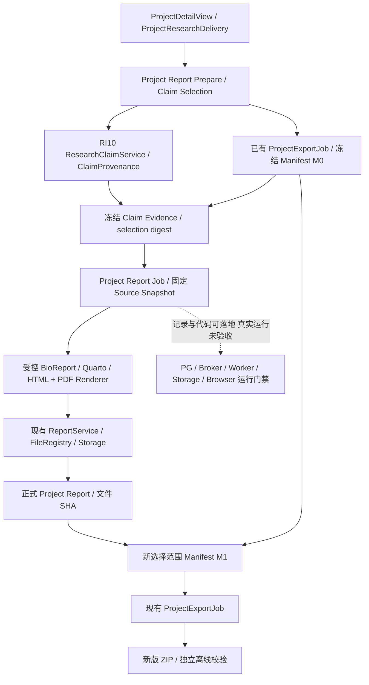
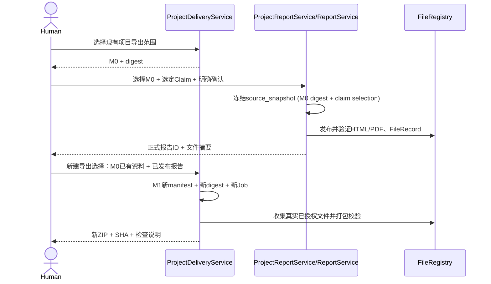

# CygnusX BioOps · RI09.5 Phase 1–4 详细实施方案

**项目级可信科学报告生成与可追溯交付（Provenance-Aware Project Scientific Report）**  
制定日期：2026-10-16 ｜ 文档状态：**下一轮实施任务书（to-be，不是 as-built）**  
适用：CygnusX BioOps 主平台 / Project、Dataset、Report、ResearchClaim、ResearchDelivery、BioReport 生态。

> **最高原则**：先复用已经完成的 RI01–RI04、RI06–RI09、RI10、RI12/RI13 和 RI09.5 原型。**不新建第二套报告引擎、不新增平行 TaskService、MCP Server、下载器或 Agent Runtime**。项目综合报告是独立于科研计算的*衍生交付产物*，不执行新的统计分析，也不将 `ZIP SHA-256` 解释为科研复现成功。

## 0. 审计事实、完成与缺失的边界

以下依据用户提供的四份 2026-10-16 报告，**不是本文件对仓库的独立复测**。

| 部分 | 报告记录的已存在代码 / 隔离能力 | 本轮待补的真实缺口 |
|---|---|---|
| RI06–RI09 | Project→DatasetVersion→AnalysisLink→Task 的可信关系；ProjectDeliveryManifest v1、ProjectExportJob、异步受控 ZIP 与原 Report/FileRegistry | 正式项目综合报告、真实 PG/Celery/存储/浏览器认证 |
| 项目交付稳定化 | 项目停用重新鉴权、ready 下载再核关系、已停用 FileRecord 刷新、畸形 DEG TSV 拒绝 | 真正跨进程/真实撤权验证，长期保留策略 |
| RI10 | 复用 `ResearchClaimService` 的已验证 `deg.tsv` 单元格；`ClaimProvenance` 只读投影和项目页 `ClaimEvidencePanel` | 经过用户选择且版本冻结的项目级 Claim 集合；并非通用结论核验引擎 |
| RI09.5 原型 | `render_project_summary_prototype`、只读 `GET /projects/{id}/exports/{job}/summary-preview`、14 章骨架、CSP 和空 sandbox iframe | 正式 project source 身份、独立报告 Job、持久发布、HTML/PDF、加入新版项目 ZIP |
| RI05 Runtime | RA01–RA15 验收计划、部分 isolated 演练 | 独立 PG DSN/Broker/Worker/存储/浏览器均未获得有效授权和真实验收 |

**文档已知基线**：`project_export_enabled=false`、`research_delivery_read_enabled=false` 等运行开关；实际值在开工前重新读取。`ReportModel.task_id` 及 `ReportGenerationJob.task_id` 存在 Task-first 非空约束；**禁止伪造 Task 代表 Project Report**。RI10 `claim_id` 是实时内容摘要，不是已经持久化的科研结论对象。BioReport 当前本地仓提交身份不等于生产镜像或 Worker 中实际渲染版本。

**最小出厂价值**：同一真实项目，用户通过经过授权的显式入口，选择冻结的项目范围和已核验的数值结论，生成一份正式的*项目级 HTML 科研总结*，查看缺口与证据，随后可选生成 PDF 并将这两份已登记产物纳入**新的**项目交付包，而不是覆盖已有报告或旧 ZIP。

## 1. 边界、依赖与阶段里程碑

### 1.1 产品范围

1. 项目综合报告采用已有 ProjectDeliveryManifest 作为原始项目事实范围 **M0**；报告内容不得跨越 M0 的 Task、DatasetVersion、Report/ReportFile 和授权文件选择。
2. 报告明确区分项目意图/研究目标与已验证科研事实；缺失历史实验条件用 `NOT_RECORDED`、`UNKNOWN`、`NOT_OBSERVED` 等现有状态显示。
3. 单任务科学报告继续由现有 FlowFrame/BioReport 及 ReportService 产生；项目综合报告只读并汇总这些事实，不执行 RNAFlow/CountsDEGFlow、不重做差异分析、不聚合或重新计算统计量。
4. 可核验 Claim **首版只允许原 RI10 支持的 `deg.tsv`、明确 gene_id/column/value、SHA 与 Task/Observation 绑定**；其他科学解释一律不升格 VERIFIED_VALUE。
5. 正式报告与项目 ZIP 是**不同类型的 Job**；失败重试只重试自己的渲染或打包阶段，不重跑分析。
6. 默认不导出 FASTQ/BAM、不公开 Token/DSN/绝对路径、完整聊天/私密 Prompt 或敏感日志。
7. 真实环境不足不阻断安全独立的代码和隔离测试；**不允许**借助 Mock 宣称通过真实验收。

### 1.2 不在本轮实施

- RI14–RI16 历史受控复现、新旧 Task 比较、L2–L4 状态提升。
- 新的多组学联合统计分析、新的知识自动发现/全文核验模型。
- 为每个 Agent 添加项目报告写工具；Agent 只能已有受权 read/prepare，JWT 人类确认仍独立。
- 无限容量项目包、自动分页遍历所有历史孤立目录、历史 Project FK 猜测回填。
- 未经许可的数据库迁移、真实 Celery 作业、生产发布或开关开启。

### 1.3 阶段与出口（可并行设计、按依赖落地）

| 阶段 | 内容 | 退出标准 |
|---|---|---|
| **G0 基线与决策** | 工作区保护、原报告 API/数据库约束兼容审计、选择 source 模型 | 有兼容矩阵及 D1 设计决策；不破坏旧 Task 报告 |
| **P1：Project Report Identity** | 项目报告 source/owner/project/M0 身份、持久 Job、版本、权限/存储边界 | 真实 SQLite 迁移/ASGI/幂等及错权限 isolated PASS；PG BLOCKED 单列 |
| **P2：Verified Claim Selection** | 用户显式选择 Claim；服务端再取真实单元格；冻结证据和缺口、敏感字段投影 | 冻结 claim selection digest，不越 M0；源漂移拒绝；历史旧值不被重写 |
| **P3：Formal HTML/PDF** | 正式项目模板、报告 Job、受控渲染、登记 SHA 和授权下载 | HTML 已发布有 FileRecord；PDF 实际成功或如实缺失；绝不重算分析 |
| **P4：M0→Report→M1 Delivery** | 选择已经发布的 Project Report → 新 M1/新 Export Job/ZIP | M0 不变；M1 含实际文件与 SHA，无自引用循环；离线验证成功（至少 isolated） |
| **R：真实环境专项验收** | RI05/RA01–RA15 加项目报告专属用例 | PG/Celery/存储/浏览器等分别有运行证据，未授权则 BLOCKED |

任何数据库模型修改先以**迁移脚本代码+独立 SQLite/显式 opt-in PG**测试；**不执行生产迁移**。

## 2. 目标架构与真相来源

注意 `M0` 是*已经真实冻结*的项目包事实范围，而不是当前项目全量扫描的动态查询；Project Report **不能在渲染时重新拉取项目当前所有任务并悄悄扩展范围**。

### 2.1 职责层（不合并现有对象）

- `ProjectDeliveryManifest`: M0 已选项目关联/文件/缺口/排除的事实范围；M1 包含已生成报告文件的下一版交付选择。
- `ClaimProvenance`: 某个时点、某个合法范围内通过 SHA、行列和真实观察取得的**值**的核验投影，不是独立新科研知识库。
- `ProjectReportSourceSnapshot`（候选 DTO 名称；先查现有类型）：针对一次明确选择，将 M0 digest、已选 Claim 的值+来源+摘要、模板投影/脱敏版本**冻结**；可以嵌于可信 Job 记录，非必须新表。
- `ReportSnapshot`: **原 Task 源**冻结证据继续有效，不将项目源塞入需要 task_id 的旧模型，不重算旧 digest。
- `ReportService/ReportFile`: 实际报告版本、文件 SHA、授权预览与下载；必须明确 project source 的扩展点或兼容适配。
- `ProjectExportJob`: 不改 M0；只能通过另一次用户明确导出选择创建 M1。

## 3. G0：工程基线与兼容决策 D1

### 3.1 当前代码审查清单

启动时定位当前真实文件路径及调用方，包括：`ReportModel`、`ReportGenerationJob`、`ReportFile`、`ReportService`、`report_snapshot_builder`、`reproducible_report_service`、`scientific_report_job`、`BioReportAdapter`、`research_delivery_service`、`ProjectDeliveryService`、`ProjectExportJob`、`ProjectResearchDelivery.vue`、`render_project_summary_prototype`、其实际 API 和权限装饰器。检查所有：`get_by_task_id`、`task_id NOT NULL`、partial unique index、Report kind 校验、run folder、FileRecord、删除/保留与升级路径。

### 3.2 必须先做的决策 D1：项目报告的身份如何保存？

| 方案 | 适用条件 | 约束 |
|---|---|---|
| **A 首选：扩展现有 Report/Job 的 source_kind** | 所有 Task-first API/仓储/索引/外键可做到无回归兼容 | 对 `source_kind=task` 保留 task_id 必填，对 `project` 项目/M0 引用必填、task_id 空；互斥 CHECK、owner+project 约束、历史默认值及迁移 |
| **B 审慎备选：最小 ProjectReportSource/Job 记录+现有报告文件能力** | 扩展原 Task 报告表风险过高（大量非空关系、历史唯一索引） | 只新增*必要的项目源/Job 身份*，其余复用原渲染/文件登记/存储/授权/版本能力；不能自建平行报告引擎或 FileRegistry |

**必须提交一页 Decision Record**：涉及具体代码调用点、迁移/FK/unique 变更、兼容测试、回滚影响、选 A/B 的证据；没有完成 D1，不得盲目让 `Report.task_id` 可空。

### 3.3 P1 身份字段与约束（建议，不是已存在字段）

- `source_kind`: task | project；历史记录默认为 task；不得使旧项目/旧报告自动改归属。
- `owner_id/project_id` 必须服务端授权决定；project 不允许客户端自报 owner。
- `source_manifest_job_id` 与 `source_manifest_digest=M0`；固定 schema 和 selection_digest。
- `report_type`: project_scientific_summary（用现有 report_kind 枚举/扩展策略），不和 task scientific/evidence 混淆。
- `template_version`, `renderer_version`, `redaction_policy_version`, `schema_version`。
- `parent_id/version` 按项目 source+M0+模板+选择范围关联，不能替换旧版本。
- `status`, `attempt_count`, `error_code`, `file_record_id/ReportFile`, `sha256`, `created_at`；禁止无文件标 ready。
- `request_key` owner+project+M0 digest+Claim selection digest+render/template version+format 绑定；重复相同选择复用，变范围必须新 Job。

**迁移安全**：existing rows backfill `source_kind=task` 必须无损；PG CHECK/FK/unique 在独立 schema 真实验证；保留历史 report.task_id 的 `get_by_task_id` 语义，旧快照/report_kind/文件下载/报告删除/保留不受影响。

## 4. Phase 2：Frozen Verified Claim Selection

### 4.1 选择与核验输入

前端只允许选择现有可信项目里的具体 `task_id`、关联 `report_id`（可空）、`file_record_id`、`feature/gene_id`、`column`，以及可选仅用于标注为 AI_INTERPRETATION 的草稿。**不接受客户端提供数值、SHA、project/owner、verification_status、历史环境等可信事实字段**。

步骤：

1. 服务端授权当前 owner/project/module 并检查当前 project active 状态；查询**冻结 M0** 中的真实 Task、Version、Report/File 引用。
2. 校验用户选择的 Task/File/Report 均在 M0 范围内。特别注意 M0 `references` 与 `included` 不相同；首版若需要逐字节验证必须重新受权读取文件，不能因仅有引用便认定包含或可得。
3. 调用原 `ResearchClaimService`/`ClaimProvenance` 完成当前 FileRecord 生命周期、`deg.tsv` 受管路径、SHA、唯一 feature、column 与有限数值验证；重复列/畸形 TSV/NA/不匹配的旧版本严格处理。
4. 冻结**服务端实际读得的值**、来源 ID、原文件摘要、Observation、绑定状态、缺口以及可复查政策版本，形成 Claim 列表的规范化 digest。首版数值陈述严格为 `feature.column = value`。
5. 将 M0 digest、claim selection digest、脱敏/渲染版本构造成版本化 source snapshot；要有规范化序列化、固定顺序、拒绝 NaN/Infinity、字段白名单、可选独立 content digest。
6. 在 Job 发布前重新检查权限、选择引用及对应字节/元数据；内容变化失败或要求重新 Prepare，**不得自动用新值刷新已冻结 Claim**。

### 4.2 等级严格区分

| 类别 | 允许表达 | 不允许表达 |
|---|---|---|
| `VERIFIED_VALUE` | 此文件此行此列在指定 SHA 下可读到的有限数值 | 实验结论、机制/因果、QC 通关 |
| `SUPPORTED_CLAIM` | 服务器基于实际已验证数值生成的有限表达 | 自动给定显著性阈值、普遍性、临床意义 |
| `AI_INTERPRETATION` | 明显区隔的解释性草稿/人工评论（可带来源） | 作为已验证科研发现或计算事实 |
| `NOT_VERIFIED` / 缺口 | 无法验证、NA、历史来源缺失 | 用当前版本或模型回答补齐历史 |

**默认正式报告只纳入用户明确选择并冻结的有限 VERIFIED_VALUE / SUPPORTED_CLAIM；其他解释可放单独“未验证解释”区并默认不纳入**。若项目没有可核验 Claim，报告应如实展示“无已验证结论”，仍可以交付事实性项目清单。

### 4.3 冻结数据何处保存？

优先使用 P1 的持久报告 Job `source_snapshot_json/source_digest` 或复用现有冻结范围引用；只有确实需要不可变长期检索、强 FK 和独立版本时才建议单独持久表。普通 Python frozen DTO 不等于数据库/WORM 永久不可变：必要时用 DB 触发器、唯一约束、只追加版本与受控发布路径强化。

**注意首次 Prepare 与用户确认的漂移检查**：返回 `prepare_digest`，Create 必须重新核同 owner/project/M0/Claim 值、模板/格式和授权；不一致返回 409 且要求重新预览，不能静默替换。

## 5. Phase 3：Formal HTML/PDF Render & Report Publication

### 5.1 保留 14 个已设计章节

1. Project Overview；2. Research Objectives（意图非事实）；3. Dataset Inventory；4. Data Provenance；5. Analysis Workflows；6. Execution Summary；7. Scientific Results；8. Key Findings（只允许冻结 Claim）；9. Quality Control；10. Evidence Coverage；11. Report Inventory；12. Reproducibility Readiness（历史 NOT_RUN）；13. Limitations；14. Appendix。

**内容真相规则**：只展示 M0 冻结已存在的数据与明确选中 Claim。缺 QC rules 不能判定 QC PASS；旧 Task 没有 observed image、release、reference SHA 时显示缺口；不能由 Chat、当前目录、当前 Flow Catalog 或模板自由推断历史事实。

### 5.2 渲染复用策略

- 保留已有原型 `render_project_summary_prototype` 作为*只读预览*；原型状态必须显著显示 PROTOTYPE，不能当 ReportFile 正式发布。
- 在现有 BioReport/Quarto 模块、主题、通用 `single` 布局及受控 Pandoc/Typst 辅助设施中选择**受版本控制的项目级模板/适配器**；先核对当前 BioReport CLI/模板/Worker 镜像是否实际可用。旧 RNA/Counts 科学模板不直接用于跨项目报告。
- 渲染器输入仅服务端可信冻结 JSON 与授权的小型结果文件副本；允许的模板路径/模块白名单固定。禁用 AI 自动生成、网络、任意 Shell、用户提供的 YAML、Python 脚本、模板路径、任意本地文件与凭据透传。
- 输出 HTML 转义并设置 CSP，平台预览使用受控 sandbox，不使用 `allow-scripts` + `allow-same-origin` 的危险组合；如需报告互动，采用独立可信域策略评审。
- **先交付正式 HTML**；可用时 PDF 由经认证的 renderer 根据同一冻结源产出。PDF 失败保留真实有效 HTML 和 `PDF_NOT_GENERATED` / partial 状态，不伪造空文件，不触发分析重跑。
- 渲染版本必须记录实际 release/version/digest；本地 Bioreport `pyproject`/Git commit 不等于生产渲染镜像证明，未验证置 `NOT_OBSERVED`。

### 5.3 状态、恢复和并发

参考现有独立报告 Job/outbox、Celery、锁、失败恢复、FileRegistry、StoragePathFactory、FileRecord、ReportFile、owner 下载。推荐 `queued → collecting → validating → rendering → publishing → ready`（具体名称遵守代码现状），`failed` 独立记录，HTML/PDF 状态可分别存在。并发相同 frozen source/template/format 只产生一个可信发布身份。Commit→Broker 和 Worker 强杀未知状态采用已有状态/幂等恢复，**不得重新生成新源事实**。

必须分清：
- 业务 Job ready 表示登记并回读校验后的实际报告产物；
- Report/FileRecord.sha256 表示**文件字节**完整性，不是科学有效性的证明；
- Project Report 不应伪造 `Task` 以复用 Task-first Job；
- 构建 Project Report 与构建 Project Delivery ZIP 不互相隐式调用；
- 下载每次重查用户/项目/文件的当前有效授权；Project 停用后拒绝从旧链接下载。

### 5.4 API 建议（先与现有路由审查，最终冻结 OpenAPI）

| 入口（候选） | 行为 | 权限/副作用 |
|---|---|---|
| `POST /projects/{id}/scientific-summary/prepare` | 选择 M0/claims/格式，返回冻结候选摘要、缺口、预算 | 无 Job、无分析 |
| `POST /projects/{id}/scientific-summary` | 可信 JWT 确认 digest + request_key，创建持久报告 Job | 只渲染；运行门禁关闭时拒绝 |
| `GET /projects/{id}/scientific-summary/{job}` | 查询 Job 状态、明确错误、产物 | 当前 owner/project/read 权限 |
| `GET /projects/{id}/scientific-summary/{job}/download?format=html/pdf` | 下载已登记实际文件 | 重验 FileRecord/SHA/项目授权 |
| `GET /projects/{id}/scientific-summary/{job}/preview` | 受控只读预览 | 不渲染、不创建 Job |

**现有 `summary-preview` 原型不应被悄悄改成写端点**。如果能沿用原 Reports API/URL，应优先复用，避免重复入口；HTTP 方法与版本化 Schema 应有兼容策略。

## 6. Phase 4：非循环的 M0 → Project Report → M1

**不变量**：

1. 已发布 M0、原 ExportJob、已存在单 Task ZIP、旧 ReportSnapshot 都不可修改。
2. 项目报告来源引用 M0 digest 和其自身 source snapshot digest，不引用最终包含自身的 M1 digest，避免摘要循环。
3. M1 可以引用 M0/项目报告 ID 与实际 ReportFile SHA/大小；M1 自身不能嵌入自己的最终 ZIP digest。最终 ZIP SHA 在包外受权下载元数据中返回。
4. 缺 PDF 的 M1 根据用户选择标 `partial`，不创建空 PDF；仅引用并未包含的大文件列为 `references`。
5. 若项目报告发布后源数据被修改，原报告不可覆盖；M1 发布时必须验证文件关系/当前授权和 bytes，失配拒绝，不静默重算或调包。
6. ProjectExportJob 不隐式调用 BioReport/Quarto 或下载服务。
7. 既有项目容量上限（本轮报告：500 files/16 MiB each/64 MiB payload/80 MiB ZIP）仍适用；报告添加后超限时返回明确错误，不偷偷放大预算。

是否修改现有 ProjectDeliveryManifest v1 Schema，须先证实可向后兼容；一般优先版本化增加 project_report 引用能力，不能偷偷改变旧 v1 canonical digest 语义。

## 7. 安全、治理和长期版本

- **身份**：所有项目/owner 由当前 JWT/会话和服务端数据库关系重建；Agent/浏览器请求不得提交可信 owner 或未经核验的 FileRecord 状态。
- **批准**：预览/Prepare 不产生持久写任务；真实创建报告是需要明确 JWT 人类操作的独立动作；不授予 Agent 自审批。报告生成批准不同于分析或下载批准。
- **网络与子进程**：Render Worker 默认隔离网络，固定受信镜像/已批准命令参数；不可传入本地绝对路径、脚本、环境变量、签名 URL、凭据或外部模板来源。
- **文件**：路径安全、FD/O_NOFOLLOW、小文件复制与前后 `fstat`、原子 staging 发布/回读 SHA；拒绝目录逃逸、symlink、超大小/文件数及恶意 HTML；报告下载权限与当下 FileRecord 生命周期重核。
- **保留**：旧报告、Job、快照、M0/M1 保留追加；项目完成/移交不等于停用；停用拒在线访问；归档/合法保留/删除策略另审批。没有定义保留期限前不自动删科研证据。
- **状态**：分别维护 FILE_INTEGRITY、EVIDENCE_COVERAGE、DELIVERY_COMPLETENESS、REPRODUCIBILITY_STATUS，不以一个成功绿色状态替代四个维度。
- **范围**：超出当前 Provenance 截断上限时拒绝“全项目”；后续单独评审 keyset 分页、冻结全部页集合摘要。首版可以只支持受信选择子集，但不得命名为整个项目完全归档。

## 8. 验收矩阵（代码、隔离、真实运行必须分离）

| 编号 | 测试/验收内容 | 必须满足 |
|---|---|---|
| D01 | 旧 Task Report/Job/ReportFile 的所有调用点影响分析 | D1 ADR 完成，无伪造Task |
| D02 | 迁移、旧记录、NOT NULL/CHECK/FK/unique 兼容 | SQLite isolated；PG opt-in 待授权 |
| D03 | 相同 project/M0/claims 同时 Create 幂等 | 请求键与冻结源一致，无重复报告 |
| D04 | 同 request_key 修改 Claim/范围/template | 409 冲突、不能换关联 |
| C01 | M0 外部 Task/File/Report 选择 | 拒绝，不泄露跨 owner 存在性 |
| C02 | 客户端自报数值/verified/SHA/owner | Schema拒绝，值只读受管源 |
| C03 | deg.tsv 唯一feature/column/有限值 | 实际源文件 SHA 与 Observation 等范围匹配 |
| C04 | NA、坏行、重复行/列、源字节漂移 | NOT_VERIFIED 或拒绝，无假科学数值 |
| C05 | 历史报告版本/旧 Observation 与现文件冲突 | 不自动借最新报告/定义 |
| C06 | 无 Claim 项目 | 诚实生成事实性报告，无虚构 Key Findings |
| C07 | FREE_TEXT 草稿与 DOI/PMID | AI_INTERPRETATION/NOT_VERIFIED，默认不纳入已验证结论 |
| C08 | Claim 冻结选择 hash/排序/版本 | 稳定、无环、不泄漏敏感字符串 |
| R01 | 14章内容与引用来自冻结 M0、Claim | 不做实时增量抓取、补历史运行环境 |
| R02 | 正式 HTML、CSP、敏感字段白名单 | 文件实际生成/回读 SHA/登记；原型状态分开 |
| R03 | PDF 成功或失败 | 同冻结事实；失败留 HTML+partial/缺口 |
| R04 | 旧审计报告 HTML 字节兼容 | 相同旧快照输出未变（除非单独版本变更） |
| R05 | 渲染失败重试/Worker重复投递 | 原 source snapshot 复用，不新做科研计算 |
| R06 | 项目停用、撤权、跨 project 下载 | API/Worker/下载时均拒绝 |
| R07 | 受控命令与模板/凭据/路径注入 | 白名单，拒绝任意脚本和外网 |
| E01 | M0、报告、M1 两级摘要 | M0 不变，M1 新身份，无循环 |
| E02 | HTML/PDF ReportFile → M1 ZIP | 成员、SHA、checksums、引用状态一致 |
| E03 | ZIP 打包中断/文件漂移/缺PDF | 坚守冻结、不修改旧包；partial/failed 明确 |
| E04 | 非作者共享/跨项目/晚到请求 | 不混入旧项目数据、不泄露报告 |
| E05 | 导出不调用 TaskService、DownloadService、科学计算 | 测试将以上设为禁止执行仍可打包 |
| E06 | 超限与截断项目 | 拒绝或准确的选定子集，不伪装全量 |
| RA01–RA15 | 前一轮已有真实环境验收要求 | 无授权测试环境继续 BLOCKED |
| BR01 | 真实 Chromium 宽屏/窄屏、下载/状态/焦点 | jsdom 不能冒充 PASS_E2E |
| BR02 | 真实 BioReport/Quarto/Pandoc/Typst 的受信版本 | 本地开发安装不冒充 Worker/生产镜像认证 |

**质量**：相关测试、静态/类型检查、前端构建不得退化；全仓已有 Ruff/mypy/前端全量失败独立记录并注明增量来源，不能宣称全仓全绿。支持用 SQLite/临时字节做 `PASS_ISOLATED`，但不当作真实公开科研结论或 PASS_RUNTIME。

## 9. 提交/测试/运行授权与停止点

- 开始前 `git status` / diff / HEAD / 子模块脏状态和被修改文件 SHA 建立 baseline；保护当前 `feat/research-agent-phase5` 工作区并行成果，不使用 reset、stash、全文件 checkout、clean。
- P1 模型/迁移只允许在隔离/明确 opt-in 测试库验证；未授权的 PG 不自动探测、不读生产 DSN。
- 真实 Celery、存储、浏览器、BioReport/Quarto 如不可访问，应对相应 gate 写 BLOCKED；可以继续独立完成安全代码与隔离测试。
- 不打开 `project_export_enabled`、下载、分析和科研复现写门禁；新增 Project Summary 使用自己经过代码与运行认证的准入，不借用与其无关的布尔开关。
- 完成 P1 兼容 ADR 后才能实施相应数据结构；若风险无法证明可控，停止相关迁移/发布而非强行迁就当前 Job。
- **不得擅自提交/推送/部署/生产迁移/计算/下载/真实科研复现**；完成后保留代码和报告，等待人工审核。

## 10. 最终交付文件与结构

建议按当前仓库实际结构创建或更新：

1. `docs/decisions/cygnusx-project-report-source-adr.md`：D1 兼容决策（A/B）、变更面、旧接口保护。
2. `docs/contracts/cygnusx-project-report-source-v1.md` + `.schema.json`：source_kind、M0/Claim、状态、版本和摘要。
3. `docs/contracts/cygnusx-project-verified-claim-selection-v1.md` + `.schema.json`：选择、冻结事实、缺口、hash。
4. `docs/implementation/cygnusx-ri095-project-scientific-report-phase1-4.md`：逐阶段 as-built 和测试结果。
5. `docs/audits/cygnusx-ri095-real-runtime-gates.md`：PG/Worker/渲染/浏览器/存储的实际状态与证据。
6. `evidence/ri095-project-report-phase1-4/`：baseline、命令、日志、JUnit、前后质量差异和 SHA（不得含秘密）。

实施总结必须分 `DONE_CODE`、`PASS_ISOLATED`、`PASS_RUNTIME`、`PASS_E2E`、`BLOCKED`；对每项写明测试证据、残余风险、是否改变业务数据、回滚边界。详细保护旧 Job/Report/ProjectExportJob/M0/ZIP 的历史兼容和回滚计划。

## 11. 下一阶段展望（非本轮承诺）

- 继续 RI05 RA01–RA15 真实隔离环境认证，形成首个可下载并独立 SHA 核验的项目报告 ZIP。
- RI11 平台 Agent Tool Profile 复用既有 `research.project_inventory`、`research.project_export_status`、`research.report_provenance` 和 RI10 旧工具；不为新报告增设无限写权限。
- RI14–RI16 在可信 Workflow Release、实际镜像/参考/输入环境可用后再实现 Reproduction Prepare → 人类批准 → 新 Task → 比较策略 → 复现报告。不得从 ZIP 完整性自动提升 L1–L4 科学复现等级。

---

**发布判定**：截至本方案撰写时，下一轮代码可在有界隔离环境实施，但没有真实 PG/Celery/存储/Browser/BioReport Worker 证据不能授予 `PASS_RUNTIME` 或生产开关开放；本方案不是对当前仓库已完成 P1–P4 的声明。
