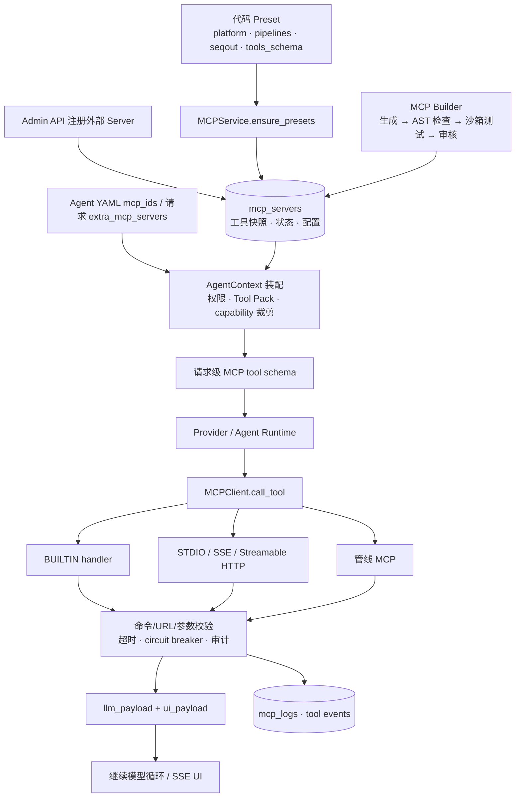
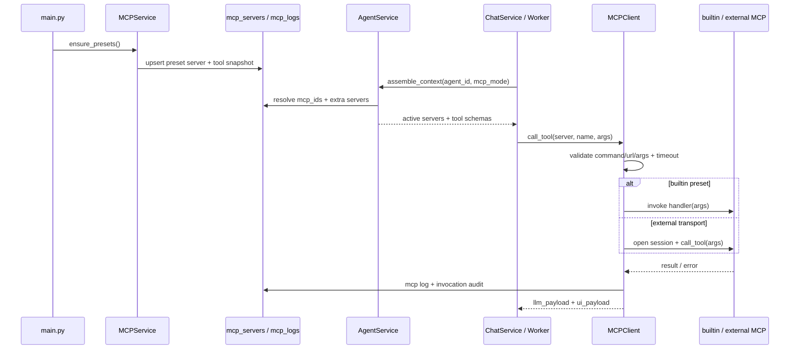

# MCP 架构与自生成框架设计

> **用途**：本文件记录 CygnusX MCP（Model Context Protocol）子系统的完整架构现状、"Agent 自生成 MCP"可行性分析与三阶段提案的历史注记（§4），以及 MCP 构建师 `agent-mcp-builder` 的最终落地实现（§5，as-built）。
>
> **最后更新**：2026-09-18
>
> **时点说明**：§1–§3、§6–§10 为 2026-07-29 时点的架构快照，所述现状已演进，部分引用（路径、行号）已失效（2026-10-03 已实测刷新 §1.3 preset 清单与行号：cygnusx-platform 22 个在 `presets.py` `PLATFORM_PRESET_TOOLS`、cygnusx-pipelines 10 个在 `pipeline_preset.py`、seqout 26 个在 `presets.py` `SEQOUT_PRESET_TOOLS`；其余行号仍以代码为准）。§4 为历史注记（2026-09-18 精简），§5 为 2026-07-30 时点的 as-built 实现记录。mcp-server 外部通道的"整改后终态"以 `mcp-server/ARCHITECTURE.md` 为准。

> **适用范围**：MCP 注册/发现/调用、沙箱隔离、AI 代码生成、实验性 MCP 生命周期管理。

> **外部通道当前安全契约**：`main.py` 与 `pipelines_main.py` 共用 `core/runtime.py`。
> HTTP/SSE 仅允许回环监听且强制独立 `CYGNUSX_HTTP_TOKEN`（至少 32 字符）；旧的
> 非回环开关不能绕过限制，尚无可信网关模式。平台 API Key 只代表其绑定 owner，入站
> Token/Header 不能指定平台用户。写工具只接受 JWT 人工批准后的 `confirmation_id`，
> 布尔值不是凭证。确认服务必须使用 Redis，故障返回 503，不再自动回退内存。
> task 审批先原子占用 `SUBMITTING` 再调用 TaskService；执行后记录失败需要人工对账，
> 不保证跨 Redis/数据库/队列事务的 exactly-once。验收证据见
> `docs/implementation/cygnusx-phase0b-runtime-integration-implementation.md`，未完成的
> 外部传输和多进程验收不能用进程内测试替代。

> **合并说明（2026-09-18）**：本文档与 `mcp_builder_agent.md`（as-built 实现文档）合一——后者全部内容并入为 §5"MCP 构建师 agent-mcp-builder（as-built）"，原文件已删除；本文档原 §4–§5"Agent 自生成 MCP 可行性分析与三阶段提案"压缩为历史注记（新 §4），保留能力复用度结论要点，删除被最终实现取代的重复设计稿（双份 AST 规则表、schema 扩展 SQL、`/mcp/*` 端点提案、五阶段部署流水线图）。最终实现见 §5。

## 这个 MCP 模块如何发挥作用

MCP 子系统把平台工具、外部服务和管线能力统一成模型可以发现并调用的工具表面，同时把注册、授权、传输、隔离、超时和审计放在同一条控制链上。启动时 `MCPService.ensure_presets()` 将代码中的内置 Preset 和管线工具幂等同步到 `mcp_servers`/工具快照；管理员通过 API 注册或更新外部 Server，Agent YAML 的 `mcp_ids` 和请求级 `extra_mcp_servers` 决定哪些 Server 可以进入本次上下文。

会话装配阶段只向模型暴露经过 Agent、用户权限、Tool Pack、Studio capability 和 MCP 模式裁剪后的 schema。模型返回 `tool_call` 后，Chat/Worker 根据 Server 和工具名交给 `MCPClient`：内置工具直接调用受控 handler，STDIO/SSE/Streamable HTTP 工具通过对应传输建立短生命周期会话。命令、URL、参数、超时和 circuit breaker 在调用前后校验，结果携带紧凑 `llm_payload` 与完整 `ui_payload`，调用日志和错误写入审计表。

MCP Builder 是另一条受控入口：Agent 在 Studio 中生成候选代码，`StaticSafetyChecker` 做 AST 静态检查，sandbox-agent 在隔离容器中启动/调用测试，通过审核和 TTL 后才注册为实验或正式 MCP。这样 MCP 既是 Agent 的扩展能力目录，也是一个有生命周期、有权限边界、有可回滚证据的运行时适配层。

### 运行架构图：MCP 从注册到调用的链路



### 实现图：Preset、Agent 装配和工具调用



---

## 1. MCP 子系统架构现状

### 1.1 三层 MCP 体系

CygnusX 的 MCP 能力由三层构成：

| 层级 | 说明 | 传输方式 | 延迟 |
|------|------|----------|------|
| 内置 Preset | 平台工具 + 管线工具，进程内执行 | `BUILTIN`（函数调用） | 零延迟 |
| 外部 MCP Server | 独立进程/容器，标准 MCP 协议 | `STDIO` / `SSE` / `STREAMABLE_HTTP` | 网络延迟 |
| 管线专属 MCP | RNAFlow / ATACFlow 各自的 FastMCP 服务 | `SSE`（端口 8900+） | 网络延迟 |

### 1.2 核心代码定位

| 功能 | 文件路径 |
|------|----------|
| Preset 注册与工具定义 | `src/cygnusx/infrastructure/mcp/presets.py` |
| 管线 Preset（RNA/ATAC） | `src/cygnusx/infrastructure/mcp/pipeline_preset.py` |
| 统一 MCP 客户端 | `src/cygnusx/infrastructure/mcp/client.py` |
| 域实体与服务 | `src/cygnusx/domain/mcp/entities.py`, `services.py`, `repositories.py` |
| 值对象（Transport/Status） | `src/cygnusx/domain/mcp/value_objects.py` |
| Admin API 路由 | `src/cygnusx/api/v1/mcp.py` |
| 渐进式能力加载 | `src/cygnusx/application/services/studio_capabilities.py` |
| 独立 MCP Server | `mcp-server/main.py` + `mcp-server/config.yaml` |
| 数据库模型 | `src/cygnusx/infrastructure/database/models/` (mcp_servers, mcp_logs 表) |
| 前端 Store | `frontend/src/stores/mcp.ts` |

### 1.3 内置 Preset 工具清单

**cygnusx-platform**（22 个工具）：

```
platform_list_tasks, platform_get_task, platform_list_flows,
platform_sandbox_execute, platform_read_file,
list_workspace_files, search_workspace_files,
workspace_list_files, workspace_read_file, workspace_get_file_info,
find_session_uploads,
europe_pmc_search, arxiv_search,
platform_get_user_info, platform_get_current_time,
platform_list_agent_skills, platform_admin_health_check,
platform_submit_download, platform_list_downloads, platform_get_download_progress,
ability_catalog_query, room_state_query
```

（完整定义见 `infrastructure/mcp/presets.py` `PLATFORM_PRESET_TOOLS`。）

**cygnusx-pipelines**（10 个工具，定义在 `infrastructure/mcp/pipeline_preset.py` `PIPELINE_TOOLS`）：

```
rna_seq_prepare, rna_seq_submit, rna_seq_status, rna_seq_results,
atac_seq_prepare, atac_seq_submit, atac_seq_status, atac_seq_results,
list_available_pipelines, check_workspace_data
```

**seqout**（26 个工具，公共数据库检索 MCP——SEQOUT_SERVER_NAME="seqout"，完整覆盖
GEO/SRA/ENA/GSA 项目搜索、样本清单、accession 解析等；定义在 `presets.py`
`SEQOUT_PRESET_TOOLS`，preset 分发见 `get_preset_by_name()`）。

**cygnusx-tools**（动态构建）：从 `tools_schema.yaml` + 启用了 `ai.enabled=True` 的 Flow 配置动态生成。

### 1.4 MCP 注册与发现流程

```text
启动阶段:
  main.py → _init_mcp_presets() → MCPService.ensure_presets()
    → 幂等写入 DB (mcp_servers 表, is_preset=True)

运行时注册:
  Admin API POST /api/v1/mcp/servers → 验证 → 写入 DB
  Agent YAML (data/ai/*.yaml) mcp_ids 字段 → 绑定到 Agent

会话加载:
  ChatService → AgentService.assemble_context(agent_id)
    → 读取 Agent 绑定的 mcp_ids → 加载 MCPServer 实体
    → studio_capabilities 渐进式加载 → LLM 获得工具 schema

工具调用:
  LLM 输出 tool_call → ChatService 路由到所属 MCPServer
    → MCPClient.call_tool()
      ├─ BUILTIN: 直接调用 PLATFORM_HANDLERS[name](args)
      └─ 外部: _open_session(server) → MCP SDK session.call_tool()
```

### 1.5 安全验证

`MCPClient` 内置三层安全校验：

| 校验函数 | 防护目标 |
|----------|----------|
| `validate_stdio_command()` | 禁止 shell 解释器、路径穿越、绝对路径 |
| `validate_sse_url()` | 禁止内网/回环/元数据 IP（169.254.x, 10.x, 127.x） |
| `validate_stdio_args()` | 禁止 shell 元字符（`;`, `|`, `&&`, `$()` 等） |

外部调用统一包裹 `asyncio.wait_for` 超时（默认 30s，`mcp_default_timeout` 配置）。

### 1.6 MCP API 端点

| 方法 | 路径 | 权限 | 用途 |
|------|------|------|------|
| GET | `/api/v1/mcp/servers` | Admin | 列出所有 MCP Server |
| POST | `/api/v1/mcp/servers` | Admin | 注册外部 Server |
| PUT | `/api/v1/mcp/servers/{id}` | Admin | 更新配置 |
| DELETE | `/api/v1/mcp/servers/{id}` | Admin | 删除 |
| POST | `/api/v1/mcp/servers/{id}/test` | Admin | 测试连接 |
| GET | `/api/v1/mcp/servers/{id}/tools` | Admin | 发现工具 |
| POST | `/api/v1/mcp/servers/{id}/tools/{name}/invoke` | Admin | 调用工具 |
| POST | `/api/v1/mcp/pipelines/tools/{name}/invoke` | User | 调用管线工具 |
| GET | `/api/v1/mcp/servers/{id}/logs` | Admin | 查看日志 |

### 1.7 数据库 Schema

```sql
-- mcp_servers 表
id            UUID PK
name          VARCHAR UNIQUE
description   TEXT
transport     VARCHAR (stdio/sse/streamable_http/builtin)
command       VARCHAR
args          JSON
url           VARCHAR
env           JSON
registry      VARCHAR
working_dir   VARCHAR
version       VARCHAR
status        VARCHAR (online/offline/error/starting)
is_enabled    BOOLEAN
tools         JSON          -- 工具快照
timeout       INTEGER
auto_restart  BOOLEAN
is_preset     BOOLEAN

-- mcp_logs 表
id            SERIAL PK
service_id    FK → mcp_servers.id
timestamp     TIMESTAMP
level         VARCHAR
message       TEXT
source        VARCHAR
```

### 1.8 热重载现状

| 组件 | 热重载支持 | 机制 |
|------|-----------|------|
| cygnusx-tools preset | 部分支持 | 每次 `get_preset_by_name()` 动态构建，新 Flow 自动出现 |
| 外部 MCP Server | 支持 | `MCPClient` 每次调用新建 session，注册后立即可用 |
| Preset 工具定义变更 | 支持 | `POST /api/v1/mcp/presets/reload` 热重载（`api/v1/mcp.py:32-39`，内部 `ensure_presets(force_preset_sync=True)`），无需重启 |
| workspace_files_prompt.md | 不支持 | import 时加载，需重启 |
| Prompt 系统 | 支持 | mtime 检测自动重载 |

---

## 2. 沙箱隔离体系

### 2.1 双沙箱架构

| 系统 | 用途 | 关键文件 |
|------|------|----------|
| SandboxPool（基础池） | 简单代码执行（MCP/API 调用） | `infrastructure/sandbox/pool.py` |
| StudioSandboxManager | AI 工作台，每会话独立容器 | `infrastructure/studio/manager.py` |

### 2.2 Studio 沙箱生命周期

```text
创建:
  ensure_running(session_id) → Docker 容器 "studio-{session_id[:8]}"
  容器内运行 sandbox_agent.py (FastAPI, UDS /workspace/.agent.sock)

通信:
  宿主机 httpx → Unix Domain Socket → 容器内 FastAPI
  无暴露端口，无 docker exec

执行:
  POST /exec → 流式 NDJSON 输出 → 超时 killpg

回收:
  Celery beat 每 5 分钟 → recycle_idle()
  空闲超过 idle_ttl_minutes (10min) → stop + remove
  Redis ZSET 执行租约 → 防止运行中被回收
```

### 2.3 资源限制

```yaml
# data/ai/studio.yaml
sandbox:
  cpu: 2                    # cpu_shares = 2048
  memory: 4g               # mem_limit
  exec_timeout_seconds: 600

# src/cygnusx/core/config.py (基础池)
sandbox_default_cpu: 2.0
sandbox_default_memory: "4g"
sandbox_exec_timeout: 300
sandbox_session_timeout: 300
sandbox_network_isolated: true
```

### 2.4 网络隔离

**模式一：`none`（默认）**
- `network_mode="none"`，容器无任何网络接口
- Agent 通信仍通过 UDS（文件系统，非网络）

**模式二：`whitelist`（当前 studio.yaml 配置）**
- 每会话创建 Docker `internal` 桥接网络（无互联网网关）
- 仅两个容器接入：沙箱 + `cygnusx-studio-egress-proxy`
- Egress Proxy（`deploy/studio/egress_proxy.py`）强制域名白名单：
  - 仅允许 HTTP 80 / HTTPS CONNECT 443
  - 当前白名单：`conda.anaconda.org, pypi.org, files.pythonhosted.org, mirrors.aliyun.com, mirrors.ustc.edu.cn`
  - 拒绝 IP 字面量、通配符、私有/保留地址
  - DNS 解析固定公网 IP（防 DNS rebinding）
- Proxy 容器加固：`read_only: true, cap_drop: [ALL], no-new-privileges, pids_limit: 128, mem_limit: 256m`

### 2.5 安全控制清单

- 非 root 执行（uid 10001）
- `realpath()` + 路径包含检查（写严格限制，读允许 platform 符号链接）
- Per-user 数据隔离（仅挂载 `users/{user_id}`，只读）
- 执行超时 + 进程组 SIGKILL
- 输出大小上限（10KB 流内，溢出写磁盘）
- Worker 节点无 Docker socket 访问权限
- 控制面认证：HMAC-SHA256 派生 token

---

## 3. AI 模型接入架构

### 3.1 Provider 抽象层

```text
┌─────────────────────────────────────────────────────┐
│  ProviderManager (单例注册表, 按 config ID 缓存)      │
│    chat_stream(config, messages, system_prompt, ...) │
└──────────────────────┬──────────────────────────────┘
                       │
       ┌───────────────┼───────────────┐
       ▼               ▼               ▼
OpenAICompatible   LiteLLM         Kimi (Legacy)
  Provider         Provider
(httpx SSE 直连)  (100+ 模型)
```

### 3.2 当前配置的模型（Provider YAML 声明）

| 名称 | 模型 | 端点 |
|------|------|------|
| deepseek-v4-flash | deepseek-v4-flash | DeepSeek（`https://api.deepseek.com`） |
| qwen3.8-flash | qwen3.8-flash | 阿里云 DashScope 兼容端点 |
| qwen3.8-omni-flash | qwen3.8-omni-flash | 阿里云 DashScope 兼容端点 |
| qwen3.8-max | qwen3.8-max | 阿里云 DashScope 兼容端点 |

当前默认声明为 `deepseek-v4-flash`。以上是磁盘配置，不代表远程模型已通过实际调用验证。动态选型现状见 `CygnusX_model_routing_architecture.md`。

### 3.3 专家意图路由与模型选型

```text
用户消息 → Router Agent (features.router: true)
  → LLM 意图分类 (temperature=0, max_tokens=10000)
  → 输出 {"agent_id": "...", "reason": "...", "complexity": "low|medium|high", ...}
  → 组装目标 Agent 上下文 (模型/提示词/工具/MCP)
  → LangGraph ReAct 循环执行
```

Router 选择目标 Agent；开启动态模型路由后，LangGraph 外层的 `ModelSelector` 再选择调用用的 Provider。两条路径的边界、开关和限制见 `CygnusX_model_routing_architecture.md`。

### 3.4 LangGraph 执行引擎

```text
StateGraph:
  __start__ → llm_call ──[has tool_calls]──→ tool_exec ──→ llm_call (循环)
                   └──[no tool_calls]──→ __end__

约束: 最多 8 轮 tool 循环
依赖注入: NodeDeps (model_config, system_prompt, tools, tool_executor, event_emitter)
```

文件：`src/cygnusx/infrastructure/execution/langgraph_runtime.py`

---

## 4. Agent 自生成 MCP 可行性分析与三阶段提案（历史注记）

> **历史注记（2026-09-18 精简）**：本节为原 §4"Agent 自生成 MCP 可行性分析"与原 §5"实施方案"（2026-07-29 时点）的压缩版，提案其后已落地为 `agent-mcp-builder`，**最终实现见 §5（as-built）**。为免与 as-built 并存漂移，已删除被实现取代的重复设计稿：双份 AST 安全检查规则表（原 §5.4）、`mcp_servers` schema 扩展 SQL（原 §5.3）、sandbox_agent `/mcp/*` 端点提案（原 §5.3）与五阶段部署流水线图（原 §5.5）。以下仅保留当时的论证结论。

### 4.1 能力复用度结论（保留要点）

2026-07-29 时点评估：现有基础设施可直接支撑"Agent 自生成 MCP"的绝大部分能力——

| 所需能力 | 现有对应 | 复用度 |
|----------|----------|--------|
| LLM 代码生成 | `ProviderManager.chat_stream()` + LangGraph | 90% |
| 隔离运行环境 | `StudioSandboxManager` / `SandboxPool` | 95% |
| MCP 注册/挂载 | `MCPService` + Admin API + `MCPClient` | 80% |
| 网络安全隔离 | Egress Proxy + network_mode=none | 95% |
| 命令安全验证 | `validate_stdio_command()` | 70% |
| 用户级隔离 | Agent YAML `mcp_ids` + per-user 数据挂载 | 60% |

结论：仅需新建 5 个组件（AST 静态安全检查器、实验性 MCP 池 `pool` 字段 + TTL、生成→部署 Pipeline、MCP 健康检查、sandbox_agent MCP 端点），复杂度均为低/中——五者其后全部以 §5 形态落地。有利前提：`MCPClient` 无连接池（注册即用、无需热重载）、Studio 沙箱生命周期管理完备、Egress Proxy 域名白名单天然限网、`cygnusx-tools` preset 动态构建先例、新增 Agent 仅需 YAML 配置。

### 4.2 当时判定的主要障碍与最终落点

| 障碍 | 当时解法 | 最终实现落点 |
|------|----------|-------------|
| MCP 进程模型（外部 MCP 为长驻进程，生成代码须在沙箱内运行） | sandbox_agent 增加 `/mcp/start`，容器内启 SSE Server | 端点思路成立，但实现改为 `stdio_client` 拉起 STDIO 子进程 + 宿主 UDS 桥接，不暴露 TCP 端口（见 §5.5） |
| 热重载 | `MCPClient` 每次调用新建 session，注册即可用 | 与预判一致，无需热重载 |
| Prompt Injection | MCP 输出消毒 + 工具结果截断 | 防线改前置到代码侧：违规直接拒绝落库的 AST 静态检查 + 沙箱隔离 + 人工审核（见 §5.4、§10），输出侧消毒未单独实现 |
| 依赖安装 | 沙箱镜像预装白名单包 + 禁止运行时安装 | 以沙箱镜像预装依赖（`requirements-agent.txt`）+ egress 域名白名单落实（见 §5.5） |

### 4.3 三阶段提案（已落地）

原方案分三阶段推进：Phase 1 MVP（新建 `data/ai/mcp_builder.yaml`、studio_tools 增加 mcp_generate / mcp_validate 工具、生成代码写入 Studio 沙箱验证，约 2 天）→ Phase 2 隔离运行（`/mcp/start` 端点、`pool="experimental"` + `expires_at`、Celery beat 清理过期实验 MCP、UDS 代理，约 3 天）→ Phase 3 安全加固（AST 分析、结构验证、输出消毒、审计日志，约 2 天）。该路径其后整体落地；与原提案的偏差（如工具形态由 studio_tools 的 mcp_generate/mcp_validate 改为 `POST /api/v1/mcp-builder/builds` API 链、实验 MCP 采用 STDIO 而非 SSE、新增审核转正与版本回滚能力）一律以 §5 as-built 为准。

---

## 5. MCP 构建师 agent-mcp-builder（as-built）

> **章节说明（2026-09-18 并入）**：本节由 `mcp_builder_agent.md`（as-built 实现文档，最后更新 2026-07-30；其上游原始设计文档为 `docs/26.7.30/mcp_builder_framework.md`）全文并入，原文件已删除。本节即 §4 提案的最终实现记录，提案与本节冲突处以本节为准。用途：让平台 AI 根据自然语言需求自动生成、安全检查、沙箱测试并注册 MCP Server。

### 5.1 定位与边界

| 维度 | 说明 |
|------|------|
| 是什么 | 一个配置驱动的内置 Agent（非 Python 模块），驱动"需求 → 可用 MCP"全流程 |
| 产出物 | 实验池 MCP Server（带 TTL、仅创建者 + Admin 可见）+ 构建记录 + 文档 |
| 运行环境 | AI 交互在 Studio 沙箱会话内；生成的 MCP 以 STDIO 子进程运行于同一容器体系 |
| 不负责 | 实验 MCP 的 LLM 自动路由（后续项）、前端管理页（后续项）、非 Python 运行时 |

**红线**（对应本文 §10）：生成代码必须过 AST 检查且在 Docker 沙箱内运行；实验 MCP 必须有 TTL；网络受 egress 白名单约束；所有操作记入 `mcp_logs`（`source='builder'`）。

### 5.2 总体架构与六阶段工作流

六阶段（规划 → 搜索 → 编码 → 测试 → 文档 → 注册）由 Prompt 驱动（见 §5.3）；提交注册链路为 `POST /api/v1/mcp-builder/builds` → `MCPBuilderService`：

```text
用户（Studio 会话）
    │ 自然语言需求
    ▼
agent-mcp-builder（qwen3.8-max, temperature=0.2）
    │ 六阶段工作流（Prompt 驱动）
    │ ① 规划 → ② 搜索 → ③ 编码 → ④ 测试 → ⑤ 文档 → ⑥ 注册
    │
    ├─ workspace_write  ──→  /workspace/mcp-builds/{name}/server.py（沙箱内）
    ├─ sandbox_execute  ──→  语法/结构自检 + 业务逻辑测试
    │
用户/前端确认提交
    ▼
POST /api/v1/mcp-builder/builds
    │
    ▼
MCPBuilderService.submit_build()
    ├─ 配额检查（默认 5 个/用户）
    ├─ （无 code 时）MCPCodeGenerator → ProviderManager.chat_stream()
    ├─ StaticSafetyChecker.analyze()  ← 违规直接拒绝落库
    ├─ 注册 MCPServer（pool=experimental, expires_at=now+TTL）
    └─ 落库 mcp_builds + mcp_logs
    ▼
POST /api/v1/mcp-builder/builds/{id}/test
    │
    ▼
StudioSandboxManager（宿主）
    │ UDS（/workspace/{session}/.agent.sock）
    ▼
sandbox-agent /mcp/start（容器内）
    │ stdio_client 启动子进程 → MCP 握手 → tools/list
    ├─ /mcp/call 逐工具验证 → test_cases 落库
    ▼
审核（平台开关 mcp_builder_requires_review）
    ├─ Admin: POST /builds/{id}/review → approved → 版本快照 mcp_versions
    └─ 关闭审核：测试通过即发布
    ▼
Celery beat（每 5 分钟）
    └─ expire_experimental → 过期 MCP 自动下线
```

### 5.3 Agent 配置

| 文件 | 内容 |
|------|------|
| `data/ai/mcp_builder.yaml` | Agent 配置：`agent-mcp-builder`，model `qwen3.8-max`，temperature 0.2，max_tokens 65536，`tool_packs: [workspace, memory, handoff]`（handoff.allowed_targets=[agent-general, agent-code]，max_hops_per_session=10），`skill_ids: [mcp-server-builder]`（六阶段工作流与代码模板由该 Skill 承载），studio.enabled + default_mode=studio + runtime_profile=analysis-core，`features.agentteams`（expert 可招募、execution_modes=[readonly_consultation, workspace_execution]、max_parallel_work_items=1 等）+ `features.mcp_builder`（配额/TTL/产物目录元数据） |
| `data/ai/prompts/mcp_builder.md` | 六阶段系统提示词（约 5.8KB）：规划/搜索/编码/测试/文档/注册；不含代码模板——模板已迁移到 Skill `mcp-server-builder` 的 `references/`（`template_local_computation.py` 本地计算版 + `template_external_api.py` 外部 API 版），Prompt 要求接到构建需求后先加载该 Skill；保留安全红线、"绝不代为提交"约束（注册须用户/前端触发 API） |
| `data/CygnusX.yaml` | `agents.enabled` 追加 `mcp_builder`（加载白名单） |
| `data/ai/prompts/router.md` | 不维护静态候选名单——router 依据运行时可用 Agent 目录路由，构建师随 Agent 目录上线即可被路由（"创建/生成 MCP Server、给 AI 加新工具"类请求） |

**加载链路**：`agent_loader.load_agent_configs()` → 幂等落库 `agent_templates` → 会话时 `assemble_context()` 组装模型/Prompt/工具。Agent 是纯 YAML+Markdown 配置，非 Python 包。

**模型配置两处**：
- Agent 对话/生成：`mcp_builder.yaml` 的 `model` 字段（改后需重启 web）
- 后端 API 直连生成：`core/config.py` 的 `mcp_builder_default_model`（可被环境变量 `MCP_BUILDER_DEFAULT_MODEL` 或请求体 `model_name` 覆盖）

### 5.4 安全检查器（`infrastructure/mcp/builder/safety.py`）

`StaticSafetyChecker.analyze(code) -> SafetyReport{passed, violations[], warnings[], dependencies[]}`，纯静态 AST 分析，不执行被测代码。

| 维度 | 规则 | 级别 |
|------|------|------|
| 语法 | `ast.parse` 失败 / 超 512KB | violation |
| import | 黑名单（subprocess/ctypes/pickle/socket/shutil/sys/threading/importlib…） | violation |
| import | 白名单外（mcp/pydantic/httpx/pandas/numpy + 标准库安全子集之外） | warning（人工审核兜底） |
| import | 相对导入 | violation |
| 调用 | `eval/exec/compile/open/getattr/__import__/globals…` 裸调用 | violation |
| 调用 | `.system/.popen/.exec*/.fork/.kill` 等属性调用（任意接收者） | violation |
| 调用 | `.loads/.load/.dumps/.dump` 仅当接收者为 pickle/marshal/shelve（不误伤 `json.dumps`） | violation |
| 属性 | `__globals__/__subclasses__/__bases__/__mro__…` dunder 访问 | violation |
| 字符串 | `/etc//proc//sys//root//dev/`、docker.sock | violation |
| 字符串 | 内网/元数据 IP | warning（egress proxy 兜底） |
| 结构 | 缺 `__exp_mcp_generated__ = True` 标记 | violation |
| 结构 | 缺 MCP handler（`list_tools`+`call_tool` 或 FastMCP `@tool`） | violation |

检查失败时构建以 `rejected` 状态落库（保留记录供用户查看违规项），不注册 Server。

### 5.5 沙箱执行层

#### 5.5.1 容器内端点（`deploy/studio/sandbox_agent.py`）

| 端点 | 行为 |
|------|------|
| `POST /mcp/start` | 路径校验（必须落在 /workspace 内）→ `mcp.client.stdio.stdio_client` 以当前解释器启动 server.py 子进程 → `ClientSession.initialize()` 握手 → `list_tools()` → 返回 `{server_id, path, tools}`；单容器上限 8 个 |
| `POST /mcp/call` | `session.call_tool(tool, arguments)`，30s 超时，返回 `{content, is_error}` |
| `GET /mcp/tools` | 重查工具清单（失效退回启动缓存） |
| `POST /mcp/stop` | 关闭 AsyncExitStack（子进程组随之终止） |
| `GET /mcp/list` | 列出运行中的实验 MCP |

子进程继承容器的全部隔离属性：非 root（uid 10001）、network_mode=none / egress 白名单、CPU/内存配额。无 TCP 端口暴露，宿主只经 UDS 可达。

#### 5.5.2 宿主封装（`infrastructure/studio/manager.py`）

`start_mcp_server / stop_mcp_server / list_mcp_servers / mcp_list_tools / mcp_call_tool`——统一走 `_agent_call(session_id, method, endpoint)` 的 UDS httpx 封装，带 busy lease 防回收竞态。工作区预建目录含 `mcp-builds/`（chown 10001）。

#### 5.5.3 镜像依赖

`deploy/studio/requirements-agent.txt` 增加 `mcp>=1.2.0`（重建镜像后生效：`deploy/studio/build.sh`）。

### 5.6 数据模型

迁移 `h6i7j8k9l1m3`（down: `g4h5i6j7k8l9`），四张新表 + `mcp_servers` 扩展：

| 表 | 用途 | 关键字段 |
|----|------|----------|
| `mcp_builds` | 构建记录（核心） | user_id, requirement, generated_code, safety_report(JSON), mcp_server_id, version, parent_build_id（版本链）, status, test_cases(JSON), test_passed, build_doc, architecture_doc, model_used |
| `mcp_versions` | 版本快照 | mcp_server_id, version（与 server 联合唯一）, code_snapshot, tools_snapshot, changelog |
| `mcp_visibility` | 用户级共享授权（预留） | mcp_server_id+user_id 唯一, access_level, expires_at |
| `mcp_reviews` | 审核记录 | build_id, reviewer_id, decision, comment |
| `mcp_servers`（扩展） | — | pool(production/experimental/deprecated), expires_at, created_by, current_version, generation_meta(JSON), review_status, is_template |

**构建状态机**（`mcp_builds.status`）：`planning → coding → testing → reviewing → approved/rejected → published → deprecated`；审核 `request_changes` 回退到 `planning`。

**实体/值对象**：`domain/mcp/entities.py` MCPServer 扩展同名字段 + `is_expired()`；`value_objects.py` 新增 `ServerPool / BuildStatus / ReviewStatus / ReviewDecision / AccessLevel`。

### 5.7 API（`/api/v1/mcp-builder`，15 条路由）

| 方法 | 路径 | 权限 | 用途 |
|------|------|------|------|
| POST | `/builds` | User | 提交构建（附 code 直接检查；缺省 LLM 生成） |
| POST | `/generate` | User | 仅生成代码 + 安全预览，不落库 |
| GET | `/builds` | User | 我的构建历史（?status=&limit=） |
| GET | `/builds/{id}` | User（本人） | 构建详情 |
| DELETE | `/builds/{id}` | User（本人） | 删除构建（联动删其实验 MCP） |
| POST | `/builds/{id}/test` | User（本人） | 指定 session 沙箱内逐工具测试 |
| GET | `/review-queue` | Admin | 审核队列 |
| POST | `/builds/{id}/review` | Admin | 审核决定（approved 自动发布 + 版本快照） |
| GET | `/servers/experimental` | User | 我的实验 MCP 列表 |
| POST | `/servers/{id}/renew` | Owner/Admin | TTL 续期 |
| DELETE | `/servers/{id}` | Owner/Admin | 删除实验 MCP |
| POST | `/servers/{id}/promote` | Admin | 实验 MCP 转正为正式（清 TTL + publish 版本行） |
| POST | `/servers/{id}/invoke` | Owner/Admin | 经沙箱 UDS 桥接调用工具 |
| GET | `/servers/{id}/versions` | User | 版本历史 |
| POST | `/servers/{id}/rollback` | Owner/Admin | 回滚到指定版本 |

实验 MCP 的调用路径（invoke）：宿主 → UDS → sandbox-agent `/mcp/start`（确保子进程在）→ `/mcp/call` → 原路返回。不经过 `MCPClient` 的 stdio/sse 校验路径（生成代码从不落宿主文件系统）。

### 5.8 生命周期与运维

| 事项 | 机制 |
|------|------|
| TTL 过期 | Celery beat `mcp-builder-expire-experimental`（每 5 分钟）→ `expire_stale_servers()`：过期实验 MCP 置 offline + 禁用；容器侧子进程随 Studio 空闲回收销毁 |
| 配额 | `mcp_builder_max_per_user`（默认 5），按活跃构建数计 |
| 默认 TTL | `mcp_builder_default_ttl_hours`（默认 24） |
| 审核开关 | `mcp_builder_requires_review`（默认 true；关闭则测试通过即发布） |
| 功能总开关 | `mcp_builder_enabled` |
| 审计 | 关键操作写 `mcp_logs`（source=builder，含 actor） |

**部署注意**（本仓库既有约束）：
- 改后端代码/YAML 后 `docker restart cygnusx-web`（不热重载）；改 Celery 任务同步重启 `cygnusx-worker` + `cygnusx-beat`
- 迁移用容器内 `/app/.venv/bin/alembic upgrade head`
- 沙箱镜像改了 `requirements-agent.txt` 后需 `deploy/studio/build.sh` 重建

### 5.9 关键文件与测试清单

```text
data/ai/mcp_builder.yaml                          # Agent 配置
data/ai/prompts/mcp_builder.md                    # 六阶段 Prompt（约 5.8KB，不含代码模板）
data/ai/skill_marketplace/mcp-server-builder/references/  # 代码模板（template_local_computation.py / template_external_api.py）
data/CygnusX.yaml                                 # agents.enabled 注册
data/ai/prompts/router.md                         # 路由（依据运行时可用 Agent 目录，非静态名单）

src/cygnusx/infrastructure/mcp/builder/
├── safety.py                                     # AST 安全检查器
├── versioning.py                                 # SemVer 推导
├── generator.py                                  # LLM 代码生成（ProviderManager 封装）
└── doc_generator.py                              # build.md / architecture.md 模板

src/cygnusx/application/services/mcp_builder_service.py   # 编排中枢
src/cygnusx/application/schemas/mcp_builder.py            # DTO
src/cygnusx/api/v1/mcp_builder.py                         # 15 条路由
src/cygnusx/infrastructure/celery_app/tasks/mcp_builder.py # 过期清理

src/cygnusx/infrastructure/database/models/mcp_builder.py  # 4 个 ORM 模型
alembic/versions/h6i7j8k9l1m3_add_mcp_builder_tables.py    # 迁移

deploy/studio/sandbox_agent.py                    # /mcp/* 容器端点
deploy/studio/requirements-agent.txt              # mcp>=1.2.0
src/cygnusx/infrastructure/studio/manager.py      # host 侧 UDS 封装

tests/unit/mcp/                                   # builder 相关 37 个单测（test_builder_safety.py 19 + test_builder_versioning.py 10 + test_builder_docs_and_generator.py 8）；目录含非 builder 测试共 58 个
tests/unit/test_agent_loader_studio.py            # agent 加载回归测试
```

### 5.10 后续项（设计文档 Phase 2/3 范畴）

| 项 | 基础已就位 | 待做 |
|----|-----------|------|
| 实验 MCP 的 LLM 自动路由 | generation_meta/tools 快照在库 | ChatService 工具发现纳入实验池（按 created_by 过滤） |
| 审核"转正"为正式 MCP | mcp_versions 快照 + review 状态机 | ~~pool experimental→production 提升流程~~ 已实现（`mcp_builder_service.promote_server()`：置 pool=PRODUCTION、清 TTL、打 publish 版本行；API `POST /servers/{id}/promote`，Admin）；待做：前端管理页 |
| 前端页面 | API 完备 | `/admin/mcp-builder`（仪表盘/审核队列/版本对比）、`/studio/mcp-builder`（用户构建历史） |
| 反馈闭环 / 成本管控 | mcp_builds.tokens_consumed | mcp_feedback 表、token_budget_per_user |

---

## 6. 独立 MCP Server（mcp-server/）

### 6.1 用途

面向外部 AI 助手（QoderCN CLI、Claude Desktop）暴露平台能力的独立 FastMCP 服务。

### 6.2 架构

```text
外部 AI 助手
    │ stdio / SSE (port 8900)
    ▼
mcp-server/main.py (FastMCP)
    │
    ├─ tools/ (9 组: tasks, flows, analysis, downloads, files, reports, sandbox, platform, pipelines)
    ├─ resources/ (任务详情、流程信息)
    ├─ prompts/ (分析模板)
    └─ client/api_client.py (httpx → 平台 REST API, X-API-Key 认证)
```

### 6.3 配置

```yaml
# mcp-server/config.yaml
transport: stdio          # stdio | sse
port: 8900
base_url: http://web:8000
tool_groups:
  tasks: true
  flows: true
  analysis: true
  downloads: true
  files: true
  reports: true
  sandbox: true
  platform: true
  pipelines: true
```

---

## 7. 管线 MCP（RNAFlow / ATACFlow）

各管线拥有独立的 FastMCP Server，提供管线专属操作：

```text
pipelines/RNAFlow/mcp/
├── main.py           # FastMCP 入口
├── mcp_config.yaml   # conda 路径、snakemake、host/port
├── services/         # 业务逻辑
└── db/               # 独立数据层

pipelines/ATACFlow/mcp/
├── main.py
├── mcp_config.yaml
├── services/         # project_mgr, snakemake, system
├── models/
└── db/
```

工具示例（ATACFlow）：项目初始化、配置生成、Snakemake 执行、Conda 环境检查、资源监控。

---

## 8. 配置管理汇总

| 配置文件 | 用途 |
|----------|------|
| `src/cygnusx/core/config.py` | 平台级 MCP 开关与超时 |
| `data/ai/*.yaml` | Agent 绑定 `mcp_ids` |
| `data/ai/studio.yaml` | Studio 沙箱配置 |
| `mcp-server/config.yaml` | 独立 MCP Server 配置 |
| `pipelines/*/mcp/mcp_config.yaml` | 管线 MCP 配置 |
| `data/ai/providers.yaml` | AI 模型提供商配置 |
| DB `mcp_servers` 表 | 运行时 MCP 注册信息 |

---

## 9. 前端集成

| 组件 | 文件 | 功能 |
|------|------|------|
| MCP Store | `frontend/src/stores/mcp.ts` | Server CRUD、工具发现、调用 |
| MCP 选择菜单 | `frontend/src/components/.../McpSelectionMenu.vue` | 聊天中附加 MCP Server |
| 工具调用卡片 | `frontend/src/components/.../McpToolCallCard.vue` | 展示工具调用结果 |
| 管理面板 | `frontend/src/components/.../McpResourceTab.vue` | Admin MCP 管理 |

---

## 10. 约束与红线

1. **安全**：生成的 MCP 代码必须通过 AST 检查 + 在 Docker 沙箱内运行，禁止直接在宿主机执行
2. **隔离**：实验性 MCP 仅对创建者可见，不得影响其他用户
3. **生命周期**：实验性 MCP 必须有 TTL，过期自动注销 + 销毁容器
4. **网络**：生成代码的网络访问受 Egress Proxy 白名单约束
5. **依赖**：仅允许沙箱镜像预装的包，禁止运行时 `pip install` 非白名单包
6. **审计**：所有生成/注册/调用/销毁操作记入 `mcp_logs`
7. **回退**：实验 MCP 异常不得影响平台内置 Preset 的正常运行

---

## 11. MCP 工具固定化：固定工具 + 动态 Flow 目录

> 基线：2026-10-16（阶段 0 已落地）。实施手册与逐阶段验收 checklist 见
> `docs/info/26.10.15/CygnusX-MCP工具固定化-审查核对与实施手册.md`；
> 本节是目标接入架构的唯一权威描述，后续阶段完成后同步更新"当前状态"。

### 11.1 背景与问题

平台每新增一个 Flow，MCP 工具数量就增长一次。改造前三套暴露口径并存：

1. **Chat 内置 `cygnusx-tools`**：`flows/*.yaml` 经 `FlowToolSchemaCompiler`
   （`src/cygnusx/tools/flow_schema_compiler.py`）自动生成
   `cygnusx_prepare_<flow_id>_submission`，每 Flow 一个工具，经
   `tools/schema_loader.py` 进 LLM 请求，执行走
   `tool_bridge_service._execute_analysis_flow()`；
2. **RNA/ATAC 四件套**（prepare / submit / status / results × 2）：外部
   `mcp-server/tools/pipelines.py` 与内置
   `src/cygnusx/infrastructure/mcp/pipeline_preset.py` **平行维护两份 schema**，
   handler 同落 `PipelineController`；
3. **外部通用提交** `cygnusx_submit_analysis(flow_id, parameters, …)`：
   已按 flow_id 分发，不随 Flow 增长，但校验是浅校验
   （`mcp-server/tools/analysis.py` 只做必填键与样本表存在性检查）。

三套口径 = 模型上下文与校验强度双漂移。核心诊断：**自动生成工具解决的是
"手工维护"，不是"工具数量膨胀"**；正确的靶子是统一暴露层。

### 11.2 目标接入架构

**固定动词 + 动态目录**：工具清单固定为 4 个能力，Flow 作为目录数据增长。
从 2 个 Flow 到几十个 Flow，工具清单不变。

```
┌─ 模型 / 外部客户端 ─┐
│  list_flows(带门控) │  目录：只含简要字段（id / 名称 / 一句话描述 / 类别标签），
│  describe_flow      │  细节永远走 describe，list 输出不随流程数膨胀
│  prepare            │  通用信封 {flow_id, arguments: object}，flow 特定参数
│  submit             │  一律收进 arguments，以 describe 契约为校验依据
└────────┬───────────┘
         ▼
AnalysisFlowToolService（唯一服务实现，内外双端共用，禁两份实现）
  discover() / describe() / prepare() / confirm_and_submit()
         ▼
TaskService.submit() 主链（确认门与九步链复用，不弱化）
         ▼
状态 / 结果 / 日志 / 取消：复用通用任务工具（外部 tools/tasks.py 全套已具备；
内置端由 FlowToolSchemaCompiler 生成的 status/summary 工具承担，后续补齐
cancel / logs 通用能力）
```

命名沿用 `cygnusx_` 前缀（与现有命名空间一致）。外部端目录/describe 已存在：
`cygnusx_list_flows` / `cygnusx_get_flow_detail`（`mcp-server/tools/flows.py`），
即固定目录工具的外部形态，不改名、不新增同能力工具。

### 11.3 关键设计决策（红线）

| 决策 | 内容 |
|------|------|
| Schema 原则 | 固定工具的 inputSchema 小而稳定；**禁止把全部 Flow 的 oneOf 塞进通用 Schema**（那是把工具清单膨胀搬成 Schema 膨胀）；flow 参数收进 `arguments` 对象 |
| 门控同源 | `list_flows` 输出必须与"实际可提交集合"同源同判定（`FlowService._enabled`，如 `counts_deg_flow_enabled=false` 默认关闭）；describe 对未开放流程同样 404/"不存在" |
| 人类确认红线 | 提交只认服务端确认凭证：参数快照 + 契约版本/哈希冻结 + 归属 + 过期（默认 30 分钟可配）+ 单次消费（原子操作防并发重放）+ **幂等**（同一 confirmation_id 重试返回既有 task_id，不新建任务）；**绝不接受模型布尔自证已确认**（`_confirmed` 已废弃，评审打回项） |
| 契约漂移防线 | prepare 冻结契约版本/哈希，submit 校验，不符即拒绝并要求重新 prepare |
| 校验对等 | 新入口校验强度 ≥ 旧 pipelines 路径；建"校验对等矩阵"（6 类非法输入 × Chat/外部双链路），不通过不进入切换阶段 |
| 校验插件化 | pipelines 控制器中的工作区数据检查、样本-FASTQ 匹配检查抽为可复用校验插件，由流程 YAML 配置引用；**插件不增加 MCP 工具** |
| 参数 Schema 严格化 | `FlowService.get_flow_json_schema()` 的 `"type": "any"` 占位（非法 JSON Schema 类型）改复用 FlowToolSchemaCompiler 编译产物，describe_flow 输出严格类型契约 |

### 11.4 现状锚点（as-built）

| 资产 | 位置 |
|------|------|
| 通用 Flow 服务（六方法齐备） | `src/cygnusx/application/services/analysis_flow_tool_service.py`（discover:53 / describe:72 / prepare:98 / confirm_and_submit:151 / get_task_status:173 / get_task_summary:188） |
| Flow 门控 | `FlowService._enabled`（`flow_service.py:76`，Settings `counts_deg_flow_enabled`，`core/config.py:91`） |
| Chat 自动生成工具 | `src/cygnusx/tools/flow_schema_compiler.py`（产物 `cygnusx_prepare_<slug>_submission`；消费者：schema_loader、内置 preset `presets.py:_build_cygnusx_tools_preset`、describe()） |
| 旧四件套（双端） | `mcp-server/tools/pipelines.py` / `infrastructure/mcp/pipeline_preset.py` |
| 外部浅校验 | `mcp-server/tools/analysis.py::cygnusx_preview_analysis`（阶段 2 起统一提交改走 `cygnusx_prepare` 全量校验） |
| 校验插件 | `src/cygnusx/domain/flow/validation_plugins.py`（`fastq_workspace`；YAML `ai.validation_plugins` 引用） |
| 外部通用任务工具 | `mcp-server/tools/tasks.py`（list/get/progress/logs/cancel/dag 全套） |

### 11.5 分阶段路线与当前状态

| 阶段 | 内容 | 状态 |
|------|------|------|
| 0 止血前置包 | 冻结政策（新增 Flow 不得新增 MCP 工具）；目录/describe 能力就位并声明门控语义；旧四件套 + 自动生成 per-flow 工具加 `[DEPRECATED]` 软弃用标注（仅 description，零行为改动） | ✅ 2026-10-16 落地 |
| 1 统一 prepare/submit | 固定工具 `cygnusx_prepare(flow_id, arguments)` / `cygnusx_submit(confirmation_id)` 落地：内置端经 `tools_schema.yaml`（`tool_role: prepare_fixed/submit_fixed`）进 `cygnusx-tools` preset，桥接分发到 `AnalysisFlowToolService`；外部端 `mcp-server/tools/analysis.py` 经新 API `POST /ai/flows/{flow_id}/prepare`、`POST /ai/flow-confirmations/{id}/submit` 调同一服务。确认记录冻结（参数快照 + SHA-256 哈希 + 归属 + 30 分钟 TTL）、单次消费原子迁移、幂等返回既有 task_id、模型通道须人类点卡 APPROVED——全部由既有 `ToolConfirmationService` 保证，固定工具零自证布尔 | ✅ 2026-10-16 落地（提交链写门禁 `require_agent_write_gate` 维持现状，启用需独立评审） |
| 2 校验对齐 | 校验插件抽取：新增 `domain/flow/validation_plugins.py`（`FlowValidationPlugin` 协议 + `fastq_workspace` 插件：工作区数据 + 样本-FASTQ 匹配，与 PipelineController 同源唯一实现），`FlowAIConfig.validation_plugins` 字段 + `flows/rna_seq.yaml`/`atac_seq.yaml` 的 `ai.validation_plugins: [fastq_workspace]` 引用，统一 prepare 按配置调用；修复 `"type": "any"`（已复用 FlowToolSchemaCompiler 严格编译产物）；契约漂移防线（确认记录冻结 `flow_version`，submit 比对当前 YAML 版本，漂移即 `FLOW_CONTRACT_CHANGED` 拒绝）；校验对等矩阵 6 类非法输入 × 新旧双路径单测全绿（`tests/unit/test_flow_validation_parity.py`，含基线对照） | ✅ 2026-10-16 落地（Chat/外部 MCP 双链路真实 e2e 冒烟待用户环境实例配合，见实施手册阶段 2 checklist） |
| 3 切换与下线 | 切换机制已落地（`LEGACY_PIPELINE_TOOLS`，后端 `core/config.py` + 外部 mcp-server `config.yaml` 同语义）：off 时 Chat per-flow 自动生成工具停止注册（编译器保留契约编译职责，`describe`/参数 Schema 照常）、内置 `cygnusx-pipelines` preset 变迁移壳（空工具清单 + 明确"已迁移"描述）、外部四件套变同名迁移 stub（调用返回迁移提示而非 tool-not-found，工具名清单闭合）；通用 status/summary 与固定工具不受影响。**默认 true 保持现状**；灰度回归（测试环境 Chat 链路 + 外部 MCP 链路 + 旧客户端包装，一周）经用户验收后双端同步翻 false | 🔧 机制就绪待切换（默认 true；flip 需用户验收） |
| 4 扩展定型 | 后端插件机制落地（`FlowValidationPlugin` 协议 + 注册表 + YAML `ai.validation_plugins` 引用，阶段 2 已交付）；《新增 Flow 接入指南》已更新进 `CygnusX_flow_architecture.md` §8（工具固定化后：flows YAML + 可选校验插件 + Worker 验收，零新增 MCP 工具，含固定工具闭环验收步骤与红线） | ✅ 2026-10-16 文档就绪（以一个真实新 Flow 走完整链路的现场验收需部署环境，列入用户验收项） |

### 11.6 新增 Flow 的目标接入路径

```
flows/<new_flow>.yaml        ← 声明式契约（参数 / 样本表 / 资源 / 执行映射）
        + 可选后端校验插件    ← 数据预检、特殊结果解析（FASTQ 预检 RNA/ATAC 共用）
        + Worker 验收
```

上线后即刻出现在 `list_flows` 目录（若开放门控），`describe_flow` 按需返回
契约，`prepare/submit` 固定工具直接可用——**全程零新增 MCP 工具**。
