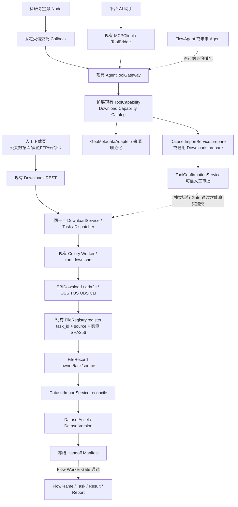

# CygnusX BioOps · 统一下载运行时与多 Agent 工具化实施方案

> **Unified Download Runtime, Provenance-safe File Registration & Agent Capability Catalog**  
> **版本**：Implementation v1.0 · 2026-10-16  
> **交付属性**：基于 2026-10-16 下载能力审计的**增量实施任务书**，不是代码已实施或发布 READY 的证明。  
> **目标**：不新增下载器、不新增任务系统、不重建 Gateway，通过修复现有 Worker → FileRegistry → Dataset 断链、可靠性和能力目录，使既有下载工具可以按权限供科研寻宝鼠、平台 AI、FlowAgent（未来适配）以及更多 Agent 复用。

## 0. 必读事实、证据等级与边界

### 0.1 唯一当前调查基线

实施人员必须先读取：

- `docs/audits/cygnusx-platform-download-capability-and-agent-tool-readiness-audit-2026-10-16.md`（用户提交的 450 行调查报告；如尚未复制进仓库，以用户附件为准）。
- `docs/audits/appendix-download-evidence-index.md`（E01–E50、H01–H05、I01–I05；存在时读取）。
- `docs/audits/appendix-download-capability-matrix.yaml`（D01–D16；存在时读取）。
- `ARCHITECTURE_DESIGN/CygnusX_download_architecture.md` 和其活动架构索引。
- 当前主仓/子仓源代码、真实 `git status`、配置、下载 UI、API、Service、Worker、FileRegistry、Dataset、AgentToolGateway 与 MCP 工具目录。

**源文件事实与设计主张区分：**以下标为“审计发现”的信息来自该调查快照，并非我在此环境独立复跑仓库。请由 Codex 在开工前重新核对路径/函数/开关；不再适用时先提交差异解释，避免覆盖已实现的修复。

### 0.2 当前证据强度

| 对象 | 2026-10-16 审计发现 | 本轮实施使用方式 |
|---|---|---|
| 下载后端 | SRA→EBIDownload；直链与 FTP→aria2c（递归目录先 ftplib）；云存储→ossutil/tosutil/obsutil | 仅复用现有传输器，不另建引擎 |
| 云盘极速提取 | 百度/123 分享入口仅 warning 后 return | 标 `UI_ONLY/UNSUPPORTED`，不得开放给 Agent |
| FTPS/通用 S3/COS | 目前未在对应 DTO/Worker 形成通用实现 | 不为了“统一”而隐式开放 |
| EBIDownload / Polariseq | 子模块 EBIDownload 1.4.0；宿主二进制也是 1.4.0；旁仓 polariseq-cli 1.4.3；容器内未知 | 不自动升级/替换生产二进制；要版本来源验证 |
| 下载 Worker 镜像 | Dockerfile.worker 未显式安装 EBIDownload/aria2c/三家云 CLI；实际 Docker socket 不可用 | 真实 Worker 依赖/镜像/挂载验收为独立 Gate |
| Worker 文件登记 | `_register_downloaded_files` 走 DataFile/FileRepository，checksum 空、task_id 缺失、source 默认 upload | **第一修复目标**；复用已有 FileRegistry.register |
| Dataset reconcile | 按 `FileRecordModel.task_id.in_(task_ids)` 取得下载文件；测试 double 曾自行填写 task_id/source | 真正的生产路径存在契约断点；测试必须用 Worker 真实登记入口 |
| DownloadService.submit | 原提交依赖 user 目录；不传 project_id；enqueue 在最终 REST DB commit 前 | 项目绑定与投递可见性需分别修复；不能等同 API 已有 Project ACL |
| 安全 | URL 仅有有限 DTO 过滤；无完整 DNS/跳转/Worker 重验/实际字节硬限 | 安全升级前禁止任意 URL Agent execute |
| Task | pending/queued/running/success/failed/cancelled，无 PARTIAL；取消主要改 DB | 失败/恢复为独立 ledger 或投影，不随意改 Task 枚举 |
| Gateway | typed ToolCapability、来源解析、受控 Dataset prepare、JWT-only 确认；真实 read/write 默认关闭 | 扩展现有目录/Service，不新建 Gateway/审批系统 |
| 真实运行 | 真实 Worker、Redis 双进程、PostgreSQL、外部 MCP、多 Agent、GEO→报告整链未验收 | 隔离测试 PASS 不等于发布 READY |

### 0.3 不可突破的安全准则

1. **保持现有源码写门禁**（审计发现 `WRITE_RUNTIME_ACCEPTED=False`，以及 `worker_paths_verified=false` 等）。本轮开发不得因为测试通过而默默改为 true。
2. **确认权属于人类 JWT**；Node 委托/API Key/模型无法提供 `user_confirmed=True` 自批或盗用用户 JWT。
3. 保护 dirty 工作树和子模块变更；不 `reset --hard`、`git clean`、大范围 checkout，不自动 commit、push、release、部署或迁移生产数据库。
4. 不下载真实大型数据、不连接真实内网靶点、不打印/复制密钥；隔离真实验收需要单独获得相应环境许可。
5. 任何输出均区分 `VERIFIED_CODE`、`PASS_ISOLATED`、`PASS_RUNTIME`、`PASS_E2E`、`BLOCKED`、`FAIL`、`NOT_TESTED`。
6. 保留人工下载 UI 的既有使用路径；新增 Agent 功能不反向削弱普通用户的下载权限和输入验证。

---

## 1. 总体架构目标与统一责任



**说明：**图示是目标数据契约与责任边界；虚线为依赖审批、运行验收或尚未实现的接入，不构成生产连通证明。

### 1.1 不应再建立的组件

- 不新增通用下载器（HTTP、FTP、云存储、SRA 仍走已有程序）。
- 不新增另一套 FileRegistry、Dataset 表、Task 表或下载队列。
- 不新增独立的 Download MCP Server / Agent Runtime；只扩展共享 `AgentToolGateway` 的工具能力及已有 ToolBridge 投影。
- 不让 React Island、Node Agent、FlowAgent 直接获得任意 URL 下载、真实主机文件路径、服务器凭据或人类确认权。
- 不强制 `dataset.prepare_import` 递归调用 `downloads.prepare` 造成重复确认；两者分工维持。

### 1.2 核心不变量

- 每个受管文件有明确 `owner`，如是下载产物则有真实 `task_id`、`source=DOWNLOAD` 或现有模型等价枚举、**实际计算**的 checksum 及 size。
- `Task.status=success` **不等于** `FileRecord 完整`；`FileRecord 完整` **不等于** `DatasetVersion READY`；`Dataset READY` **不等于** Flow Worker 可运行。
- 已有 Task 可能无 project_id；不可由目录名字推导所有权。新增科研导入应以服务端已校验的 DatasetIngestion/project 引用保持项目边界。
- 下载源 MD5、实际落盘 SHA-256、Handoff manifest hash 分开记录，不得混为一个哈希。
- 预案创建可能写 SQL/Redis 状态，但不得建真实 download Task、网络传输或用户文件。
- 任务投递结果未知不可自动重放；重复请求要共享幂等判定及对账策略。

---

## 2. 分阶段施工顺序与依赖

| 阶段 | 建议名称 | 主要目标 | 依赖 Gate | 产出 |
|---|---|---|---|---|
| **S0** | 基线与最小测试复现 | 重新定位审计断点、冻结既有更改与功能门禁 | G0 | 可追溯 baseline / 测试 fixture |
| **S1 / P0-A** | 下载文件登记契约修复 | 真实 Worker `FileRegistry` → `Task/FileRecord` → Dataset reconcile | G1 | 跨层契约测试，不由 double 代写 |
| **S2 / P0-B** | 运行镜像/协议契约修复 | CLI 版本、Aspera 漂移、Worker 依赖路径、transport 检查 | G2（静态 + 隔离） | manifest、规范化支持范围 |
| **S3 / P0-C** | 安全与硬预算修复 | URI/host/network/redirect/FTP/大小/解压/签名 URL | G3（隔离安全） | 统一安全策略、负例 |
| **S4 / P0-D** | 可靠性/任务事务 | 唯一目录、DB/Queue 对账、幂等、PARTIAL、取消 | G4（隔离契约） | 可恢复语义、运维 runbook |
| **S5 / P1-A** | 统一 Download Capability Catalog | 按协议/环境/用户/Agent 的 typed 能力、来源和原因 | G5 | Gateway 单一能力目录 |
| **S6 / P1-B** | Agent 工具投影与受控预案 | Node/平台 AI 同一服务与审批；FlowAgent 最小可信接入计划/可实现则适配 | G6 | 只读/Prepare/状态的 Agent 集成 |
| **S7 / P2** | 真实下载与科学 E2E 验收 | 在允许的隔离环境逐协议/Task→Asset→Flow/Report 运行 | G7 | DL-RG01–15 证据与准入决策 |

可分两轮：**第一轮 S0–S1** 封闭最关键断链并获得可重复的隔离证明；**第二轮 S2–S6** 补安全可靠性和多 Agent 接入；S7 独立环境验收。为了减少改动回归，不建议一次性把八阶段几十个文件全修改后才验收。

---

## 3. S0 · 代码基线与真实失败再现（实施开始前必做）

### S0.1 核对代码/工作树

执行只读：`git status --short`、`git diff --stat`、`git rev-parse HEAD`、`git submodule status --recursive`；明确脏工作树中哪些修改属于此前 Phase3/Agent/React Island，不覆盖。定位调查 E01–E50 的**实际函数**，特别是：

- `frontend/src/views/DownloadsView.vue`：`handleSubmit`、`mapTask`、任务轮询。
- `src/cygnusx/api/v1/downloads.py`：`submit_download` 与 Gateway 写门禁。
- `src/cygnusx/application/schemas/download.py`：`DownloadRequest/DownloadSource` 与验证器。
- `src/cygnusx/application/services/download_service.py`：`submit`、目录、队列调用。
- `src/cygnusx/infrastructure/celery_app/tasks/download.py`：`_execute_download`、`_register_downloaded_files`、FTP、直链、云 CLI。
- `src/cygnusx/domain/` 中 `DataFile`、FileRepository、`FileRecordModel` 和 `FileRegistry.register` 的真实位置。
- `src/cygnusx/application/services/dataset_import_service.py`：`prepare/execute/reconcile`。
- `src/cygnusx/application/services/agent_tool_gateway.py`、schema/catalog、MCP preset、Node callback。

路径在审计中为定位提示；文件位置变更时只更新报告，不机械创造旧路径。

### S0.2 写出可失败的**契约回归测试**

建立不依赖生产 Redis/PG/外网的隔离用例：合成一个带 Task ID、用户、受控临时目录的下载场景，由**实际下载 Worker 的文件登记函数**登记真实测试文件，随后调用**真实 Dataset reconcile 查询**（只允许替代最外层网络传输/Queue）。当前审计版本期望它会暴露关联缺口；测试应首先作为 red test 证明问题，再由 S1 变 green。

不要在 fixture 或双桩中直接手工写 `FileRecord.task_id`、`source=DOWNLOAD`、checksum 后声称 Worker 已改好。记录“红测试”运行命令及失败断言。

### G0

- 基线 SHA、dirty、相关已有实现及作用域明晰。
- Worker 真登记入口可被隔离调用，测试断言包含 task_id、source、sha、owner、size。
- 没有启用真实写门禁、没有触发大下载、没有外部网络副作用。

---

## 4. S1 / P0-A · 修复 Worker → FileRecord → Dataset 断链

### 4.1 根因（来自 2026-10-16 审计）

`_register_downloaded_files` 扫描真实目录后构造 `DataFile(checksum="")`、未传 task_id；`FileRepository.save` 不映射任务 ID。`DatasetImportService.reconcile` 只通过 `FileRecordModel.task_id.in_(task_ids)` 查文件；I04 测试 double 自行写了这些字段。因此**必须改生产登记链**，不是修改测试以绕过 reconcile。

### 4.2 代码设计与边界

1. 优先查清 `FileRegistry.register(...)` 的现有参数、事务/配额与自动目录注册行为。审计显示它已有 `task_id`、`source`、`checksum` 参数，并已被 GEO 归档服务调用。直接复用；不要创建 `DownloadFileRegistry` 平行实现。
2. 下载完成后从**本次 Task 专属的 output manifest / 白名单产出路径**登记，避免递归扫整个共享项目根；没有 manifest 时先构建受约束的输出清单（有限大小、数量、路径），单纯目录扫描须排除非任务文件。
3. 对每个真实普通文件，以受控流式方式计算 `SHA-256`，读取实际 size，校验 owner 根 `realpath` containment，拒绝软链接/硬链接/特殊文件/目录逃逸。不要将 progress.key、aria2 临时块、checkpoint、日志、控制元数据误识别为科研资产。
4. `FileRegistry.register` 传入**真实** `task_id`、`source=DOWNLOAD`（以现有枚举为准）、实际 checksum、file size、storage path、owner 和必要目录/引用。`FileRecord.task_id` 映射现有字段，不能仅存进 metadata JSON。
5. 文件已登记（相同路径）时必须检查是否属于同一任务/相同内容；旧记录无 task_id 或 checksum 空不能无条件静默跳过。提出兼容的“补关联/对账”策略，并验证权限与哈希；禁止借此把其他任务或其他用户文件重新认领。
6. 对**多个 SRR、单 SRR 多 FASTQ、paired-end、批量 supplementary**，必须保持 `task_id → 多个 FileRecord`；单个 FileRecord 不能把多个不同物理文件覆盖为同一个“结果”。
7. 完成登记后提供可验证的数量、size、checksum 与失败明细；登记失败时不把 Task SUCCESS 当成完整科研资产，使用现有 Ingestion 的 `RECONCILIATION_REQUIRED` / PARTIAL 语义或新增不破坏原 Task 的状态投影。
8. `DatasetImportService.reconcile` 保留 owner/project 权限、FileRecord.task_id 关联和 source evidence 校验；修正真登记契约后应无需测试替身注入。
9. 如果过去已有“无 task_id / checksum”的历史文件，单列 `legacy_unlinked` 只读盘点/可回填方案；**不自动给历史文件改 owner、猜 task、批量重算所有用户文件**。涉及迁移单独审核。

### 4.3 建议的契约形状（示意，不要求新模型）

```python
# 伪代码，仅表达约束，不是仓库已存在的 API 签名
for path in verified_output_paths:
    if is_control_or_temp_file(path):
        continue
    validate_owned_regular_file(path, owner_root, task_work_dir)
    size, sha256 = streaming_sha256_and_size(path)
    record = existing_file_registry_register(
        owner_id=task.user_id,
        storage_path=path,
        task_id=task.id,
        source='DOWNLOAD',
        checksum=sha256,
        size_bytes=size,
    )
    assert record.owner_id == task.user_id
    assert record.task_id == task.id
# 仅在 FileRecord 完整/对账通过后，允许 ingestion 链接 DatasetAsset
```

重点是**服务端来源归属**，不能让 Agent 自己填 owner/task_id/source/path 取得授权。

### 4.4 必须完成的测试

| ID | 测试场景 | 通过标准 |
|---|---|---|
| F01 | 单真实临时文件经 Worker 登记 | FileRecord 有真实 task_id/source/sha/size/owner |
| F02 | 一个 Task 产出多文件 | 全部与同一 Task 关联，路径和 hash 独立 |
| F03 | 两个用户任务输出同名文件 | 用户/任务不混合，目录隔离 |
| F04 | control/progress/.aria2/checkpoint/日志 | 不进入科研资产登记 |
| F05 | 同一 Task 重试登记同一文件 | 幂等，不重复配额，不误更新其他用户 |
| F06 | 旧路径已有无关联记录 | 阻断或合法对账，不静默冒领 |
| F07 | 不同内容同路径 | 报错/新版本策略，不复用过期 checksum |
| F08 | 软硬链接/目录逃逸/非普通文件 | 后端拒绝、无错误资产 |
| F09 | 文件登记中途异常 | 状态可对账，不标数据资产 READY |
| F10 | 完整 Worker登记 → 实际 Dataset reconcile | 无手工注入字段，产出关联 DatasetAsset |
| F11 | Task 成功但工作目录无文件 | 不能声明 COMPLETE_FILES_VERIFIED |
| F12 | 部分下载文件已存在而任务失败 | 文件进入受控 PARTIAL/对账，不被隐藏或误标完成 |

### G1（S1 完成定义）

- F01–F12 的针对性用例达到 PASS_ISOLATED；如某能力受执行门禁限制，必须明确 BLOCKED 并限定可验收范围。
- 在真实 Worker 登记代码上证明 `Task.id → FileRecord.task_id → DatasetAsset`，不再只依赖双桩。
- 与原手工下载、数据管理、已有 FileRecord 查询相关的回归不退化。
- **仍不能宣称真实 Worker 已通过**，也不能开启 Agent execute。

**交付文件建议**：`docs/implementation/download-s1-file-registry-dataset-bridge.md`、隔离测试与日志索引、历史文件兼容说明、最小回滚步骤。

---

## 5. S2 / P0-B · Worker 镜像与传输协议契约修复

### 5.1 先收敛版本和依赖，不盲升 Polariseq

审计发现：宿主 EBIDownload 1.4.0，旁仓 polariseq-cli 1.4.3；Worker 镜像未证明安装所需二进制。`Dockerfile.worker` 未显式构建/安装 EBIDownload、aria2c、OSS/TOS/OBS CLI，Compose 源代码挂载不能自动证明这些可执行文件存在。

任务：

1. 给每个下载 `source/method` 建立**所需程序矩阵**：SRA/ENA 的 Rust/wget/fasterq-dump、direct_link aria2c、递归 FTP 的 Python ftplib、三家厂商 CLI。先确认真实 Worker 构建/挂载/ENTRYPOINT 采用哪套二进制。
2. 定义“源码 commit/lockfile/编译工具链/二进制 version/hash/help/Worker 镜像 digest/运行 UID/挂载”的可审计 Runtime Manifest 规范。源码清单与 Worker 实际镜像必须分别列出。
3. 修正页面 `aspera` 与 CLI `ftp/prefetch/aws/auto` 的契约漂移。不能为了让下拉选项成功而映射 `aspera→ftp` 并假装仍是 Aspera；如对应真实部署不存在 Aspera，明确隐藏或标不支持。
4. `include/exclude` 高级参数目前未从 UI payload 传输；梳理是否存在后端支持及验证，缺少对应后端能力时隐藏/提示不支持，避免“填了筛选但无效”。
5. 将 `DownloadRequest` 的 `source`、`protocol`、`method`、`capability` 和有效配置统一到实际服务端能力判断；配置 YAML `allowed_schemes` 与 DTO 硬编码不一致时必须定义单一有效策略，并服务端复核。
6. 将 Binary path 的 YAML 优先级和 host/worker storage mount 不一致问题纳入部署检查；只允许经过版本验收的明确二进制 path，禁止由用户输入命令/路径。
7. 如果采取 Worker 镜像打包下载程序方案，应保证 supply-chain pinned version/hash；若采用可信宿主只读挂载方案，必须额外验证镜像内路径/权限/UID/manifest。**选择后出 ADR，不自动发布**。

### 5.2 独立支持范围（如有缺证据，必须标未知）

| 来源 | 现在应怎样声明 | 发布前需额外证明 |
|---|---|---|
| SRA / ENA accession | `SRR` 级别已设计；SRX/SRP/PRJNA 依赖真实解析 | 运行程序输入契约、fastq pair、多 Run |
| GEO GSE/GSM | 通过权威 SOFT/ENA 先解析 Run/附件 | 不把 GSE 直接传仅适用 Run 的命令 |
| direct_link | HTTP/HTTPS/FTP 后端代码 | aria2c 实际存在并可用，协议独立验收 |
| FTP directory | `ftplib` 目录展开（匿名） | 主机/端口/数据连接/递归限额 |
| FTPS | DTO 当前不接受 | 标 `UNSUPPORTED`，不自动加到 Agent 工具 |
| OSS/TOS/OBS | 厂商 CLI 代码存在 | 每个单独版本、配置和隔离账户验收 |
| S3/COS/cloud drive | 不能以名称推断已支持 | 明确 `UNSUPPORTED`，如未来需求另立项 |

### G2

- 用户界面与后端能力声明一致，不再宣称 Aspera/FTPS/云盘已经可执行。
- 二进制/镜像/配置 provenance manifest 和实际环境认证流程可复跑；如 Docker 环境不可用，标 `BLOCKED_RUNTIME`，不得把宿主版本伪装成 Worker PASS。
- 任意 source/method 不支持时服务端拒绝并返回机器可读 reason。

---

## 6. S3 / P0-C · URL、网络与传输硬预算（优先 HTTP(S) 与 FTP）

### 6.1 服务端两层防护

**Prepare/提交前**：规范化输入 URL、scheme、hostname、编码、端口、用户信息、域名解析和来源授权；对每条 batch link 验证，拒绝未知来源、IP literal/整数形式本地地址、内网/回环/链路本地/云元数据等禁止目标。科研 GEO 附件优先使用 resolver 提供的权威 URL。

**Worker 真正执行前/重定向时**：用共享同一策略重新验证目标主机与解析 IP，必要时实施 egress 网络强制隔离/固定解析策略，禁止仅由 Web DTO 过滤而 Worker 任意联网；HTTP 逐跳重定向、FTP 控制与数据连接均需被约束。`aria2c/wget` 是否能提供严格逐跳控制需要评估；如果不能，先限制到安全可证明的来源/协议，并在独立网络层控制出口，**不能伪造具有完整 DNS rebinding 防护**。

### 6.2 高风险问题列表（审计明确定位的缺口）

- `_validate_cloud_host` 的异常处理疑似吞掉 `ValueError`；加入合成 IPv6、裸 bucket、畸形 URI 负例并修复。
- HTTP 可直接输入，但缺 DNS 固定与 redirect 每跳过滤；敏感云元数据 IP、内网地址禁止请求。
- FTP 匿名目录枚举缺深度/条目/总字节上限，默认 `ftplib.FTP(host)` 未把 URL port 传入；FTP passive 的数据连接地址与控制通道策略需要明确；FTPS 不支持则直接拒绝。
- `DownloadRequest.max_bytes` 未作为 Worker 硬限；需要在 Worker/传输层累加实际落地字节并终止超限任务，建立临时盘与项目配额限制。
- 任务参数含签名 URL query、云 object URI，CLI stderr/日志可能泄露；日志显示必须脱敏，权限 URL 加密/访问时效与存储策略要评审。
- 压缩包安全沿用现有 `domain/dataset/archives.py` 的受限逻辑，不能允许 Agent 指定任意展开目的地或在原目录覆盖。
- 批量 URL 的去重和 links≤100 当前主要在 UI/REST，必须提升到业务 Service/Worker 边界，FTP 扩展后重新计算硬数量和预算。

### 6.3 建议安全契约（伪 DTO）

```yaml
DownloadSafetyPolicyV1:
  allowed_source_families: [geo_supplementary, ena_run, verified_direct_link, managed_cloud]
  allowed_transport: [https, http, ftp] # 具体需逐源、逐运行环境认证
  approved_origin_ref: '<source_ref_or_policy_id>'
  max_total_bytes: '<trusted_server_limit>'
  max_files: '<trusted_server_limit>'
  max_depth: '<trusted_server_limit>'
  max_duration_seconds: '<trusted_server_limit>'
  project_storage_scope: '<server_derived>'
  redirects: '<bounded_and_each_hop_verified_or_disabled>'
  egress_policy: '<worker_enforced>'
```

并非建议静态开放 HTTP 和 FTP；需要由运行门禁决定可用模式。

### 6.4 必需负例

URL 包括：整数 IPv4、IPv6、DNS 指向私网/重绑定、redirect 到私网、用户名密码、畸形编码、超长 URL、签名 query 日志脱敏；FTP 包括恶意目录树、不同数据连接主机、超目录深度、超文件数量；下载预算包括实际流量超过预估、中途磁盘不足、断链、429、未知 Content-Length、压缩包超限；全部使用自控隔离 mock/fixture 或经授权的隔离测试服务，**禁止测试生产内网 SSRF**。

### G3

- 入口 DTO、Service、Worker 的策略一致且有实际负例；缺 Worker 网络出口控制时 Agent 任意 URL 继续 BLOCKED。
- 断链/重定向/超预算不导致成功状态或越权文件。
- 无凭据/签名 URL 原文泄露到日志、ToolTrace、LLM 对话内容。

---

## 7. S4 / P0-D · 下载调度可靠性、取消与对账

### 7.1 事务与队列竞态

审计指出 `DownloadService.submit` 有“enqueue 在外层 REST 事务最后 commit 之前”窗口。不能只把 Worker 的查询重试当成解决。须提出并实现一个**已存在框架可承受的最小可靠提交方案**，优先检查项目内有无复用的 transactional outbox / post-commit dispatch：

- 如果已有 outbox：复用 Task intent/outbox 同事务落库，由单独 dispatcher 发送，重复投递基于 task_id/request_key 可幂等。
- 如果没有 outbox：评估明确的提交边界（DB commit 成功后 enqueue）、失败时明确 `DISPATCH_PENDING`/对账记录与重试任务；**不允许** Worker 看到不可见 Task 或发送失败后无可恢复记录。
- 对不确定是否已投递的请求，不直接再次 submit；先根据 task id/queue id 和 DB ledger 对账，使用幂等边界收敛。
- 不能以“Exactly Once”承诺掩盖分布式队列的重复投递；目标是 at-least-once + 幂等副作用与可对账。

### 7.2 工作目录、幂等与配额

- 每个 Task 使用唯一且受控的工作目录，避免同 accession/首 URL 导致两个任务写同一个物理路径。
- request_key 绑定 `owner + project（如有）+ canonical_source_snapshot + normalized_params`，同一次请求返回同一逻辑结果；参数变化需拒绝重复 key。
- 防跨入口重复（Dataset import vs 人工下载）：首先定义同一 source/file identity 的可查询“已存在资产/进行中任务”，在产品层提示复用/显式新建；不擅自跨用户 dedup。
- 下载前原子预算预留，实际传输过程硬字节限制，完成后调整实际使用量；失败按实际占用/清理策略回收，账实一致。
- FileRegistry 重试不得重复增加 used_storage；删除/归档/失败残留不得盲删用户原文件。

### 7.3 取消与部分失败

- 浏览器中断聊天与取消已提交下载 Task 分开。
- Task cancel 请求只改 DB 不足以证明传输停止；需要由 Worker 安全终止受管子进程/进程组，设置撤销/停止标识、拒绝继续写入/登记，并在状态中区分用户取消、系统失败和退出中。
- 子进程被终止后保留可安全对账的 partial 文件；下一次恢复必须有一致的源、文件 hash、下载位置、预算和审批，不能无条件重新执行。
- 任务状态枚举不一定需要增 PARTIAL；建议在 `DatasetIngestion`/下载 ledger 中表达 `PARTIAL / RECONCILIATION_REQUIRED`，不要改变既有 Task 状态契约导致客户端崩溃。
- 下载 CLI 进程 exit 0 但没有实际输出、大小不符、校验失败 → 不能标记文件完整/科研可用。

### G4

- 可以隔离重现 DB 提交后 enqueue 失败、重复调度、Worker crash、部分文件、登记失败、用户取消和 retry 的一致状态。
- 任何 Task 的真实/模拟运行状态均来自服务端持久数据或受验证的 worker events；不虚构进度。
- 继续保持 Agent execute Gate 关闭；真实 broker/PG/Redis 功能仍依赖 S7。

---

## 8. S5 / P1-A · 扩展现有 Download Capability Catalog

### 8.1 目标

**Catalog 不只是列出 Tool 名称，而是将每个源/协议/操作的受控可用性表达为数据**；工具实际可见性由 Agent role、用户/项目、服务端 feature gate、源权限、Worker/传输认证状态决定。

优先扩展当前 `ToolCapability` / `AgentToolGateway.describe_capabilities` 和现有 typed schema，不新增另一个配置服务器。只读目录不能泄露未经授权的来源配置、二进制绝对路径或内部网络。

### 8.2 建议的视图字段（若已有同义字段则映射而不新建）

```ts
interface DownloadCapabilityViewV1 {
  id: string; // e.g. source.sra; transport.direct_https; source.geo_supplementary
  sourceFamily: string;
  transports: Array<'https'|'http'|'ftp'|'sra'|'oss'|'tos'|'obs'>;
  operations: Array<'discover'|'inspect'|'prepare'|'status'|'execute'>;
  declaredSupport: 'SUPPORTED'|'PARTIAL'|'UNSUPPORTED';
  runtimeVerification: 'UNKNOWN'|'BLOCKED'|'PASS_RUNTIME'|'PASS_E2E';
  enabledForCaller: boolean;
  reasonCode?: string; // e.g. TOOL_DISABLED, WORKER_UNVERIFIED, SCOPE_DENIED
  budgets?: { maxFiles?: number; maxBytes?: number; maxDurationSeconds?: number };
  sourcePolicyId?: string; // non-secret reference
  schemaVersion: 'v1';
}
```

注意：这只是**面向已授权调用者的只读投影**，运行镜像 digest/二进制绝对路径可放在可信运维内部 Manifest，不应全部暴露给 LLM。

### 8.3 目录数据从哪里来

- 静态声明：DownloadRequest/Adapter 真实支持的来源与协议（不是前端营销文案）。
- 授权：Gateway existing role/project/module/scopes 与审批要求。
- 运行认证：受信任、可追溯的 per-capability release manifest；不能由 Agent/前端自行上报 PASS。
- 健康检查：能否访问认证后的本地 Worker/依赖；**health≠真实下载认证**。
- 适用性：GEO→权威解析；SRR→已有受限 Rust CLI；处理后的附件→受控 direct_link；云盘/FTPS/通用 S3 不得自动宣称可用。

### 8.4 工具与策略

建议“概念工具”如下，最终按现有 catalog 命名收敛：

| 只读或预案能力 | 复用对象 | Agent 权限边界 |
|---|---|---|
| `download.list_capabilities` | `Gateway.describe_capabilities` | 所有授权 Agent，可读自己可用能力 |
| `download.resolve_source` | `GeoMetadataAdapter` / 已有 resolver | 科研类 Agent 只读，不能自造文件 URL |
| `download.inspect_files` | Dataset source candidates | 只读，返回 verified/unknown 字段 |
| `dataset.list_project_assets` | Dataset/FileRecord owner 查询 | 仅当前有权项目 |
| `dataset.prepare_import` | 现有 `DatasetImportService.prepare` | user/project/session 绑定，写预案不建 Task |
| `downloads.prepare` | 现有 Gateway legacy 下载预案 | 非 Dataset 的受控资源，不与 import 重复审批 |
| `tasks.get_status` | owner Task/入库状态读取 | 返回真实 Task/file/asset 引用，非虚拟进度 |
| `download.execute` | 仅现有受控服务端操作边界 | 不提供给模型自批；保持源码/运行门禁 |

**命名重要性低于同一后端契约；严禁实现功能重叠的第二个 tools.py。**

### G5

- Catalog 如实反映 `declared_support`、`runtime`、`enabled_for_caller`、不同 Agent scopes；不能因为静态注册而声称可执行。
- 关闭 Feature Gate、撤销 Project 访问、Worker 未认证、无 Redis 时，目录和最终 Gateway invoke 均一致拒绝。
- D01–D16 实际能力分类由当前源码/验收状态派生；云盘仍是 unsupported。

---

## 9. S6 / P1-B · 多 Agent 统一调用与 Prepare

### 9.1 Agent 接入表

| 入口 | 已有基础 | 本轮最小增量 | 禁止事项 |
|---|---|---|---|
| 科研寻宝鼠 | Node 固定受信回调→Gateway；React Island typed actions → Vue/BFF | 将能力目录、状态、预案与 card 适配；复用原卡 UI | 不在 React 直连 MCP，不转发人类 JWT 给 Node |
| 平台 AI 助手 | MCPClient / ToolBridge → Gateway | 修动态 preset 失败的 fixture，并真实隔离验证 tools 注入、schema/handler 一致 | 不允许 ToolBridge 自批/绕 Gateway |
| 外部 MCP | 独立 cygnusx_submit_download wrapper | 文案清理、Schema/确认与 Gateway 对齐；保留兼容路由并消除错误宣称 | 不能使用 `user_confirmed=True` 授权 |
| FlowAgent | 目前仅 snakemake plan 工具，没有下载 Gateway 接线 | 先定义可信身份委托/项目范围 adapter；可在安全设计获审后增量实现 read/inspect/prepare | 不直接借用 API Key 变成任意用户，不能自行执行下载 |
| 未来 Agent | 未实现 | 按 `agent_kind × scope × project` 建单一策略 | 不默认开放全部下载器 |

### 9.2 工具事件与对话投影

- 复用现有 `ToolInvocation`、科研 `PlatformTool`、Proposal 与 Task 恢复；**服务端保存真实关联 ID**。
- `PREPARED` 与 `APPROVED` 状态不应有 Task ID，直到调用原业务 Service 返回实际 Task ID。
- 当前写权限缺失时返回可解释 `BLOCKED(reason_code)`，不模拟已下载；React 原 DataCard、Grounding、Next Shovel、ToolTrace 完整保留。
- `dataset.prepare_import` 包含权威 GSE/GSM→SRR/附件、raw/processed 路径；不把 GSE 直接给 Rust CLI。
- 文献 PMID/DOI 不能直接当 download target，必须核实对应 accession/正式附件。
- 同一 `project_id` 要从平台可信会话/Project owner 推导；无项目仍允许全球元数据只读探索；导入与下载预案要求授权项目（或通用人工下载独立 owner scope）。

### 9.3 Prepare 与审批分工

- 科研数据：DatasetImportService 唯一维护 source snapshot、样本证据、预算、Ingestion 与 confirmation，内部受控执行可直接通过 DownloadService；不强制再走一次 downloads.prepare。
- 通用 URL/云存储：只对支持且被允许的源提供 downloads.prepare；若任意 URL 安全未验收，Agent 只读 inspect 或 Blocked，不发布通用执行工具。
- 统一 `ToolConfirmationService` 一次可信用户 JWT 确认、绑定参数哈希/TTL、Redis CAS；每个授权只允许匹配的业务操作范围，下载与分析审批不可互用。
- 真实 execute 操作仍按原 Worker、Service、Task 权限及现有源码 Gate 拒绝，直到 S7 对应能力通过。

### 9.4 验收

- 同一合法 GEO 发现，寻宝鼠与平台 AI 获取结构一致的 source/proposal/status DTO；只读可无项目，写预案必须有授权项目。
- 不同 Agent role/scopes 的目录不同；跨用户/项目、伪造 delegated token、审批重放均拒绝。
- Node callback/MCP 工具 schema 不要求网络协议相同，但后端统一调用真实 DatasetImport/DownloadService。
- FlowAgent 在没有可信身份 adapter 前标 `NOT_INTEGRATED`，不能报告“全 Agent 就绪”。
- 修复隔离动态 preset 测试失败（审计提到缺 `legacy_pipeline_tools` fixture），**要补正确 fixture/行为，不靠 skip 掩盖**；实际 MCP transport 仍需 S7。

### G6

- Agent read/prepare/status 的静态+隔离测试通过；工具目录会按 permission/gate 正确过滤。
- 未开放真实写；旧 React UI 不回归；所有平台工具卡引用真实 Proposal/Task。

---

## 10. S7 / P2 · 真实运行闭合和最小科研案例

> 此阶段依赖**授权的隔离运行环境**；若执行环境无 Docker/网络/PG/Redis，必须停在 BLOCKED 并交付安全运行手册，不能用 fake Redis/SQLite 替代真实发布门禁。

### 10.1 DL-RG01–DL-RG15 门禁与责任

| Gate | 真实需要证明的内容 | 成功证据 |
|---|---|---|
| RG01 | Docker 镜像与 Worker 二进制来源 | 主/子仓 SHA、镜像 digest、容器内 version/hash/help、依赖、UID/挂载 |
| RG02 | PostgreSQL schema/事务/并发 | 隔离 PG 升降级、ownership/DB 可见性、备份与回滚 |
| RG03 | Redis CAS/TTL/重放 | 真实 Redis 两进程竞争，只有一次有效确认消费、故障拒绝 |
| RG04 | Celery/Queue 调度与事务 | 真 Task 写入、投递、Worker 消费，失败对账与重放限制 |
| RG05 | HTTP 与 HTTPS 各自小文件 | 来源验证、Worker hard max_bytes、SHA256、FileRecord 登记 |
| RG06 | FTP 小文件/目录 | FTP 控制与数据连接、host/port、递归预算、校验；FTPS 未支持则 UNSUPPORTED |
| RG07 | SRA/ENA 小 Run | accession→真实 FASTQ、单双端/多文件、源 MD5、实际 SHA256 |
| RG08 | GEO supplementary | 权威来源→真实小附件→科学分类/归档审阅→DatasetAsset |
| RG09 | OSS/TOS/OBS 各自 | CLI 真实版本/短期凭据/失效/日志脱敏、各协议独立结果 |
| RG10 | 双用户双项目端到端权限 | UI/REST/Gateway/Node/MCP/Task/FileRecord/Report owner/project |
| RG11 | 网络与预算安全 | DNS/redirect/FTP 回连、硬配额、恶意压缩文件、出站拒绝 |
| RG12 | Task→文件→Dataset→Handoff | 真实任务 id、FileRecord.task_id/source/SHA、Asset/Version/manifest hash |
| RG13 | 失败/取消/续传与部分产物 | Worker kill/断网/重复投递、DB/文件对账、无重复费用 |
| RG14 | 两个 Agent 真实共享工具业务链 | Node callback + 平台 AI MCP、schema/permissions/audit/approve/status |
| RG15 | 小型真实科研闭环 | GEO/SRA→文件→DatasetVersion→FlowTask→ResultManifest→双报告真实 ID |

### 10.2 最小真实案例顺序

- **Case 1：GEO processed raw counts（确实有权威 raw counts 来源证据）**：GEO→权威附件→经认证 HTTPS 传输→FileRecord SHA→人工确认 raw counts/分组→DatasetVersion/Handoff→CountsDEGFlow→Scientific BioReport 与 Execution Evidence。不能把仅“整数”或 Series Matrix 当 raw counts。
- **Case 2：小型 SRA/ENA FASTQ**：GEO/ENA→SRR→已有认证 EBIDownload/Rust→FASTQ→FileRecord/Handoff→RNAFlow→结果、Manifest 与 BioReport。只在计算和网络成本得到许可时运行。
- Case 1/2 均要求真实 Task ID、文件大小/校验、Flow 版本与任务产物、报告 ID/hash、用户/项目与版本。外部来源失败时不能造假；可先用**隔离、自建合法的小文件服务**做传输运行证据，但不能把它冒充“GEO 科研 E2E”。

### 10.3 发布决策（按能力、Agent、操作独立）

- `READ_ONLY_READY`：已通过必要身份/Gateway/只读源验证。
- `PREPARE_READY`：已通过预案/来源/预算/确认记录/存储检查，但没有真实 execute。
- `MANUAL_DOWNLOAD_READY`：特定人工协议已通过对应真实 Worker/安全门禁。
- `AGENT_PREPARE_READY`：特定 Agent 在可信委托和权限下可创建受控预案。
- `AGENT_EXECUTE_READY`：只有特定工具/协议/项目/Agent 经全部写运行 Gate 与授权后才能有限开放。
- `DATASET_HANDOFF_READY`：文件登记、科学审核、Handoff 与 Worker 路径通过。
- `SCIENTIFIC_E2E_READY`：真正有分析与双报告 ID；不能用前端截图替代。

即使全部实证通过，正式生产发布仍需独立批准，不由 Codex 自动修改功能开关或部署。

---

## 11. 全部测试矩阵（开发实施新增 I-T01–I-T40）

| 组 | ID | 核心场景 | Gate |
|---|---|---|---|
| 数据登记 | I-T01–I-T05 | Worker真实登记、多个文件、owner、control排除、重复幂等 | G1 |
| 资产对账 | I-T06–I-T10 | 旧记录、冲突hash、登记失败、Dataset reconcile、空目录 | G1 |
| 部分失败 | I-T11–I-T12 | 失败部分文件、版本不能误READY | G1 |
| 版本/契约 | I-T13–I-T16 | EBIDownload参数、Aspera漂移、不同来源协议能力、Worker依赖 Manifest | G2 |
| URI/网络 | I-T17–I-T22 | IPv4/IPv6/整数、DNS/redirect、FTP目录、签名URL脱敏、云URI | G3 |
| 硬预算 | I-T23–I-T25 | 超字节/超文件/超深度/配额、硬停止和残留 | G3 |
| 事务可靠 | I-T26–I-T30 | DB与队列可见性、失败对账、重复投递、唯一工作目录、Task取消 | G4 |
| 目录能力 | I-T31–I-T34 | 不同Agent scope/gate/认证原因、工具 schema、动态 preset | G5/G6 |
| Prepare | I-T35–I-T37 | 科研source→预案、不重复confirm、approve不能自批 | G6 |
| 联合恢复 | I-T38–I-T40 | Task/asset/status历史恢复、跨项目权限、执行Gate下无下载副作用 | G6 |

每个范围项实施时应拆成**实际具名的测试函数**、执行命令、用例结果和引用代码。此矩阵是开发验收任务安排，**不是当前已有 40 项通过**。

建议跨阶段长期保留：D01–D16 能力矩阵、原审计 D-T01–D-T44、真实 DL-RG01–DL-RG15 的编号。不要因为新增 I-T 测试而覆盖原调查记录。

### 11.1 重点失败用例（必须解释）

- `Task success` 但 FileRecord 不存在；必须出现 `RECONCILIATION_REQUIRED` 或等价拒绝，不能创建 READY Dataset。
- Worker 进程 0 退出但目录只有 `progress.key`，不能产生科研 FileRecord。
- `aria2c --check-integrity` 没有提供可靠 expected digest 时，不能伪造 source checksum 已验证。
- 旧版本迁移后用户手工下载继续允许，Agent 仍由于写 Gate 关闭无法真实执行。
- 数据源从 GSE 解析出多个 Run 时，每 SRR 的 Task/FileRecord 归属必须清楚；ERR/DRR 不因为前端看到 accession 就绕过当前 import 约束。
- `downloads.prepare` 与 `dataset.prepare_import` 结果不能在未确认前重复创建真实 Task。

---

## 12. 重要代码入口、修改边界与回滚策略

| 范围 | 预计代码位置（Codex 开工需复核） | 允许修改的主要职责 |
|---|---|---|
| Worker 登记 | `src/cygnusx/infrastructure/celery_app/tasks/download.py` | `FileRegistry` 接入、真实 checksum、任务文件清单、失败对账 |
| 文件治理 | `FileRegistry.register` / `FileRepository` / FileRecord 数据模型 | 复用已有 owner/task/source/checksum；尽量不新增迁移 |
| 下载提交 | `src/cygnusx/application/services/download_service.py` | 幂等、目录、队列边界、通用 Transport 校验 |
| 下载 Schema | `src/cygnusx/application/schemas/download.py` | 协议支持、URL/URI 校验、预算契约 |
| 下载 API | `src/cygnusx/api/v1/downloads.py` | JWT/APIKey 既有确认、DTO/Service 一致性、受管项目与错误码 |
| 下载执行器 | `src/cygnusx/infrastructure/download/` + BinaryExecutor | 硬限/取消/安全参数/进度、保持 argv 无 shell |
| 科研导入 | `src/cygnusx/application/services/dataset_import_service.py` | 对账、Task关联、保留科研 Source/Sample/Version |
| Gateway/Catalog | `src/cygnusx/application/services/agent_tool_gateway.py`、`application/schemas/agent_tools.py` | 只读能力目录、最小 Prepare/schema/scopes 扩展 |
| 模型工具适配 | MCPClient/ToolBridge/Node callback/外部 mcp-server | 契约一致、按 Agent 职责最小权力，不新建 runtime |
| UI | `frontend/src/views/DownloadsView.vue`、Treasure React Island 卡片 | 修文案错误、真实来源标记、Prepare/status 入口 |
| 部署/配置 | `deploy/docker/Dockerfile.worker`、Compose、download tool YAML | 源码/二进制/digest/路径证明与变更验收；不自动发布 |

### 12.1 保留人工下载行为的回归标准

- 下载页面四个 tab 保留，但云盘不得继续让用户误以为真实可提取。
- 人工 JWT 既有下载权限与 Agent 审批逻辑是两个入口；不要强制用户人工下载先走模型预案。
- 状态查询只返回本用户 Task，不能因 Catalog 改造泄露其他项目/用户 FileRecord。
- 现有任务列表与进度显示不退化；直链不再误显示为 SRA，未知速度/大小不虚构数值。
- 目录重命名/唯一工作目录后仍保证 FileRegistry、共享存储和已有下载结果可查；原有历史记录不得清空。

### 12.2 建议回滚方法

1. 每个阶段保留 git diff hunk、变更文件清单和测试 logs，不使用全仓 reset（原工作树已有未提交成果）。
2. S1 回退仅恢复下载登记代码，但必须保留已有用户 FileRecord；如果真实环境已登记新记录，回退只能改代码/flag，**禁止自动删文件或数据库记录**。
3. S2/S3 错误部署时关闭新 source/Agent 工具路由，保留手工可用的已认证协议；不过时的实际 Worker 仍要符合最低网络边界。
4. S4 失败时保留 Task/Outbox 对账 ledger，不能因回滚丢失“已投递但未确认”状态。
5. S5/S6 随时可关闭工具可见性/Prepare 路由（真实权限由后端保证），不删除用户预案/对话记录。
6. S7 真实执行被暂停时，禁新执行，允许 owner 只读查询已有 Task 和交付物。

---

## 13. 必交交付物与阶段报告格式

建议路径：

```text
docs/implementation/download-s0-baseline-and-red-test.md
docs/implementation/download-s1-file-registry-dataset-bridge.md
docs/implementation/download-s2-worker-protocol-provenance.md
docs/implementation/download-s3-network-budget-safety.md
docs/implementation/download-s4-task-idempotency-recovery.md
docs/contracts/cygnusx-download-capability-catalog-v1.md
docs/implementation/download-s5-agent-catalog.md
docs/implementation/download-s6-multi-agent-tool-integration.md
docs/audits/download-s7-runtime-release-gates.md
docs/adr/download-transport-and-asset-registration.md
```

每阶段的报告必须包含：

```markdown
## Stage Sx / Gate Gx
- Current branch / HEAD / submodules / pre-existing dirty changes:
- Evidence references from 2026-10-16 audit that still apply:
- Implemented changes (exact files/functions):
- New/changed schemas, API/errors, background jobs, migrations:
- Security invariants: confirm, owner, project, URL, budget, egress:
- Tests executed (command, environment, PASS/FAIL/BLOCKED):
- Real-run evidence vs mock/fixture evidence:
- Manual UI/Agent behavior changes and regressions:
- Known limitations / accepted risks:
- Rollback plan preserving files/tasks/DB:
- Gate decision: PASS_ISOLATED / BLOCKED / FAIL / PASS_RUNTIME:
- Next eligible stage:
```

**最终状态按能力维度报告，绝不输出一个不加限定的 `READY`。**

---

## 14. 与科研闭环的关系：为什么先修下载链

目标还是：**Research Question → GEO/Literature → DatasetImport Proposal → Approved Download → Task+FileRecord → DatasetVersion → Frozen Handoff → FlowFrame Analysis → Result Manifest → BioReport + Execution Evidence Report**。

当前更真实的项目路径是：

1. 源码/fixture 已有 GEO 权威解析与导入预案；
2. 真正 Worker 登记存在 Task/FileRecord 关联断点；
3. Agent execute 与 Runtime Gate 仍关闭；
4. 因此直接增加 Agent“自动下载”按钮并不能证明科学闭环。

**优先通过 S1/S2/S3/S4，让平台人工下载与科研 Dataset 互相认得，再由 S5/S6 将可信能力开放给 Agent；最后在 S7 用真实小型数据证明。**

这就是本次阶段重构和未来论文中“可追溯科研执行基础设施”的底层工程意义。

---

## 15. 一页验收清单（负责人签收用）

- [ ] S0：静态断点仍存在，红测试用真实 Worker 注册入口定位。
- [ ] S1：Worker 通过现有 FileRegistry 登记 task/source/SHA；多文件正确对账。
- [ ] S1：Dataset reconcile 不再依赖 double 人为填写 ID；下载成功不等于 READY。
- [ ] S2：EBIDownload/Polariseq 来源与容器二进制版本证据清晰；Aspera/云盘/FTPS 文案正确。
- [ ] S3：HTTP(S)、FTP、云 URI 的服务端/Worker 权限、出站、重定向和硬预算有负例。
- [ ] S4：队列投递可对账、唯一工作目录、幂等/部分失败/取消可验证。
- [ ] S5：Gateway catalog 按协议、身份、scope、运行状态返回真实能力。
- [ ] S6：寻宝鼠与平台 AI 共用真实业务服务；FlowAgent 状态如实反映。
- [ ] S6：Prepare 不产生真实下载任务；人类 JWT-only 审批、源码写门禁保持。
- [ ] S7：有真实镜像/Redis/PG/Worker/协议/双用户负例/完整 FileRecord 证据。
- [ ] S7：完成至少一个合法 GEO 小文件的 Dataset Handoff；额外科研分析与双报告需独立 Gate。
- [ ] 所有进度报告将代码验证、隔离测试、真实运行与发布分开。

**工程检查点：先把既有下载文件可靠地变成有来源、有任务、有哈希、可对账的项目资产，再让各类 Agent 使用。**
