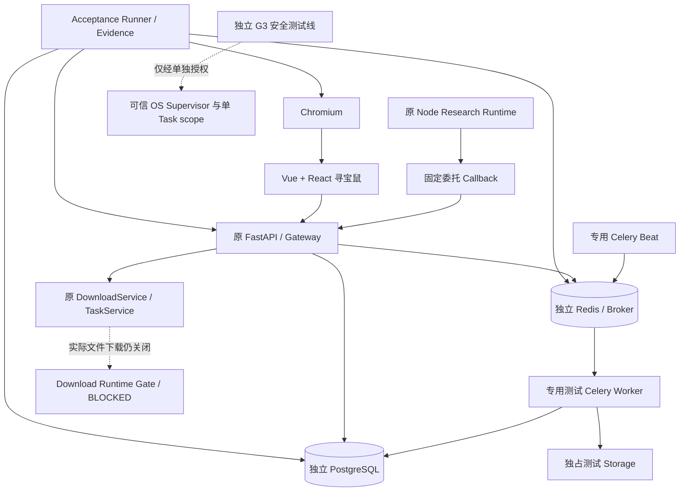

# CygnusX BioOps｜非生产环境集成与安全验收测试手册

> **版本**：v1.0 · 2026-10-17  
> **用途**：交给在**有明确操作权限的独立机器**上工作的工程师 / Codex / 运维 Agent，按阶段部署、运行、记录与判定。  
> **范围**：RI-ENV-02 环境落地、S4-B1 任务可靠性、S5-C2 多 Agent 运行集成，以及**条件式** S3/G3 可信下载执行安全验收。  
> **当前事实**：此前 S4-B0 / S5-C1 为 `PASS_ISOLATED`；S4-B1、S5-C2 与 G3 **均无真实运行通过证据**。本文是待执行的测试方案，**不是测试通过报告**。

---

## 0. 十条不可跳过的原则

1. **先确认授权，再执行操作**。仅使用明确命名的 disposable 非生产主机、数据库、队列、目录与测试用户；不得复用生产资源。测试权限的范围必须包括是否允许故障注入、重启 Worker、操作测试文件等。
2. **不把代码存在当作运行认证**。`CODE_AVAILABLE` / `CONFIGURED` / `PASS_ISOLATED` 均不等于 `PASS_RUNTIME` / `PASS_E2E`。
3. **不改变冻结执行门禁来跑测试**。保持 `DOWNLOAD_TRANSPORT_RUNTIME_ACCEPTED=False`、`WRITE_RUNTIME_ACCEPTED=False` 和原 `require_download_runtime` 等安全语义。仅可在授权的独立测试环境，按现有正式配置方式打开经过审查的**只读**能力；Prepare 只能通过原权限和审批服务测试，不能绕过冻结写门禁。
4. **普通 Celery Worker 不等于可信下载沙箱**。不得将现有带 Docker socket、共享凭据、共享存储的 Worker 当作 S3/G3 的下载执行边界。
5. **S4-B1 可以通过受控、无外部下载副作用的调度/文件 fixture 测试**事务、领取和登记；此通过**不能证明真实下载协议或进程安全**。测试夹具必须调用原业务代码和持久化路径，不能新增第二套业务系统。
6. **默认先做负向测试**：未认证下载必须明确拒绝；跨用户/项目查询必须拒绝；被撤销的委托必须拒绝。任何越权成功立即停止相应阶段。
7. **模型不是授权源**。用户、会话、项目、Scope、批准、runtime_verified 只能从可信服务端状态派生；不得接受模型或浏览器自报。
8. **故障注入只能影响测试资源**。禁止在生产 Broker 上丢包、删除队列、kill 共享 Worker、关闭公共网络或写生产数据库。
9. **不要自动清理不明文件**。`.download-task.json` 仅为归属提示；清理之前必须对照可信 Task / owner / project / FileRecord，默认不执行删除。
10. **逐项提交原始证据**。测试退出码为 0 且全部 skip 不构成通过；截图不能代替后端事实；Task `CANCELLED` 不能证明下载进程树已停止。

## 1. 测试目标、范围与状态定义

### 1.1 分层验收目标

| 验收层 | 需要证明什么 | 不证明什么 |
|---|---|---|
| L0 `ENV_READY` | 机器、网络、IPC、独立资源、源码和镜像一致，操作获得授权 | 业务服务正确 |
| L1 `CODE_BASELINE` | 现有下载/Agent 回归仍通过 | PostgreSQL、真实队列、浏览器可用 |
| L2 `S4_B1_RUNTIME` | 真实 PG、多进程 Broker/Celery、恢复、取消与 FileRegistry 一致性 | G3 网络、磁盘和进程隔离 |
| L3 `S5_C2_RUNTIME` | 真实 Node→FastAPI、Gateway、PG/Redis、两个 Agent Runtime 的工具消费与权限 | 真实下载执行 |
| L4 `S5_C2_E2E` | Chromium 中真实科研数据卡片、项目切换、Prepare、SSE/恢复 | Agent 自主批准或下载 |
| L5 `S3_G3_SECURITY` | 专用受信 OS Supervisor + 单 Task 执行域、唯一出口、原子网络 RX 计量、磁盘硬配额、停止/恢复证据 | 其他尚未逐协议认证的传输方式 |

**执行顺序：** L0 → L1 → L2 → L3 → L4；L5 是**另一条安全验收路线**，必须在具备实际 `TrustedExecutionAdapter`/Supervisor 实现、可信准入与专用授权之后独立开展。L2/L3/L4 可通过，不代表 L5 可以执行。

### 1.2 唯一认可的结果字段

- `PASS_ISOLATED`：在隔离夹具或确定性替身下运行了真实业务代码。
- `PASS_RUNTIME`：真实 PG/Redis/Broker/Worker/Node/API（按该用例要求）执行，并获得数据库、消息与网络事实。
- `PASS_E2E`：通过真实 Chromium / 浏览器客户端，且关联到服务端请求、存储事实和审计。
- `BLOCKED`：未满足可执行依赖或授权；写明具体阻断与责任方。
- `FAIL`：在满足前置条件时断言未通过；保留失败证据并创建缺陷。
- `NOT_TESTED`：未执行，不可填 0 或写成通过。
- `SKIPPED`：测试框架跳过，需记录原因，不计入通过。

### 1.3 现有实现事实（截至 2026-10-17 的报告，不代替源码复核）

- S4：`after_commit` 发布、可靠性版本 queued 行重投、原子 `queued→running`、幂等键、别名上限（报告默认 64）、独立工作目录、取消/对账分离；beat 报告配置为 600 秒周期、10 分钟冷却、100 行/批。
- S5：十二类 Download Capability；`downloads.describe_capabilities`、`dataset.discover`、`dataset.list_project_assets`、`dataset.inspect`、`dataset.list_files`、`tasks.get_status`、`downloads.prepare`、`dataset.prepare_import`；科研寻宝鼠经固定委托 callback，平台 AI 经 MCPClient/ToolBridge，最终复用 AgentToolGateway。
- S3：`TrustedExecutionAdapter` 目前在已提交报告中只是 Protocol/模型，**没有可运行的受信 OS Supervisor**；九项 HTTP 真实测试默认因缺驱动而 skip。现有普通 Worker 不能替代受信执行域。
- 环境：RI-ENV-01 当前运行器 Docker socket 和 TCP bind 返回 `EPERM`；已发现 RI095 acceptance 模板，但它只覆盖报告/导出任务，不应直接当作下载可靠性测试 Worker。
- 历史 HEAD 有 `51011118...` 与较新的 `d9c92cf...` 差异，且主仓/子模块存在未提交修改。**在目标机器必须重新核实源码内容与构建产物，不得仅引用 HEAD。**

## 2. 授权、角色与资源申请表（运行前填写）

> 以下是**待填的运维验收表**，不是已知环境参数。禁止在本手册/测试日志中填写真实密码或 Token。

| 字段 | 必填值 / 检查项 |
|---|---|
| `ENVIRONMENT_ID` | `cygnusx-it-<date>-<owner>`，由负责人分配且唯一 |
| 操作授权 | 授权人、有效日期、允许命令/容器/端口/重启对象、禁止范围 |
| 主机/平台 | Linux VM / Docker Desktop / 授权云测试机；操作系统与架构 |
| Git / 子模块 | 主仓 commit、dirty tree digest、FlowFrame、Treasure-Seeking_Mouse 的精确 commit 与状态 |
| Compose project | 独立 `COMPOSE_PROJECT_NAME`；不得使用生产 project/name |
| PostgreSQL | 专用实例/数据库/角色、版本、迁移权限、允许清理范围 |
| Redis / Broker | 独立实例/DB/vhost、账号、专属队列与 Worker/Beat identity |
| Storage | 独占 root、真实 UID/GID、配额/空间、保留期限、只读备份方案 |
| FastAPI / Node | 版本、镜像摘要、仅测试可达的 API 与固定 callback URL |
| Chromium | 可写 profile/cache、匹配自动化驱动、测试 UI 访问地址 |
| 网络边界 | 仅获授权元数据目标；若测试 G3，额外有**独立**受信出口、隔离域和硬预算 |
| 资源上限 | CPU、RAM、磁盘、inode、DB 连接、队列消息数、运行时长、HTTP 请求数 |
| 数据清理 | 谁清理、何时清理、允许的 Volume/DB/queue 名称；默认先留证不删 |

**硬停止条件**：任一连接指向生产数据库/共享队列、未获故障注入授权、源码镜像不匹配、不能保证测试数据隔离、无法确定测试任务来源、执行门禁被意外打开。

## 3. 环境与架构要求



### 3.1 Compose 与部署复用原则

1. 在实际仓库核对 `deploy/docker/`、`deploy/acceptance/`、`deploy/docker/docker-compose.worker.yml`、`deploy/acceptance/compose.yml` 与 `deploy/acceptance/acceptance.env.example` 的**当前存在性和内容**。这些名称来自既往报告，分支或工作树可能变化。
2. RI095 acceptance 的 internal network、独立 PG/Redis/Volume、低权限 UID 可以借鉴；报告/导出专用 Worker 的任务注册**不等于**下载 Celery 任务注册。
3. 创建单独的**测试配置扩展文件**或批准的环境定义；不可编辑生产 Compose 默认值，亦不可把生产 `.env` 挂载到测试容器。
4. 专用测试 Worker 不允许获取 Docker socket、主机 root、共享用户文件或生产凭据。若原 Worker 镜像默认包含这些挂载/特权，必须在测试 Compose 中移除或拒绝启动；即使移除也**不自动获得 G3 认证**。
5. S4 真实消息链应使用专属 queue、broker endpoint 和 Worker name；启动前查看配置，确保测试 Worker 不订阅生产队列。
6. **先 PG/Redis/Worker，再 Node 与浏览器**。G3 的受信 Supervisor 作为独立安全设施，不在普通 Compose 中“顺带验证”。

### 3.2 分阶段开放的权限

| 阶段 | 可以做 | 不可以做 |
|---|---|---|
| P0–P1 | 只读源文件审计、基础服务健康、现有 pytest | 下载、外部故障注入 |
| P2 S4 | 测试库多事务、独立 Broker/Worker、无传输副作用任务、受控本地 FileRecord | 真实文件网络下载、kill 共享 Worker |
| P3 S5 | 在**隔离实例**按最小必要配置启用目录/发现/资产读取；按现有授权做 Prepare | 放开 `WRITE_RUNTIME_ACCEPTED`、替模型批准、越权查询 |
| P4 UI | 测试浏览器/测试账号、断线与会话切换 | 浏览器直连数据库、携带真实生产 Token |
| P5 G3 | **须另行授权且实现受信 Supervisor 后**对自有 HTTP 服务器进行低额度执行安全测试 | 使用普通共享 Worker、测试未认证 HTTPS/FTP/云后端、访问生产地址 |

## 4. 操作前检查命令（从仓库根目录，逐项审核后执行）

> 下列是可复制的**只读/静态**命令；假定在仓库根目录，存在 `git`、`python3`。实际测试路径与解释器要先核查。任何输出包含敏感路径/配置时先脱敏再分享。

```bash
pwd
uname -a
id
git rev-parse --show-toplevel
git rev-parse HEAD
git status --short
git submodule status --recursive
find deploy -maxdepth 3 -type f \( -iname '*compose*yml' -o -iname '*.env.example' \) -print | sort
find tests -maxdepth 3 -type f \( -name '*download*test*.py' -o -name 'test_download*.py' -o -name 'test_phase0b_redis.py' \) -print | sort
python3 --version
command -v docker || true
command -v node || true
```

> `git status` 仅报告路径；含敏感配置的 diff **不要直接上传**。`git submodule status` 不是子模块 dirty 内容的摘要，必须进入每个子模块检查实际 dirty 文件和构建上下文。

如果授权使用 Docker Compose，先检查**模板是否存在**和**测试环境变量文件是否来自独立测试来源**：

```bash
# 以下仅为模板，实际文件名必须先经仓库检查和运维审核。
export TEST_COMPOSE_FILE='<REVIEWED_TEST_COMPOSE_PATH>'
export TEST_ENV_FILE='<APPROVED_TEST_ENV_PATH>'
export COMPOSE_PROJECT_NAME='<APPROVED_UNIQUE_PROJECT>'
# 仅验证语法，不启动服务。--quiet 避免将渲染后凭据打印到日志。
docker compose --env-file "$TEST_ENV_FILE" -f "$TEST_COMPOSE_FILE" config --quiet
```

**绝不直接复制执行**如下危险示例：对默认 compose `up -d`、对默认数据库 `alembic upgrade head`、`docker compose down -v`、`docker system prune`、`git reset --hard`、修改 Docker socket 权限、`kill` 不明 Worker。正式启动和迁移必须依据已批准的 Environment ID、Compose 文件、数据库身份核验与清理责任执行。

### 4.1 先验身份证明（必须保留）

- PostgreSQL：真实服务端版本、`current_database()`、`current_user`、server 地址/端口（脱敏）、数据库非生产标记及允许 schema；使用**测试角色只读连接先验**，未核对不得迁移。
- Redis/Broker：实际运行端点、Redis server version / RabbitMQ vhost（如使用）、专属 queue/DB；只可在独立测试实例测断连。
- Worker：实际镜像 digest、容器启动命令、注册任务名、**消费的队列名**、当前代码/工作树构建指纹；不得用 worker hostname 代替镜像证据。
- Node/API：版本与固定 callback audience/URL；不能让模型设置 callback URL。
- 浏览器：Chromium 版本、profile 路径和测试站点 URL；保持浏览器 sandbox。
- 初始冻结门禁：从运行容器的**有效服务端配置和运行校验**证明传输与 Agent 执行均不可用；只读配置文件中的值不足以证明容器实际读取它。

## 5. P0：环境运行准入（首先执行）

**先执行 ENV 测试，全部 P0 通过后才运行任何写库/队列测试。**

| ID | 优先级 | 场景 | 合格标准 | 证据 |
|---|---|---|---|---|
| ENV-01 | P0 | 操作授权与 Environment ID | 测试资源、允许操作、额度、清理责任书面确定；无共享生产对象 | 授权清单，脱敏 |
| ENV-02 | P0 | 工作树和子模块一致性 | 主仓 HEAD、dirty 文件、FlowFrame/寻宝鼠 SHA、构建上下文有记录；运行镜像源码一致 | manifest + image digest |
| ENV-03 | P0 | 独立存储与网络 | 专属 PG/Redis/Broker/queue/volume；无生产数据挂载，无 docker.sock 给测试 Worker | 审查后配置摘要、运行观察 |
| ENV-04 | P0 | IPC 与服务端口 | `socketpair`/self-pipe、loopback TCP、Unix IPC 正常；全部仅在测试域 | 本地最小脚本、exit code |
| ENV-05 | P0 | PostgreSQL 身份 | 独立 DB/role，读写范围、迁移允许范围已核验 | 脱敏 SQL 结果 |
| ENV-06 | P0 | Broker / Worker 隔离 | 真实独立 broker 队列，Worker 只订阅测试队列，任务注册匹配 | Worker inspect/启动日志 |
| ENV-07 | P0 | 安全门禁 | 未认证真实下载仍拒绝；Agent 不能执行下载 | API/Service 拒绝响应+源码配置 |
| ENV-08 | P0 | 运行额度与日志 | 时间/连接/磁盘/消息上限已设定；日志不含 Token/敏感 URL | 配额表、脱敏日志 |

### 5.1 IPC 最小回归

先运行曾在旧沙箱失败的标准库最小用例，**只在获授权机器上执行**：

```bash
python3 - <<'PY'
import asyncio

async def main():
    value = await asyncio.wait_for(asyncio.to_thread(lambda: 42), timeout=10)
    assert value == 42

asyncio.run(main())
print('IPC/asyncio.to_thread PASS')
PY
```

再运行现有**原测试**（路径来自阶段报告，运行前 `test -f`）：

```bash
# 请在项目根目录，并使用已确认的虚拟环境。
LITELLM_LOCAL_MODEL_COST_MAP=True MPLCONFIGDIR=/tmp/cygnusx-matplotlib \
  .venv/bin/python -m pytest \
  tests/unit/tools/test_tool_bridge.py::test_upload_ref_resolution \
  -vv -s -o faulthandler_timeout=20
```

**判定**：标准库通过 + 原 upload 测试通过，才证明旧环境自唤醒阻断在本环境已解除；若 upload 仍失败，则重新定位业务或环境根因，不以标准库结果取代 upload 测试。

## 6. P1：复跑代码隔离基线（不升级运行状态）

> 命令入口依据历史报告；先执行 `test -f`，如路径不在当前源码，更新清单并记录原因。`-m 'not quarantine'` 会排除隔离标记的测试；**必须单独统计 skip 和 deselected**，不能用 pytest exit 0 自动升级运行状态。

```bash
# 下载可靠性专项（历史基线 S4-B0：252 passed，但不能预设本次结果）
LITELLM_LOCAL_MODEL_COST_MAP=True MPLCONFIGDIR=/tmp/cygnusx-matplotlib \
 .venv/bin/python -m pytest tests/unit/test_download*.py \
 tests/unit/test_dataset_import_handoff.py -q -m 'not quarantine' --tb=short

# Agent / Gateway / LangGraph 关键隔离回归（报告中有这些入口）
LITELLM_LOCAL_MODEL_COST_MAP=True MPLCONFIGDIR=/tmp/cygnusx-matplotlib \
 .venv/bin/python -m pytest \
 tests/unit/test_download_s5a_catalog.py \
 tests/unit/test_download_s5b_consumption.py \
 tests/unit/test_langgraph_runtime.py \
 tests/unit/chat/test_langgraph_chat_runtime.py \
 tests/unit/test_agent_tools_phase2.py \
 tests/unit/test_dataset_gateway_phase3.py \
 tests/unit/test_dataset_import_handoff.py \
 -q -m 'not quarantine' --tb=short

# 既有 Redis 集成入口：可能因无服务 skip；必须明确记录。
LITELLM_LOCAL_MODEL_COST_MAP=True MPLCONFIGDIR=/tmp/cygnusx-matplotlib \
 .venv/bin/python -m pytest tests/integration/test_phase0b_redis.py -q -rs
```

> **重要**：上述单元测试很多使用 SQLite/MemoryStore/ASGITransport/fetch 替身，结果只能记录 `PASS_ISOLATED`。若 Redis 测试仍为 `skipped`，标记 `SKIPPED` 而不是 `PASS_RUNTIME`。在证据目录保存 pytest 全部原始输出和退出码。

## 7. P2：S4-B1 真实 PostgreSQL / Broker / Celery 任务可靠性

### 7.1 安全测试数据与执行方式

在**专用** PG 中准备（由现有数据模型、迁移和测试 seed 创建，不在此凭空给出 SQL 表名）：

- `User A`、`User B`；`Project A1`、`Project A2`（A 拥有）、`Project B1`（B 拥有）；分别有 active session。
- 仅属于本次 Environment ID 的 Task、Dataset、FileRecord 和本地 fixture 文件（如小型固定字节内容、SHA-256 已知）。
- 每个 Task 使用独立工作目录、不同 request_key，测试结束后保留关联记录以便核对。
- **不调用真实外部网络下载器**。测试层可以在独立域通过已审查的 fixture 工厂创建合法 queued Task / 文件，进入**原** TaskRepository / dispatcher / Celery Worker 领取或 FileRegistry 调用链；不能为了经过 `DownloadService.submit` 而关闭安全运行门禁或伪造受信协议证书。若某个黑盒路径必须通过 G3 才可达，标记 `BLOCKED_BY_G3`，但可以分别验收其上游 PG/queue 语义。

### 7.2 PostgreSQL 事务与幂等矩阵

| ID | 优先级 | 场景与操作 | 期望断言 | 关键证据 |
|---|---|---|---|---|
| PG-01 | P0 | 两个独立 PG connection/transaction 同 owner+project+intent 并发提交 | 同一活动意图至多一个有效 Task；其余复用或正确冲突；无死锁 | Task count、事务日志、锁等待 |
| PG-02 | P0 | 同 `request_key` 同参数重复提交（含 HTTP 客户端重试） | 返回同 Task，不重复建目录/扣配额 | task_id、目录数、request_digest |
| PG-03 | P0 | 同 `request_key` 变更参数 | 明确 `DOWNLOAD_REQUEST_CONFLICT`，不复用错误意图 | 状态码/错误、Task 快照 |
| PG-04 | P0 | A1/A2/B1 相同表面请求 | 不跨 user/project 复用，也不泄露对方 Task | 多项目/跨用户查询 |
| PG-05 | P0 | 外层 rollback 与 savepoint commit/rollback | 外层回滚没有可见有效 Task/投递；savepoint 不提前投递 | DB 事务记录+队列计数 |
| PG-06 | P0 | Commit 成功但通知/发布异常 | 持久 queued Task 存在，可被恢复；同键重试复用 | Task、enqueue 日志 |
| PG-07 | P0 | 两事务并发更新同 Task 别名与旧实体回写 | 不丢失别名、恢复/取消/登记事实；唯一约束保持 | 列值前后对照 |
| PG-08 | P1 | 别名到上限及已存在键 | 新别名拒绝，旧键可查询；当前上限由有效配置读取 | 限额/错误码/Task |
| PG-09 | P1 | 无键重复终态 vs 带新键明确重试 | 无键复用已有终态；新键重新尝试依契约创建新 Task/目录 | Task lineage / request keys |
| PG-10 | P1 | User 行锁并发负载、别名 JSON 查询 | 实测锁等待与执行计划；无灾难性阻塞，超阈值需登记优化项 | `EXPLAIN`、耗时分位数 |
| PG-11 | P0 | FAILED/CANCELLED 遭旧 SUCCESS 回写 | 终态不被复活；相关 FileRecord/配额事实不丢失 | 并发前后 DB 状态 |

**操作指导**：每个并发测试必须从两个实际数据库连接或不同进程执行，记录连接数、冲突顺序及 SQLAlchemy Session 生命周期。`asyncio.gather` 使用同一个 SQLite facade **不能替代**真实多连接测试。若需要 SQL 诊断，仅在测试库执行经过审查的 `EXPLAIN` / PG 锁视图查询，优先不要 `EXPLAIN ANALYZE` 改变写入事实。

### 7.3 Broker、Worker 和恢复矩阵

| ID | 优先级 | 场景与操作 | 期望断言 | 关键证据 |
|---|---|---|---|---|
| MQ-01 | P0 | commit 前检查 Broker；commit 后检查投递 | 未提交前不消费；提交后才发布 | commit 时间、消息时间、task_id |
| MQ-02 | P0 | Broker 不可用导致发布失败 | queued Task 持久，重试不会建第二 Task | 原 DB 行、Broker/应用日志 |
| MQ-03 | P0 | Broker 收到消息但发布者丢 ACK / 超时 | 重投允许，但 Worker 原子领取只执行一次 | Broker message-id、claim 记录 |
| MQ-04 | P0 | 同一 Task 两次消息/两个消费者竞争 | 至多一个 `queued→running` 成功，不重复 FileRegistry 登记 | PG 条件更新与 claim 计数 |
| MQ-05 | P0 | 发布前 API 进程终止或 HTTP 断开 | 不依赖请求对象仍可恢复已提交 Task | DB/恢复扫描日志 |
| MQ-06 | P0 | 停止测试 Worker 后恢复，queued/task 状态连续 | queued 能恢复；running 不盲目重跑 | 旧/新 worker identity、Task |
| MQ-07 | P1 | Broker 长时间故障和恢复 | 发布尝试有冷却，不紧密重试；恢复后可推进 | attempts、间隔、队列计数 |
| MQ-08 | P1 | Worker/Beat 源码与队列注册 | 注册的是当前测试镜像中的原目标任务；不订阅生产队列 | registered/active_queues 摘要 |

**故障注入策略**：仅操纵测试 Broker/Worker 或测试网络代理；每次故障前记录目标名称及暂停/恢复命令，经第二人确认命中测试资源，绝不对共享服务执行。`kill -9` **只能**针对获授权的专用测试容器/进程，且本测试不会被当作单 Task 进程树停止证明。

### 7.4 Beat、恢复、公平性矩阵

| ID | 优先级 | 场景与操作 | 期望断言 | 关键证据 |
|---|---|---|---|---|
| REC-01 | P0 | 101 个历史旧版本 queued + 有效 version=1 queued | 过滤发生在 LIMIT 前，有效任务能进入恢复批次 | SQL 查询/扫描 Task IDs |
| REC-02 | P0 | 105 个符合时间条件的有效 queued | 按批处理，实际扫描总数与各轮 Task IDs 匹配；不漏不重执行 | 100/5/0 的可复现实测或解释差异 |
| REC-03 | P0 | 两个真实 PG 会话同时执行扫描 | `SKIP LOCKED` 无重复领取，不死锁 | 双扫描器日志+锁证据 |
| REC-04 | P1 | 持续输入新任务 + 原积压任务 | 旧任务最终获得处理机会；记录实际最大等待与原因 | enqueue/scan 时间线 |
| REC-05 | P0 | `running` 长时间不更新、Worker 状态不明 | 仅 `RECONCILIATION_REQUIRED`，**不自动改 queued 或重新下载** | Task、扫描记录 |
| REC-06 | P1 | 恢复扫描事务提交失败 | 未提交的扫描结果不发布；恢复后仍可扫描 | 事务/队列/attempts |
| REC-07 | P1 | 比较当前有效 beat 周期与冷却配置 | 扫描频率按配置，测量端到端恢复延迟；不能声称恒定上界 | Beat 配置和时间戳 |

**注意**：报告中的 600s / 10min / 100 条是**历史配置**。本次先查看实际配置，不得在生产中为了加快测试随意降低阈值；可使用**独立测试环境**中审查过的测试时钟/可配置参数缩短耗时，必须记录与正式配置的差异。

### 7.5 FileRegistry、取消、目录安全矩阵

| ID | 优先级 | 场景与操作 | 期望断言 | 关键证据 |
|---|---|---|---|---|
| FR-01 | P0 | 受控本地文件经原 FileRegistry 登记 | FileRecord.task_id、owner/project/source/size/SHA 真实匹配 | DB FileRecord + `sha256sum` |
| FR-02 | P0 | 重复登记同 Task 同文件 | 不重复计数或扣除配额 | 前后 FileRecord count、quota |
| FR-03 | P0 | 登记写入中断/事务回滚 | 不写虚假成功、不删除原文件；保持待对账 | savepoint/Task/文件快照 |
| FR-04 | P0 | 非零退出或部分文件 | Task 非成功；有效部分按原规则处理，`scientific_ready=false` | Task 状态、产物清单 |
| FR-05 | P0 | 取消与 finalize 两连接并发 | CANCELLED 不被晚到 SUCCESS 覆盖；无二次退款 | 并发时间线、Task/quota |
| FR-06 | P0 | 同 Task 两次取消 | 结果幂等，不重复副作用；不声称进程已停止 | 响应和 Task 投影 |
| FR-07 | P1 | 工作目录冲突、rollback 残留 marker | 目录唯一；marker 仅提示，不能单独清理 | work_dir、marker/DB 比对 |
| FR-08 | P0 | 软链接/路径替换/特殊文件输入 | 拒绝越界、拒绝登记不安全文件，不影响其它 Task | 访问拒绝与磁盘快照 |
| FR-09 | P0 | 任意 FAILED/CANCELLED 后重新提交同键 | 符合原幂等/新键重试，旧 FileRecord 不被复用到新 Task | task_id 与 sha 关联 |

**执行检查**：保留测试文件副本，对同一文件在独立工具中计算 SHA-256；复核原 FileRegistry 数据、数据库事务和使用量。不要通过手写 `FileRecord` 行来证明登记链。对抗性文件场景只能在 disposable 测试根下构造。

## 8. P3：S5-C2 真实多 Agent、PG/Redis 与固定回调

### 8.1 入口与数据

真实调用链 A：`React → Vue/BFF → Node Research Runtime → 固定委托 Callback → FastAPI → AgentToolGateway → 业务 Service`。  
真实调用链 B：`AgentService → Legacy/LangGraph → MCPClient → ToolBridge → AgentToolGateway → 业务 Service`。

**必须验证“真的走了网络”**：Node HTTP 客户端请求日志、FastAPI access log、Gateway invocation ID、真实 PG 审计记录、相同 `call_id`（脱敏）和响应关联；Node `fetch` 替身和 ASGITransport 只能作为隔离证据。

准备 User A / User B、A1/A2/B1、各自 active session。允许的读能力由**真实服务端配置**与 Gateway 当前 scopes 决定；查询目录不可自动授予执行权限。测试外部 GEO/SRA/ENA 只允许明确授权的元数据端点、限制请求数、大小和时间，不下载 FASTQ/BAM/SRA 文件。

### 8.2 Agent 接入与权限矩阵

| ID | 优先级 | 场景与操作 | 期望断言 | 关键证据 |
|---|---|---|---|---|
| AG-01 | P0 | Node 真实 HTTP fixed callback 查询目录 | Node/API 双侧记录，同一可信委托；返回授权能力与 BLOCKED 执行状态 | 请求关联+Gateway audit |
| AG-02 | P0 | 平台 AI Legacy 完整工具轮次 | 实际装配工具→MCPClient/Bridge→Gateway→结果回灌；拒绝不会 success=true | Runtime 事件与调用日志 |
| AG-03 | P0 | 平台 AI LangGraph 完整工具轮次 | 同上，走真实 LangGraph 执行代码 | Runtime / graph event |
| AG-04 | P0 | A1 读取 A2/B1 的 Dataset/FileRecord/Task | 同用户其他项目按权限隔离；跨用户必须拒绝，无错误泄露 | API/PG 行与拒绝日志 |
| AG-05 | P0 | 委托过期、重放、token_version 更新 | Redis 与持久身份重验后拒绝，不重放 Prepare | Redis 状态、审计 |
| AG-06 | P0 | 模块禁用、项目撤权、归档 session | 在 invoke 时再验证；旧 Catalog 不产生永久能力 | 实时 API 拒绝 |
| AG-07 | P0 | 模型传入 owner/project/scopes/runtime_verified | Schema 或业务拒绝，无扩权，不改变可信上下文 | 原始参数（脱敏）、结果 |
| AG-08 | P0 | 通用 Context 缺 scopes vs 已有限 scopes | 缺省通过可信会话最小派生；已有限 scope 不扩张 | Bridge/Gateway 输入投影 |
| AG-09 | P0 | `dataset.prepare_import` 预案 | 真实 PG Proposal 与原一次确认关联，**没有执行下载 Task** | proposal_id、Task count |
| AG-10 | P0 | 两并发确认请求抢同一批准 | 依原确认机制仅一次有效消费；没有模型自批 | Redis/PG 原子证据 |
| AG-11 | P1 | Redis 故障时防重放/确认 | 失败关闭；不能因 Redis 不可用转为允许 | 真实故障窗口与响应 |
| AG-12 | P1 | GEO/SRA/ENA 元数据查询 | 权威来源、真实 accession、缺失 size/checksum 明确缺失；无科学文件下载 | 来源 URL 元数据、大小界限 |
| AG-13 | P0 | ToolBridge 业务拒绝/非法参数 | `success=false` 或等价错误结构，不走替代执行或隐式重试 | tool_result + invoke 次数 |
| AG-14 | P1 | Node Callback 超时、网络断连 | 产生正确失败；Prepare 不自动重放，不创建伪造 Task | 双侧网络日志/PG |
| AG-15 | P1 | `dataset.list_project_assets` 版本上限 | 有界最多 200 最近版本；不把截断空列表表示为“无历史” | 响应页/数据库计数 |
| AG-16 | P0 | 12 类 Download Capabilities 状态 | 未认证协议 `execution_allowed=false`；Cloud Drive 不冒充实现 | 原 Catalog + Gateway |

**安全要求**：仅以实际用户认证或平台正式测试签发委托调用固定 Callback；浏览器不可自行构造跨用户 Delegation。`downloads.prepare` 与 `dataset.prepare_import` 的职责不能混为一谈。若冻结写门禁使 Prepare 实际不可达，记录 `BLOCKED_BY_POLICY` 并说明配置，**不要修改常量来获取绿色结果**。

### 8.3 Redis 专项补充

必须实测 Redis server（非内存替身）：TTL 到期、`NX` 防重放、不同进程竞争、一次确认、故障拒绝、恢复后的 token_version 状态。所有测试只操作专属 Key namespace/DB；不能 `FLUSHALL` 或清空共享 DB。Redis 用作 Broker 时，明确区分 broker/keyspace 与 Gateway 委托/确认 keyspace；一个 Redis 进程可以承担多个逻辑用途，但必须证明测试数据不与业务冲突。

## 9. P4：浏览器真实科研工作流验收

| ID | 优先级 | 场景 | 合格标准 | 关键证据 |
|---|---|---|---|---|
| BR-01 | P0 | Chromium 打开真实测试项目的寻宝鼠页面 | React Presentation 完整，真实网络请求正常 | screenshot、HAR（脱敏）、console |
| BR-02 | P0 | GEO DatasetCard / 文件候选 / 来源证据 | 与 Gateway 服务端结果一致，缺失字段不伪造 | card截图+API payload |
| BR-03 | P0 | Existing Dataset / Version / FileRecord | 仅当前授权项目，版本/校验状态真实显示 | screenshot+PG 关联 |
| BR-04 | P0 | Capability / 下载按钮 | 未认证的协议显示 BLOCKED，不可调用执行 API | 点击日志+API trace |
| BR-05 | P0 | Import Prepare | 显示预案与审核步骤，绝不显示“下载成功” | proposal_id+截图+Task数 |
| BR-06 | P0 | A1→A2 项目切换，旧请求迟到 | 旧数据不覆盖当前项目、不泄漏权限 | 延迟请求日志+前端截图 |
| BR-07 | P0 | A/B 切换登录 / session 归档 | 旧身份数据消失、旧权限不能复用 | UI+后端拒绝 |
| BR-08 | P1 | SSE 断流与浏览器刷新 | 错误终态正确；重新获取持久事实，不伪造 Task | Network/console/会话记录 |
| BR-09 | P0 | 运行中撤销权限/关闭模块 | UI 重新读取后按钮受限，后端调用始终拒绝 | 撤权前后屏幕+日志 |
| BR-10 | P1 | 中英文与原有组件回归 | Composer、Literature、ToolTrace、Grounding、Next Shovel、Sidebar 正常 | 双语截图/可复现实测 |

**执行指导**：使用已验证能运行的 Chromium + Playwright（或仓库现有浏览器驱动），复用真实 UI/API；Playwright 的测试文件位置须从当前仓库发现，不要假造某个命令已存在。保存至少：截图、网络请求/响应元信息、浏览器 console、服务端 invocation/Proposal/Task 关联。截图仅用于 UI 事实，不能单独证明 PG/Redis 或 JWT 认证通过。

## 10. P5：S3/G3 下载执行安全认证（**独立授权，默认不得启动**）

### 10.1 必须全部满足的额外前置条件

- 有实际实现并审查的 `TrustedExecutionAdapter`（非 Protocol-only）和独立 OS Supervisor；服务端真实解析可信 owner/Task/admission/budget 引用、版本、TTL、caller 通道。
- 每 Task scope 在下载 CLI 启动前建立，具有可信任务进程树监管、cgroup / namespace 或等价经审计边界；非 root、无 NET_ADMIN/NET_RAW、无 Docker socket、无 DB/Broker/云凭据、只允许独占写域。
- 唯一受控网络出口，IPv4/IPv6/DNS/重定向逐跳约束，代理故障禁止直接回退。
- **同步、强制**网络 RX 任务硬额度：计数覆盖响应头、失败包、并发连接、Range、重试，且有精确定义的计量层与上界；不能用 Content-Length 或下载后文件长度替代。
- 真实块和 inode 硬配额覆盖输出、HOME、TMP、cache、checkpoint 与子进程；受信 OS Supervisor 有故障停机、租约过期、子进程清空与出口撤销证明。
- 自己控制的 HTTP 测试源（包括受控未授权重定向目标）和明确字节、inode、时间、进程及清理额度；开始前先证明**禁止任何实际未经授权直连**。
- 一套受审查的真实 `trusted_http_driver` pytest 插件，覆盖 `tests/integration/test_download_trusted_http_boundary.py`；原代码中的默认 skip 不是通过。

**若其中任何项缺失：整组 G3 记录为 `BLOCKED`，不运行真实下载，也不把普通 Docker 网络或 cgroup 可见性当作认证。**

### 10.2 九项 HTTP 实际安全场景

| ID | 优先级 | 场景 | 合格标准 | 关键证据 |
|---|---|---|---|---|
| G3-01 | P0 | `small_file` | 在批准的自有 HTTP 源下载小文件，SHA/size 正确、真实 RX>0，按原 FileRegistry 登记 | Task/scope/sha/RX/DB |
| G3-02 | P0 | `unauthorized_address` | 未批准 IPv4/IPv6/私网/回环/元数据地址均无法从 scope 连接 | egress deny + 目标无请求 |
| G3-03 | P0 | `unauthorized_redirect` | HTTP 跳转到受控未授权目标被阻断，不发生直连 fallback | redirect & deny logs |
| G3-04 | P0 | `unknown_length` | 无 Content-Length 响应依可信实际 RX 计量，仍受硬上界 | 接收字节计量与文件 |
| G3-05 | P0 | `network_over_budget` | 低额度 + 重试/并发/Range 下真实已放行 RX 不越硬限 | 原子账本、上下限 |
| G3-06 | P0 | `disk_quota_exhausted` | 块/inode 耗尽硬拒绝，不影响其他 Task/父卷，不转 SUCCESS | FS quota/EDQUOT、产物 |
| G3-07 | P0 | `cancel` | 断出口→清空整个进程树→稳定文件对账；CANCELLED 非停止证明 | scope 空树+出口撤销 |
| G3-08 | P0 | `worker_sigkill` | 单测试 Worker 被终止后独立 Supervisor 按租约断出口清理，记录时长 | lease/death/reap evidence |
| G3-09 | P0 | `partial_reconciliation` | 失败后安全稳定文件可登记，但 Task 非成功、Dataset 不伪造 READY | Task/FileRecord/状态 |

**认证粒度**：环境 + Worker/CLI digest + HTTP 实现版本 + egress/quota 策略版本 + 期限 + caller 通道。**HTTP 通过不认证 HTTPS、FTP、EBIDownload、OSS/TOS/OBS。**后续每协议单独验证并由可信服务端消费证书；不得只翻全局 boolean。

## 11. 证据采集、命名与脱敏

### 11.1 推荐证据目录结构（测试主机本地，保留权限）

```text
<APPROVED_EVIDENCE_ROOT>/<ENVIRONMENT_ID>/
  00-authority/                  # 授权说明（脱敏）、资源边界、运行者、时间
  01-baseline/                   # HEAD、dirty files、submodule、image digests
  02-config-review/              # Compose 静态验证与门禁核对，不存密码
  03-env-runtime/                # 真实 server versions、IPC、queue/role 证明
  04-isolated-regression/        # pytest output/exit code
  05-s4-postgres/                # PG-xx
  06-s4-broker-worker/           # MQ-xx / REC-xx
  07-s4-files/                   # FR-xx
  08-s5-agent/                   # AG-xx
  09-s5-browser/                 # BR-xx
  10-g3-security/                # G3-xx，未准入保持空
  11-findings/                   # 故障 ticket、严重级别、复测
  12-report/                     # 汇总报告、签字和证据索引
```

### 11.2 每项测试最少记录

| 字段 | 说明 |
|---|---|
| `test_id` / `status` | 本文矩阵唯一 ID，真实结果，不默认通过 |
| `environment_id` | 授权环境唯一标识 |
| `actor` / `start_utc` / `end_utc` | 测试执行者与时间 |
| `commit` / `worktree_digest` / `submodules` | 当前实际代码；未提交变更不能仅记录 HEAD |
| `image_digest` / `service_versions` | API、Worker、Node、PG、Redis、Broker、Chromium |
| `command_or_action` / `exit_code` | 实际运行命令或 UI/网络操作和退出码 |
| `assertions` / `observations` | 验收断言、实际数值和差异 |
| `user_id/project_id/session_id/task_id` | **测试用**身份与对象（对外分享时脱敏） |
| `proposal_id/file_record_id/checksum` | 如果相关，填写真实数据库关联与 SHA |
| `evidence_files` | 日志、DB snapshot、截图、HAR、scope/quota 记录 |
| `issue_id` / `owner` / `retest` | 失败或阻断的追踪与复验 |

- 严禁在 evidence 里储存生产密码、完整敏感 URL、签名 URL、JWT、云密钥、`.env` 原文、HAR 中的 Authorization header 或含私人内容的原始聊天。
- 如必须保留包含密钥的原始操作日志，应放在运维批准的受控密钥储存域，导出报告只引用脱敏证据。
- 证据采集后计算 SHA-256 并保存只读 manifest；不将修改/重放测试的消息历史当作无修改真相。

### 11.3 退出码采集示例（对已审查命令执行）

```bash
# 请先在当前 shell 设置唯一、安全、仅本次使用的证据目录。
mkdir -p "$APPROVED_EVIDENCE_DIR"
set -o pipefail
# EXAMPLE_TEST_CMD 替换为经审核的单条测试命令；不要 eval 用户输入。
# <EXAMPLE_TEST_CMD> 2>&1 | tee "$APPROVED_EVIDENCE_DIR/test.log"
# result=${PIPESTATUS[0]}
# printf '%s\n' "$result" > "$APPROVED_EVIDENCE_DIR/exit-code.txt"
```

如果测试依赖动态 Token，使用测试系统的受控凭据注入；不要在 shell trace 中开启 `set -x`。

## 12. 分阶段准入与总体验收标准

### 12.1 分阶段 Go / No-Go

| 门 | 通过的最低标准 | 必须维持的阻断 |
|---|---|---|
| GATE-E | ENV-01–08 无 P0 FAIL，运行对象与源码可审计 | 无授权/共享资源则 NO-GO |
| GATE-S4 | 真实 PG/Broker/Worker 的 P0 用例均有事实证据；未触达的黑盒下载执行明确分离 | 不因无传输安全证据提升 G3 |
| GATE-S5-R | 真实 Node/API、PG/Redis、Legacy+LangGraph 的 P0 用例通过，跨 user/project 拒绝成立 | 不给模型写/批准/下载权限 |
| GATE-S5-UI | Chromium P0 场景通过，并关联真实后端证据 | 页面好看或 jsdom 绿不能替代 |
| GATE-G3 | 受信执行器落地且 G3-01–09 所适用场景全部通过，绑定实际环境/协议/版本认证 | 未认证协议与 caller 继续 BLOCKED |

**任何 P0 安全用例发生越权成功、真实下载意外发生、Task/资产伪造成功、配额硬限失效，都应标记 `FAIL` 并中止该门后续测试。** 仅报告环境不满足则为 `BLOCKED`，不是 `FAIL`。`RUNTIME_NOT_TESTED` 不能与 `PASS_RUNTIME` 混用。

### 12.2 S6 受控下载执行准入规则

以下都需单独核验，缺一不可：

1. S4 的真实 Task/queue/文件可靠性经过对应范围 `PASS_RUNTIME`。
2. S5 的真实 Agent 工具调用、权限/委托/审批在对应范围 `PASS_RUNTIME`，UI 所需功能经过 `PASS_E2E`。
3. G3 对**指定协议、Worker 工具 hash、执行隔离和预算策略**完成真正 `PASS_RUNTIME` 认证。
4. 原人类 JWT 审批、身份/项目 Scope、Redis nonce/CAS、下载预算及证据链能够按同一次 Task 关联。
5. **只对经过验证的环境+协议+caller 通道**在服务端授权，不能因为 Catalog `CODE_AVAILABLE` 或测试 boolean 打开就放行全平台。

### 12.3 推荐实际执行顺序（第一天 / 第二天 / 后续）

**第一天：** 完成授权、源码和镜像核对、独立 PG/Redis/Broker/API/Worker，先验冻结门禁；执行 IPC + upload 测试；跑 P1 隔离回归；用真实 PG 做 PG-01–07，不要求启动浏览器。

**第二天：** 完成 MQ-01–08、REC-01–07、FR-01–09；若关键 P0 失败先修复再复验。保存 S4-B1 分项报告，不因为文件模拟而放行 G3。

**第三天：** 接入 Node Callback、平台 AI Legacy/LangGraph 与真实 Redis，执行 AG-01–16；再运行 Chromium BR-01–10。仅在测试读/Prepare 权限被正式批准的前提下进行。

**后续独立安全工作：** 实施受信 OS Supervisor / TrustedExecutionAdapter、独立源和硬预算；通过新的安全审查后执行 G3-01–09。当前仅有 Protocol，不得直接开始此步骤。

## 13. 故障处理与复测

- **发现资源指向生产**：立即停止全部写入/故障注入，不删除证据，通知负责人重新核准 ENV。
- **发现跨项目/跨用户泄露**：中止 S5，冻结测试功能开关；保存最小脱敏请求/响应，排查 Gateway 调用时重验。
- **发现取消被晚到 SUCCESS 复活**：中止 S4 状态可靠性验收，保留 Task/FileRecord/配额快照；仅在测试库重放并加回归。
- **发现 Broker 重复消息引发两次下载**：立即停止 Worker；若实际发生外部下载，按安全事故处理，不继续扩大任务量。
- **发现 G3 有任何外连/配额逃逸**：先由受信监督器断出口，再清空测试 scope，保存可信计数及原始证据，不继续其他协议。
- **原测试因环境限制超时**：抓栈与运行环境证据，将 `BLOCKED` 与业务 FAIL 区分；不要只加大 timeout 或 quarantine。
- **复测要求**：先保留失败日志，再在新 evidence 子目录执行修复后复测，关联 issue 和修订 SHA；不能覆盖失败证据。

## 14. 清理、回滚与交接

1. 首先保存 evidence manifest、数据库测试对象清单、测试服务版本和缺陷记录。
2. 停止本 Environment ID 的测试流量和定时任务；确认没有待运行的**本环境**队列消息，并记录最终状态。
3. 只清理授权清单列出的测试资源；**不要默认执行** `docker compose down -v`、`redis-cli FLUSHALL`、`DROP DATABASE`、`rm -rf` 或任何影响未知对象的命令。
4. 对不明 `.download-task.json`、残留文件与 FileRecord 冲突只标记 `UNKNOWN`；不得据 marker 自动删除。
5. 回滚代码时逐 hunk 审查，尤其保留 Gateway 身份交集、MCP 错误传播、Task 取消终态保护、文件归属与幂等修复；禁止 `git reset --hard` 清理共享工作树。
6. 输出最终报告：环境与授权、当前运行源码、按 ID 测试结果、失败与阻断、能力发布矩阵、尚缺 G3 证据、清理责任与下轮建议。

## 15. 运行 Agent / Codex 执行规范（直接交给有权限的 Agent）

> 你现在位于**已获得用户及运维授权的非生产环境**。阅读本手册及仓库中最新下载/Gateway/执行架构后，**首先完成 ENV-01–08 与冻结门禁核查**；若授权或资源不清楚，停止执行并报告缺口。  
> 对每个测试 ID：先检查对应实际业务代码与已有测试入口，复用原 Service、Repository、Gateway、Worker、FileRegistry；不得假造不存在的 API 路由、数据库表或脚本。必要时在独立测试目录创建经审查的 runtime 测试驱动，不能新增业务系统或绕开安全门禁。  
> 按 **P1→P2→P3→P4** 执行，并将所有实际命令、退出码、Task / Proposal / FileRecord 关联、截图与脱敏日志保存在单独 evidence 目录。真实下载执行归 **P5 / G3**，只有实现受信 Supervisor、可信硬预算、明确单独授权后才可运行。  
> 不自动推送、部署生产、迁移生产库或清理未知数据。完成后交付真实验收报告，`PASS_RUNTIME` / `PASS_E2E` 必须逐能力、逐环境、逐协议有证据；否则标明 `BLOCKED` / `NOT_TESTED`。

---

## 附录 A｜用于复核的报告与代码入口

**历史报告（本手册的依据）**：

- `download-s4a-task-reliability-implementation.md`
- `download-s4b0-reliability-hardening.md`
- `download-s4b1-runtime-reliability-acceptance.md`
- `download-s5a-capability-catalog.md`
- `download-s5b-agent-capability-consumption.md`
- `download-s5c1-agent-runtime-code-closure.md`
- `download-s5c2-agent-runtime-acceptance.md`
- `download-s3-e1-trusted-execution-boundary.md`
- `download-s3-e1-runtime-validation.md`
- `cygnusx-integration-runtime-enablement.md`

**仓库内需再次核实的路径**（来自上述报告，当前未实际检查完整仓库）：

- `ARCHITECTURE_DESIGN/CygnusX_download_architecture.md`
- `ARCHITECTURE_DESIGN/CygnusX_agent_tool_gateway.md`
- `ARCHITECTURE_DESIGN/CygnusX_agent_execution_framework.md`
- `src/cygnusx/infrastructure/download/reliability.py`
- `src/cygnusx/infrastructure/download/trusted_execution.py`
- `src/cygnusx/application/services/download_service.py`
- `src/cygnusx/application/services/task_service.py`
- `src/cygnusx/application/services/agent_tool_gateway.py`
- `src/cygnusx/application/services/tool_bridge_service.py`
- `src/cygnusx/infrastructure/celery_app/tasks/download.py`
- `tests/integration/test_download_trusted_http_boundary.py`
- `tests/integration/test_phase0b_redis.py`

**版本提醒**：本文并未验证仓库最新路由、DB 表名、Compose service 名或任何运行设施已经存在。所有待实施的 runtime harness/浏览器驱动/受信 OS Supervisor 均应由目标机器的工程师先核实与审查后再使用；不存在时记为 `BLOCKED`，不得把本手册的场景名称当作已经实现的 pytest 测试函数。
