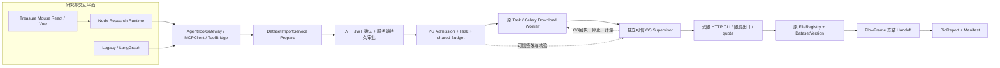

# 00｜CygnusX BioOps 三大关键工作包总体技术路线与验收门禁

## 1. 最终愿景与本轮范围

**目标业务链：**

`科研问题 → 公开 GEO/SRA/ENA & 文献证据 → DatasetCard → 来源/文件核验 → Import Prepare → 人工审批 → 单 Task 受控下载 → FileRecord/SHA → DatasetVersion → 冻结 Handoff → FlowFrame → BioReport → Evidence/Manifest`

本次只直接实施三个工作包：

- **P0-A / 授权事实**：Human Approval、ingestion/proposal、owner/project、Task、Admission、attempt、预算、撤销与审计绑定。产物是“可信允许/拒绝的控制平面”，不代表下载进程可执行。
- **IAT-R3 / 研究产品体验**：真实 Legacy/LangGraph、Node Research Runtime、Gateway、React/Vue、SSE 和只读/Prepare 浏览器流程。不得执行下载。
- **G3-E2 / 不可绕过的数据平面**：独立可信 OS Supervisor，仅认证第一个严格固定的 HTTP 实现，使用强制 network/RX、disk/inode、lease/stop 与 signed receipt；九项真实环境测试。

S4 的故障窗口作为并行小包，S6/S7 是未来的 Go/No-Go，而非本轮默认继续实施。

## 2. 权威事实与证据等级

审计事实以 `CygnusX_Current_Implementation_Status_Audit_2026-10-18.md` 为基础：当前状态与 2026-10-18 的审计时刻有关；本方案所有新设计属于**待实施建议**，禁止写成已完成。

| 能力 | 当前审计事实 | 本轮要产生的新增证据 |
|---|---|---|
| Gateway/Catalog | 目录12类、共享 Gateway、scope 缩减已有代码；局部 PG/Redis 历史证据 | 真实 Node 和两 Runtime 的完整服务/项目证据 |
| P0-A | Admission/审批快照、同 Task binding、epoch claim 与回执结算已有源码 seam 和 SQLite 隔离证据；真实 PG 仍未验 | PG 真并发、同 Task 绑定、单次消费、撤销/结算、宽整数迁移 |
| IAT-R3 | 两 Runtime/Node/React/Vue 有源码与隔离回归增量；真实服务与 Chromium 业务链仍未验 | API监听 + PG 模板/模型配置 + Node 聊天 + Chromium 业务 E2E |
| S4 | 幂等冲突、批次集合与恢复探针有隔离证据；PG/Broker/Worker/Beat 故障窗口仍未验 | 同次场景的故障注入 + 原始消息/Task/文件证据 |
| G3-E2 | mTLS 客户端、publication receipt/nonce 验证；现有 Supervisor 为默认拒绝服务骨架，Worker HTTP 接线已有离线 seam；无 Linux 强制后端，9 项全 skip | 真 Supervisor 强制点、OS事实、九项 non-Mock true-runtime |
| FlowFrame/BioReport | Handoff/科学类型/报告渲染存在；科学报告 end-to-end 不成立 | 待 S6 后同一科研案例验证 |

### 不得混用的四种状态

- `CODE_IMPLEMENTED`：可定位源码与签名/接口；不推断可运行。
- `PASS_ISOLATED`：有特定单测和确定性替身绿；替身覆盖范围必须写清。
- `PASS_RUNTIME`：有对应版本的真实 PG/Redis/Node/Worker/OS 服务执行和可复核原始证据。
- `PASS_E2E`：真实 Chromium 与业务数据/权限状态形成闭环，HAR、截图及 DB/日志关联。
- `BLOCKED`/`NOT_TESTED`/`STALE_EVIDENCE` 单列，不能用通过数量冲抵。

## 3. 架构与互相依赖



**关键依赖：** IAT-R3 只读/Prepare 可独立；G3 Supervisor 软件可并行开发；G3 真正 `start` 必须先有服务端核验 P0-A 的可信引用。任何 Agent 工具不能直接签发 Admission 或开执行门禁。

## 4. 三包详细阶段分解

| 阶段 | 交付范围 | 退出条件 | 可以并行 | 不可以越过 |
|---|---|---|---|---|
| P0-A0 | 基线与 dirty 保护、ERD、状态迁移图 | 名词、源事实、迁移路径可追踪 | IAT-R3 | 擅自修改旧迁移 |
| P0-A1/A2 | 持久审批/Task/Admission/预算状态机 | 同 Task、same owner/project/caller、每次预算统一来源 | IAT-R3 / G3 控制面 | 用调用方自报审批 |
| P0-A3 | PG 并发/撤销/额度/迁移验收 | 所有拒绝和原子单消费真实 PG PASS | IAT-R3 | 开启下载 |
| IAT-R3 A/B | 真实 API/PG/Redis、确定性 Provider 双 Runtime | SSE完整工具轮次，各自 PG Audit | P0-A | 只做 in-process 单测 |
| IAT-R3 C/D | Node 真实聊天、React + Vite + Chromium 业务 | GEO卡→合法Prepare→待审批，项目/SSE测试通过 | P0-A / G3 | 假数据冒充外部已验证 |
| G3-E2 A/B | OS Supervisor 与隔离资源设施 | 不可绕过出口/硬计量/硬quota、真实 stop | IAT-R3 | 无 host 授权启动 |
| G3-E2 C/D | 同 Task admission 消费、HTTP九项 | 9/9 非Mock + Registry/SHA/进程空scope | S4 小包 | 全局翻 write gate |
| S4 收尾 | PG锁、真实丢 ACK/API SIGKILL/Beat 等 | 故障恢复证据，风险闭合 | P0-A/IAT-R3 | 报告 Worker 接生产队列 |
| S6 后续 | 每 caller/protocol/environment 独立准入评审 | P0-A/IAT/G3/S4 与多重门禁一致 | 不自动 | 任一缺失 NO-GO |
| S7 后续 | 完整科学案例 + FlowFrame + BioReport | 同一来源/Task/SHA/manifest 可重放 | 不自动 | 不以项目报告替代科学报告 |

## 5. 源码与工作树保护规则

审计中：主仓 `main d648f54d...`，五个子仓 dirty，R3 React/Vue 文件在审计过程中发生新修改，G3 `download_execution` 模型/仓库/迁移为 dirty。Codex 开工必须重新检查：

```bash
# 只读示例；按仓库路径执行
git branch --show-current
git rev-parse HEAD
git status --porcelain=v1 -uall
git submodule status --recursive
git diff --name-status
git diff --cached --name-status
```

生成 `evidence/<workpackage>/baseline/`：HEAD、全量子仓 HEAD 和各自 dirty 文件清单、tracked diff SHA、未跟踪文件单列、核心文件 SHA、锁文件 SHA。不能只用 `HEAD` 代表可复现构建；不跑 `git reset --hard`、`git clean -fdx`、批量 `git checkout`。多 Agent 并行时锁定文件所有权：P0-A 独占 Admission/DB 迁移；IAT-R3 独占 Node/Vue/React/SSE；G3-E2 独占 Supervisor/可信执行模块；共享 `tasks/download.py` 与 `dataset_import_service.py` 必须安排接口协商后由一个负责人修改，避免无序覆盖。

**运行验收前**需要只读记录实际服务镜像 digest、API/Worker 源码指纹、子仓 SHA、环境 ID；若 dirty 源码在测试期间改变，之前 PASS 标记需要 `STALE_EVIDENCE` 或重新跑。

## 6. 不可妥协的安全策略

1. 下载 `DOWNLOAD_TRANSPORT_RUNTIME_ACCEPTED=False`；Gateway `WRITE_RUNTIME_ACCEPTED=False`；各 Agent 写开关默认 false；未经独立审批/认证绝不翻转。
2. 若当前实现固定 require gate，则 G3 的 HTTP 原型应置于运维授权、隔离、非生产的**测试驱动**中，验证可信边界；不要删 gate、改 gate 常量或将“内部测试”偷偷接入所有用户请求。
3. 根信任：真实 actor/JWT 与持久审批、原 Task、唯一 owner/project、任务预算、签名 tool+execution policy、environment/caller；任何模型参数只能表达请求，不是授权源。
4. Worker 不获得监督器宿主 OS 权限；受限子进程不拥有 Docker Socket、DB/Redis/Broker/API 凭据、普通用户 HOME 或共享存储写访问。
5. HTTP 测试使用自有允许/拒绝控制端点；阻断地址场景不能借机扫描互联网/云元数据服务。
6. 真实 PG、Broker、Node、Chromium 或 OS 运行均需此次明确的**独立非生产授权**。已有日志授权不自动延续。

## 7. 结果发布与回滚

每个包输出 `docs/implementation/<stage>-implementation-report.md` 及 `evidence/<stage>/`。报告包括：源文件变更表、原始测试命令/退出码、场景 IDs、DB 状态、时间线、异常/拒绝路径、门禁核验、弱断言清单、未运行项、残留数据、按 hunk/文件回滚方法。不得将不同测试集合相加，不得以默认 skip 绿色计数为通过。

### S6 准入五项 AND 门槛

- [ ] P0-A 同 Task 审批/Admission/预算/撤销：真实 PG PASS。
- [ ] S4 真实原 Worker/Broker/Beat/失败窗口：适用范围 PASS。
- [ ] IAT-R3 Node、两 Runtime、React 研究工作流：真实 runtime + E2E PASS。
- [ ] G3 HTTP 九项、OS计量/停止/额度/收据：固定 scope PASS，其他协议仍 BLOCKED。
- [ ] 环境+协议+tool digest+caller+actor+有效期的运行许可审查和逐通道开关另行批准。

满足之前：**S6 NO-GO；S7 NOT_YET_END_TO_END**。

当前工作树身份与迁移补充验收见 `docs/implementation/cygnusx-p0a-g3-runtime-identity-acceptance.md`。该报告的 `PASS_ISOLATED` 仅覆盖控制面契约和离线回归；真实 PG、OS Supervisor、G3 九项 HTTP 仍按本路线保持 `BLOCKED/NOT_TESTED`。
