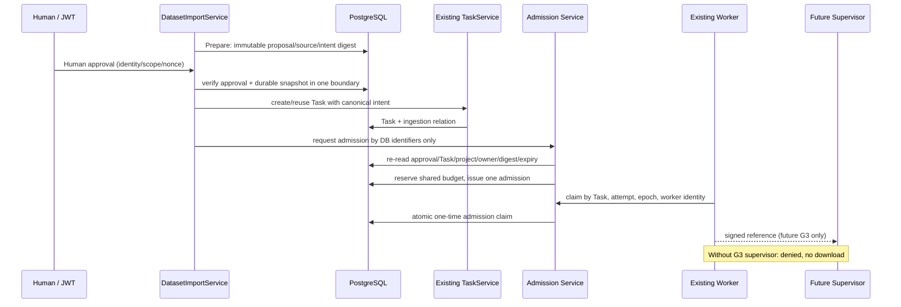

# 01｜P0-A · Trusted Admission & Budget Binding 详细实施文档

## 0. 阶段界限和完成定义

**业务目标**：将真实人工审批、合法 import/ingestion、唯一可信 Task、DownloadExecutionAdmission、执行 attempt/epoch、caller/tool/environment 身份、总预算统一为**由服务端重新核验且具有原子事务语义的一组持久事实**。这是一套执行前控制平面，不负责实际网络隔离；即使 P0-A 全部通过，`DOWNLOAD_EXECUTION_READY` 仍为 false，G3 不通过就不能下载。

**审计时已有但不能直接信任为完成**：`dataset_import_service.py` 中 Prepare/确认；`download_execution_admission.py` Repository 与 `models/download_execution.py` dirty 代码；迁移 `dwnadmission01` 与四项 SQLite 测试；`issue_processed_http_admission` 通过调用方前置“审批已验证”的假定；`reserve` 限制 reserved 但不提供完整计量结算；`CONSUMED` 撤销与同 Task 运行撤销未实现；32 位 `Integer` 大字节额度隐患。以上均来自 2026-10-18 审计，开工前必须复核实际仓库。

**首个实施场景**：单个合法 processed HTTP ImportProposal 对应一个真实原 Task，不将 raw 多 Task 情况悄悄视为已解决。raw 多 Task 必须按共享 parent budget 做模型/拒绝设计，并单测证明不能超额；无法闭合则 raw 执行明确阻断。

## 1. 先查源码——保留既有系统

先只读定位并记录具体函数签名、调用者、状态迁移和 DB 关系：

- `src/cygnusx/application/services/dataset_import_service.py`：`prepare`、确认消费、`execute`，可信 ingestion/proposal/approval 实际落库或 Redis 路径；必须知道人类 JWT 确认产生了什么事实。
- `src/cygnusx/application/services/download_service.py`：`submit`、canonical intent、request_key 与任务分配；绝不复刻新的 Task 队列。
- `src/cygnusx/application/services/tool_confirmation_service.py`、`agent_tool_gateway.py`、`agent_tool_delegation.py`：模型 `prepare` 与人类审批分离，scope 缩减、token_version、nonce；不能让 Agent 签发人工批准。
- `src/cygnusx/infrastructure/database/models/download_execution.py`、`repositories/download_execution_admission.py`、`alembic/versions/dwnadmission01...py`：实际已有字段、唯一键、类型、锁、触发器或索引；先对已存在代码做差异化修改。
- `src/cygnusx/infrastructure/celery_app/tasks/download.py`、`infrastructure/download/trusted_execution.py`、`supervisor_client.py`：Worker/可信执行引用传递位置；本包**不启动** Supervisor。
- `src/cygnusx/infrastructure/download/reliability.py`、`application/services/task_service.py`：旧 queued→running、取消、reconcile 与发布窗口，不破坏 S4 机制。

**禁止**：新建第二套 Confirmation、Task、Quota 总账或 Broker；把模型输出的 `approved=true` 作为事实；直接把 Redis TTL 当唯一持久审批记录；在请求失败后生成不可对账的游离批准。

## 2. 建议的授权链与信任边界

服务端重新读取的最小关联字段：

| 领域事实 | 可信来源 | 必需校验 |
|---|---|---|
| actor 和审批 | 已认证的用户 JWT + 原确认服务审计记录 | user 有 owner/project 权限，审批确为用户主动，未过期/撤销，nonce 只消费一次 |
| Proposal/Ingestion | 原 DatasetImportService 持久记录 | 状态可执行、source manifest digest、requested files 未变化 |
| Task | 原 `Task` + idempotency/owner/project | 与 proposal/ingestion 唯一关联，状态 queued，参数哈希/方法/目标一致 |
| Admission | 服务端数据库生成，凭 ID 查询 | 对应 exact Task/attempt/epoch；签发者、签发时间、有效期、版本固定 |
| Budget | PostgreSQL 持久总账/Reservation | parent 限额包含所有子 Task、byte/blocks/inodes/time 可原子预留 |
| caller / tool / environment | 后端签名身份、运维固定白名单、镜像/hash | human 与 Agent 独立通道；client/model 不能自报或扩权 |
| Revoke | 经认证用户/后台策略服务 | 未启动阻止领取；已启动请求 Supervisor stop，不能仅把 DB 状态改 revoked 即宣称 OS 停止 |

**强约束**：`approval_id`、`ingestion_id`、`task_id`、`admission_id`、`budget_id`、`attempt_id`、`epoch` 的关联必须单向可查、在可信事务中验证；签名回执只证明已认证签发主体的声明，真正 OS 事实仍由 G3 Supervisor 提供。

当前源码增量还将首次 Supervisor `execution_id` 持久绑定到 Admission：同一 Task/attempt/epoch/execution 的重试可复用已消费 claim，改变执行身份则拒绝；`dwnexec04` 遇到已有 consumed/settled 历史记录会显式停止迁移，不猜测旧执行身份。该幂等边界由迁移与隔离 authority 回归覆盖，尚不等同于真实 PostgreSQL 并发验收。

## 3. 设计建议：数据契约与类型（以当前模型审查结果为准）

### 3.1 Durable Approval Snapshot

如果已有持久审批实体，优先扩展或关联，不制造影子审批表。若原确认只有 Redis TTL，建议利用现有 ingestion/proposal 的审计/状态表保存不可变快照（必填）：`actor_id`、`approved_at`、`auth_session_or_jti_hash`（非明文 token）、`approval_version`、`owner_id`、`project_id`、`proposal_digest`、`source_digest`、`method`、`max_budget`、`expires_at`、`revoked_at`、`nonce_hash`、`status`。原始 token 不入库。

必须区分：**审批“记录持久化”与“Redis 一次消费抗重放”是两项相互配合的事实**；任一项失败都不能出具可执行 Admission。

### 3.2 Admission 实体

建议字段（若已实现等价字段则复用）：`id`、`task_id`、`ingestion_id`、`approval_reference`、`budget_account_id`、`attempt_id`、`epoch`、`caller_kind`、`caller_id/hash`、`tool_digest`、`protocol`（本期 HTTP 候选）、`environment_id`、`worker_identity`、`policy_digest`、`request_digest`、`expires_at`、`claimed_at`、`revoked_at`、`status`、`version`。

候选状态机：`PREPARED → ISSUED → CLAIMED → CLOSED`，异常为 `REVOKED/EXPIRED/RECONCILIATION_REQUIRED`。**不要照搬此枚举覆盖已有模型**；需写一个实际值与建议语义的映射，逐状态说明 DB 事务和副作用。

### 3.3 Budget 总账（不同单位严禁混算）

`network_rx_limit_bytes`（Task 网络边界接收字节）、`network_rx_reserved_bytes`、`network_rx_admitted_bytes`、`disk_block_limit_bytes`、`disk_inodes_limit`、`deadline`。**P0-A 负责总账、预留和结算接口；G3 负责真正的 RX 计量和 OS 文件系统硬限制**。不允许用 HTTP Content-Length、最终文件 size 或“磁盘 quota 估算值”冒充网络硬计量。

原子条件表达式（仅为契约示意，必须按真实 schema 适配）：

`UPDATE shared_budget SET reserved_bytes=reserved_bytes+:delta, version=version+1 WHERE id=:parent AND reserved_bytes+:delta <= limit_bytes AND state='ACTIVE' RETURNING id,version;`

返回零行意味着拒绝，并验证：`delta>0`、非溢出、所有子 Task 共用 parent 限额、Reservation 唯一 `(task_id, attempt_id, epoch)`、失败/终止未见 Supervisor 对账不可直接退款可再次使用。对齐网络计量前 `admitted_bytes` 必须 `UNKNOWN/NOT_REPORTED` 而非 0。

### 3.4 PostgreSQL BigInteger 与迁移

审计明确提示字节字段可能用 PG 32-bit `Integer`，不能凭 SQLite 100 字节通过就忽略 >2 GiB 风险。检查**所有**网络/文件/预算字节字段和算式，需可支持既定最大预算则使用 `BigInteger` 或明确 hard reject 不超过有符号 32 位（按业务策略选一且写测试）；禁止默默溢出或正负翻转。迁移需具备：upgrade/reviewable downgrade、唯一键/索引、非负 CHECK、范围检查、外键、现有数据兼容与无长锁的变更计划；真实 PG 预检必须在独立 DB 上执行。

## 4. 最重要的四条事务时序

### T1：成功审批与 Admission

1. API 验证 JWT 与用户项目/许可权限；查询真实 Proposal/Ingestion。
2. 验证人工决定已成功消费且有持久审计快照；对变更内容计算服务端 digest，确保与审批版本相同。
3. 在事务内建立或锁定原 Task，并关联 ingestion/approval；锁 parent budget；**同一事务**预留预算并签发绑定 exact Task 的 Admission；唯一键防并发双发。
4. commit 成功以后才执行现有 `after_commit` 投递；不能让 Worker 在记录 commit 前获得有效可执行批准。
5. 若 Task/Admission 以跨事务组织，必须先写明恢复/补偿状态机，避免孤儿 Admission。优先降低跨事务不确定窗口，不另建调度器。

### T2：并发/重试

同 `task_id/attempt/epoch` 两消费者 claim，只有一个数据库条件更新成功；另一方得到明确拒绝/幂等观察结果，不启动第二个 Supervisor scope。API/Redis 重试不能绕过 PG 唯一键。并发 parent 子任务只共享一个余额。

### T3：撤销与取消

未 claim：原子标记 `REVOKED`，释放**仍未消耗**的预留额度（根据可信事务状态）。已 claim / 运行中：记录撤销请求、阻止 renew、请求 G3 独立 Supervisor 撤销出口并清空 scope；**无停止回执时保持 `RECONCILIATION_REQUIRED`，不能宣称网络已停止或把整个预算重新发给下一 Task**。

### T4：Worker 死亡/超时/未知回执

发生 ack 丢失、Worker SIGKILL、Supervisor 断联、预算上报未知时，`Task` 与 Admission 存在不可确定事实；先 fail closed，进入待对账，持久保存 attempt/epoch 和已保留额度，不因“没有收到数据”就把网络使用量归零。重试必须绑定既定累计余额，不能重新获得完整预算。

## 5. 详细实施顺序

**P0-A0（只读基线）**：输出当前 ERD、状态机图、source map、dirty 风险矩阵、授权边界；明示当前已存在字段和待新增字段；检查下载安全门禁。

**P0-A1（数据库与审批来源）**：复用原 confirmation/ingestion 审批事实，缺持久字段则最小扩展；完成数据库迁移；对未完审批、无权 actor、过期、nonce 已消费、内容变更 fail closed。

**P0-A2（Service 层核验和原 Task 关联）**：删除/收紧仅依赖 `caller_already_verified` 这种信任声明的公共执行入口；从受信 Session 重新查证原记录。收敛到原 Import execute/Task service 路径；确认重复请求/终态重试仍遵守 S4 的 canonical intent 与 request_key 契约。

**P0-A3（Budget 与 Lease 语义）**：父预算原子预留、Claim CAS、attempt/epoch fencing、撤销、结算与 Unknown；明确 G3 必须上报的计量与 stop 证明 DTO，不在 P0-A 伪造 OS 收据。

**P0-A4（迁移与测试）**：SQLite/替身先 red→green；拿到**新一轮授权**后真实 PG 双连接、多 Worker claim、并发 parent budget、rollback/savepoint/commit-crash、>2 GiB 边界、actor/project/scopes 否决；不要用 SQLite facade 代替 PG PASS。

**P0-A5（审计与交接）**：完整记录证据路径、状态图、版本、API/Worker 消费端调用边界、G3 依赖；提交前代码审查且不自动提交。

## 6. 验收矩阵（都要有拒绝场景）

| ID | 场景 | 预期不可变事实 | 实证要求 |
|---|---|---|---|
| PA-01 | 未经人工批准的模型/服务请求 | 无 Admission/Task 执行许可 | PG 行数+错误码 |
| PA-02 | 合法 actor 项目 A，篡改到项目 B | 拒绝，任何预算不扣减 | 双项目PG事实 |
| PA-03 | 审批版本/源 digest 与 Task 不一致 | fail closed | request/DB digest |
| PA-04 | 两并发消费者 claim 同一 Admission | 恰好 1 CLAIMED | PG 双连接 barrier |
| PA-05 | 两个子 Task 共用同父 budget | 合计无法越上限 | PG 行锁/余额 |
| PA-06 | 大预算 >=2GiB 或拒绝边界 | 无 DB overflow | PG 字段类型及 SQL |
| PA-07 | 事务 rollback/savepoint/commit failure | 无孤儿可执行 Admission | PG 行与队列时间线 |
| PA-08 | 未 claim 撤销 | 不可再 claim、未用 reservation 按策略释放 | PG 状态/同意图重试 |
| PA-09 | 运行中撤销，无 Supervisor 回执 | `RECONCILIATION_REQUIRED`，不冒充停止 | Task+Admission 状态 |
| PA-10 | Worker death / duplicate attempt/epoch | 不二次发放完整预算 | DB 记录/epoch |
| PA-11 | token/nonce 重放与超时 | 原子拒绝且保留审计 | Redis+PG |
| PA-12 | legacy/旧 Task/旧目录 | 无隐式授权升级 | 历史兼容/迁移检查 |
| PA-13 | caller/tool/environment/hash 变更 | 拒绝，需重新审批/认证 | 显示受信来源与拒绝码 |
| PA-14 | 默认安全门禁 | 未开放真实下载/Agent write | 配置源码 + 运行输出 |

## 7. DoD、阻断与回滚

P0-A `CODE_COMPLETE` 需要源码、迁移、状态机、并发测试、拒绝路径、原业务复用均齐全；`PASS_RUNTIME` 需要真实非生产 PG + Redis/Confirmation 的完整证明。**即使 P0-A PASS_RUNTIME，G3 未通过时下载始终 BLOCKED。**

阻断条件：审批源无持久可查事实、无法绑定唯一原 Task、budget 不可原子共享、已 claim 可无证重放、当前环境无 PG 授权、迁移对现存数据不兼容、任何 fail-open。出现则停止对应写接线、留报告，不开门禁。

回滚策略：先禁用新 Admission 签发/停止许可（原门禁已关），保留 Task/审批/预算对账数据；按已审查 migration downgrade 或兼容修复恢复，但不能为了回滚删除审计、原文件、已有订单或未结算预算。逐文件/hunk 回滚 dirty 源码；不得整仓 reset/clean。运行中新 Task 不明时先隔离，不回滚为“已安全停止”。

**本文件不表示实施已完成。**
