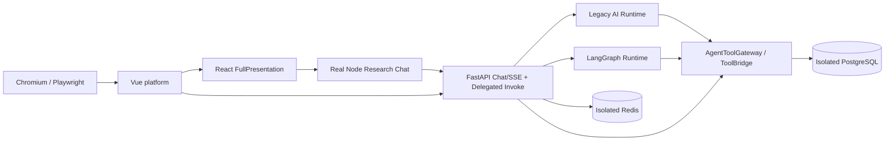

# 02｜IAT-R3 · Agent Research Workflow Closure 详细实施文档

## 0. 目的与真正的验收对象

**目标**：以当前 CygnusX 统一 Agent/数据服务为权威，完成**真实监听服务与浏览器**上的科研发现、证据展示、已有资产检查、合法 Import Prepare（待人工审批），覆盖两种 AI Runtime、原 Node Research Runtime、Vue/React 原生研究工作台、PostgreSQL/Redis 和 SSE/撤权。**本阶段不执行文件下载、FlowFrame 写任务或 Agent 自动审批。**

当前审计保留的事实：Legacy/LangGraph 两 Runtime 使用确定性 Provider 通过 32 项隔离回归，但没有真实 PG agent_templates 配置和服务级轮次证明；Node `platform-tools.ts` 某次目录调用在 PG Audit/Redis 有历史证据，但不是完整聊天全轮次；React `FullPresentation`/Vue typed adapter 和 SSE cursor/replay 具备实现与隔离测试，真实科研业务 Chromium 未运行；`TreasureResearchWorkbench.vue` 在审计时发生 dirty 更新，旧哈希已经过期；合法 Prepare 只有 SQLite/替身证据。

源码增量记录（2026-10-18）：委托控制面现对已验签 JWT 的 `sub`、`session_id`、`jti`、`project_id`、`scopes`、`token_version` 做 claim 类型与 UUID/取值校验；签名有效但 claim 形状异常的令牌在进入权限交集、项目边界或 Redis 防重放逻辑前统一拒绝。该增量由 4 个 malformed-claim 回归和完整 `test_agent_tools_phase2.py` 隔离套件覆盖，仍属于离线证据，不能提升本节列出的真实服务/浏览器验收等级。

后续离线修复（当前工作树）：AgentTeams artifact 登记在未注入 Case service 时不再隐式触发外部 Case 查询，避免离线路径阻塞；带真实文件引用的明确单细胞分析请求可绑定 `scrna` Flow，而无输入的咨询请求仍保持不绑定。能力注册表与描述性团队清单同步为 16 个可招募专家（含 `agent-explorer`），Case watcher 的 `new_only` 回归补齐 Redis 发布替身。相关 AgentTeams 核心回归 76 项通过、定向 Ruff 通过。当前沙盒线程池不可用，依赖 `LocalStorageBackend` 的 data-tools 回归无法运行；这些结果仍是隔离证据，不提升真实 API/PG/Redis/Node/Chromium 验收等级。

## 1. 关键原则：一个权威平台，多种表现形式

**必须复用**：

- 科研寻宝鼠的 `pipelines/Treasure-Seeking_Mouse/functions/seqout-chat/platform-tools.ts`、原 Node 聊天入口（审计在 `index.ts`）、`src/island/FullPresentation.tsx` 和既有 `MessageBubble`、`ResearchWorkflowPanel`、Dataset/Literature/Grounding/ToolTrace 卡片；
- 主站 `frontend/src/views/TreasureResearchWorkbench.vue`、前端 adapters / session stores，不能另做假 React UI；
- `AgentToolGateway`、`ToolBridgeService`、`MCPClient`、真实 `DatasetImportService.prepare`、项目及会话服务；
- `research_treasure_service` 既有 request_id/fingerprint/cursor、SSE 去重与重放；
- `infrastructure/ai_provider/testing.py` 的受控确定性 Provider，按正式 ProviderManager 装配，不让测试直接绕过 Runtime。

**请求与可信身份**：用户/项目从真实 JWT、平台 Session、可信 Gateway 上下文派生；Node delegated token 由平台签发且 Redis NX 防重放，模型不能自报 `owner/scopes/project`。R3 的 Gateway 只允许已批准的 read/prepare 子集，下载执行与 write 继续关闭。

## 2. 分层运行拓扑

重要区别：**真实 Node callback HTTP POST ≠ Node 原聊天模型工具轮次**；**Legacy/LangGraph ASGI + 替身 DB ≠ 真实 PostgreSQL service Runtime**；**Vue 登录页 PASS ≠ React 科研工作台 PASS_E2E**。

## 3. IAT-R3-0：运行身份与环境冻结

1. 拿到明确授权的非生产 Linux/Docker 或本地测试环境；隔离 PG role/db、Redis、Broker、Storage、API、Node、测试账号/项目、端口与销毁权限。
2. 读取**当前** main HEAD、所有子仓 `HEAD + dirty`、当前 Node pnpm/lockfile、Vue package-lock、受控测试 Provider 版本；生成 manifest。R3 审计曾出现 `TreasureResearchWorkbench.vue` 在 93/93 校验后变更，运行镜像必须包含本次源指纹而非仅 HEAD。
3. 构建/运行主 API + Node 原服务 + Vue/React；复用原 Compose 与 npm/pnpm 版本、隔离队列。不触碰生产 treasure-mouse 容器或业务用户。
4. 实际确认 `GET readiness`、SQL `current_database()` / `current_user`、Redis key namespace、Node callback 地址、Chromium sandbox、SSE 可达；记录服务镜像 digest、业务包版本、退出码与固定测试时限。
5. 默认 `ACCEPTANCE_READS` 不扩大写权限，仅对目标只读能力按原控制开关开放。**绝不开放下载 write/execute**。

## 4. IAT-R3-A：两种 Agent Runtime 的真实服务轮次

### 4.1 测试数据/模型装配

在专属测试 PG 中创建合法的 `agent_templates` 和受控模型配置；使用既有 ProviderManager 的确定性 Provider，不保存真实外部 API Key。此 Provider 的测试输出可以固定触发工具调用，但**必须**走正式 API `chat/stream` → AgentService/Runtime → ToolBridge → Gateway → 工具结果回灌 → 二次 Assistant 答复 → done 的真实代码路径，不能直接 `gateway.invoke` 当作全轮次。

### 4.2 Legacy 必测

- 真实用户 A/项目 P1 创建 Session，给合法自然语言问题；Provider 输出一个 `downloads.describe_capabilities` 与一个允许的 `dataset.*` 工具请求。
- 验证 Tools IDs、schema args、实际 Gateway 调用、PostgreSQL audit、Redis 状态、二次 Assistant 回复含工具结果而非假内容、`done` 结束、SSE 事件 seq。
- 验证模型传入 `owner/project/scopes` 尝试越权：被 schema 或 Gateway 拒绝；拒绝不能被包装 `success=true`。
- 前端断连、模型工具异常、超时：HTTP/SSE 状态清楚，error code 与 `is_error` 正确；最终不能创建下载 Task。

### 4.3 LangGraph 必测

用**同一套权威 Gateway 工具**重复上述完整流程，额外核查 state transition、stream callback 顺序、模型工具循环次数上界、工具重复调用幂等/防重放、session 已撤权后的迟到工具请求拒绝。不能仅以 Legacy 通过替代 LangGraph。

### 4.4 第三方模型可选

用户若提供批准的测试模型 Key 和额度，才执行单独标记的真实模型质量测试；核心 R3 运行验收不应依赖外部厂商响应确定性。**确定性 Provider 的 PASS_RUNTIME 只证明编排与工具基础设施，不证明模型推理科学正确性。**

## 5. IAT-R3-B：真正的 Node Research Chat 全轮次

从 **Node 服务公开的原聊天入口**触发（不是手工 Node 脚本直接 `platformToolAdapter.call`），要求：

1. Node 聊天解析工具调用，经 `platform-tools.ts` 的 `bioops_describe_capabilities`、`dataset.discover`、必要的只读资产工具发起真实 HTTP；Node 从平台受信 callback 获取委托，不接收模型自报 URL/Token。
2. FastAPI `/agent-tools/delegated/invoke` 验证 Bearer、owner/project/session、scope 子集、TTL、jti+call_id Redis NX，一次消费后返回结构化工具结果；重放=409。
3. 平台 PG audit 可按 Node 的 chat message / tool_call ID 与 Gateway invocation ID 串联；Node 将原结果完整注入后续模型回复/前端卡片协议。
4. 非法工具 `submit/cancel`、模型传入 owner/scopes、意图中夹带的未经批准 URL、重定向/调用超时都应该 fail closed；Node 既不自动重试危险写，也不自动下载。
5. 两用户、两项目、多 session、退权和 session 归档均独立；查看到的卡片数据绝不跨项目混用。

**证据**：Node process logs、真实 HTTP HAR/trace、PG invocation row、Redis nonce/key、完整 message/tool/result 序列；必须能证明源头确实来自 Node Chat Runtime。

## 6. IAT-R3-C：真实 GEO/已有资产/合法 Import Prepare

### 合法可重放的固定科研测试数据

- 使用经过审查的公开 GEO 元数据快照或授权 endpoint，只请求少量元数据（如未获外网授权，**绝不对外请求**）；测试快照必须明确注明 source、fetch date、digest、是否 synthetic、真实科学含义未知。
- 预置真实测试 PG 中的 DatasetAsset、DatasetVersion、FileRecord（若必要，用原 FileRegistry 登记实际固定本地小文件并计算 SHA；不能手填可信关联作为验证）；分配两个 owner/project，另外准备无资产项目。
- `DatasetCard` 的 accession、source_evidence、confidence_flags 必须来自受信 Gateway DTO；浏览器 UI 不生成“已核验”字段。
- `Import Prepare` 使用合法 accession + 固定候选构造并持久化 proposal/ingestion，查询 PG 证明存在且关联 P1；不能再仅以“空 accession 正确拒绝”充当合法 Prepare 通过。
- 只做到`待人工审批/拒绝`，**不调用已锁定的 execute/submit/download**；检查 0 个新增下载 Task、`execution_allowed=false`。

### 科研正确性底线

metadata 结果与证据来源真实性单独核对。`processed matrix` 与 `raw FASTQ`、`raw_integer_counts` 类型不能混淆；不可用 TPM/FPKM 值伪装 RNAFlow counts DEG。离线快照 E2E 不能宣称实时 GEO 端点已经通过科学验证。

## 7. IAT-R3-D：真实 React/Vue + Chromium E2E

必须在 Chromium 的真实 Playwright 浏览器上下文（sandbox 保持开启）打开**`TreasureResearchWorkbench.vue` 实际路由并验证 React `FullPresentation` 已 mount**，不能停在主站登录页/空白 iframe。

| 测试 | 用户行为 | 强断言 |
|---|---|---|
| R3-BR01 | 登录用户 A，打开研究工作台 | React FullPresentation 特征元素、真实 Node/Tool Network，而非登录页 |
| R3-BR02 | 搜索/呈现 GEO | DatasetCard 有 accession、真实来源字段、metadata digest |
| R3-BR03 | 点击 dataset 资产 | owner/project 边界，真实版本/SHA/FileRecord 可核对 |
| R3-BR04 | 发起合法 Prepare | 返回 proposal_id 与 DB row，下载 Task 新增 0 |
| R3-BR05 | 检查未认证下载 | 按钮不可执行，API 回 `DOWNLOAD_TRANSPORT_UNVERIFIED`/拒绝，非仅 CSS disabled |
| R3-BR06 | 项目 P1→P2，迟到 SSE | P1 帧不能污染 P2，旧请求日志与 epoch/seq 有对应证据 |
| R3-BR07 | Session 归档/撤权 | 新请求、旧委托与重放明确拒绝，页面隔离 |
| R3-BR08 | SSE 断流重连 | 按 cursor 恢复、同 event 只呈现一次、不丢已 commit 的帧 |
| R3-BR09 | Node/API 服务重启 | 仅承诺代码实际支持的跨进程恢复；如取消 producer 进程内，必须标注 BLOCKED，不得以重连成功伪称跨进程取消支持 |
| R3-BR10 | 宽度、i18n、错误卡片 | 中英路径、空数据/超时正确、无敏感日志/5xx |

每个测试保存 screenshot、HAR、console、视频/trace（如有）、真实 API 请求、PG row、Redis key（脱敏）、Git/worktree hashes。没有这些，只能计隔离前端单测。

## 8. SSE 一致性与撤权边界

审计已有 request_id/fingerprint/cursor 重放和前端去重，但 producer/cancel 注册在进程内，跨进程取消/重启恢复尚未实现。R3 应：

- 先保留现有 producer 生命周期语义，不因 E2E 需要擅自新增第二套队列；
- 检查每条 SSE frame 的 stream/session/project/generation/version/seq，模型对数据/会话身份不能自报；
- reconnect 带 cursor，服务端真实持久回放而非仅页面缓存；duplicate frame 只入 UI 一次；
- `cancel` 必须区别“请求被接受”和“实际 producer 已停止”，无跨进程回执则 UNKNOWN/BLOCKED；
- 如果用户当前需求包含跨进程恢复，则另做最小可靠性改造与授权测试，不能通过放宽测试替代。

## 9. 验收与完成等级

| 子目标 | 通过标准 | 不能作为替代的证据 |
|---|---|---|
| R3-A Legacy | 真实监听 API→ProviderManager→Runtime→Gateway→DB→SSE | 直接 Gateway 单测 |
| R3-A LangGraph | 独立完整工具轮次及最终答复 | Legacy 已通过 |
| R3-B Node | 真实 Node 聊天入口、委托 HTTP、回灌与 PG/Redis | 手动 `platformToolAdapter.call` |
| R3-C Prepare | 合法 proposal 持久化、关联项目，新增下载 Task 0 | 非法输入被拒 |
| R3-D Browser | 实际 React 工作台/数据卡片/Prepare/撤权/SSE，HAR 与 DB 对应 | 登录页、首页刷新、401 |
| R3-E Isolation | A/B users/projects、stale response、session revocation | Vue mock store 单测 |

阶段性可以独立签发 `R3_READ_PREPARE_PASS_RUNTIME`/`R3_PRODUCT_PASS_E2E` 等有限结论。**不得把“部分通过”合成全部 S5-C2 PASS_RUNTIME**。G3 和下载执行仍 NO-GO。

## 10. 工作包交付及风险回滚

交付：`docs/implementation/cygnusx-iat-r3-research-workflow-closure.md`、`evidence/iat-r3-runtime/`、测试用例 ID 状态表、源码/镜像摘要、合法测试数据 manifest、Node/Provider/React 版本、原始网络与数据库证据；迁移/fixture 只在授权测试 PG 内。必须复核运行时 `agent_templates` 真实存储及 Provider 配置，不能在生产 DB 创建测试 Agent。

回滚：关闭测试容器和隔离 READ 开关；将专用测试用户/资产按事先批准的 retention 处理；当前 dirty 前端/子仓逐文件 hunk 回退本次工作，禁止整仓 reset/clean；保留原始测试证据，不自动 down -v。源码变更与测试镜像脱节即 `STALE_EVIDENCE`，重新构建重跑。
