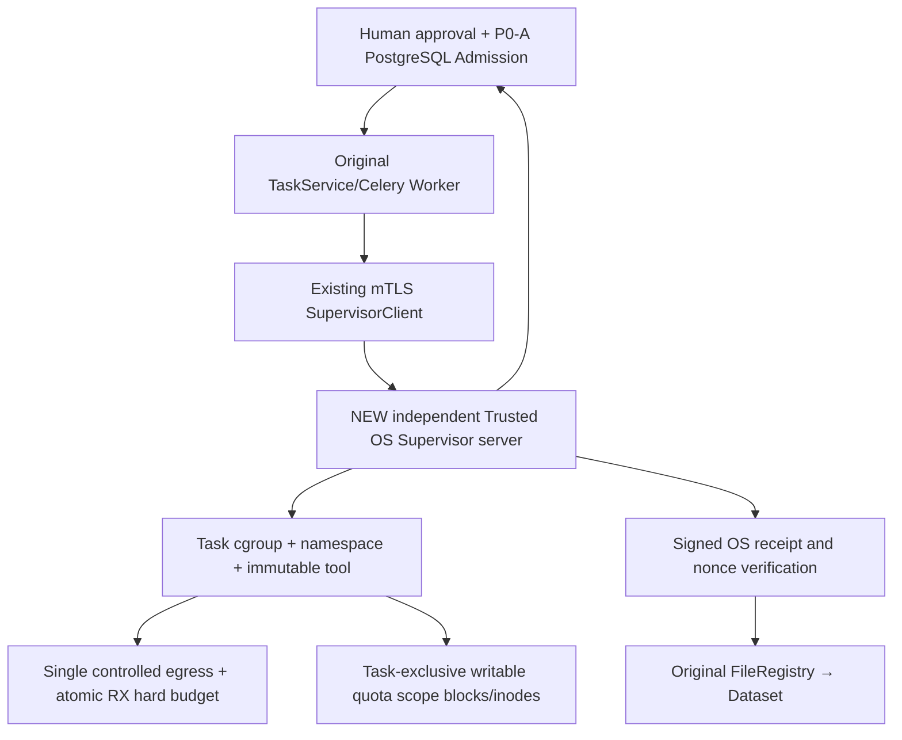

# 03｜G3-E2 · Trusted HTTP Execution 详细实施与安全认证方案

## 0. G3-E2 究竟要完成什么？

**目标不是增加接口或再跑一轮 Mock。** 要在明确授权的非生产 Linux 环境建立一个独立、可审计、默认拒绝的可信 OS Supervisor，控制真实 Task 运行前后全过程，并使**首个受审查 HTTP 下载来源/固定工具版本**取得九项真实安全验收。后续 HTTPS、FTP、SRA/ENA、云 CLI 不自动继承认证。

审计真实起点：`infrastructure/download/trusted_execution.py` 已有 Protocol/DTO；`supervisor_client.py` 有 HTTPS+mTLS start/observe/renew/stop/evidence 客户端；FileRegistry 之前存在签名 publication receipt 和 nonce 事务验证。后续源码增量已补 Supervisor 默认拒绝服务骨架、Worker HTTP 生命周期接线、执行请求构造器及带 Admission 绑定的回执结算；但尚无 Linux enforcement backend、持久 scope journal、默认运行配置或真实 OS/PG/Worker 运行证据，九个真实 HTTP 集成测试仍全部 skip。`download_execution_admission` 的运行闭环仍未认证。

当前离线增量：Worker 从持久 Task/Admission/attempt 派生确定性的 `execution_id`，与 Supervisor 的 Task/epoch scope 保持同一重试身份；新增回归确认重复构造请求完全一致。该修正只改善重试对账契约，不替代真实后端的跨进程 scope 唯一性证明。

**完成定义**：Supervisor 服务端 + P0-A 可信 Admission 引用 + 每 Task 启动前 OS 资源隔离 + 真实跨连接硬 RX + 块/inode 硬配额 + 不依赖 Worker 存活的 lease/cancel + 禁直连出口 + signed OS evidence + FileRegistry/SHA 同 Task 对账 + 九项真运行场景。没有任何一项可使用字段自报替代 OS 强制事实。

## 1. 合规运行环境与信任分工

需要被专门授权的 Linux 测试主机/VM：可创建并管理独立 cgroup v2 subtree、network namespace、受控 mount/user namespace、受控文件系统 project quota 或等效独立硬限制卷、受控出口计量设施，且具备**自有** HTTP allow/deny/redirect 测试端点。Docker Desktop 不自动具备这些可验证的内核/文件系统能力；如环境不满足，当前阶段只能交付源码/接口和离线测试，真实九项 `BLOCKED`。

**角色权限拆分**：

| 角色 | 权限 | 严禁 |
|---|---|---|
| API/原 `DownloadService` | 鉴权/Task/审批/Admission 服务，已存在 PG | 发 OS namespace/cgroup 权限给模型 |
| 原 Celery 下载 Worker | 只调用 `TrustedExecutionAdapter`，获取已审查 Task/Admission 引用 | 共享宿主 docker.sock；直接运行未隔离 aria2c；继承全部云/DB 凭据给 CLI |
| 独立 OS Supervisor | 在授权测试主机持有必要最小 OS 隔离能力，认证 Worker/mTLS 和 Admission | 第二套业务审批、第二套队列、替业务 PG 确认人工许可 |
| 受限 HTTP CLI | 固定 digest 的现有 aria2c、非 root、只读 rootfs、Task 独占写域、唯一出口 | Docker/DB/Redis/Broker/cloud keys；NET_ADMIN/NET_RAW；任意 shell 及动态工具安装 |
| 可信出口/额度点 | 强制 DNS/IP/端口/redirect 和 per Task atomic RX 限额 | 直接后门路径、忽略 IPv6、事后文件 size 估算代替硬限 |

**证据与信任链**：Supervisor 在每次 `start` 时重新核验 Task/owner/project、Approval、Admission、attempt/epoch、budget reservation、caller/environment/tool digest/expiry；如果不具备直接 DB 读取能力，可以通过固定内部控制面签名的短时证明取得结果，但不能仅相信 Worker 提交的 JSON。任何连接中断视为未知/拒绝，不回退到老 `BinaryExecutor`。

## 2. 组件分层：不能只实现客户端

### 2.1 业务与 OS 界面

现有 `TrustedExecutionAdapter` DTO 只允许受信引用；不得接受任意 `argv`、任意环境变量、任意 host path 或模型指定网络权限。服务端依据 `tool_digest/policy_digest` 固定可执行文件及安全参数。必要 DTO（按已有类型增量适配）：

- `start(task_id, admission_id, attempt_id, epoch, expected_source_digest, caller_context_ref)` → 真实 `execution_id`, `scope_id`, deadline, attested policy digest；**创建 OS 边界成功之后才真正 exec**。
- `observe(execution_id)` → signed source-bound counters / quota / state，带单调序列、事件时间与可信计量点版本。
- `renew(execution_id, lease_nonce, epoch)` → 校验 Task+Admission 未撤销、有界延租，不能让旧 epoch 延续。
- `stop(execution_id, cause)` → 先阻断网络出口→终止进程树→等待空 scope→回执；重复 stop 幂等。
- `evidence(execution_id)` → 可信 OS 观测、计量、artifact manifest、nonce 和签名；未停净/计数未知不能签“完成可登记”的 receipt。

**Supervisor 不是业务任务系统**：业务 Task 和原 Celery 仍唯一；Supervisor 内部 Scope/Lease/Execution Attempt 是 OS 管理对象，不自行认领科研资产和审批。

## 3. 执行前不可绕过的隔离

从开始到 exec 的顺序必须可测试：

1. **Admission**：认证 mTLS caller，重读 P0-A 同 Task、owner/project、tool/environment/protocol、预算余额，完成 Claim CAS/nonce（如果未绑定，拒绝并不创建 scope）。
2. **Pre-create**：配置单 Task ID/epoch 的 cgroup，预留 task-exclusive quota domain、read-only rootfs/工具、非 root UID/GID、cap_drop ALL、no_new_privs、fd/env allowlist、HOME/TMP/cache/checkpoint 同 Task quota。
3. **Network preflight**：创建不可绕过的网络 namespace / egress policy；禁止从子进程直连互联网或 host/DB/Redis/云 metadata；禁止通过未认证 IPv6/替代 DNS/代理变量/额外 FD 逃逸。
4. **Atomic budget**：为 Task+epoch 初始化网络硬 RX 额度，并保证所有连接汇聚同一计量状态（详见第 4 节）；在放行第一字节前生效。
5. **Exec**：在建立并核验上述边界之后启动已批准的固定 digest HTTP CLI；禁止“启动后再迁入 cgroup/设置网络”。重复 start 只能返回当前确切 scope；不能新建第二个并行下载。
6. **Observe**：可信 OS 管理者记录 child PIDs/cgroup membership、network counters、quota、exit code、stop/lease 状态。不信 CLI exit 0 自证结果成功。

**关于 Linux 实现选择**：可采用 cgroup v2 + netns + 受控出口网关/数据面 + XFS project quota 或等价卷。实际选型须先证明：当前内核/挂载/云网络允许强制执行、权限没有外泄、不会出现无计量直连链。`ulimit -f`、`RLIMIT_FSIZE`、proxy 环境变量、aria2c 自带 limit 或 `Content-Length` **不等价**于必需的硬强制机制。

## 4. 网络：HTTP only，按 Task 边界 RX 硬上界

### 4.1 强制出口与目标审批

- HTTP 测试第一版严格锁定一个自有来源 host/port/path（确切允许范围由测试环境配置）。
- 唯一出口负责 DNS→当前目标 IP 关联、实际 TCP 连接 IP/端口验证、每次重解析和 redirect 再验；阻断 RFC1918、回环、link-local、IPv6 ULA、云元数据以及除特别授权自有测试目标外的所有地址。测试中的“未授权地址”只能是操作者控制的 deny 端点。
- 子进程 netns 无默认可直连外部路由；代理、替代 DNS、IPv6、raw socket、FD 继承都不能绕出。即便 CLI 配置被篡改，也只能通过可信计量点。
- HTTP 302/307/308 等每一跳必须预先验证；自有 redirect 测试目标未授权时**不得发送请求**。
- 此阶段不支持 HTTPS（TLS 隧道的计量语义及证书边界需独立设计）、FTP、SRA/ENA、OSS/TOS/OBS。HTTP 认证不自动转换为通用 URL 下载证书。

### 4.2 原子 RX 硬预算定义与并发

本项目定义的硬约束是：**穿过可信出口进入该 Task 受限 scope 的累计 RX 网络字节 ≤ `task_rx_budget_bytes`**。计量应覆盖响应头、失败响应、重复 Range、重试以及**所有并发连接**；确定性处理 TCP 分片/重传、头/体编码及代理缓冲。另行统计上游收到、出口丢弃的字节；不要把“网络 RX 硬限”描述为上游账单绝对上限。

选择可验证的数据面强制点（如单一受控出口的同步 chunk-credit/packet gate，或真实 BPF/cgroup ingress enforcement），需要说明计量在哪里、是否覆盖所有传入 Task 字节、何时原子扣减、按包可能的不可分割边界如何拒绝、系统重启/并发/重传是否重复计数、是否有 kernel 缓冲超调。**如果不能证明零超界，只能报告允许的严格有界超调和独立批准标准；不得自行定义“允许超预算”为通过。**

必须设计竞态用例：两连接同时临界余额、无 Content-Length、302 多跳、HTTP 错误响应、Range 重试、关闭后迟到包、Worker 死亡。`budget consumed` 的可信持久对账必须来自 Supervisor；CLI 和业务 Worker 只可观察，不能声明计量。

## 5. 文件系统：全可写域的块与 inode 硬限制

每个 Task 专属 quota domain，覆盖**所有**可写位置：目标 output、工作目录、HOME、TMPDIR、XDG_CACHE_HOME、checkpoint、下载中间文件、配置缓存、任何子进程写路径。只读 rootfs/工具与受限 TMP 配置必须真实 mount 审核；禁止硬链接/宿主共享卷/额外挂载逃逸。

选择 project quota / 专属硬限卷后，在真实 FS 上验证 `df`、实际 block usage、inode count 与 EDQUOT/ENOSPC；测试 `many-small-files` inode 耗尽与 `large-write` block 耗尽，其他 Task 和父卷保留运维余量。注意 sparse file 的 logical size ≠ allocated blocks，tmpfs 内存用量须分开约束；仅 cgroup IO 限速不是 quota，`RLIMIT_FSIZE` 只约束单文件不约束所有后代。

预算到期、配额耗尽或 quota 数据缺失均 fail closed，不将部分文件自动标记可交付；真实 FileRegistry 应在稳定、已停止的目录上进行受审查对账。

## 6. 独立生命期：取消、租约、Worker SIGKILL 与回执

| 事件 | Supervisor 必须执行 | 可信验收事实 |
|---|---|---|
| 正常完成 | 关闭出口、等待全部后代退出，冻结产物快照 | scope empty、egress revoked、true counts、artifact manifest |
| 用户取消 | 先阻断出口，再终止整 Task 子进程树，确认为空 | 取消接受与 OS stop 回执分离 |
| 超时/预算耗尽 | 同上；清理后代和仍开放 FD | 未超硬限、已隔离、正确 Task failed/reconcile |
| Worker SIGKILL | 独立 watchdog 通过 deadline/lease 主动清理 | 不依赖 Worker finally；记录最大残留时间 |
| Supervisor 自身重启 | 出口默认拒绝，再扫描未关闭 scope 与租约 | 未认证 scope 不可自动续跑；状态可对账 |
| 网络/控制面断连 | 保守阻断新 start、旧 lease 到期断出口 | UNKNOWN 不能转 SUCCESS |
| 重复 stop/start/renew | fencing epoch/唯一 scope，无双执行 | nonce/序号单调、重复幂等 |

**`require_quiescent()`** 只能检查必要条件，不应误当作执行 stop 的代码。只有经过签名、绑定 exact Task/execution/scope/attempt/epoch 且证明 scope 为空、出口撤销、quota/计量真实的回执，才可进入原 FileRegistry 的成功登记路径。回执 nonce 要在可信事务中单消费；未知仍 `RECONCILIATION_REQUIRED`，用户文件保留待核对。

## 7. 与原 Celery、FileRegistry、Dataset 的最小接线

- 保持原 `DownloadService.submit`、`TaskService`、`reliability.dispatch_download`、`TaskRepository`、`FileRegistry`、`DatasetImportService`；不新建任务队列。单独经过授权的**测试 Worker** 注册原 `run_download`，只订阅测试队列且 `SERVICE_NAME=worker`，避免 R2 出现的 async pool event-loop 复用问题；不要扩权 report/export Worker。
- 下载 Worker 调原 Adapter/Client，拿**可信 Task/Admission 引用**；当 Supervisor 不可用时 fail closed，不 fallback 到原普通 `BinaryExecutor`/worker requests/CLI。
- 成功时必须先核验可信发布 receipt 与 nonce+Task/scope/epoch+manifest，确认进程树、网络出口已停止且硬预算未超，再逐个用原 `FileRegistry` 校验文件实际 SHA/size、quota/owner/source/Task 等关系。Partials/sidecar/链接/失败日志不是成功产物。
- Task/HTTP执行器失败不能简单等同 Celery task 函数成功返回（R2 出现过 `succeeded` 外层日志但业务状态 `failed`）；报告必须检查原 Task DB 状态和 FileRecord 事实。
- 如果签名由 OS Supervisor 管控，密钥只存在 Supervisor 可信域，业务 Worker 不得拥有可以伪造 OS 事实的签名私钥。
- **门禁**：默认所有协议、caller 均无执行权限。即使 test HTTP 认证通过，提交原生产模式开启建议也只能另行逐环境+来源+tool digest+human/agent caller 评审；本工作包**不翻转**全局 gate。

## 8. 九项真实 HTTP 安全测试与强证据

复用 `tests/integration/test_download_trusted_http_boundary.py` 的既有场景/fixture 契约，修复缺真实 driver 的阻断；测试 driver 不得使用 Mock/文件复制替代网络/OS 强制，不得通过 `skip` 取得成功。每项在**有明确授权的隔离 OS 环境**且严格小额度下执行：

| G3 原场景 | 操作（使用受控自有端点） | PASS 硬条件 |
|---|---|---|
| `small_file` | 从自有允许 HTTP 地址真实下载固定小文件 | 原 CLI scope exit、OS RX>0、scope/egress 关闭、FileRecord SHA/size 正确 |
| `unauthorized_address` | 请求明确受控 deny endpoint，并探针测试 IPv4/IPv6/直连逃逸 | 真数据平面阻断、deny 端点无有效访问，0 文件登记 |
| `unauthorized_redirect` | 允许来源 302 到受控 deny 地址 | 每跳策略拦截、deny 无 HTTP request、不允许 fallback |
| `unknown_length` | 无 Content-Length 的自有小响应 | 总 RX 实计、不凭长度放行，正确结算/对账 |
| `network_over_budget` | 小限额超量、并发、重试/Range | 实际 `RX_admitted ≤ hard_limit`，出口及时拒绝，绝不 SUCCESS |
| `disk_quota_exhausted` | block 或 inode 的微小专属硬 quota | 真实 EDQUOT/ENOSPC、不伤其他 Task、完整部分文件对账 |
| `cancel` | 经原用户取消路径中途停止 | 先断出口、空 scope、子进程全死，取消不能变 SUCCESS |
| `worker_sigkill` | 杀**隔离测试 Worker** 而非生产 Worker | 租约过期后独立清理，范围收缩且停止回执可核对 |
| `partial_reconciliation` | 构造半文件与失败 | 不报告已科学 READY；真实 Registry/Task/sha/size 关系可核对 |

**每项必须有**：EnvironmentID、host内核/cgroup/quota/出口policy、worker/CLI/image digest、Task/approval/admission/attempt/epoch/scope、RX counter before/peak/after/drop、quota blocks/inodes、进程树/cgroup members、退出码、回执/签名验证、DB Task/FileRecord、SHA 和 test log。真实性评审独立于 pytest 退出码；未满足任一强条件即 FAIL/BLOCKED。

## 9. 建议阶段性里程碑

### E2-0：OS 与授权清单（STOP gate）

签收单独授权：非生产 host/VM、允许 netns/cgroup/mount/quota 的权限、允许的自有 HTTP 源与 deny endpoint、CPU/内存/网络/磁盘/inode/时限、清理责任。执行只读设备能力评估。无实权时不能靠添加 sudo/docker.sock 修补。

### E2-1：Supervisor Server 骨架与 mTLS

受信 Supervisor 独立进程/daemon；mTLS 身份与 server-owned admission verifier；现有 `SupervisorClient` 契约测试；没有授权/过期/重复/错 Task 一律无 scope。无权限的 Worker 不获得 OS 权限。

### E2-2：OS 强制设施

先实现启动前 cgroup/net/mount/quota、只读 rootfs 和环境白名单，并以绕过测试证实无直连、无可写逃逸。

### E2-3：网络 RX 硬预算

实现唯一强制出口和并发原子计量；定义明确可复核的 Task-boundary RX 字节语义。反复进行超额、重试、错误包/头、IPv6 与重定向负测。

### E2-4：生命周期和 Worker 接线

独立 watchdog/lease，取消/SIGKILL/重启回执；固定 test Worker 和工具 digest；依赖 P0-A 签发可信 admission。未完成不允许到 E2-5。

### E2-5：原产物登记与九项真测试

真实下载同 Task/Admission/Receipt/FileRegistry 链，进行九项非 mock 测试，签发**仅限具体 scope/environment/protocol/tool 的测试认证报告**；S6 人工和 Agent 均仍需单独 Go/No-Go。

## 10. 风险与条件停机

| 风险 | 先验检测 | 必须处理 |
|---|---|---|
| Worker 带高权限或 Docker socket | mount/cap/ns/env inspect | 禁止启动；改变为最小权限隔离任务 |
| netns 有 IPv6/代理后门 | 直连/IPv6/DNS 负测 | fail closed，不能出具 RX 证书 |
| 计量在文件写入后进行 | 代码路径和数据面 trace | 立即停止，改为放行前同步扣减 |
| quota 未覆盖 /tmp/cache | mountinfo/quota report/子进程写测试 | 不运行真实 HTTP |
| Worker 停止但后代未空 | cgroup process tree | 不释放预算、不 FileRegistry READY |
| PG Admission 只信调用方自报 | 同 Task SQL 查询证明 | 阻断 start |
| 证据/签名跨 Task 可重放 | nonce+epoch/ID 负测 | 阻断发布/登记 |
| 九项中的 pytest skipped | pytest collection/report | 不得计算 PASS_RUNTIME |

**最重要的验收结论**：G3-E2 只有服务端安全设施与九项真实 OS/HTTP 证据全部通过才可发布受限 HTTP 运行认证；**G3-E2 通过也不意味着 Agent 自动下载、HTTPS/FTP/SRA/云下载或 FlowFrame 执行已准入**。

## 11. 回滚和可追溯交付

实施源文件、OS 服务配置、policy digest、只读证明、从 E2-0 到 E2-5 的红绿日志和 signed scope evidence 组成交付。Supervisor 失败先断任务出口、停止独立 scope，确保不影响业务 Worker/DB/其他 Task；保留已存在 Task/FileRecord 和预算审计。测试资源清理必须在授权范围内完成，先取证后处理；不得 `down -v` 或删除未知用户文件。源码逐 hunk/新增文件回滚，不整仓 `reset/clean`。

**这是一份待实施的设计和验收要求，不是 G3 已通过的声明。**
