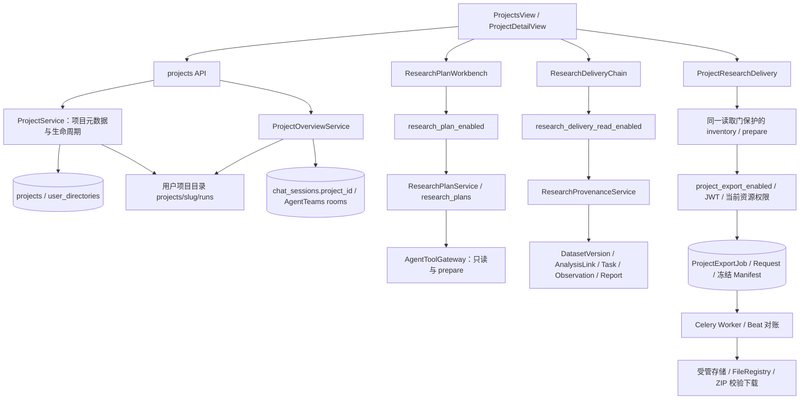

# CygnusX 项目管理架构与科研功能未启用调查

调查时间：2026-10-21，Asia/Shanghai。对象：用户截图中的项目详情页及本机现有 `cygnusx` 部署。

本文是本次调查快照。架构入口仍为 `ARCHITECTURE_DESIGN/README.md`；结论以本次代码、容器配置与数据库只读查询为依据。工作树已有其他任务的修改，本次未改业务代码、功能配置或现有架构文档，未启动/重启服务、执行迁移、创建业务数据或启用科研功能。

## 1. 结论

截图显示的是**基础项目管理之上的三个科研扩展区**。当前基础项目数据已存在；三个扩展区的服务级功能开关仍关闭，前端却在项目详情加载后直接展示并请求它们，因此出现连续的不可用提示。

直接原因：

- `RESEARCH_PLAN_ENABLED` 未配置，使用默认 `false`。
- `RESEARCH_DELIVERY_READ_ENABLED` 未配置，使用默认 `false`；它同时保护科研交付链和成果 inventory。
- `PROJECT_EXPORT_ENABLED` 未配置，使用默认 `false`；它进一步控制实际导出。
- 在现有 Web 容器中调用这三个门禁函数，全部得到 `AuthorizationError / 403 / FEATURE_DISABLED`。第三个门禁首先被科研交付读取开关阻断。

继续保持关闭的既有依据：最新专项隔离验收记录为 **PARTIAL，生产 NOT_ACCEPTED**。真实科研成果 corpus、非空交付链、Worker 生成 ZIP 和授权下载闭环尚未完成验收。计划审阅/生命周期和空项目预览已得到部分真实运行证据，但不能据此推导完整科研交付已可上线。

这不等于功能没有实现，也不等于只需勾选用户权限。代码和相关表已经存在；配置启用、用户授权、真实数据关联与运行准入是不同条件。

## 2. 本次直接核验的现有部署

机器可读证据：[snapshot.json](../../../evidence/project-workspace-investigation-20261021/snapshot.json)。可重复执行的只读采集器：[collect.py](../../../evidence/project-workspace-investigation-20261021/collect.py)。采集器仅输出白名单开关与汇总，不输出密码、Token、用户标识或业务内容。

### 2.1 Web / Worker / Beat 配置

三者的容器内新进程 Settings 均得到以下值：

| 配置 | 值 | 作用 |
| --- | --- | --- |
| `research_plan_enabled` | false | 项目研究计划 API 与服务 |
| `research_delivery_read_enabled` | false | 科研交付读取、项目成果 inventory、相关预览路由 |
| `project_export_enabled` | false | 项目导出 Job、重试及下载 |
| `research_delivery_write_enabled` | false | 科研证据采集/交付写入，另受 Agent 运行门禁约束 |
| `project_report_write_enabled` | false | 正式项目科学报告生成 |
| `project_report_pdf_enabled` | false | PDF 生成 |
| `tool_gateway_read_enabled` | false | Agent 共享工具上下文入口 |
| `agent_analysis_write_enabled` | false | Agent 分析写操作 |
| `agent_download_write_enabled` | false | Agent 下载写操作 |

仓库根 `.env` 未设置这九个同名变量。主 Compose 显式设置 Web 的分析/下载写门为 false，并以默认 false 传入共享工具读门；其余科研开关沿用 Settings 默认值。Web 主进程环境白名单读取也与此一致。

配置链为：根 `.env` → Compose `env_file`/`environment` → 容器环境 → `Settings` → `get_settings()` 缓存。修改根 `.env` 后，通常需要按实际 Compose 编排重新创建相关服务；仅刷新浏览器或重启旧容器不会更新 Docker 创建时的环境变量。将来开启导出还必须核对 Worker/Beat 的配置，不能只更新 Web。

严格边界：本次 Settings 是在现有容器中新建 Python 进程采集，未直接读取 Web 进程内的配置缓存。匿名 HTTP 请求三个入口均返回 401，证明认证层先拦截；本次没有用户登录态，**没有把函数复现的 403 冒充已登录 HTTP/浏览器实测**。

### 2.2 数据库汇总

在现有 `cygnusx-db` 的 `omichub` 数据库，以 `BEGIN READ ONLY` 查询；Web 配置同样指向 `db / omichub`。当前 Alembic revision 为 `memory_settle_cursor01`。

| 对象 | 条数 |
| --- | ---: |
| projects | 36 |
| chat_sessions | 484 |
| 其中 project_id 非空的会话 | 93 |
| tasks | 226 |
| reports | 159 |
| research_plans | 0 |
| datasets | 0 |
| dataset_analysis_links | 0 |
| project_export_jobs | 0 |
| project_report_jobs | 0 |

相关科研表及 request 表已存在；`project_members` 表不存在。36 个项目的 status 均为 NULL，当前服务按 active 解释。

这组证据排除了“相关表全没建”这一解释，但不证明所有迁移约束、Worker 和存储契约均已验收。数字是数据库整体快照，不能据此识别截图所属用户或项目。

## 3. 现阶段项目管理的架构



### 3.1 基础项目空间

`ProjectModel` 是单所有者聚合：`id/user_id/name/slug/description/customer/status/settings`，同一用户的 slug 唯一。项目创建同时写数据库、目录索引，并创建 `projects/{slug}/runs/`。

基础接口包含项目列表、数量、创建、详情、overview、PATCH 和删除。当前 PATCH 支持 `status` 与整体替换的 `settings`；没有在这个接口中实现名称/描述修改。项目状态为 `active / completed / handed_over`，NULL 兼容 active；completed/handed_over 会异步尝试将该项目 Studio 会话休眠打包。

项目 overview 聚合两类来源：会话来自数据库（`chat_sessions.project_id == str(project.id)`，另合并 AgentTeams 房间），历史运行来自项目 `runs/` 的磁盘扫描。扫描读取所有非隐藏一级子目录，递归统计文件大小和数量，检查 README/environment/AGENTS 等标记；目录时间优先解析名字，失败回退 mtime。

因此页面“历史分析运行”的一行目录、计算 Task、数据库 Run、科研计划 Step、导出 Job 是不同对象，不能互相视作已完成的科研证据。

### 3.2 项目归档与团队共享

`ProjectArchiveService` 将已有执行的 README、环境快照、manifest 等归档到项目目录，并维护项目 AGENTS 记录；它不是新的计算引擎。

项目没有项目成员表或项目级角色系统，读写依靠当前用户所有权。团队文件的 `owner/writer/reader` ACL 是独立体系；拥有团队文件权限不等于拥有别人的项目。项目中的 customer 字段也是描述信息，不构成团队授权。

### 3.3 ResearchPlan 协调层

研究计划有版本、摘要、DAG、预算、审阅和步骤状态，通过 `research_plans` 持久化。后端从身份确定 owner/project，模型不能自行注入批准状态。

当前模式固定为 `PLAN_ONLY`：审阅指定版本与 digest，不批准后续下载、计算或发布。advance 一次只推进一个可就绪的只读/prepare 步骤；遇到 MUTATING/REPORT_PUBLISH 步骤，先写入 `WAITING_APPROVAL` 后返回，不派发业务任务。计划内始终保留 `LIVE_EXECUTION_BLOCKED` 缺口。

项目计划工作台主要读取、审阅及控制已有计划；它本身没有完整的手工新建计划表单。后端 POST prepare 和共享 Gateway 的 plan.prepare 路径存在。计划开关打开但计划表为空时，应看到空状态，不会自动生成计划。

### 3.4 科研交付与项目导出

交付链按 `Dataset → DatasetVersion / frozen Handoff → DatasetAnalysisLink → Task → 真实产物 / Observation → 科学报告与执行证据报告` 聚合。计算成功、字节完整、证据充分和可交付分别建模，不能用 Task success 替代其余条件。

项目成果 inventory 只接受明确的 Dataset 关联，声明 `association_scope=explicit_dataset_links_only`、`historical_tasks.reason=NO_PROJECT_FK_NO_BACKFILL`。不会通过目录名、项目名称或时间猜测旧任务归属。**所以当前 226 个 Task、159 个 Report 不会因为打开页面开关就自动出现在新交付链中**；Dataset 和 AnalysisLink 均为 0，打开读取门后首先仍是空链路。

导出有独立 `ProjectExportJob/ProjectExportRequest`、冻结清单摘要、幂等、Celery outbox/Worker、Beat 恢复和下载时权限/字节复核。它打包已有证据，不重新执行分析。当前默认总 payload 64 MiB、单文件 16 MiB、ZIP 80 MiB、文件数 500；不是将整个项目目录或 FASTQ/BAM 无界压缩。正式科学报告/PDF另有独立开关和任务。

## 4. 截图中的三个提示分别怎么触发

| 截图区块 | 前端 → API | 首个功能门禁 | 提示的含义 |
| --- | --- | --- | --- |
| 科研计划与审阅 | ResearchPlanWorkbench → `GET /projects/{id}/research-plans` | require_plan_enabled | 前端 catch 所有失败后显示统一“检查功能及权限”，不能单靠这句判断具体错误 |
| 科研执行与交付链 | ResearchDeliveryChain → `GET /projects/{id}/research-delivery` | require_research_read | 同样是统一错误提示 |
| 项目科研成果与可追溯导出 | ProjectResearchDelivery → `GET /projects/{id}/delivery-inventory` | 路由 require_research_read | 只有响应 code 为 FEATURE_DISABLED 时才显示截图中的“项目科研交付功能尚未启用” |

最后一张卡最容易误读：加载 inventory 时尚未进入生成 ZIP 的阶段，读取门就可以返回 FEATURE_DISABLED。因此截图红条不能单独证明“只缺 PROJECT_EXPORT_ENABLED”；当前确实还缺更前置的 `RESEARCH_DELIVERY_READ_ENABLED`。

`ProjectDetailView.vue` 第 555–557 行只用 `v-if="overview"` 挂载三个区块，没有依据服务功能状态预先隐藏。前两张卡还合并了功能关闭、权限不足和网络失败，所以视觉上像项目整体故障。

## 5. “科研模式”按钮为何不能解决

项目详情的“新会话默认开启科研模式”调用 PATCH，保存：

```json
{"settings":{"research_mode":{"enabled":true,"render_mode":"message_flow","workspace_protocol":"standard","ptc_llm_query":false}}}
```

它控制后续新会话的默认设置，不写 Settings 中的服务开关，也不修改 WRITE_RUNTIME_ACCEPTED。开启它不能消除上述门禁。管理员角色同样不能绕过这些无角色分支的功能开关。

用户权限则是另一层：计划/项目导出路径还检查用户 active、项目 owner、`files/tasks/reports` 模块等；review/advance、创建/重试/下载等操作要求真实 JWT。源码门禁先于这些检查失败，不能据本次结果判断截图用户后续权限一定齐全。

## 6. 为什么此前没有开放：最新验收证据

依据活动入口 [科研功能隔离运行验收](../../../ARCHITECTURE_DESIGN/CygnusX_Research_Feature_Runtime_Acceptance.md)，并读取对应 [results.json](../../../evidence/runtime-acceptance/20261019-235848-bootstrap/results.json)：

- 全新专用 PostgreSQL 迁移、计划版本/审阅生命周期，以及浏览器的计划操作、空交付、只读导出预览有部分真实通过记录。
- 真正的非空 Dataset/Task/Report 科研记录缺少获准 corpus，未完成读取验收。
- 没有本轮真实 Worker 生成的项目 ZIP，没有实际 ZIP 下载、成员/大小/SHA 闭环；并发和故障恢复也未完整验收。
- PDF 与对象存储不属于本轮已通过范围。
- 该轮验收未授予生产开放资格，隔离容器已停止，开关恢复关闭。

不能沿用旧文档中“Docker 没权限”来解释现在：本次 Docker 可访问，现有 Web/Worker/Beat 正在运行。最新限制已经是业务证据和运行准入未收口。

更深的写执行还有两项代码事实：

1. `agent_tool_gateway.py` 的 `WRITE_RUNTIME_ACCEPTED = False`，环境变量不能把它变为已验收。
2. 当前服务生成的 Handoff 中 `worker_paths_verified=False`，分析执行需要可信冻结输入与真实 Worker 路径验证。

项目 ZIP 打包自身的开关与 Agent 分析/下载门禁不同，不应把这两个硬门误解为“项目读取和已有成果导出永远不能独立测试”。它们约束的是新科研执行链，必须分别验证。

## 7. 额外发现的项目管理问题

以下不构成本次关闭的直接原因，但会影响后续开放和维护：

| 问题 | 当前代码证据与影响 |
| --- | --- |
| 项目设置开关没有从已加载设置回填 | projectResearchDefault 初始为 false，切项目重置 false，加载 overview 后未赋值自 settings；已保存 true 也可能在刷新后显示关闭。属于源码发现，本次未用真实账号复现 |
| 删除和磁盘回填可能冲突 | delete_project 只删项目行/目录索引，保留物理目录；list/count 的 _backfill_from_disk 又会为缺失 slug 建项目。按此组合，保留目录的删除项目可在后续列表中以新记录重新出现；本次未对现有项目做破坏性实测 |
| 项目名修改入口不足 | PATCH 只接受 status/settings，服务回填注释提到的 rename 并未由该 API 提供 |
| 项目与科研交付存在两种聚合口径 | runs 扫描能展示历史目录，科研 inventory 却只认 Dataset 链；不能承诺历史运行天然可导出 |
| 运行扫描成本随目录增长 | overview 递归扫描每个 run 的文件；当前没有从该路径看到分页索引化的 run 文件统计 |

现有 `CygnusX_project_workspace_architecture.md` 中还有三处与源码不一致：项目状态写作 archived/deleted，实际为 active/completed/handed_over；删除行为描述容易被理解为删除物理目录，实际保留文件；run 发现描述依赖命名正则/标记，实际接受所有非隐藏一级子目录，正则仅用于时间解析。该文件已有其他任务修改，本次仅指出差异，未覆盖编辑。

## 8. 分阶段开放的建议

以下是后续实施顺序，本次没有执行启用。

1. **先把功能状态展示清楚**：项目页区分服务关闭、当前用户无权、无计划/无绑定数据和请求失败；由后端公开当前用户可见的能力状态，避免三个必失败请求表现为页面故障。
2. **单独验收计划与只读展示**：在隔离环境按需启用 RESEARCH_PLAN_ENABLED / RESEARCH_DELIVERY_READ_ENABLED；需要 AI 准备计划和推进只读工具时，再核对 TOOL_GATEWAY_READ_ENABLED 与具体能力开关。检查用户/项目及 files/tasks/reports 权限。预期能力仍为 PLAN_ONLY，且当前库无记录时应显示空状态。
3. **准备真实科研关联与成果样本**：明确 DatasetVersion/Handoff/AnalysisLink 的真实来源，核对已有产物和报告的关联；历史任务需要单独制定可审计关联方案，不能靠名称猜测，也不能用合成 Task 冒充真实 corpus。
4. **再验收已有成果导出**：独立启用测试环境的 PROJECT_EXPORT_ENABLED，核对 Web/Worker/Beat、Broker、存储和权限一致；完成 JWT 创建 → Worker 打包 → Ready → ZIP 内容/SHA → JWT 下载，再覆盖重试、重复派发、撤权和恢复。
5. **最后评审新科研执行与正式报告/PDF**：分别补充 Worker 路径/输入验证、真实分析案例、报告渲染依赖等证据，再处理各自源码门禁与配置。不将计划审阅等同于执行批准。

## 9. 本次验证范围

- 当前源码、相关活动架构文档和上轮机器可读验收证据交叉核对。
- 现有三个容器的白名单配置、Web 服务进程环境、门禁函数复现。
- 现有数据库只读身份/revision/表/汇总查询。
- 现有 Nginx 匿名 HTTP 三入口：401，未绕过认证。
- 后端 6 组相关隔离测试：**115 passed，3 warnings**，日志见 [backend-tests.log](../../../evidence/project-workspace-investigation-20261021/backend-tests.log)。覆盖版本/计划、只读网关、交付、导出与稳定性；使用 SQLite/临时文件和替身，不证明真实科研 Worker 闭环。
- 前端 3 组组件测试：**17 passed**，日志见 [frontend-tests.log](../../../evidence/project-workspace-investigation-20261021/frontend-tests.log)。使用 jsdom/API Mock，不等同真实 Browser E2E。

未运行全仓门禁、未重新进行完整 PG/Celery/Browser 科研验收。本次目标是解释现状与关闭原因，不据测试通过授予生产开放资格。

## 10. 源码定位

| 对象 | 位置 |
| --- | --- |
| 开关与缓存 | `src/cygnusx/core/config.py:85–98, 886–899` |
| 项目模型 | `src/cygnusx/infrastructure/database/models/project.py` |
| 项目服务及回填 | `src/cygnusx/application/services/project_service.py` |
| 项目总览/磁盘 runs | `src/cygnusx/application/services/project_overview_service.py:39, 182` |
| 项目页三卡片挂载 | `frontend/src/views/ProjectDetailView.vue:555` |
| 项目级科研模式默认值 | `frontend/src/views/ProjectDetailView.vue:39` |
| 计划开关及写步骤停止 | `src/cygnusx/application/services/research_plan_service.py:42, 350` |
| 科研读写门禁 | `src/cygnusx/application/services/research_provenance_service.py:57` |
| 项目导出开关/权限/历史不回填 | `src/cygnusx/application/services/project_delivery_service.py:74, 108, 213` |
| Agent 源码运行门禁 | `src/cygnusx/application/services/agent_tool_gateway.py:47` |
| 三个提示原文 | `frontend/src/components/{ResearchPlanWorkbench,ResearchDeliveryChain,ProjectResearchDelivery}.vue` |
| 真实运行验收基线 | `ARCHITECTURE_DESIGN/CygnusX_Research_Feature_Runtime_Acceptance.md` |

本次关键文件 SHA-256 随 snapshot 保存，用于区分当前脏工作树与 Git HEAD；其他任务后续修改后，应重新核验相关结论。
