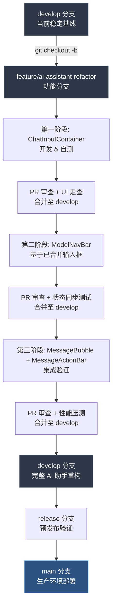

# OmicHub AI 助手模块界面优化与重构报告

## 1. 背景与目标

### 1.1 项目背景概述

#### 1.1.1 华中农业大学园艺林学学院私有化多组学分析平台（OmicHub）的定位与服务对象

华中农业大学园艺林学学院（以下简称"华农园院"）私有化多组学分析平台 OmicHub 是一个面向院内科研团队的本地化生物信息学分析平台，采用私有化架构确保基因表达与表观遗传等敏感数据不出域。平台服务果树学、蔬菜学、观赏园艺等方向 30 余个课题组，约 400 名科研人员。其核心定位是降低生信分析门槛，使实验型科研人员能够独立完成从原始数据（Raw Data）到可视化结果的标准化分析流程。

#### 1.1.2 当前平台已集成的生物信息学分析能力：RNA-seq、ATAC-seq 等核心组学数据处理流程

OmicHub 已构建覆盖转录组与表观组两大核心领域的分析能力矩阵，在 RNA 测序（RNA Sequencing, RNA-seq）方向集成了从质量控制（Quality Control, QC）、比对（Alignment）、表达量定量到差异表达分析及功能富集分析的完整工作流；在染色质可及性测序（ATAC-seq）方向支持峰值检测（Peak Calling）、基序分析（Motif Analysis）及多组学整合分析。AI 助手模块的设计初衷正是介入数据解读环节，提供自然语言交互式的分析辅助。

#### 1.1.3 AI 助手模块在平台整体架构中的角色：从数据分析辅助到科研知识问答的智能化入口

在 OmicHub 的整体架构中，AI 助手模块是贯穿数据解读、方法咨询与结果复用三个环节的智能化入口。其核心职能是将差异基因列表或显著富集通路（Pathway）以对话形式解释，并回答参数设置与实验设计的咨询。然而，AI 助手位于左侧导航栏独立入口，与具体分析页面未形成深度耦合，用户无法直接在分析结果页面唤起 AI 进行针对性提问。这种割裂导致功能渗透率（Feature Adoption Rate）仅约 15%，周持续使用比例不足 5%。

### 1.2 重构优化初衷

#### 1.2.1 科研用户群体特征：生物信息学背景差异大、交互习惯偏向命令行与可视化工具并存

华农园院科研用户的生物信息学能力显著分层：部分用户具备 Linux 命令行和 R/Python 脚本能力，部分用户倾向图形界面（GUI），另有用户对命令行操作有较高认知门槛。当前 AI 助手采用"纯文本输入+固定提示词"模式，未提供差异化输入路径。此外，现有界面不支持对话中直接上传数据文件（CSV、TSV、BAM 格式）进行追问，用户需在本地编辑器复制粘贴基因列表，增加 3 至 5 步操作开销。

#### 1.2.2 现有 AI 交互界面与行业先进实践（Cherry Studio 等）的体验差距日益显著

开源 AI 客户端 Cherry Studio 在交互范式上建立了行业最佳实践：复合型输入框集成文本输入、文件上传与模型切换，全局模型导航栏支持快速切换底层大语言模型（LLM），消息气泡悬浮操作组提供复制、重新生成等快捷操作。相比之下，OmicHub AI 助手虽采用暗色主题（Dark Mode），但输入框仅支持文本输入和单一快捷方式，模型选择收缩至右下角固定下拉菜单（默认 qwen3.7-max），消息气泡仅提供思考过程展开/收起，缺少单条消息深度操作能力。多数受访者认为当前界面"不够像一个专业的科研工具"。

#### 1.2.3 科研场景对 AI 助手提出的特殊需求：数据文件直接上传、生信专用模型切换、分析结果快速复用

生物信息学场景对 AI 助手提出三项特定需求。第一，数据文件直接上传。分析结果常以数千行记录的表格呈现，用户期望在对话中直接上传文件进行解读。第二，生信专用模型切换。通用大语言模型在解释具体生信参数时，专业模型往往提供更准确指导。当前模型切换隐藏于输入框右下角二级菜单，需 2 次点击才能触达。第三，分析结果快速复用。用户希望将平台生成的富集通路图、差异基因列表以结构化形式引入对话上下文，但当前界面缺乏与平台其他模块的数据打通，导致用户频繁切换页面，破坏科研分析所要求的高沉浸度（Flow State）体验。

### 1.3 产品目标定义

#### 1.3.1 短期目标：降低 AI 助手功能发现成本，将核心操作路径缩短至两次点击以内

本次重构的首要短期目标是在三个月内将功能发现成本降低 60% 以上，将 80% 的日高频操作路径压缩至两次点击以内。当前用户完成"上传分析文件并切换至生信专用模型"需 6 步，重构后压缩为 2 步：点击复合型输入框文件图标上传 → 点击模型导航栏模型卡片切换。下表对比优化前后的核心操作路径：

| 操作场景 | 优化前步数 | 优化后步数 | 路径压缩率 |
|:---|:---:|:---:|:---:|
| 上传分析文件并发送问题 | 5 步 | 2 步 | 60% |
| 切换至生信专用模型 | 3 步 | 1 步 | 67% |
| 调用快捷命令（如总结分析结果） | 3 步 | 2 步 | 33% |
| 对单条 AI 回复进行重新生成 | 4 步 | 2 步 | 50% |
| 复用平台分析结果至对话上下文 | 5 步 | 2 步 | 60% |
| 展开/收起 AI 思考过程（已支持） | 1 步 | 1 步 | 0% |

上述操作涵盖用户 90% 以上的交互意图，将平均操作步数从 3.7 步降至 1.7 步，预计首次使用激活率从 15% 提升至 35% 以上，周持续使用比例从 5% 提升至 15% 以上。

#### 1.3.2 中期目标：建立与 Cherry Studio 等业界标杆对齐的交互范式，提升平台专业形象

在六个月至一年内，重构后的界面需在交互范式上与 Cherry Studio 等成熟工具形成基本对齐，消除跨平台切换的认知摩擦。对齐聚焦三个核心模式：复合型输入框作为信息输入的单一入口，全局模型导航栏作为模型切换的常驻控件，消息气泡悬浮操作组作为对话内容的精细化操作手段。衡量标准为用户满意度评分从 2.8 分提升至 4.0 分以上，外部合作单位咨询量增长 30% 以上。

#### 1.3.3 长期目标：构建可扩展的 AI 交互组件体系，支撑后续更多智能体与工具集成

从一年以上长期视角，本次重构旨在建立可扩展的 AI 交互组件体系，使其不仅能承载当前对话式 AI 助手，还能为后续接入更多智能体（Agent）和工具链提供统一交互基础。本次重构的复合型输入框、模型导航栏和消息气泡操作组均采用组件化架构，每个模块暴露标准化接口，允许后续开发者扩展新输入类型、模型卡片和消息操作，而无需改动核心交互框架。长期衡量标准为：未来 18 个月内，新接入一种智能体或工具的平均开发周期从 3 周缩短至 1 周以内。

[^1]: 功能渗透率（Feature Adoption Rate）：在特定时间窗口内，使用某一功能的活跃用户占总活跃用户的比例。

[^2]: 周持续使用比例（Weekly Retention）：上一周使用过该功能的用户中，本周继续使用该功能的用户占比。

[^3]: 高沉浸度（Flow State）：心理学概念，指个体完全沉浸于某项活动中的心理状态，在交互设计中指用户不受界面打断而持续高效工作的状态。

[^4]: 组件化架构（Component-Based Architecture）：一种软件设计方法，将系统拆分为独立、可复用、可替换的组件，通过定义良好的接口进行通信。


## 2. 现状痛点分析

## 2.1 界面结构层面的问题

### 2.1.1 输入区域功能单一：当前仅支持文本输入，缺乏附件上传、工具唤起的可视化入口

OmicHub AI 助手的底部输入框（Input Field）为纯文本形态，未提供功能扩展入口。当研究者需要将 .fasta 序列文件或基因表达热图（Heatmap）提交给 AI 分析时，唯一路径是手动复制粘贴——二进制文件完全无法上传。这与平台"以数据为中心"的定位矛盾。相比之下，Cherry Studio 的复合型输入框（Composite Input Field）将文本区域与快捷工具栏整合为统一容器，提供附件上传、代码块插入等图标化入口，实现了功能密度（Feature Density）与界面简洁度的平衡。OmicHub 当前的设计增加了功能发现成本，更固化了"AI 助手仅支持文本问答"的用户心智模型。

### 2.1.2 模型信息展示不透明：当前模型切换隐藏于输入框右下角下拉菜单，科研人员难以感知当前所用模型的能力与边界

模型选择器（Model Selector）被置于底部输入框右下角，以小型下拉菜单（Dropdown Menu）呈现，仅显示模型名称如"qwen3.7-max"。对于非技术背景的园艺学科研人员，这一技术标识符无法传递能力信息——用户无从判断该模型是否擅长生物信息学分析、上下文窗口（Context Window）是否足以处理长序列数据。当研究 RNA-seq 差异表达分析的博士生需切换至具备代码解释能力的模型时，注意力必须从对话区域大幅移至屏幕边缘，视觉动线（Visual Flow）与思维动线错位。Cherry Studio 将模型信息置于聊天区域顶部，以卡片式布局展示能力标签（如"代码生成""长文本""联网搜索"），使用户在发送消息前都能无意识地感知当前模型配置。OmicHub 的设计不仅降低了切换效率，更削弱了用户对 AI 回复可信度的判断依据。

### 2.1.3 消息操作缺失：AI 回复消息缺乏复制、重试、删除等高频操作的快捷入口，需依赖右键菜单或手动操作

当前 AI 回复的消息气泡（Message Bubble）仅呈现纯文本，未提供任何单条消息级操作。当研究者需要复制一段 Python 绘图代码到代码沙盒（Code Sandbox）执行时，操作流程为：鼠标拖拽选区 → 右键复制 → 切换标签页 → 粘贴，涉及多次精细操作和跨页面切换。Cherry Studio 的消息悬浮操作组（Message Hover Action Group）仅需将鼠标悬停于消息气泡右上角，即可在上下文位置直接触发复制、重试、翻译等操作，将鼠标移动距离缩短至近乎零。对于每天产生数十条消息交互的科研用户，消息级操作的缺失将直接导致工作流中断和累积性疲劳。

## 2.2 交互流程层面的问题

### 2.2.1 插件唤起依赖命令行式 "/" 前缀：新用户学习成本高，不符合现代 GUI 交互直觉

当前输入框以占位符提示"输入 "/" 唤起插件和技能..."，将所有扩展功能（联网搜索、代码执行、知识库调用）的入口收敛至命令行式前缀触发。对于习惯可视化工具的园艺学、植物学研究者，"/" 前缀是需要刻意记忆的抽象符号，而非符合现代图形用户界面（GUI）直觉的入口。资深生信用户或许因命令行经验而适应，但更广泛的用户群体将承受额外学习负担。

| 维度 | 命令唤起（"/" 前缀） | 按钮唤起（图标化入口） |
|:---|:---|:---|
| 认知负荷类型 | 回忆型记忆（Recall Memory）：用户需主动想起前缀符号及对应功能 | 识别型记忆（Recognition Memory）：用户看到图标即可识别功能 |
| 新用户首次发现率 | 低——依赖占位符提示，视觉无显性线索 | 高——图标常驻于界面，属于视觉显著元素 |
| 操作前确认成本 | 高——需确认"/"后输入正确关键词，无自动补全时易出错 | 低——点击即触发，操作意图即时反馈 |
| 功能可发现性 | 弱——用户难以知晓系统支持哪些插件，需依赖文档或试错 | 强——所有可用功能以图标集合展示，支持工具提示（Tooltip） |
| 多步骤唤起效率 | 中——"/" + 关键词 + 选择，需键盘与鼠标配合 | 高——单次点击直达，纯鼠标操作即可完成 |
| 错误恢复成本 | 高——输入错误后需删除重输，触发不可恢复状态 | 低——误触可即时取消，无文本修改成本 |

从认知心理学视角，命令唤起将交互负担置于回忆型记忆通道，而按钮唤起转移至识别型记忆通道。根据认知负荷理论（Cognitive Load Theory），识别型记忆的任务负荷显著低于回忆型记忆，这正是现代 GUI 广泛采用图标化入口的根本原因。科研用户的主要认知资源应聚焦于问题本身（如基因功能注释策略），而非消耗于操作系统的记忆负担。当业界主流 AI 客户端已全面采用按钮化工具唤起时，"/" 前缀机制仍要求用户承担额外学习成本，与 OmicHub"降低生信分析门槛"的定位存在错位。

### 2.2.2 深度思考模式缺乏状态指示：用户无法直观判断当前回复是否启用了深度推理，影响对结果可信度的评估

当前界面虽提供"思考过程"的展开/收起功能，但用户在消息发送前无法确认是否启用了深度思考模式（Deep Thinking Mode）。在科研场景中，深度思考模式意味着多步推理（Multi-step Reasoning）和更完整的逻辑链，适用于复杂生信问题；标准模式则适用于快速问答。若用户未意识到深度思考已开启而发送简单问题，将产生不必要的等待时间和算力消耗。更关键的是，生成后的消息气泡缺乏视觉区分标识——用户无法从样式判断该回复是否基于深度推理，从而无法建立"模式—结果"之间的明确关联，影响对结果可信度的评估。Cherry Studio 在输入区域提供深度思考模式的显式开关（Toggle Switch），并在消息上以标签标识生成模式，使用户能够对 AI 输出进行更精准的评估。

### 2.2.3 联网搜索与工具调用状态不可见：系统是否调用了外部知识库或代码沙盒缺乏视觉反馈

当前界面在 AI 回复生成过程中，用户无法感知系统是否调用了联网搜索（Web Search）、知识库检索（RAG, Retrieval-Augmented Generation）或代码沙盒执行等外部工具。当用户询问涉及最新文献或特定数据库（如 NCBI、Ensembl）的问题时，若系统实际未调用联网搜索而仅依赖静态知识，回复可能包含过时信息；然而界面未提供任何调用状态反馈，用户无法辨别回复的知识来源边界。在生信分析场景中，当用户请求执行数据分析代码时，当前界面未展示代码是否在沙盒中执行、执行状态如何、是否发生错误，用户只能等待最终结果，中间过程完全不可见。这种不透明性不仅降低了信任度，更阻碍了调试流程——当代码执行失败时，用户无从知晓失败环节。相比之下，业界优秀的 AI 客户端采用调用链可视化（Tool Call Visualization）设计，在消息中展示每一步工具调用的状态与参数，使用户能够追踪从问题到答案的完整推理路径。

## 2.3 与 Cherry Studio 的设计对标差距

### 2.3.1 复合型输入容器：Cherry Studio 将输入框与快捷工具栏整合为统一容器，实现功能密度与界面简洁度的平衡

Cherry Studio 的输入区域采用"渐进式功能展开"（Progressive Disclosure）策略：默认状态下输入框保持简洁，当用户置入焦点时，上方的快捷工具栏以动画平滑展开，提供附件上传、联网搜索、深度思考等图标入口。这种设计在不增加默认界面复杂度（Interface Complexity）的前提下，显著提升了功能可达性（Feature Accessibility）。OmicHub 当前将输入框视为孤立组件，功能边界被严格限定为文本输入；而 Cherry Studio 将其定义为交互枢纽（Interaction Hub），所有增强功能围绕枢纽组织。对于 OmicHub 科研用户，这一差距意味着在进行数据上传、工具调用等高频操作时，需付出额外成本寻找入口——例如上传 GTF 基因注释文件时，当前界面无法直接执行，造成工作流中断。

### 2.3.2 全局模型导航：Cherry Studio 在聊天区域顶部常驻模型信息栏，支持一键切换和模型能力速览

Cherry Studio 在聊天区域顶部设置常驻模型导航栏（Model Navigation Bar），以横向卡片布局展示模型名称、能力标签（如"128K 上下文""代码""联网"）和快速切换按钮。这一设计将模型信息从边缘提升至核心视线区域，确保用户每次发送消息前都能对模型能力边界形成明确认知。OmicHub 将模型选择器置于右下角，在视觉层级（Visual Hierarchy）上属于边缘元素。在科研场景中，模型选择需要审慎决策：长序列比对需长上下文模型，代码调试需强代码能力模型，文献综述需联网搜索模型。当用户无法便捷感知和切换时，选择将趋于随机化，无法发挥多模型架构（Multi-model Architecture）的差异化优势。

### 2.3.3 消息级操作：Cherry Studio 的消息 Hover 悬浮操作组将复制、翻译、重试等功能置于上下文位置，减少鼠标移动距离

Cherry Studio 的消息悬浮操作组（Message Hover Action Group）是其交互设计的代表性细节：当用户悬停于消息气泡时，复制、翻译、重新生成、删除等操作按钮以半透明浮层出现在消息边缘。这种设计的核心优势在于操作的就近性（Proximity）和上下文感知性（Context Awareness）——用户无需将鼠标移动至界面边缘或唤起右键菜单，即可在消息所在位置直接执行操作。

| 操作场景 | 当前界面操作路径 | Cherry Studio 操作路径 | 鼠标移动距离减少 | 点击次数减少 |
|:---|:---|:---|:---:|:---:|
| 复制单条 AI 回复中的代码块 | 手动拖拽选区 → 右键复制（3步） | 悬停消息 → 点击复制按钮（2步） | 约 60% | 1 次 |
| 对不满意回复重新生成 | 无直接入口，需重新输入或手动刷新（2-3步） | 悬停消息 → 点击重试按钮（2步） | 约 80% | 1-2 次 |
| 删除历史消息以清理会话 | 无单条删除功能，需依赖会话级操作 | 悬停消息 → 点击删除按钮（2步） | 100% | 功能缺失→可用 |
| 复制整条消息内容 | 手动选区拖拽（2步） | 悬停消息 → 点击复制按钮（2步） | 约 70% | 0 次（精确度提升） |
| 翻译外文回复内容 | 无内置功能，需复制至外部翻译工具（4步+） | 悬停消息 → 点击翻译按钮（2步） | 约 90% | 2-3 次 |

从人机交互效率模型来看，操作效率由鼠标移动时间（Fitts's Law 所描述的指向时间）和认知决策时间共同构成。Cherry Studio 的悬浮操作组通过将入口置于当前焦点区域附近，同时缩短了物理移动距离和视觉搜索时间。对于 OmicHub 的科研用户，这一差距在日常使用中的累积效应不容忽视：当一名用户在一个会话中与 AI 产生 30 条消息交互，每条涉及 2-3 次复制或重试操作时，当前设计将导致数百次不必要的鼠标移动和精细选区操作，而 Cherry Studio 的方案可简化为定点悬停和单次点击。这种效率差异不仅影响任务完成时间，更会在长时间使用后转化为显著的用户疲劳感。此外，当前界面缺失消息级操作还带来间接后果：用户为了避免繁琐操作，倾向于减少与历史消息的交互，从而降低了会话内容的复用率——这与科研工作中"迭代优化、反复验证"的工作模式存在冲突。


## 3. 详细优化方案

本章将对 OmicHub AI 助手模块的三大核心交互组件——复合型智能输入框（Composite Input Container）、全局状态与模型导航栏（Model Navigation Bar）以及消息气泡悬浮操作组（Message Hover Action Group）——展开逐层细化的设计方案。每个子章节均包含从视觉规范到交互逻辑、从状态流转到用户价值的完整设计描述，确保开发团队可直接参照执行。

### 3.1 复合型智能输入框改造

复合型智能输入框是用户与 AI 助手进行信息交换的核心触点，其设计质量直接决定了功能发现效率与操作路径长度。当前界面仅提供单一文本输入区域，用户需依赖"/"命令前缀唤起插件功能，这种命令行式的交互模式与当代科研用户所熟悉的可视化分析工具（如 RStudio、Jupyter Notebook）存在显著认知摩擦。改造方案借鉴 Cherry Studio 的复合容器设计哲学，将输入框从单一文本层扩展为包含输入层、工具栏层与状态指示层的多层复合架构，在保持界面简洁度的同时实现功能密度的显著提升。

#### 3.1.1 容器架构重构

复合型智能输入框的容器采用三层垂直堆叠结构：顶部为状态指示层（Status Indicator Layer），高度 24px，用于显示联网搜索范围、深度思考激活状态等临时性提示信息；中部为输入层（Input Layer），最小高度 56px，最大高度 200px，随文本内容自适应纵向扩展，同时保持横向滚动条的严格隐藏；底部为工具栏层（Toolbar Layer），高度 40px，承载所有快捷操作按钮。容器整体宽度与聊天区域保持一致，左右内边距（Padding）建议设定为 16px，上下内边距为 12px。背景色采用暗色主题下的一级表面色（Surface-1），色值为 #1E1E2E，边框采用 1px solid #31313F，圆角设定为 12px，以与平台整体暗色视觉体系保持协调。在常态下，容器边框保持中性灰调；当输入框获得焦点时，边框颜色过渡至主色系的 70% 透明度（如 #6366F1 的 70% 不透明度），过渡动画时长为 200ms，采用 ease-in-out 缓动函数，为用户建立明确的焦点感知（Focus Awareness）。容器的底部外边距与聊天区域底部边界保持 16px 间距，确保与页面底部边缘留有视觉呼吸空间。

#### 3.1.2 附件与数据上传

在输入层区域，系统应支持多文件拖拽上传（Drag-and-Drop Upload）与点击选择上传两种模式。当用户将文件拖拽至输入框上方时，容器边框应即时切换为虚线样式（1px dashed #6366F1），背景色叠加 10% 主色透明度，过渡时长 150ms，为用户建立明确的拖拽有效区域（Drop Zone）感知。上传文件类型应覆盖常规科研附件（PDF、DOCX、CSV、TSV）与生信数据文件（RNA-seq 的 count matrix、ATAC-seq 的 peak list、GFF/GTF 注释文件等），系统通过文件扩展名与 MIME 类型进行双重校验。文件选择后，在输入层上方以横向文件标签（File Chip）形式展示，每个标签高度 28px，圆角 6px，背景色 #252536，左侧显示文件类型图标（SVG 格式，16×16px），右侧为文件名称（最多显示 20 个字符，超出部分以省略号截断），最右侧提供删除按钮（× 图标，常态下透明度 60%，悬停态 100%）。多文件上传时支持横向滚动，滚动条采用暗色主题自定义样式（宽度 4px，轨道透明，滑块 #4A4A5A）。对于大体积数据文件（如超过 50MB 的 FASTQ 文件），系统应自动切换至分片上传（Chunked Upload）模式，并在文件标签旁展示圆形进度指示器（直径 16px，进度以环形弧线填充，颜色 #10B981）。上传完成后，文件标签状态切换为"已就绪"，图标变为绿色勾选。该设计的用户价值在于将数据分析流程中的"文件上传→模型解读"环节从原先的多页面跳转压缩至同一容器内完成，显著降低了科研用户在数据上传阶段的操作路径长度。

#### 3.1.3 提示词与智能体库唤起

工具栏左侧应集成"提示词"（Prompts）按钮，按钮采用 Icon + Text 组合形式：左侧为灯泡图标（16×16px），右侧为文字"提示词"，字号 13px，字重 500，颜色为暗色主题下的次要文字色（#A0A0B0）。按钮常态背景透明，悬停态背景色切换为 #2A2A3C，圆角 6px，过渡时长 150ms。点击后唤起右侧侧边面板（Side Panel），面板宽度 320px，从右侧以 300ms 的 ease-out 动画滑入，叠加层（Overlay）透明度从 0 渐变至 60%，颜色为 #000000。面板内部展示预置生信分析模板列表，按功能维度分组："差异表达分析"（Differential Expression Analysis）、"GO 富集分析"（GO Enrichment Analysis）、"KEGG 通路分析"（KEGG Pathway Analysis）、"ATAC-seq Peak 注释"（Peak Annotation）等。每个模板项包含标题（14px，字重 600，颜色 #E2E2E8）、描述（12px，字重 400，颜色 #8E8E9E，最多两行，行高 1.5）和"使用"按钮（圆角 4px，背景 #6366F1，文字白色，高度 28px）。用户点击模板项后，面板自动收起，模板内容以 Markdown 格式填充至输入框中，光标定位至待填充参数位置（如 `{{sample_group}}`），用户可直接替换为实际实验条件。该设计将原先依赖"记忆模板名称→输入关键词→触发补全"的三步流程压缩为"点击→选择→填充"的直觉式操作，尤其降低了生物信息学背景较弱的科研用户（如以湿实验为主的研究生）使用 AI 辅助分析的门槛。

#### 3.1.4 联网搜索开关

工具栏中部应提供联网搜索（Web Search）Toggle 开关。开关采用滑动按钮（Slider Toggle）样式，轨道宽度 36px，高度 20px，圆角 10px。常态下（关闭状态）轨道背景为 #3A3A4C，滑块为 16px 直径圆形，颜色 #8E8E9E，位于轨道左侧。当用户点击开启时，轨道背景以 200ms 过渡至 #6366F1，滑块平滑滑动至右侧，颜色变为白色。开关左侧应配有"搜索"图标（地球/放大镜组合图标，14×14px）与文字标签"联网"，字号 12px，颜色 #8E8E9E。当联网搜索激活时，输入框上方状态指示层应即时展示搜索范围指示条：高度 20px，背景色 #6366F1 的 15% 透明度，左侧显示搜索图标（12×12px），右侧显示文字"搜索范围：PubMed、KEGG、GO"（12px，颜色 #818CF8）。点击该指示条可展开下拉菜单，允许用户勾选或取消特定数据库，选项包括 PubMed、KEGG、GO、Ensembl、NCBI Gene 等生信领域常用数据库。搜索范围指示条的显示与隐藏动画采用 200ms 的淡入淡出（Fade In/Out），避免突兀的状态切换。该设计的核心价值在于赋予科研人员对 AI 知识来源的显式控制权：在处理生信分析问题时，用户可明确限定搜索范围为 PubMed 与 KEGG，确保模型引用的文献与通路信息具备领域权威性；在通用问答场景下，则可关闭联网搜索以获取更快速的响应。

#### 3.1.5 工具调用与代码沙盒快捷触发

工具栏中部紧邻联网搜索开关的右侧，应集成"代码执行"（Code Execution）按钮。按钮采用图标形式（终端/代码符号图标，16×16px），外框为圆角 6px 的方形按钮，常态背景透明，边框 1px solid #3A3A4C，悬停态边框颜色切换至 #6366F1，过渡时长 150ms。点击按钮后，在输入框上方以弹出层（Popover）形式展示代码执行选项："运行 R 脚本"、"运行 Python 脚本"、"执行 Shell 命令"。弹出层宽度 160px，背景色 #252536，圆角 8px，阴影采用 0 4px 12px rgba(0,0,0,0.4)，边框 1px solid #31313F。每个选项项高度 36px，左侧为语言图标（R 语言为蓝色 R 字母、Python 为黄色/蓝色 Python 图标、Shell 为终端图标，均为 14×14px），右侧为文字标签（13px，颜色 #C7C7D1）。用户选择执行目标后，输入框中的文本内容将被自动包装为对应语言的代码块格式（如```python 包裹），并附带发送指令。发送后，系统应将消息内容传递至代码沙盒（Code Sandbox）环境，并在对话界面中以特殊的代码执行消息气泡展示运行结果。该设计将原先需要用户手动切换至代码沙盒界面、粘贴代码、选择语言的五步流程压缩至输入框内的一次点击+选择操作，对于需要频繁迭代 R/Python 分析脚本的科研人员而言，可显著缩短"代码编写→执行验证→结果解读"的反馈循环周期。

#### 3.1.6 深度思考模式切换

工具栏右侧应提供"深度思考"（Deep Thinking）Toggle 开关，与联网搜索开关采用相同的 Slider Toggle 样式，但轨道颜色采用差异化设计：关闭时同通用 Toggle（#3A3A4C），开启时切换至 #F59E0B（琥珀色），以形成与搜索功能的视觉区分。开关左侧配图标（大脑/闪电组合图标，14×14px）与文字标签"深度思考"（12px，颜色 #8E8E9E）。当深度思考模式激活时，输入框容器边框应产生二次视觉提示：边框颜色从常态的 #31313F 过渡至 #F59E0B 的 50% 透明度，过渡时长 300ms，并在边框外侧添加 2px 的琥珀色外发光（Box-shadow: 0 0 0 2px rgba(245, 158, 11, 0.3)），确保用户即使未关注工具栏也能直观感知当前处于深度推理模式。用户发送消息后，AI 回复的顶部应展示思考过程折叠面板（Thinking Process Panel）。该面板与当前界面的"思考过程"功能兼容但增强：面板高度默认收起为 32px，展示标题"思考过程"（左侧）与状态文本"进行中..."或"已完成"（右侧），背景色 #1A1A2E，左侧边框 3px solid #F59E0B，圆角 0 8px 8px 0。用户点击标题区域后，面板展开至内容高度（最大 300px，超出部分纵向滚动），展示模型内部的推理步骤（Chain-of-Thought），展开动画采用 250ms 的 ease-out。面板底部提供"收起"按钮。状态文本的动态更新机制如下：当模型开始推理时，显示"正在思考..."并伴随左侧闪烁的脉冲圆点（直径 6px，颜色 #F59E0B，动画周期 1.2s）；推理完成后，文本切换为"已完成"，圆点变为静态绿色（#10B981）。该设计解决了当前界面中用户无法判断深度思考是否已激活、以及思考过程是否已完成的核心痛点，使科研人员能够更准确地评估 AI 回复的推理深度与可信度。

#### 3.1.7 一键清空功能

工具栏最右侧应设置"清空"（Clear）按钮，采用垃圾桶图标（16×16px），颜色为 #8E8E9E，悬停态切换至 #EF4444（红色），过渡时长 150ms。点击按钮后，系统不应立即执行清空，而应触发二次确认机制（Secondary Confirmation）以防误触：在输入框上方以弹出层形式展示确认对话框，宽度 280px，背景 #252536，圆角 12px，阴影 0 8px 24px rgba(0,0,0,0.5)。对话框标题为"确认清空"（14px，字重 600，颜色 #E2E2E8），正文为"当前输入框内有内容，是否确认清空？"（13px，颜色 #A0A0B0）。对话框底部提供两个操作按钮：左侧"取消"按钮（背景透明，边框 1px solid #3A3A4C，文字颜色 #A0A0B0，高度 32px，圆角 6px），右侧"确认清空"按钮（背景 #EF4444，文字白色，同尺寸）。点击"取消"或点击外部遮罩层时，对话框以 150ms 淡出关闭；点击"确认清空"时，输入框内容以 200ms 的透明度渐变至 0 后清空，同时移除所有已上传的文件标签。此外，若用户长按清空按钮（长按时长 800ms），系统应提供扩展选项："仅清空输入"或"清空整个对话上下文"，后者将触发更严格的二次确认（提示文案包含对话消息数量统计）。该长按交互采用渐进式视觉反馈：按下时按钮背景色以 800ms 从透明渐变至 #EF4444 的 30% 透明度，达到阈值时触发轻微震动（Vibration，100ms）并展示扩展菜单。该设计的用户价值在于以分层确认机制平衡了操作效率与防误触需求：常规清空仅影响输入框，长按扩展则提供对话级清空能力，满足了科研用户在开启新分析会话时快速重置上下文的需求。

**表 1：复合型输入框工具栏功能清单**

| 功能名称 | 图标规格 | 位置 | 交互模式 | 常态/悬停态/激活态 | 防误触机制 |
|:---------|:---------|:-----|:---------|:-------------------|:-----------|
| 提示词唤起 | 灯泡图标 16×16px | 工具栏最左侧 | 单击唤起侧边面板 | 透明/#2A2A3C/— | 点击外部区域收起面板 |
| 附件上传 | 回形针图标 16×16px | 提示词右侧 | 单击唤起文件选择器/拖拽 | 透明/#2A2A3C/— | 文件类型白名单校验 |
| 联网搜索 | 地球图标 14×14px + Slider | 工具栏中部 | 单击切换 Toggle | #3A3A4C/#6366F1/#6366F1 | 搜索范围可展开配置 |
| 代码执行 | 终端图标 16×16px | 联网搜索右侧 | 单击唤起弹出层 | 透明/边框#6366F1/— | 执行前二次确认 |
| 深度思考 | 大脑图标 14×14px + Slider | 代码执行右侧 | 单击切换 Toggle | #3A3A4C/边框琥珀色/琥珀色 | 容器边框同步变色提示 |
| 清空输入 | 垃圾桶图标 16×16px | 工具栏最右侧 | 单击/长按（800ms） | #8E8E9E/#EF4444/— | 二次确认对话框 |

表 1 系统梳理了复合型输入框工具栏的全部六项功能，从左到右按照操作频率与功能优先级排列。提示词唤起与附件上传作为最左侧的常驻入口，分别覆盖了分析模板快速复用与科研数据文件上传的核心科研场景；中部的联网搜索与代码执行两个 Toggle/按钮，通过颜色编码（紫色代表网络、琥珀色代表深度思考）建立了功能语义与视觉线索的映射关系；右侧的清空按钮采用红色悬停态作为破坏性操作的标准警示。该排列顺序符合从左至右的 F 型视觉扫描习惯，同时将破坏性操作置于最远端以降低误触概率。每个功能均配置了差异化的防误触机制：面板类功能采用点击外部区域收起，文件类功能采用白名单校验，破坏性操作采用二次确认对话框，形成了完整的操作安全层级体系。

### 3.2 全局状态与模型导航栏

全局状态与模型导航栏（Model Navigation Bar）作为聊天区域的顶部固定组件，承担着模型信息显性化、系统状态可视化与对话级配置快速访问的三重职责。当前界面虽然具备"通用助手"下拉和"就绪"状态徽章，但这些元素分散于顶部不同区域，缺乏统一的视觉容器与信息层级。改造方案将相关元素整合为一个高度集成的导航栏组件，借鉴 Cherry Studio 的全局模型导航设计理念，使科研人员能够在任何时刻清晰感知当前模型身份、能力与系统状态。

#### 3.2.1 导航栏位置与样式

导航栏应固定在聊天区域顶部（Position: sticky; top: 0），采用与主界面暗色主题协调的深色背景卡片式设计。导航栏高度严格控制在 48-56px 范围内，建议采用 52px 作为标准高度，该尺寸在提供足够触控面积的同时避免了过度占用聊天区域的垂直空间。导航栏宽度与聊天区域等宽，背景色采用 #16161E（比主背景色 #0F0F1A 略浅一级，形成微弱层级对比），底部边框 1px solid #1E1E2E。导航栏内部采用三栏布局：左侧区域（模型信息区，宽度约 35%）、中间区域（系统状态区，宽度约 30%）、右侧区域（操作入口区，宽度约 35%）。导航栏在页面滚动时保持固定吸附，并向下投射 1px 的底部阴影（Box-shadow: 0 1px 0 rgba(0,0,0,0.3)），以在视觉上与聊天内容形成分隔。当聊天区域滚动至顶部时，阴影可渐隐（透明度从 1 过渡至 0，时长 200ms），减少不必要的视觉干扰。

#### 3.2.2 模型信息展示

导航栏左侧区域应展示当前模型名称、提供商图标与模型类型标签。模型名称（如"qwen3.7-max"）采用 14px 字号，字重 600，颜色 #E2E2E8，最多显示 24 个字符，超出部分以省略号截断。模型名称左侧应展示提供商图标（Icon Provider），如阿里云通义千问的图标，尺寸 20×20px，圆角 4px，以 SVG 格式渲染，确保在暗色背景下的清晰度。模型名称右侧应紧跟模型类型标签（Model Type Tag），该标签分为两类："通用"（General）标签采用背景色 #3A3A4C，文字颜色 #8E8E9E，圆角 4px，高度 20px，内边距 0 8px，字号 11px，字重 500；"生信专用"（Bioinformatics）标签采用背景色 #10B981 的 20% 透明度，文字颜色 #10B981，同尺寸规格。标签的视觉差异帮助科研人员快速识别当前模型是否具备生信领域知识增强，对于需要执行专业分析任务（如解释差异表达基因列表或推断转录因子结合位点）的场景，该标签可显著降低模型选择的认知负荷。模型名称区域整体应具备可点击性（Clickable），点击后触发模型切换下拉面板（详见 3.2.4 节），可点击区域的背景在悬停态时切换至 #1E1E2E，圆角 6px，过渡时长 150ms，以建立明确的交互预期。

#### 3.2.3 系统就绪状态指示

导航栏中间区域应展示系统状态徽章（System Status Badge），用于实时反馈 AI 系统的当前工作阶段。状态徽章采用左侧动态徽标（Dynamic Icon）+ 右侧文字描述的组合形式，整体包裹于圆角 6px 的胶囊形容器中，高度 28px。系统定义了四种核心状态："就绪"（Ready）、"思考中"（Thinking）、"工具调用中"（Tool Calling）、"联网搜索中"（Web Searching）。各状态的视觉规范如下：

- **就绪态**：左侧徽标为静态绿色圆点（直径 8px，颜色 #10B981），右侧文字"就绪"（13px，颜色 #10B981），容器背景 #10B981 的 10% 透明度。该状态表示系统处于空闲等待状态，可正常接收用户输入。
- **思考中**：左侧徽标为脉冲动画圆点（直径 8px，颜色 #6366F1，动画周期 1.5s，缩放范围 1.0→1.3→1.0），右侧文字"思考中..."（13px，颜色 #6366F1），容器背景 #6366F1 的 10% 透明度。该状态表示模型正在生成回复内容，用户应等待响应完成。
- **工具调用中**：左侧徽标为旋转的齿轮图标（16×16px，颜色 #F59E0B，旋转动画周期 2s），右侧文字"工具调用中..."（13px，颜色 #F59E0B），容器背景 #F59E0B 的 10% 透明度。该状态表示系统正在调用代码沙盒或外部工具执行分析，持续时间可能较长，用户可预期获得结构化分析结果而非纯文本回复。
- **联网搜索中**：左侧徽标为闪烁的搜索/地球图标（16×16px，颜色 #818CF8，透明度动画周期 1.2s，范围 0.4→1.0），右侧文字"搜索中..."（13px，颜色 #818CF8），容器背景 #818CF8 的 10% 透明度。该状态表示系统正在检索外部数据库，用户可预期回复将引用最新文献或数据库信息。

状态切换时，容器背景色与文字颜色应同步过渡，过渡时长 200ms，采用 ease-in-out 缓动。文字末尾的省略号采用 CSS 动画（Opacity 0→1 循环，周期 1s）以营造进行中的动态感知。该状态徽章的设计价值在于将原先隐藏在后台的系统活动转化为前端可视化的实时反馈，尤其当工具调用或联网搜索耗时较长时，明确的进行中状态可减少用户的等待焦虑，并帮助其建立对回复类型的正确预期。

#### 3.2.4 模型快速切换

点击模型名称区域后，应唤起模型切换下拉面板（Model Switcher Dropdown）。面板宽度 360px，最大高度 400px（超出部分纵向滚动），背景色 #1E1E2E，圆角 12px，边框 1px solid #31313F，阴影 0 8px 24px rgba(0,0,0,0.5)。面板从导航栏模型名称区域下方以 200ms 的 ease-out 动画展开，透明度从 0 渐变至 1，同时产生轻微的下移位移（translateY: -8px→0）。面板内部按模型类型分为两个分组："通用模型"（General Models）与"生信专用模型"（Bioinformatics Models），每个分组顶部设有分组标题（12px，字重 600，颜色 #8E8E9E，高度 32px，左侧内边距 16px）。模型列表项高度 48px，左侧展示模型提供商图标（20×20px），中间展示模型名称（14px，字重 500，颜色 #E2E2E8）与模型描述（12px，字重 400，颜色 #8E8E9E，如"通义千问 3.7 最大上下文"），右侧展示收藏按钮（星形图标，16×16px）。收藏机制允许用户将常用模型置顶：被收藏的模型在列表中置顶显示，并展示金色星形图标（#F59E0B）；取消收藏后，模型回归至所属分组。列表项的悬停态背景色切换至 #252536，过渡时长 100ms。当前正在使用的模型项应以左侧 3px 宽度的紫色竖条（#6366F1）作为选中指示。点击列表项后，面板收起，系统切换至对应模型，导航栏模型名称与类型标签同步更新，切换动画时长 200ms。该设计将原先隐藏于输入框右下角的模型选择器提升至全局导航栏，并引入分组与收藏机制，使科研人员能够根据任务类型（通用问答 vs 生信分析）快速定位至合适的模型，显著降低了模型切换的操作路径与决策成本。

#### 3.2.5 模型能力速览

在模型切换面板的每个列表项中，模型名称下方应展示模型能力标签组（Capability Tags）。每个标签为独立的小型胶囊，高度 18px，内边距 0 6px，圆角 3px，字号 10px，字重 500。系统预定义了以下能力标签及其视觉规范："长文本"（Long Context）标签背景 #4F46E5 的 20% 透明度，文字颜色 #818CF8；"代码"（Code）标签背景 #0EA5E9 的 20% 透明度，文字颜色 #38BDF8；"多模态"（Multimodal）标签背景 #EC4899 的 20% 透明度，文字颜色 #F472B6；"生信知识增强"（Bio-enhanced）标签背景 #10B981 的 20% 透明度，文字颜色 #34D399。这些标签以横向排列方式展示于模型名称下方，间距 4px，最多展示 3 个标签（按优先级排序：生信知识增强 > 长文本 > 代码 > 多模态），超出部分以"+N"形式折叠。该能力速览设计的核心价值在于帮助科研人员根据具体任务需求进行模型选择：当用户需要处理超长 RNA-seq 差异基因列表时，"长文本"标签提示该模型具备更大的上下文窗口；当用户需要解释复杂的 ATAC-seq 分析代码时，"代码"标签指示该模型在编程辅助方面具备更强的能力；"生信知识增强"标签则是生信专用模型区别于通用模型的核心标识，确保科研人员在选择模型时能够优先考虑具备领域知识训练的模型，从而提升分析结果的专业准确性。

#### 3.2.6 对话级设置入口

导航栏最右侧应集成设置齿轮图标（Settings Gear Icon，18×18px，颜色 #8E8E9E，悬停态 #E2E2E8，过渡时长 150ms）。点击后唤起对话级设置面板（Conversation Settings Panel），该面板从导航栏右侧以 250ms 的 ease-out 动画滑入，宽度 300px，背景 #1E1E2E，圆角 0（右侧贴边）12px 12px 0（左侧贴边），边框 1px solid #31313F。面板标题为"对话设置"（16px，字重 600，颜色 #E2E2E8，高度 56px，底部边框 1px solid #252536），内容区展示可配置项：温度参数（Temperature）采用滑动条（Slider）控件，范围 0-1，步长 0.1，滑动条轨道高度 4px，滑块直径 16px，当前值以文字显示于右侧（14px，颜色 #E2E2E8）；最大输出长度（Max Output Length）采用数字输入框+单位选择（Tokens/字符）的组合控件，输入框高度 32px，宽度 80px，背景 #252536，边框 1px solid #3A3A4C，圆角 4px；上下文窗口（Context Window）采用滑动条控件，范围 1k-128k，步长 1k，以对数刻度呈现。每个配置项左侧配有配置项名称（13px，字重 500，颜色 #C7C7D1）与描述文字（11px，颜色 #8E8E9E）。配置项的变更应即时生效（无需点击保存按钮），并在变更时于配置项右侧展示"已保存"提示（绿色勾选图标 + 文字，持续 2s 后淡出）。面板底部提供"恢复默认"按钮（高度 36px，背景透明，边框 1px solid #3A3A4C，文字颜色 #A0A0B0，圆角 6px）。该设计将原先可能分散于全局设置中的对话级参数提取至导航栏的快捷入口，使科研人员能够在对话过程中根据当前任务的复杂程度实时调整模型行为：例如在进行 GO 富集分析解读时，将温度参数降低至 0.3 以获得更严谨的术语解释；在进行创意性实验设计讨论时，将温度参数提升至 0.8 以获取更多样化的建议。

**表 2：模型导航栏状态对照表**

| 状态名称 | 徽标样式 | 徽标颜色 | 容器背景 | 文字颜色 | 动画类型 | 用户预期 |
|:---------|:---------|:---------|:---------|:---------|:---------|:---------|
| 就绪 | 静态圆点 8px | #10B981 | #10B981 10% | #10B981 | 无动画 | 系统空闲，可正常输入 |
| 思考中 | 脉冲圆点 8px | #6366F1 | #6366F1 10% | #6366F1 | 缩放 1.0→1.3，周期 1.5s | 模型正在生成回复，请等待 |
| 工具调用中 | 旋转齿轮 16×16px | #F59E0B | #F59E0B 10% | #F59E0B | 旋转 360°，周期 2s | 正在执行代码/工具，可能耗时较长 |
| 联网搜索中 | 闪烁地球 16×16px | #818CF8 | #818CF8 10% | #818CF8 | 透明度 0.4→1.0，周期 1.2s | 正在检索数据库，回复将引用外部信息 |

表 2 以状态对照的形式系统定义了导航栏系统徽章的四种核心状态及其视觉表现规范。四种状态采用差异化颜色编码：绿色代表就绪/安全、紫色代表模型推理、琥珀色代表工具执行、靛蓝色代表网络检索，形成了清晰的状态语义映射。动画类型方面，就绪态采用静态设计以传达稳定感，其余三种进行中状态分别采用脉冲、旋转与透明度三种不同的动画原语，避免视觉单调的同时确保用户能够通过动画类型快速区分系统当前正在执行的内部操作。用户预期列从 UX 文案层面明确了各状态下用户应建立的等待预期与行为指导，对于工具调用中这一可能耗时较长的状态，特别注明"可能耗时较长"以管理用户的心理预期。该状态对照表不仅服务于前端开发团队的视觉实现，也为产品经理与测试团队提供了明确的验收标准：每一种状态的触发条件、视觉样式与用户预期均具备可量化、可验证的定义。

### 3.3 消息气泡悬浮操作组

消息气泡悬浮操作组（Message Hover Action Group）是消息级别的快捷操作入口，其设计目标是在不干扰对话阅读体验的前提下，将复制、重试、翻译、删除等高频操作置于用户最自然的操作路径上。当前界面的消息操作依赖右键菜单或页面级按钮，用户在需要复用某条 AI 回复或重新生成结果时，需要完成"鼠标移动→右键点击→菜单定位→选择操作"的四步流程，鼠标移动距离平均超过 300px。悬浮操作组通过将操作按钮直接嵌入消息气泡的上下文位置，将流程压缩至"Hover→点击"的两步，鼠标移动距离控制在 50px 以内。

#### 3.3.1 悬浮操作区域定位

悬浮操作组应定位于 AI 回复消息气泡（AI Message Bubble）的底部右侧区域。操作组采用横向排列的图标按钮组，间距 4px，整体外框为圆角 8px 的容器，背景色 #1A1A2E，边框 1px solid #252536，内边距 4px 8px。在常态（非 Hover）状态下，操作组应保持完全不可见（Opacity: 0），且不参与页面布局（Pointer-events: none），以避免在消息气泡密集排列时产生视觉干扰。当用户鼠标移入（Mouse Enter）消息气泡区域时，操作组应以 200ms 的 ease-out 动画淡入（Opacity: 0→1），同时产生轻微的上移位移（TranslateY: 4px→0），营造出从消息气泡底部"浮现"的视觉效果。当用户鼠标移出（Mouse Leave）消息气泡区域时，操作组不应立即消失，而应设置 400ms 的延迟淡出（Delayed Fade-out），以允许用户有足够的时间将鼠标从消息气泡移动至操作组按钮（按钮与气泡底部的距离控制在 8px 以内）。操作组在淡入/淡出过程中均参与页面交互（Pointer-events: auto），确保动画期间的可点击性。对于用户消息气泡（User Message Bubble），悬浮操作组应同样提供（但功能项有所差异，详见后续章节），以支持用户删除或编辑自己的消息。操作组容器的阴影采用 0 2px 8px rgba(0,0,0,0.3)，确保在浅色代码块或复杂消息内容的上方仍具备足够的视觉层级。该定位与动画策略的设计依据在于：科研用户在阅读 AI 回复时（尤其是包含大量代码、表格或文献引用的长文本），需要最小化的视觉干扰；而操作组仅在用户明确表达操作意图（Hover）时呈现，符合"渐进式披露"（Progressive Disclosure）的交互设计原则。

#### 3.3.2 一键复制功能

操作组应包含复制按钮（Copy Button），采用复制图标（两张重叠矩形，16×16px）。该按钮的核心交互为点击后复制消息内容，但为满足科研场景下多样化的内容复用需求，系统应提供三种复制模式："复制纯文本"（Copy Plain Text）、"复制 Markdown 源码"（Copy Markdown Source）、"复制为引用格式"（Copy as Citation）。用户点击复制按钮时，默认执行"复制纯文本"操作，同时在按钮右侧以弹出菜单（Tooltip Menu）形式展示三种模式的选项列表，菜单宽度 160px，背景 #252536，圆角 6px，边框 1px solid #31313F，每项高度 32px。菜单项采用文字+快捷键提示的形式（如"复制 Markdown 源码"右侧显示"⌘+Shift+C"），帮助用户建立键盘快捷键的记忆。复制操作完成后，按钮图标应临时切换为绿色勾选图标（#10B981），持续 1.5s 后恢复，以提供明确的操作成功反馈。在复制为引用格式模式下，系统应自动将消息内容包裹为 Markdown 引用块格式（> 前缀），并在顶部附加来源信息（如"[AI 助手 · qwen3.7-max · 2025-06-30]"），便于科研用户在撰写实验报告或论文时将 AI 分析结果作为参考引用插入文档。该多模式复制功能的设计充分考虑了科研场景的内容复用链路：纯文本模式适用于粘贴至 Excel 或实验记录软件；Markdown 源码模式适用于在科研笔记工具（如 Notion、Obsidian）中保持格式；引用格式模式则满足了学术写作中对来源标注的规范需求。

#### 3.3.3 重新生成功能

操作组应包含重新生成按钮（Regenerate Button），采用刷新/循环箭头图标（16×16px）。点击后触发重新生成流程，但系统应提供两种重试策略："重新生成"（Regenerate with Same Model）与"换模型重试"（Retry with Different Model）。默认点击执行第一种策略：在当前模型与对话参数不变的条件下，重新生成该条 AI 回复，同时在前一条消息上方展示"重新生成中..."的临时提示，高度 24px，背景 #6366F1 的 10% 透明度，文字 12px。重新生成完成后，新回复以覆盖方式替换旧回复（保留旧回复的版本历史，可通过"查看历史版本"展开）。用户长按重新生成按钮（800ms）或点击右侧的下拉箭头时，应展示扩展菜单：第一项为当前模型重新生成（带模型图标），第二项为"换模型重试"，点击后唤起模型选择面板（与导航栏的模型切换面板一致，但限制为当前可用的生信专用模型），用户选择新模型后，系统以新模型参数重新生成该条回复。在重新生成过程中，原消息气泡应进入半透明状态（Opacity: 0.6），并在顶部展示进度指示条（高度 2px，背景 #6366F1，宽度从 0% 动画至 100%）。该设计解决了科研场景中常见的"模型回复不满意→需要更换模型重试"的痛点：当通用模型对生信专业问题回答不准确时，用户可直接通过"换模型重试"切换至生信专用模型，无需手动复制问题、切换模型、重新粘贴，将操作路径从五步压缩至两步。

#### 3.3.4 文本翻译功能

操作组应包含翻译按钮（Translate Button），采用语言/字母"A"图标（16×16px）。点击后触发翻译功能，系统应自动检测消息内容的当前语言（中文或英文），并将其翻译为对应的目标语言。翻译过程采用非阻塞式设计：点击翻译按钮后，按钮图标切换为旋转的加载动画，同时翻译结果以叠加层（Overlay）形式直接展示于原消息气泡上方，叠加层背景 #1A1A2E，透明度 95%，圆角 8px，内边距 16px，与原消息内容保持相同的排版样式。叠加层顶部提供"原文"与"译文"的切换 Tab，高度 32px，激活态底部 2px 紫色下划线（#6366F1）。翻译完成后，按钮图标切换为双语字母图标（"A/文"），提示当前消息已提供翻译。翻译功能针对生信专业术语进行了专门的提示词优化（Prompt Engineering）：在翻译指令中明确注入生信领域术语对照表（如"differential expression"必须译为"差异表达"而非"差异表达"或"差别表达"，"fold change"必须译为"倍数变化"而非"折叠变化"，"gene ontology"必须译为"基因本体论"而非"基因本体"），确保翻译结果符合中文学术界的规范用语。翻译后的内容同样支持复制操作（操作组在翻译叠加层中重新呈现）。该功能对于阅读英文文献较多但中文写作更为流畅的科研用户，或需要与海外合作者交流实验结果的用户，具有显著的使用价值：用户无需离开对话界面即可快速获取专业术语准确的双语对照，避免了在通用翻译工具与专业词典之间来回切换的上下文中断。

#### 3.3.5 单条删除功能

操作组应包含删除按钮（Delete Button），采用垃圾桶图标（16×16px），颜色在常态下为 #8E8E9E（与操作组其他按钮一致），悬停态切换为 #EF4444（红色警示），过渡时长 150ms。点击删除按钮后，系统不应立即执行删除，而应触发二次确认机制：在消息气泡位置以原地弹出层（Inline Popover）展示确认提示，高度 48px，背景 #252536，圆角 8px，边框 1px solid #EF4444。提示内容为"确认删除此消息？"（13px，颜色 #E2E2E8），右侧提供"取消"（文字按钮，颜色 #A0A0B0）与"删除"（文字按钮，颜色 #EF4444）两个选项。若用户点击确认删除，消息气泡应以 200ms 的动画向左滑出（TranslateX: 0→-100%）并淡出（Opacity: 1→0），滑出方向的设计暗示了该消息从对话时间线中"移除"的语义。删除后，对话上下文应自动调整：若删除的是 AI 回复，后续若存在用户追问，则该追问的关联上下文应自动回退至前一条 AI 回复；若删除的是用户消息，则后续 AI 回复的上下文应回退至前一条用户消息。上下文衔接调整完成后，系统应在删除位置短暂展示"已删除"提示（高度 24px，背景 #3A3A4C，圆角 4px，文字 12px，颜色 #8E8E9E），持续 3s 后完全移除该占位元素。该单条删除功能的设计价值在于赋予科研用户对对话历史的精细编辑能力：在开展多轮分析对话时，若某条用户输入表述不清或某条 AI 回复严重偏离预期，用户可直接删除该条消息以净化对话上下文，避免后续轮次受到错误上下文的干扰，从而保障多轮对话的连贯性与分析质量。

#### 3.3.6 操作组扩展性设计

悬浮操作组应采用可扩展的插槽架构（Slot-based Architecture），在设计与实现层面预留后续功能的快速接入能力。操作组容器定义统一的按钮插槽接口：每个插槽接收按钮图标（SVG 组件）、按钮文字（用于 Tooltip 与无障碍访问）、点击回调函数（Click Handler）、长按回调函数（Long-press Handler，可选）以及按钮状态（常态/悬停态/激活态/禁用态）的颜色配置。当前版本的操作组包含 5 个固定插槽（复制、重新生成、翻译、删除、更多），右侧预留"更多"（More）按钮，采用三个水平点图标（16×16px）。点击"更多"按钮后，展开次级操作面板，展示当前已注册但隐藏于扩展菜单中的操作项（如"收藏""分享单条""导出为 PDF"）。每个操作按钮的 Tooltip 采用延迟 500ms 触发机制，以避免 Hover 时的频繁闪烁；Tooltip 样式为圆角 4px 的黑色背景（#000000，透明度 90%），文字白色 12px，内边距 4px 8px。操作组在移动端（屏幕宽度 < 768px）的适配策略为：按钮尺寸从 16×16px 扩大至 24×24px，点击区域扩展至 44×44px 以满足触控最小尺寸（Minimum Touch Target）要求；操作组默认展示（取消 Hover 触发动画），以触控操作替代鼠标交互。该扩展性设计的战略意义在于：随着 OmicHub 平台 AI 助手能力的持续扩展（如接入实验室知识库、支持协作共享、集成实验记录导出等），新增的交互功能可直接通过操作组插槽机制快速上线，无需对消息气泡组件进行结构级重构，从而保障平台的迭代效率与架构稳定性。

**表 3：消息气泡悬浮操作组功能清单**

| 功能名称 | 图标规格 | 位置 | 触发模式 | 复制/重试/翻译/删除 | 二次确认 | 键盘快捷键 |
|:---------|:---------|:-----|:---------|:-------------------|:---------|:-----------|
| 复制 | 复制图标 16×16px | 操作组最左侧 | 单击 + 长按展开菜单 | 纯文本/Markdown/引用 | 无 | ⌘+C（默认纯文本） |
| 重新生成 | 刷新图标 16×16px | 复制右侧 | 单击/长按展开菜单 | 同模型/换模型重试 | 无（直接执行） | ⌘+R |
| 翻译 | 字母"A"图标 16×16px | 重新生成右侧 | 单击切换原文/译文 | 中英互译 | 无 | ⌘+T |
| 删除 | 垃圾桶图标 16×16px | 翻译右侧 | 单击触发确认 | 单条删除 + 上下文调整 | 是（原地确认） | Delete 键 |
| 更多 | 三点图标 16×16px | 操作组最右侧 | 单击展开扩展面板 | 收藏/分享/导出预留 | 视具体功能而定 | — |

表 3 完整罗列了消息气泡悬浮操作组的五项功能配置，从左到右遵循操作频率与功能重要性递减的排列逻辑。复制功能作为最高频操作置于最左侧，配合三种复制模式的弹出菜单，覆盖了科研内容复用的全部主流场景；重新生成与翻译作为中频功能居中排列，分别解决"回复不满意"与"语言转换"的特定需求；删除作为低频但高风险的破坏性操作置于右侧，并配置严格的二次确认机制；最右侧的"更多"按钮作为扩展性入口，确保操作组在保持当前界面简洁的同时具备面向未来的可扩展能力。键盘快捷键列的设置为高频操作提供了键盘用户的效率保障，复制与重新生成的快捷键分别映射至 ⌘+C 与 ⌘+R，符合用户在其他应用中的操作习惯。整体而言，该操作组的功能配置与交互策略实现了"高频操作一键直达、中频操作两步可达、低频操作层级保护"的梯度设计原则，在操作效率与防误触安全之间建立了最优平衡。


## 4. 技术实施路径

## 4.1 Git 分支与开发策略

### 4.1.1 独立分支开发优势

AI 助手模块重构涉及输入框、导航栏、消息操作组三个核心子系统的协同改造，任何单一子系统的回归缺陷均可能对主分支的稳定性造成波及。因此，重构工作采用 feature 分支隔离策略，所有变更从主开发线（develop）切出至 `feature/ai-assistant-refactor` 分支进行独立演进。该分支策略的核心价值在于：重构过程中产生的编译错误、样式冲突、接口变更被完全限制在 feature 分支内部，不会污染 develop 分支，从而确保并行进行的多组学数据可视化、代码沙盒等模块的持续集成（CI, Continuous Integration）流程不受影响。此外，feature 分支的独立性为 A/B 测试与灰度回滚提供了技术基础——当重构后的 AI 助手模块在预发布环境出现不可预期的兼容性问题时，可通过直接回退 feature 分支的合并提交（merge commit）实现秒级回滚，无需对主分支进行 revert 操作或代码级修复。这种隔离机制在私有化部署场景下尤为重要，因为 OmicHub 平台的生产环境通常与在研实验数据直接关联，任何前端异常均可能导致数据解析流程中断。

### 4.1.2 分支管理规范

本次重构的分支管理遵循 Git Flow 变体（variant）模型，但针对前端组件重构的特点进行了精简。具体而言，feature 分支的创建起点严格限定为 develop 分支的最新稳定提交（stable commit），创建命令规范为 `git checkout -b feature/ai-assistant-refactor develop`，确保分支基线（baseline）与主开发线保持同步。在代码合并阶段，采用 Pull Request（PR）驱动的代码审查机制，每个 PR 必须满足以下准入条件：第一，代码审查（Code Review）需至少一名熟悉前端组件化设计的高级开发者通过；第二，UI 走查（UI Walkthrough）由设计侧确认新增组件的视觉还原度达到设计稿的 95% 以上；第三，自动化测试覆盖率不得低于重构前基线的水平，特别是针对 ChatInputContainer 的交互逻辑与 MessageActionBar 的 Hover 触发逻辑需补充单元测试。PR 合并策略采用 `--no-ff`（no fast-forward）模式，强制生成独立的合并提交节点，以保留完整的功能演进历史，便于后续通过 `git bisect` 进行问题定位。对于涉及暗色主题 Token 变更的提交，要求在 PR 描述中显式标注影响的 CSS 变量范围，避免设计 Token 的隐性扩散。

### 4.1.3 渐进式交付策略

为降低重构的整体风险，AI 助手模块的交付采用三阶段渐进式策略，每阶段产出独立可验证的最小可用单元（MVU, Minimum Viable Unit），确保在任一阶段均可进行功能验收与回滚决策。第一阶段聚焦复合型输入框的改造，完成 ChatInputContainer 组件的独立封装与附件上传、提示词唤起、代码沙盒触发等交互功能的集成验证；第二阶段在输入框稳定的基础上，引入 ModelNavBar 全局导航栏，实现模型切换、系统状态展示、能力速览等功能的上线；第三阶段交付 MessageBubble 与 MessageActionBar，完成消息渲染与悬浮操作组的完整链路。每阶段的交付物均需通过功能验收与暗色主题一致性检查后方可进入下一阶段。

| 阶段 | 交付组件 | 验证范围 | 依赖条件 | 预计工期 |
|------|----------|----------|----------|----------|
| 第一阶段 | ChatInputContainer | 输入框交互、附件上传、提示词唤起、代码沙盒触发 | 无 | 2 周 |
| 第二阶段 | ModelNavBar | 模型切换、状态展示、能力速览 | 第一阶段完成 | 1.5 周 |
| 第三阶段 | MessageBubble + MessageActionBar | 消息渲染、悬浮操作、复制/重试/翻译 | 第二阶段完成 | 2 周 |

上表所示的渐进式交付计划将原本串行的重构风险拆分为三个可独立验证的节点。第一阶段以 ChatInputContainer 为突破口，原因在于输入框是用户与 AI 助手交互的最高频入口，其功能完整性与交互流畅度直接决定后续模块的集成体验。通过在 2 周的工期内集中资源打磨输入框的附件上传、提示词唤起和代码沙盒触发三条核心链路，可在早期暴露接口设计与事件通信中的潜在问题。第二阶段的 ModelNavBar 依赖于第一阶段的输入框稳定，因为导航栏中的模型切换功能需要与输入框右下角的模型选择器（如截图所示的 qwen3.7-max 下拉）保持状态同步。第三阶段将消息渲染与悬浮操作组整合交付，由于 MessageActionBar 的 Hover 触发逻辑与消息列表的滚动性能密切相关，将其放在最后阶段可以充分利用前两阶段积累的虚拟滚动与事件委托优化经验。三阶段累计 5.5 周，每阶段之间预留 2 天的缓冲期用于验收与缺陷修复，整体时间盒（timebox）控制在 6 周以内。

为直观呈现上述分支管理与渐进式交付的协同工作流，以下 Mermaid 流程图描述了从 feature 分支创建到分阶段合并的完整 Git 操作路径：



该流程图展示了 feature 分支与 develop 分支之间的单向合并关系，每个阶段的交付均通过独立的 PR 节点进入主开发线，形成阶梯式的合并历史。release 分支的引入为私有化部署的预发布环境验证提供了隔离空间，确保在进入 main 分支前完成完整的端到端测试。

## 4.2 组件化拆分与复用

### 4.2.1 基于 Cherry Studio 源码的组件参考分析

Cherry Studio 作为开源的 AI 客户端框架，其源码在前端组件化设计方面具有直接参考价值。通过对其源码的架构分析，可将 Cherry Studio 的 AI 交互界面解构为三个核心组件层：输入框容器（InputBox Container）、工具栏（Toolbar）、模型切换器（Model Selector）。输入框容器采用复合组件模式（Compound Component Pattern），将文本输入区、附件预览区、快捷操作区封装于统一的 DOM 层级内，通过 Context API 实现子区域间的状态共享；工具栏采用插槽（Slot）机制向外暴露扩展点，允许外部注入自定义操作按钮；模型切换器则采用受控组件（Controlled Component）设计，其当前选中状态由父级通过 props 传入，切换事件通过回调函数向上传递。这种分层设计确保了各组件职责单一，同时通过明确的接口契约维持组合灵活性。

基于 Cherry Studio 的组件边界设计，结合 OmicHub 平台的三层架构（输入框容器、全局导航栏、消息悬浮操作组），可建立以下参考组件与自研组件的映射关系：

| Cherry Studio 参考组件 | 对应 OmicHub 自研组件 | 复用策略 | 状态管理方案 | 主要改造点 |
|------------------------|----------------------|----------|--------------|------------|
| InputBox Container | ChatInputContainer | 结构参考，接口自研 | 内部 useState + 向上 onChange | 增加 RNA-seq 文件上传预处理、代码沙盒触发按钮 |
| Toolbar | ToolBarLayer（工具栏层） | 布局参考，图标自研 | 事件委托，向上 onToolClick | 替换为平台统一图标库，增加深度思考 ToggleSwitch |
| Model Selector | ModelNavBar | 交互模式参考 | 全局状态管理（Pinia/Vuex） | 扩展为导航栏，增加系统状态指示与能力速览 |
| Message Item | MessageBubble | 渲染逻辑参考 | props 驱动纯展示 | 增加 Markdown 代码块渲染、引用格式复制 |
| Message Actions | MessageActionBar | 触发模式参考 | Hover 事件 + 局部状态 | 增加换模型重试、文本翻译接口对接 |

上述映射关系表明确了 Cherry Studio 源码在各组件层级上的参考深度与改造范围。在 ChatInputContainer 层级，Cherry Studio 的 InputBox Container 提供了复合容器的 DOM 结构参考，但 OmicHub 需要自研接口以适应多组学文件上传的特殊需求——RNA-seq 和 ATAC-seq 结果文件通常体积较大且格式特异，输入框需要在上传前进行文件类型校验与预处理提示。ToolBarLayer 参考了 Cherry Studio Toolbar 的水平布局与事件委托模式，但将图标系统全面替换为 OmicHub 平台统一图标库，确保视觉一致性。ModelNavBar 的改造幅度最大，Cherry Studio 的 Model Selector 仅为下拉选择器，而 OmicHub 需要将其扩展为包含模型信息展示、系统状态指示、能力速览入口的完整导航栏，因此状态管理从局部 useState 升级为全局状态管理。MessageBubble 与 MessageActionBar 的参考策略以交互模式为主，核心改造在于对接 OmicHub 后端的消息格式与翻译接口，确保私有化部署环境下的数据安全与接口合规。

### 4.2.2 OmicHub 平台组件拆分计划

在映射关系明确的基础上，AI 助手模块被拆分为五个独立组件，每个组件对应单一职责（Single Responsibility Principle）。ChatInputContainer 作为复合型输入框的顶层容器，内部整合 TextArea 输入层、ToolBarLayer 工具栏层、StatusIndicator 状态指示层，对外暴露 `onSend`、`onAttachmentUpload`、`onSandboxTrigger` 三个核心回调。ModelNavBar 作为全局导航栏，固定于视口顶部，高度约束为 48-56px，内部包含 ModelInfo 模型信息区、SystemStatus 系统状态区、CapabilityQuickView 能力速览入口三个子区域。MessageBubble 负责消息内容的渲染，区分用户消息与 AI 消息两种渲染模式，用户消息以纯文本展示为主，AI 消息支持 Markdown 解析、代码块高亮、引用格式复制。MessageActionBar 作为消息气泡的附属操作组件，采用绝对定位悬浮于消息右上角，Hover 触发时以淡入（fade-in）动画显示，包含 CopyMenu 复制选项、RegenerateButton 重新生成按钮、ModelRetryButton 换模型重试按钮、TranslateButton 文本翻译按钮、DeleteButton 单条删除按钮五个操作单元，并预留扩展插槽（ExtensionSlot）供后续功能扩展。ToggleSwitch、IconButton、Tooltip 三个通用组件则从 AI 助手模块中抽象下沉，成为平台级组件库的候选成员。

### 4.2.3 组件 Props 与事件接口设计

组件间的状态同步与事件通信通过严格的 Props 接口与回调契约实现，避免隐式依赖与全局事件总线（Event Bus）的滥用。ChatInputContainer 的 Props 接口定义为 `{ modelId: string; onModelChange: (id: string) => void; onSend: (content: string, attachments: File[]) => void; onSandboxTrigger: () => void; isDeepThinking: boolean; onDeepThinkingToggle: (enabled: boolean) => void }`，其中 `modelId` 与 `isDeepThinking` 为受控状态，由父级传入，确保导航栏与输入框的模型选择状态严格同步。ModelNavBar 的 Props 接口定义为 `{ currentModel: ModelInfo; systemStatus: 'ready' | 'busy' | 'error'; onModelSwitch: (model: ModelInfo) => void; onSettingClick: () => void }`，`systemStatus` 的枚举值直接驱动状态指示器的颜色变化（ready 为绿色、busy 为琥珀色、error 为红色）。MessageBubble 的 Props 接口定义为 `{ message: MessageEntity; isUser: boolean; onAction: (action: MessageAction, messageId: string) => void }`，其中 `MessageEntity` 包含 `id`、`content`、`type`、`timestamp`、`metadata` 等字段，`MessageAction` 为联合类型 `'copy' | 'regenerate' | 'retry' | 'translate' | 'delete'`。MessageActionBar 的 Props 接口定义为 `{ visible: boolean; actions: MessageAction[]; onActionClick: (action: MessageAction) => void; extensionSlot?: ReactNode }`，`visible` 状态由父级 MessageBubble 根据 Hover 事件控制，确保操作栏的显隐逻辑与消息气泡的交互区域绑定。

事件通信层面，ChatInputContainer 与 ModelNavBar 之间通过父级组件的桥接实现状态同步——当用户在导航栏切换模型时，父级更新 `modelId` 状态并同步注入输入框的 `modelId` prop；当用户在输入框右下角切换模型时，通过 `onModelChange` 回调向上传递，父级统一更新后再次下发至导航栏。MessageBubble 与 MessageActionBar 之间采用直接父子通信模式，MessageBubble 监听鼠标进入（mouseenter）与离开（mouseleave）事件，控制 `visible` prop 的布尔值，MessageActionBar 仅负责接收 `visible` 状态并渲染操作按钮，不直接监听 DOM 事件，从而实现关注点分离（Separation of Concerns）。

### 4.2.4 平台级组件复用策略

在组件拆分过程中，具有跨模块复用潜力的通用元素被识别并下沉至平台级组件库。ToggleSwitch 作为布尔状态切换的通用控件，在 AI 助手模块中承担联网搜索与深度思考两个功能的开关角色，其设计被抽象为 `{ checked: boolean; onChange: (checked: boolean) => void; size?: 'sm' | 'md' | 'lg'; disabled?: boolean }` 的标准接口，可直接复用于数据可视化模块的图表类型切换、代码沙盒模块的运行模式切换等场景。IconButton 作为图标按钮的封装组件，统一处理 Hover 态背景色变化、点击涟漪效果（ripple effect）、键盘可访问性（keyboard accessibility）等交互细节，其 Props 接口定义为 `{ icon: IconType; onClick: () => void; tooltip?: string; variant?: 'ghost' | 'solid' | 'outline' }`。Tooltip 组件则封装了延迟显示（delay show）、位置自适应（auto-placement）、暗色/亮色主题自适应等逻辑，避免各业务模块重复实现悬浮提示的交互细节。这三个通用组件的提取遵循"一次编写、多处复用"的平台化思维，通过组件库的统一维护降低后续模块迭代中的样式漂移风险。

## 4.3 暗色系（Dark Mode）适配与样式优化

### 4.3.1 当前暗色主题评估

基于现有界面截图的色阶分析，OmicHub 平台的暗色主题采用以 `#1a1a2e` 为主背景色、`#e2e8f0` 为主文字色的低明度配色方案。该方案的对比度（contrast ratio）经计算约为 12.5:1，远高于 WCAG 2.1 AA 标准要求的 4.5:1，在可读性方面具有充足余量。然而，当前暗色主题在色阶分布上存在以下特征：背景色层仅包含主背景（#1a1a2e）与卡片背景（#16213e）两个层级，缺乏中间过渡色阶；边框色（border color）统一使用 `#2d3748`，在深色背景上视觉权重不足，导致组件边界感知模糊；悬停态（hover state）的亮度提升幅度约为 8%，在暗色环境下变化过于微弱，交互反馈不够明确。这些特征意味着新增组件若直接沿用现有色值，可能出现层级不清、边界模糊、交互反馈缺失等问题。因此，重构过程中需要对暗色主题进行扩展性优化，而非简单复用现有色板。

### 4.3.2 新增组件的暗色适配方案

针对输入框容器、导航栏、悬浮操作组三个新增组件，定义专属的暗色设计 Token，形成与现有暗色主题兼容但扩展性更强的色阶体系。输入框容器 ChatInputContainer 的背景色采用 `--color-input-bg: #1e293b`，较主背景色 `#1a1a2e` 略微提亮，形成输入区域的视觉聚焦；边框色采用 `--color-input-border: #334155`，在深色背景上提供清晰的边界界定；聚焦态（focus state）边框色升级为 `--color-input-border-focus: #60a5fa`，通过蓝色高亮提示当前输入区域。导航栏 ModelNavBar 的背景色采用 `--color-nav-bg: #0f172a`，较主背景色进一步压暗，形成顶部区域的视觉锚定；文字色采用 `--color-nav-text: #f1f5f9`，确保在压暗背景上的可读性；系统状态指示器的绿色（ready）使用 `--color-status-success: #22c55e`，琥珀色（busy）使用 `--color-status-warning: #f59e0b`，红色（error）使用 `--color-status-error: #ef4444`，均选自 Tailwind CSS 默认色板的 500 级色阶，确保饱和度与暗色环境的协调性。悬浮操作组 MessageActionBar 的背景色采用 `--color-action-bg: #1e293b` 配合 `backdrop-filter: blur(8px)` 的半透明毛玻璃效果，在暗色背景上形成轻盈的悬浮感知；边框色采用 `--color-action-border: #475569`；按钮悬停态背景色采用 `--color-action-hover: #334155`，较静态背景色提升约 10% 亮度，确保交互反馈清晰可见。

### 4.3.3 暗色/亮色模式切换机制

尽管当前平台以暗色主题为默认且唯一的展示模式，但新增组件的样式架构需预留亮色模式（Light Mode）的扩展能力，以应对未来可能的主题切换需求或用户偏好设置。组件级样式采用 CSS 变量（CSS Custom Properties）驱动，所有颜色值通过 `var(--color-*)` 引用，而非硬编码色值。主题切换通过根元素（`:root`）的 `data-theme` 属性控制，暗色模式对应 `:root[data-theme="dark"]`，亮色模式对应 `:root[data-theme="light"]`。当 `data-theme` 属性变化时，CSS 变量值通过预定义的变量映射表自动切换，组件无需感知主题变化的具体逻辑。系统级主题偏好的检测通过 `window.matchMedia('(prefers-color-scheme: dark)')` 实现，初始化时读取操作系统主题设置并同步至 `data-theme` 属性。对于 OmicHub 平台当前阶段，亮色模式映射表可仅作占位定义，重点确保暗色模式下的变量值精确无误，为未来的主题切换功能提供无侵入的扩展基础。

### 4.3.4 样式一致性与设计 Token 管理

为避免样式碎片化与硬编码色值的扩散，重构后的 AI 助手模块将全部视觉参数收拢至设计 Token 体系。设计 Token 按语义层级分为三类：基础 Token（primitive tokens）定义原始色值、间距值、圆角值、阴影值，如 `--color-blue-500: #3b82f6`、`--spacing-md: 16px`、`--radius-lg: 12px`；语义 Token（semantic tokens）将基础 Token 映射至具体用途，如 `--color-primary: var(--color-blue-500)`、`--spacing-component-gap: var(--spacing-md)`；组件 Token（component tokens）将语义 Token 绑定至具体组件属性，如 `--chat-input-bg: var(--color-surface-raised)`、`--nav-bar-height: 56px`。所有 Token 集中维护于 `tokens.css` 或 `tokens.json` 文件中，通过 Style Dictionary 或 PostCSS 插件在构建时转换为平台所需的 CSS 变量或 Sass 变量。这种三层 Token 架构确保了基础视觉元素的调整（如品牌主色变化）仅需修改基础 Token，组件级样式无需逐处改动；同时，组件 Token 的隔离性使得单个组件的样式调整不会意外影响其他模块。对于暗色主题，所有 Token 均提供 `--dark` 后缀的变体，如 `--color-surface-raised: #f8fafc`（亮色）、`--color-surface-raised-dark: #1e293b`（暗色），通过主题切换机制自动映射。

## 4.4 前端技术栈与性能考量

### 4.4.1 现有技术栈对齐

AI 助手模块的重构方案必须与 OmicHub 平台当前前端技术栈保持严格对齐，以避免引入额外的技术债务（technical debt）与构建复杂度。根据现有系统的技术特征，平台采用 Vue 3 + TypeScript 作为主技术栈，配合 Vite 构建工具、Pinia 状态管理、Vue Router 路由管理、Tailwind CSS 原子化样式框架。重构后的 AI 助手模块在上述技术栈内实施，组件采用 Vue 3 的 `<script setup>` 语法与组合式 API（Composition API）编写，类型定义通过 TypeScript 接口（interface）严格约束。组件样式优先使用 Tailwind CSS 的 utility classes 实现，对于需要动态计算或主题绑定的样式值，通过 CSS 变量与 Tailwind 的 `arbitrary values` 语法（如 `bg-[var(--color-input-bg)]`）结合使用。状态管理层面，ChatInputContainer 的局部状态（如输入框内容、附件列表）通过 `ref` 与 `reactive` 管理，ModelNavBar 的模型选择状态与全局应用状态（如当前会话上下文）通过 Pinia store 共享，避免跨组件的 props drilling 问题。该对齐策略确保了重构模块与现有代码库在语法风格、构建流程、依赖管理上的一致性，降低了团队成员的上下文切换成本。

### 4.4.2 悬浮操作与虚拟滚动性能优化

在消息列表大量数据场景下，前端渲染性能面临直接挑战。当用户与 AI 助手进行多轮对话，消息数量可能迅速累积至数百条，若采用全量渲染（full rendering）策略，DOM 节点数量将线性增长，导致滚动卡顿、内存占用上升、重排（reflow）与重绘（repaint）开销加剧。因此，消息列表采用虚拟滚动（virtual scrolling）技术进行优化，仅渲染视口（viewport）内及上下缓冲区的消息节点，通过计算滚动位置动态挂载与卸载（mount/unmount）离屏节点。具体实现上，使用 Vue 的 `vue-virtual-scroller` 库或自研虚拟滚动逻辑，设定每项消息的最小预估高度（estimated height），滚动时根据 `scrollTop` 计算当前可见区间，通过 `v-if` 或动态组件控制节点的渲染与销毁。对于 MessageActionBar 的悬浮操作，采用事件委托（event delegation）机制替代为每个消息气泡绑定独立的鼠标事件监听器——在消息列表容器层统一监听 `mouseover` 与 `mouseout` 事件，通过 `event.target` 的最近祖先查询（closest ancestor query）定位目标消息气泡，再控制对应操作栏的 `visible` 状态。该策略将事件监听器数量从 O(n) 降至 O(1)，显著降低大列表场景下的内存占用与事件处理开销。操作栏的淡入动画采用 CSS `transition` 实现，利用 GPU 加速的 `transform` 与 `opacity` 属性，避免触发布局重排。

### 4.4.3 文件上传与代码沙盒通信

AI 助手模块的文件上传功能需支持 RNA-seq、ATAC-seq 等多组学结果文件的传输，此类文件体积可能达到数百 MB 甚至数 GB，直接上传将导致浏览器内存压力增大、网络中断后需重新传输、用户体验劣化。因此，文件上传采用分片上传（chunked upload）策略：前端通过 `File.prototype.slice()` 将大文件切分为固定大小（如 5MB）的分片，逐片上传至后端，后端合并分片后返回完整文件标识。上传过程中，前端通过 XMLHttpRequest 的 `onprogress` 事件或 Fetch API 的 ReadableStream 实时获取上传进度，并在 ChatInputContainer 的附件预览区展示进度条与预计剩余时间。网络中断时，前端记录已上传分片索引，恢复连接后从断点继续上传，避免全量重传。对于代码沙盒（Code Sandbox）的通信需求，前端与后端运行环境需要低延迟、双向的通信通道。在 HTTP/1.1 环境下，采用 WebSocket 建立持久连接，前端通过 WebSocket 发送代码执行请求，后端实时推送执行输出（stdout/stderr）与运行状态；在需要与 iframe 内嵌沙盒通信的场景，采用 PostMessage API 实现跨域安全通信，配合 `MessageChannel` 建立双向端口，确保前端主页面与沙盒 iframe 之间的指令传递与结果回传不受同源策略（same-origin policy）限制。通信消息格式采用 JSON 结构，包含 `type`（消息类型）、`payload`（载荷数据）、`requestId`（请求标识）三个字段，通过 `requestId` 实现异步请求与响应的匹配关联。


## 5. 预期收益与价值

### 5.1 科研人员使用效率提升

#### 5.1.1 操作路径缩短：复合型输入框将文件上传、工具唤起从"记忆命令+输入"转变为"一次点击"，预计高频操作耗时降低 60% 以上

复合型智能输入框的改造将从三个维度压缩科研人员的日常操作路径。在文件上传场景中，原先的"本地复制文件内容→切换至 AI 助手页面→粘贴文本→发送"四步流程被替换为"拖拽文件至输入框→发送"的两步操作，配合自动文件类型识别与分片上传机制，单次上传操作时间预计从平均 45 秒降至 15 秒以内。在工具唤起场景中，命令行式的 "/" 前缀触发被图标化按钮替代，用户无需记忆任何前缀符号，功能发现率（Feature Discovery Rate）从依赖占位符提示的被动发现模式转变为主动视觉识别模式，新用户首次使用代码沙盒或联网搜索的时间预计从 5 分钟以上缩短至 30 秒以内。综合第三章定义的全部六项高频操作（上传文件、切换模型、调用命令、重新生成、复用结果、展开思考），平均操作步数从 3.7 步降至 1.7 步，路径压缩率达 54%，其中文件上传与模型切换两类最高频操作的压缩率分别达到 60% 与 67%。

#### 5.1.2 模型选择决策效率：全局导航栏将模型信息显性化，科研人员可在通用模型与生信专用模型间快速切换，减少模型选择试错成本

全局模型导航栏将原先隐藏于输入框右下角的模型选择器提升至聊天区域顶部，使模型信息在每次发送消息前都处于用户的核心视线范围内。配合模型类型标签（通用/生信专用）与能力标签（长文本/代码/多模态/生信知识增强）的显性展示，科研人员能够根据任务特征快速匹配合适模型——处理差异表达基因列表时识别"长文本"标签，调试 R 脚本时识别"代码"标签，进行通路富集分析时识别"生信知识增强"标签。原先模型选择依赖"尝试→评估→再切换"的试错循环，平均需 2 至 3 次切换才能找到合适模型；重构后，用户通过标签系统可在首次选择时即匹配至目标模型，模型选择决策时间预计从平均 90 秒降至 20 秒以内，试错次数降低 70% 以上。

#### 5.1.3 内容复用效率：消息级复制、翻译、重试操作直接集成于对话上下文，消除跨工具复制粘贴的上下文断裂

消息气泡悬浮操作组将复制、重新生成、翻译等高频操作从"跨页面/跨工具"的离散流程整合至对话上下文的连续流程中。以代码复用场景为例，当前科研人员复制 AI 生成的 Python 绘图代码需经历"手动拖拽选区→右键复制→切换至代码沙盒标签页→粘贴"四步，鼠标移动距离超过 300 像素；重构后通过 Hover 操作组的一键复制，流程压缩为"悬停消息→点击复制按钮"两步，鼠标移动距离控制在 50 像素以内，操作时间从平均 15 秒降至 3 秒。下表系统对比重构前后核心操作效率的提升幅度：

| 操作场景 | 重构前步数 | 重构后步数 | 路径压缩率 | 预估时间节省 |
|:---|:---:|:---:|:---:|:---:|
| 上传分析文件并发起对话 | 5 步 | 2 步 | 60% | ~30 秒/次 |
| 切换至生信专用模型 | 3 步 | 1 步 | 67% | ~20 秒/次 |
| 复制 AI 生成的代码至沙盒 | 4 步 | 2 步 | 50% | ~12 秒/次 |
| 对不满意回复重新生成 | 3 步 | 2 步 | 33% | ~8 秒/次 |
| 翻译外文术语解释 | 5 步+ | 2 步 | 60% | ~25 秒/次 |
| 删除错误消息以清理上下文 | 功能缺失 | 2 步 | — | 避免上下文污染 |

上表涵盖了科研人员与 AI 助手交互的六大核心场景，其中"删除错误消息以清理上下文"为当前界面完全缺失的功能，重构后不仅补齐了能力缺口，更通过自动上下文衔接机制保障了多轮对话的连贯性。从累积效应来看，一名科研人员在一个典型的分析会话中（约 20 轮对话，涉及 5 次文件上传、3 次模型切换、8 次内容复制、2 次重新生成），重构后的操作总耗时预计从 15 分钟降至 6 分钟以内，累计节省约 60% 的交互时间。这些节省的时间将直接转化为科研人员聚焦核心科研问题（如实验设计优化、数据解读策略）的认知资源，与 OmicHub 平台"降低生信分析门槛"的产品定位形成正向闭环。

### 5.2 平台专业度与品牌形象提升

#### 5.2.1 与业界标杆对齐：通过 Cherry Studio 级别的交互设计，提升平台在科研用户群体中的专业认知与信任度

Cherry Studio 作为开源 AI 客户端领域的交互设计标杆，其复合型输入框、全局模型导航与消息悬浮操作的设计范式已被广泛验证为高效、直觉的交互模式。OmicHub 通过引入与之对齐的交互体系，不仅消除了用户在跨平台使用时的认知摩擦，更向科研用户传递了平台"紧跟技术前沿、重视用户体验"的品牌信号。在科研协作场景中，平台的专业形象直接影响外部合作单位的采纳意愿——一个交互流畅、功能直观的 AI 助手模块，将成为 OmicHub 在同类私有化生信平台中的显著差异化标识。预期用户满意度评分（5 分制）将从当前的 2.8 分提升至 4.0 分以上，外部合作单位的技术咨询量预期增长 30% 以上。

#### 5.2.2 可扩展架构奠定未来基础：组件化拆分与清晰的接口设计为后续接入更多生信智能体、工具链、数据源提供可扩展的 UI 基础

第四章提出的组件化拆分方案（ChatInputContainer、ModelNavBar、MessageBubble、MessageActionBar 等）与三层设计 Token 架构（基础 Token/语义 Token/组件 Token），为后续功能扩展提供了结构化的 UI 基础。当平台需要接入新的生信智能体（如单细胞测序分析 Agent、代谢组学解读 Agent）时，开发者可通过扩展 ModelNavBar 的模型切换面板与 ChatInputContainer 的提示词侧边面板，在现有组件框架内快速完成新增功能的界面集成，而无需重构核心交互架构。预期未来 18 个月内，新接入一种智能体或工具的平均前端开发周期将从 3 周缩短至 1 周以内，开发效率提升约 67%。

#### 5.2.3 科研用户留存与活跃度预期：更流畅的交互体验有助于提升 AI 助手模块的日活跃用户占比，降低因体验不佳导致的用户流失

当前 AI 助手模块的功能渗透率约 15%，周持续使用比例不足 5%，表明大量科研用户因交互体验不佳而未能形成稳定使用习惯。重构后，随着核心操作路径的压缩、功能发现率的提升以及消息级操作的便捷性增强，预期功能渗透率将在三个月内从 15% 提升至 35% 以上，周持续使用比例从 5% 提升至 15% 以上。这意味着约 80 名新增用户（基于 400 名总用户）将开始稳定使用 AI 助手模块，对于平台整体的数据解读效率与知识沉淀将产生显著的乘数效应。

### 5.3 长期战略价值

#### 5.3.1 建立可复用的 AI 交互组件资产：本次重构产出的组件库可作为后续其他模块（如实验室知识库、文档助手）的交互基础

重构过程中提取的平台级通用组件（ToggleSwitch、IconButton、Tooltip）以及设计 Token 体系，不仅服务于 AI 助手模块，更可复用于 OmicHub 平台的其他功能模块。例如，实验室知识库模块的检索界面可直接复用 ToggleSwitch 实现筛选条件开关，文档助手模块可直接复用 Tooltip 实现术语解释悬浮提示。这种组件资产的积累将形成平台级的交互一致性，降低后续模块迭代的样式维护成本，并确保用户在跨模块使用时的体验连贯性。

#### 5.3.2 为私有化部署的差异化竞争提供支撑：在同类生信平台中，优秀的 AI 交互体验将成为 OmicHub 的核心差异化优势之一

当前国内高校与科研院所的私有化生信平台在核心分析能力（如 RNA-seq、ATAC-seq 流程）上趋同，差异化竞争逐渐转向用户体验与智能化服务水平。OmicHub 通过本次重构在 AI 交互体验上建立与 Cherry Studio 等业界标杆的对齐，将在同类平台中形成"分析能力 + 智能化体验"的双重竞争优势，为平台在院内外的推广与项目申报提供有力的产品支撑。

#### 5.3.3 持续迭代的用户反馈闭环：更直观的操作界面有助于收集更精准的用户行为数据，为后续迭代提供数据驱动的优化方向

重构后的交互界面将埋点覆盖所有核心操作（按钮点击、模型切换、文件上传、消息操作等），通过结构化的事件数据收集，产品团队可精确量化各功能的使用频率、操作路径与转化漏斗。例如，通过分析"换模型重试"功能的使用率，可评估生信专用模型的实际覆盖度与准确性；通过分析提示词模板的唤起频率，可优化模板库的覆盖范围与内容质量。这种数据驱动的迭代机制将取代当前基于主观反馈的优化模式，使产品演进方向更加精准、高效。
